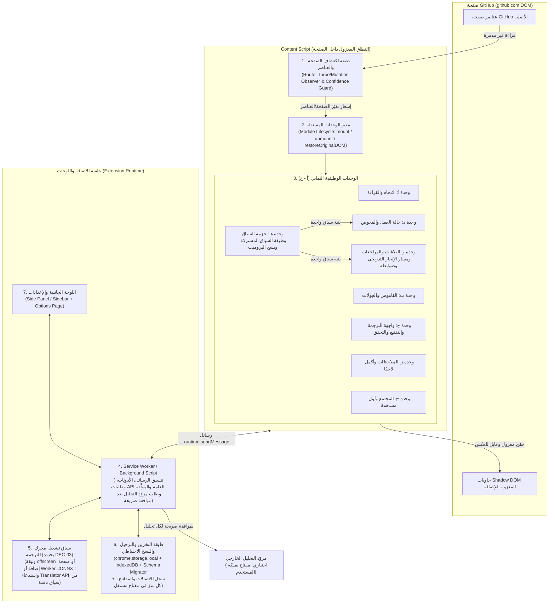
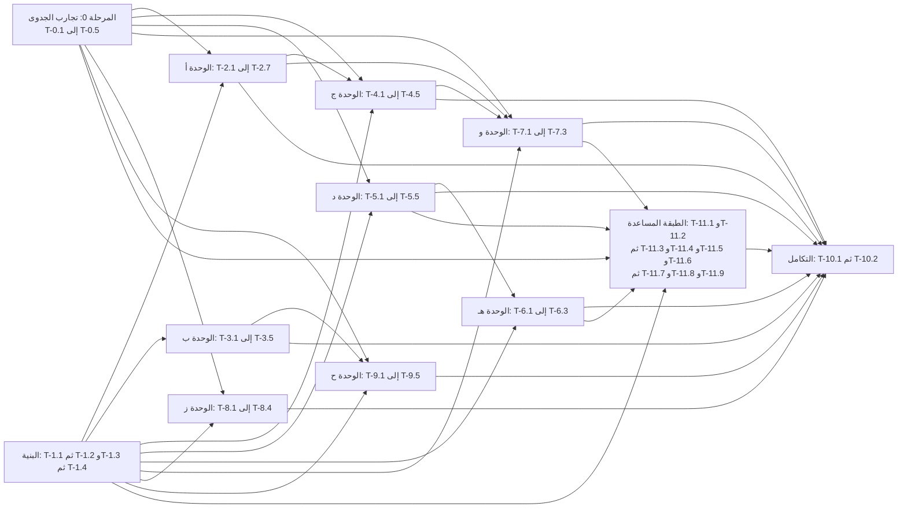

# مِجهَر (Mijhar): المخطط التنفيذي ومواصفات إضافة متصفح GitHub العربية (نسخة مراجَعة)

- **تاريخ قراءة الوثائق الرسمية المذكورة في القسم 1.2:** `2026-10-22`. هذا التاريخ تاريخ تحقق من مصادر وليس موعدًا لأي مهمة، وقد تتغير تلك الوثائق بعده.
- **نطاق الوثيقة:** دراسة الجدوى، المعمارية، تصميم التجربة، مصفوفة التتبع للميزات الفرعية الستّ والخمسين (`F-A1` إلى `F-H6`؛ منها 47 ميزة الطلب الأصلي و9 أضافها توسيع `2026-10-23`)، المهام والاعتماديات، الاختبارات، سجل المخاطر والفرضيات، وقائمة القرارات.
- **حالة العمل:** تخطيط ومراجعة وثيقة، ومعه تنفيذ بدأ فعلًا: دُمجت الموجات A وB (الهيكل والنواة المنطقية والتقنيع وبيانات القاموس وتجارب الجدوى الأربع) وحالتها في `STATUS.md`. و**توسيع النطاق بتاريخ `2026-10-23` (القسم 0.3) تخطيط وتوثيق فقط: لم تُنفَّذ أي ميزة من ميزاته، ولم يُنشأ مفتاح، ولم يُجرَ أي اتصال بمزوّد، ولم يُرفع شيء.** **اسم المشروع المعتمد:** «مِجهَر» (Mijhar)، والمعرّف التقني `mijhar`، بقرار المالك في `DEC-06` بتاريخ `2026-10-22` (القسم 0.2). **الاختبارات المذكورة في الوثيقة لم تُنفَّذ**؛ هي مواصفات لما سيُختبر لاحقًا.
- **الملفات المرافقة ومصدر البيانات:** السجلات المهيكلة (الميزات والمهام ومعايير القبول والاختبارات والقرارات والمراحل والحالات) محفوظة في `data/plan.json` و`data/status.json` و`data/naming.json`، ومنها تُولَّد `ROADMAP.md` و`phases/` و`TRACEABILITY.md` و`DECISIONS.md` و`STATUS.md` و`NAMING.md` وبيانات لوحة المتابعة `dashboard/`. يفحص `tools/check.mjs` تطابق هذه الوثيقة مع البيانات (المعرّفات والاعتماديات ومعايير القبول والاختبارات)، فأي اختلاف بينهما خطأ يجب إصلاحه لا مصدر ثانٍ. تفاصيل القرارات وخياراتها في `DECISIONS.md`، والأسماء في `NAMING.md`.
- **كيف تُقرأ الوثيقة:** كل ما هو «معتمد» ورد بوصفه متطلبًا؛ وكل ما هو «مقترح» أو «توصية» أو «قرار معلق» يُذكر بوصفه كذلك ولا يُنفَّذ قبل قرارك. المقترحات الإضافية الستة في القسم 10 خارج النطاق المعتمد.

---

## 0. سجل المراجعة: ما الذي صُحِّح في هذه النسخة

هذا السجل يخص هذه المراجعة وحدها. حُذف الجدول القديم الذي كان يقارن «نسخًا» سابقة، لأن تلك النسخ غير موجودة في مساحة العمل ولا يمكن التحقق مما نُسب إليها. النطاق محفوظ كما هو: **8 وحدات و47 ميزة فرعية** (`F-A1` إلى `F-H6`) دون حذف أو تقليص أو تأجيل أو «حد أدنى للإطلاق»، والمقترحات الستة (`P-OPT-01` إلى `P-OPT-06`) منفصلة وغير معتمدة.

| # | الموضوع | ما وُجد في الوثيقة السابقة | ما صُحِّح الآن |
| :-: | :--- | :--- | :--- |
| 1 | عدد المهام | ذُكر أن المهام 35. والواقع أن الوثيقة تذكر 44 معرّفًا `T-*` فريدًا تحت 30 عنوانًا، وكثير من العناوين يجمع أكثر من معرّف. | سجل مهام واحد يولّد القسم 6: **47 معرّفًا فريدًا** من `T-0.1` إلى `T-10.2`، لكل معرّف عنوان مستقل، دون تكرار أو معرّف مفقود. العناوين الجامعة هي عناوين المراحل `6.1` إلى `6.11` فقط. الأرقام كلها مولَّدة من السجل وتُجمع في القسم 2.1. |
| 2 | التقديرات الزمنية | لم تبق أيام أو ساعات، لكن بقيت أرقام أداء مطلقة (`< 16ms` و`< 15ms` و`< 25ms` و`< 100ms`...) بلا ظروف قياس ولا أساس، وبقيت «بوابات قبول» رسمية في مخطط الاعتماديات. | لا تقدير لأيام أو ساعات أو مدد أو مواعيد في أي قسم. الانتقال بين المهام بالاعتماديات وشروط القبول فقط. ميزانيات الأداء `PB-01` إلى `PB-07` تحمل **ظروف قياس مشتركة** (جهاز مرجعي، 3 تشغيلات تسخين، 30 قياسًا فأكثر، الوسيط والمئين 95)، وأرقامها القديمة موسومة «أهداف أولية (فرضية)». القيمتان الافتراضيتان `PP-01` و`PP-02` معاملان للمنتج وليستا تقديرًا لزمن العمل. |
| 3 | مصفوفة التتبع | 47 صفًا، لكن سبعة معايير قبول مذكورة فيها (`AC-B2` و`AC-B3` و`AC-D2` و`AC-D3` و`AC-F2` و`AC-F3` و`AC-F4`) لا تظهر في المهام التي تُحمَّل بها، وعمود الاختبارات يشير أحيانًا إلى مجموعات لا إلى اختبار محدد. | مصفوفة 2.2 مولَّدة: لكل ميزة متطلب، ومهمة منفِّذة، ومعيار قبول، واختبار محدد واحد على الأقل، وكلها معرَّفة. تحقّق آلي من أن كل معرّف مذكور له تعريف، وأن كل معيار موجود داخل مهمته. |
| 4 | حارس الكتابة في إخفاء التشكيل | كان الحارس يقارن `nodeValue === strippedText`، وهذا لا يثبت أن الإضافة هي آخر من كتب. | «حارس ملكية الكتابة» (`T-2.7`): سجل لكل عقدة (`originalText`، `strippedText`، سجل كتابات الإضافة، رقم جيل، علامة تلوث)، وتفريغ `MutationObserver.takeRecords()` قبل أي استعادة أو تعطيل، والاستعادة بشروط متعددة وعند الشك يُترك النص. المقارنة بالنص المنزوع فحص إضافي لا دليل ملكية. اختبارات `TEST-RTL-05F` و`05G` و`TEST-GUARD-01` إلى `04`. |
| 5 | وضع القراءة | افتُرض أن اعتراض `Ctrl/Cmd+F` يغطي البحث. | لا يُعترض البحث الأصلي. يُقاس سلوك كل متصفح في `T-0.1`، وتُعالَج حالات النسخ الجزئي والممتد والغني والسحب، ويُحدَّد في القرار `DEC-02` أيّ طريقة تُقدَّم. |
| 6 | ملاحظات الأسطر | وعد بكشف تغيّر السطور وبرابط التزام ثابت. | مرساة احتمالية بست نتائج (أ إلى و): مطابقة، انتقال فريد، تكرار ملتبس، تغيّر، حذف أو إعادة تسمية، فقد وصول. الرابط الثابت محاولة لا ضمان، وعند الالتباس تُحفظ الملاحظة محليًا دون ربط وتُعلن الحالة. |
| 7 | `SHA-256` | وُصف بأنه «تجزئة مشفرة» تحمي الكود الخاص. | هو دالة تجزئة لا تشفيرًا، ولا يحمي نصًا قصيرًا أو شائعًا يمكن تخمينه. صُحِّحت المصطلحات في `DEC-05` وأُدرجت حدوده، ولم يُفرض خيار تخزين نيابة عنك. |
| 8 | المعتمد والمقترح و`PAT` | أُدرجت توصيات داخل جداول القرارات بصيغة تقارب الاعتماد، وخُلط في `DEC-04` بين التخزين الصريح والمشفر. | حقل «توصية غير ملزمة» منفصل في كل قرار، ولا يُنفَّذ أي خيار قبل اختيارك. خيارات `DEC-04` منفصلة: الجلسة، القرص بنص صريح، القرص بعبارة مرور، عدم الإتاحة، أو تخيير المستخدم. رمز دقيق الحبيبات للقراءة فقط بأقل صلاحيات تثبتها `T-0.3`، يُدخَل في صفحة الإضافة، وتُجرى الطلبات من الخلفية، ولا يصل إلى الصفحة ولا السجلات. |
| 9 | التحقق من الوثائق | رقم 67 مدخلًا في قاموس المشروع السابق، وحجم المجزئ «1.7 ميغابايت»، وادعاء Edge 148، وتناقض في سجلات Actions. | الأرقام الفعلية: **107 مدخلات**، ومجزئ `3,961,545` بايت (و`6,748,848` بايت لـ`tokenizer.json`). رقم Edge 148 ورد بلا مصدر، ثم وُجد في قسم الدعم من وثيقة Chrome (`VER-01`)، فصار موثقًا من تلك الوثيقة فقط، أما عمل Edge داخل الإضافات فيبقى فرضية (`HYP-02`). تناقض السجلات: نقطة REST تعمل دون مصادقة للموارد العامة، أما سلوك الواجهة الرسومية فلم يُختبر (`HYP-08`). الحقائق المتحقق منها في 1.2، والباقي فرضيات مربوطة بتجارب. |
| 10 | الأسماء | ادعاء استمرارية مع «رفّ»، ووصف «مسبار» بأنه اسم فريد في المتاجر. | حُذف الربط: «رفّ» تطبيق حافظة مستقل وليس أصل المشروع السابق. لا يوصف أي اسم بأنه فريد أو متاح؛ الفحص الأولي في 9.1 غير كافٍ قانونيًا ولا يغني عن بحث المتاجر والعلامات. الاسم والاختصارات (`Alt+G` و`Alt+K` و`Alt+H`) مؤقتة بانتظار اختيارك. |
| 11 | الاعتماديات والموانع | كانت `T-1.1` (هيكل المانيفست والبناء) تشترط `DEC-01` (إطار الواجهة) مع أنها لا تعتمد عليه، فكان القرار يوقف سلسلة المهام كلها؛ وكان `T-10.2` يشترط `DEC-06` كاملًا مع أن الاسم والاختصارات وحدهما يتوقفان عليه؛ وكانت ميزات الفحوص والرمز الاختياري في مهمة واحدة؛ وكان يُطلب «استيفاء بوابات المراحل 1 إلى 9» رسميًا قبل المرحلة 10. | رسم الاعتماديات خالٍ من الدورات (فحص آلي)، وجدول 6.12 يطابق حقول «تعتمد على» في أقسام المهام (فحص آلي). `DEC-01` تحمله `T-1.4` وحدها؛ فهو يوقف 35 مهمة فعلًا وتستمر 12 مهمة مستقلة عنه؛ و`DEC-02` و`DEC-04` و`DEC-05` يوقف كلٌّ منها مهمته الحاملة له وإغلاق التكامل النهائي (`T-10.1` و`T-10.2`) فقط، ولا يوقف مهمة ميزة أخرى؛ و`DEC-03` يوقف `T-4.3` إلى `T-4.5` وإغلاق التكامل النهائي؛ و`DEC-06` يوقف حقول الاسم والاختصارات في `T-10.2` وحدها؛ و`DEC-07` لا يوقف شيئًا. المانع يوقف المسار المتأثر فقط، والعمل المستقل المصرَّح به يستمر. لا بوابات رسمية ولا طلبات موافقة متكررة. |
| 12 | سلامة الملف | ذُكر سابقًا في أثناء المراجعة وجود «محارف تالفة». | لا فساد في الملف: ترميزه UTF-8 صحيح ولا يحوي رمز الاستبدال U+FFFD. ما ظهر تالفًا كان عرضًا ناتجًا عن أداة القراءة في الطرفية. |
| 13 | تناقضات داخلية وادعاءات تتجاوز دليلها | بعد المراجعة الأولى بقيت مواضع: مهمة (`T-2.5`) معلنة موقوفة وغير موقوفة بـ`DEC-02` في آن واحد؛ وبيانات توافق Edge وFirefox منسوبة إلى «لم تُقرأ» مع أنها في قسم الدعم من وثيقة Chrome؛ ومعايير قبول تتطلب ما لا تبنيه مهمتها (`AC-1.2` و`AC-C1` و`AC-C5` و`AC-S2.4`)؛ وصلاحية `api.github.com` الاختيارية بلا مهمة مالكة مستقلة عن `DEC-04`؛ وفحص مجلد `docs/` وأوامر الاختصارات بلا مهمة ولا معيار ولا اختبار؛ وعبارة «يثبت غياب» في `T-9.4`. | أُعيدت صياغة هذه المواضع وربطها بمهمة ومعيار واختبار، وأُضيفت `HYP-16` (تحميل الخطوط المضمّنة مع CSP الصفحة)، وحُدّدت قاعدة نمو الذاكرة مقابل خط أساس يقيسه `T-0.1`. أُجريت مراجعتان مستقلتان للنص؛ وما اقترحتاه لم يُقبل إلا بعد التحقق منه من الوثيقة أو المصدر. |

**حدود هذه المراجعة:** لم تُجرَّب الإضافة ولا أي اختبار من الاختبارات الـ89، ولم تُفحص صفحات GitHub الحية، ولم تُقَس أي ميزانية أداء. ما لم تثبته وثيقة رسمية قُرئت فعلًا فهو فرضية (`HYP-*`) تحسمها تجربة جدوى قبل البناء عليه.

### 0.1 تحديث ملفات التخطيط (`2026-10-22`): التناقضات المؤثرة التي أُصلحت

اقتصر هذا التحديث على ما يغيّر ترتيب العمل أو ما يُختبر فعلًا؛ لم تُفتح دورة مراجعة شكلية، ولم يُحذف أو يُقلَّص شيء من الوحدات الثماني والميزات الـ47، وبقيت المقترحات الستة خارج النطاق.

| # | التناقض | أثره | الإصلاح |
| :-: | :--- | :--- | :--- |
| 14 | اختبارات `PAT` (`TEST-SEC-01` إلى `03`) و`AC-5.5` مكتوبة لتخزين الرمز وحده، مع أن `DEC-04` يتضمن خيار عدم دعمه (د-4)؛ وتجربة `T-0.3` تطلب رمزًا تجريبيًا من المالك أيًّا كان القرار. | لو اختير د-4 لصارت مهمة `T-5.5` بلا معيار قبول قابل للتحقق، ولطُلب رمز لا حاجة إليه. | فرعان مربوطان بالقرار: فرع الدعم (د-1/د-2/د-3/د-5) يحمل `AC-5.5` و`TEST-SEC-01` إلى `03`؛ وفرع عدم الدعم (د-4) يحمل `AC-5.5N` الجديد و`TEST-SEC-04` الجديد (إثبات غياب أي مسار للرمز). يُشغَّل فرع واحد ويُعلَّم الآخر «لا ينطبق». والشق الموثَّق من `AC-S3.2` و`AC-S3.3` لا يُجرى إلا إن كان `DEC-04` معلقًا أو داعمًا وقت التجربة. |
| 15 | جدول «ما يتوقف عند كل قرار» يعدّ `T-8.3` و`T-10.2` متوقفتين كليًا، بينما تنص المهمتان على أن القرار يوقف جزءًا منهما فقط. | قرار متأخر كان سيوقف عملًا مستقلًا عنه (مسار المستودعات العامة في `T-8.3`، وتجهيز الحزم في `T-10.2`). | عمود «نوع الإيقاف» في 6.12: «يوقف البدء» أو «يوقف جزءًا وإغلاق المهمة». |
| 16 | `DEC-06` يجمع الاسم والاختصارات، وهما قراران مختلفا المدخلات (فحص الأسماء مقابل فحص تعارض الاختصارات مع المتصفحات). | حسم أحدهما كان معلقًا بالآخر. | فُصلت الاختصارات في `DEC-08` ومانعه `BLK-DEC-08`؛ وبقي `DEC-06` للاسم. |
| 17 | `TEST-NAV-01` مسند إلى `T-1.2` ويشترط مقارنة ميل الذاكرة بخط أساس `T-0.1`، و`T-1.2` لا تعتمد على `T-0.1`. | اعتماد خفي غير مصرَّح به. | في `T-1.2` يُسجَّل الميل دون مقارنة، والمقارنة جزء من `AC-10.1` في `T-10.1` وحدها. |
| 18 | تفاصيل القرارات وترشيحات الأسماء مكتوبة هنا، وطُلب لها ملفان مستقلان. | مصدران متعارضان محتملان. | القسم 9 صار فهرسًا يحيل إلى `DECISIONS.md`، والقسم 9.1 يحيل إلى `NAMING.md`. |

الأرقام بعد هذا التحديث في 2.1: 73 معيار قبول (منها زوج شرطي لا ينطبق منه إلا واحد)، و90 اختبارًا معرَّفًا (ينطبق منها 89 إن اختير دعم الرمز و87 إن لم يُختر)، و8 قرارات معلقة، و16 مانعًا مسمّى.

### 0.3 توسيع النطاق والرؤية (`2026-10-23`)

وسّع المالك نطاق المشروع ورؤيته بتوجيه مكتوب: يتحول مِجهَر من أداة لترجمة واجهة GitHub إلى **أداة مساعدة متكاملة تمكّن المستخدم من الفهم والإنجاز** عبر جمع السياق المرتبط بالمهمة، وتوضيح المشكلة وأدلتها، واقتراح الخطوة التالية، واختصار العمل اليدوي؛ وتبقى الترجمة ميزة أساسية ضمن المنتج. والنطاق من اختصاص المالك وحده لأن `AD-14` يستثني تغيير النطاق من التفويض، فهذا التوسيع بأمره لا بتفويضه (`AD-23`).

**بنود التوجيه (يُشار إليها في المصفوفة 2.2 بـ`ت-1` إلى `ت-8`):** (1) توسيع الأقسام القائمة بثلاث درجات (بلا مفاتيح / برمز GitHub / بمفتاح مزوّد) دون إنشاء قسم منفصل للذكاء الاصطناعي ودون تكرار معماري. (2) إتاحة رمز GitHub اختياريًا بأقل صلاحية وفصل القراءة عن الكتابة ودقة حالة البيانات. (3) زر «نسخ البرومبت» بلا صندوق نص. (4) مفتاح مزوّد تحليل اختياري داخل الإضافة فوق حزمة السياق المشتركة. (5) تفعيل الميزات في سياقها وإدارة الاتصالات في الإعدادات. (6) مسار إنجاز تدريجي بضوابط أمان تنفيذي. (7) حماية البيانات والشفافية والتكلفة. (8) النسبة والروابط والتراخيص.

**ما تغيّر في هذه الوثيقة وفي البيانات:**

| # | الموضوع | ما كان | ما صار |
| :-: | :--- | :--- | :--- |
| 19 | النطاق | 8 وحدات و47 ميزة و47 مهمة و11 مرحلة | 8 وحدات و**56 ميزة** و**57 مهمة** و**12 مرحلة**: 9 ميزات جديدة داخل الوحدات (د) و(هـ) و(و)، ومرحلة تنفيذية واحدة (القسم 6.12) وتجربة جدوى خامسة (`T-0.5`) وعشر مهام. ولا تُنشأ وحدة تاسعة ولا قسم جديد في الواجهة (`AD-16`). |
| 20 | «محلي فقط» | التزام مطلق: لا خدمات خارجية | لم يبق مطلقًا حيث كان يمنع قدرات مفيدة: الأساس كله — ومنه «نسخ البرومبت» — يعمل بلا أي مفتاح وبلا أي إرسال، ولا يُشترط إرسال المحتوى إلى مزوّد لاستخدام المنتج؛ وإن أضاف المستخدم مفتاحًا فلا إرسال إلا بطلبه الصريح لكل تحليل بعد موافقة تبيّن المحتوى والوجهة والتكلفة (`AD-07` المعدَّل و`AD-17`). |
| 21 | رمز الوصول `PAT` | `DEC-04` محسوم بـد-4: **لا** يُتاح إدخال رمز | أُعيد حسمه إلى **د-5** (ذاكرة الجلسة افتراضًا، والقرص الصريح باختيار معلَن)؛ والقرار القديم محفوظ بتاريخه وسببه في `history` داخل `data/plan.json` وفي `DECISIONS.md`. وبإعادة الحسم عاد `AC-5.5` و`TEST-SEC-01` إلى `03` للانطباق، وصار `TEST-SEC-04` «لا ينطبق»، وعادت `HYP-07` و`HYP-09` فرضيتين مفتوحتين. |
| 22 | قياس لم يُجرَ | عُلِّم الشق الموثَّق من `AC-S3.2` و`AC-S3.3` «لا ينطبق» في تقرير `T-0.3` لأن `DEC-04` كان د-4 | لا يُعاد فتح `T-0.3` المدمجة ولا يُدَّعى أنها قاست ما لم تقسه: يبقى تقريرها سجلًا تاريخيًا، ويُجرى القياس في تجربة جديدة `T-0.5` بمعياريها `AC-S5.3` و`AC-S5.4`. |
| 23 | عدم النيابة عن المستخدم | منع مطلق لأي إجراء يغيّر حالة المستودع | يبقى منع النيابة **الصامتة** كما هو، ويُستثنى مسار إنجاز واحد (`F-F6`) لا يكتب إلا بطلب صريح وموافقة على النطاق بعد معاينة فرق التغيير، ولا يدمج ولا يغلق (`AD-06` المعدَّل و`AD-18`). |
| 24 | ترقيم المراحل والموجات | 18 مرحلة في 8 موجات (A إلى H)، والتكامل `MJ18` في الموجة H | 23 مرحلة في 11 موجة (A إلى K): خمس مراحل جديدة `MJ18` إلى `MJ22`، و`T-0.5` أُضيفت إلى `MJ11` (فبُدِّل مودلها إلى Opus لأنها تجربة قياس). ولم تُعد ترقيم أي مرحلة بدأت: `MJ1` إلى `MJ4` مدمجة و`MJ5` إلى `MJ17` بأرقامها؛ ونُقلت مرحلة التكامل من `MJ18` إلى `MJ23` في الموجة K لتبقى آخر ما يُدمج، ولم تكن قد بدأت. |
| 25 | النسبة والتراخيص | لا نصّ نسبة في المشروع ولا ملف تراخيص أطراف ثالثة | صيغة النسبة الحرفية «تصميم وتطوير سلطان» مع `https://bysltan.com` ورابط المستودع المتحقق منه، وإشعارات الأطراف الثالثة في ملف منفصل، ولا ترخيص مفتوح المصدر يُضاف؛ ويفحصها `AC-10.3` في `TEST-PKG-01` (`AD-20`). |
| 26 | إعلان جمع البيانات | `required: ["none"]` في حزمة Firefox | يبقى كما هو لأنه يطابق سلوك الإصدار المبني الآن، ويُراجَع إلزاميًا في المرحلة التي تشحن الرمز أو مزوّد التحليل أو تنزيل النموذج (`AD-15` المعدَّل و`AD-21`). |

**حدود هذا التوسيع:** لم يُنفَّذ منه شيء. والأسعار والمودلات المذكورة في `DEC-09` لقطة مرجعية بتاريخها **غير متحقق منها في هذه الجلسة**، وتُقرأ القيم الفعلية وقت التنفيذ. والوصول المباشر من سياق الإضافة إلى واجهة المزوّد، ونجاح الكتابة إلى الحافظة من سياق محقون، ودقة تقدير التكلفة، وأقل صلاحيات الرمز: كلها **فرضيات** (`HYP-17` و`HYP-18` و`HYP-19` و`HYP-07` و`HYP-09`) تقيسها `T-0.5` ولا تُبنى عليها ميزة قبل وثيقتها.

### 0.2 اعتماد اسم المشروع (`2026-10-22`)

اعتمد المالك اسم **«مِجهَر» (Mijhar)** في `DEC-06`، وطلب تغيير اسم مجلد المشروع واعتماد الاسم في كل الملفات. فصار المعرّف التقني `mijhar` بدل المعرّف المؤقت `gh-ar` في هذه الوثيقة وملفات التخطيط ولوحة المتابعة، ومنه بادئة السمات `data-mijhar-*` وعناصر `mijhar-*` المحقونة. ولم يتغير بذلك نطاق ولا مهمة ولا معيار قبول؛ وتبقى قبل النشر فحوص الاسم المسرودة في `NAMING.md`. وما يرد في سجل المراجعة أعلاه عن «اسم مؤقت» يصف حال الوثيقة قبل هذا القرار.

---

## 1. تعريف المنتج وحدوده، ومراجعة السياق والمشروع السابق والوثائق الرسمية

### 1.1 تعريف المنتج وحدوده

* **ما هو المنتج:** إضافة متصفح (`Manifest V3`) تعمل طبقةً مساعدة فوق صفحات `github.com` الحقيقية، غايتها أن **يفهم المستخدم وينجز**: تخفيف عوائق القراءة بالعربية، وشرح عناصر الواجهة ومفاهيم Git في سياقها، وترجمة تقنية عند الطلب تحفظ الشفرة، وتلخيص حالة طلبات الدمج والفحوص وسجلات الأخطاء، وجمع السياق المرتبط بالمهمة في برومبت يُنسخ بضغطة أو يُحلَّل بمفتاح يملكه المستخدم، واقتراح الخطوة التالية بالأدلة، وتجهيز حزم سياق للنماذج اللغوية أو الزملاء، والمساعدة في كتابة البلاغات والمراجعات وتجهيز تعديل بطلب صريح، وحفظ الملاحظات الخاصة ومواضع العمل («أكمل لاحقًا»)، وإرشاد المبتدئين إلى أول مساهمة والمحتوى العربي. والترجمة ميزة أساسية ضمن المنتج لا هدفه الوحيد (`AD-16`).
* **من تخدم:**
  1. **المبتدئ والمتعلم:** من يصعب عليه فهم مصطلحات GitHub (`Fork` و`Rebase` و`Merge conflict` و`Checks`) أو يتردد في أزرار لا يعرف أثرها وحدود التراجع عنها.
  2. **المطور والمراجع:** من يقرأ ويكتب محتوى عربيًا مختلطًا بالشفرة، ويراجع طلبات الدمج وسجلات الفحوص، ويجهز ملخصات للنماذج أو الفريق، ويدوّن ملاحظات خاصة.
* **حدود المنتج المعتمدة:**
  1. **ليست موقعًا بديلًا ولا محاكاة:** تعمل داخل DOM صفحة GitHub الفعلية ولا تعيد بناءها.
  2. **استقلال الوحدات وإزالة الأثر:** لكل وحدة من الثماني ولكل إعداد فرعي مفتاح تشغيل وإيقاف مستقل. عند إيقاف وحدة أو الإضافة تُزال الأنماط والعناصر والسمات التي حقنتها الإضافة وتُستعاد العقد التي عدّلتها، **ما لم يكن GitHub قد غيّرها بعد ذلك، فلا تُلمس**. لا تعد الوثيقة بإزالة بلا أثر في كل حالة؛ الحالات المستثناة تُسجَّل ويُقاس الباقي بـ`AC-1.2` و`AC-A7` و`PB-01` في ظروفها.
  3. **عدم النيابة الصامتة عن المستخدم:** لا تنفذ الإضافة من تلقاء نفسها إجراءً يغيّر حالة الحساب أو المستودع (لا دمج ولا حذف ولا دفع ولا إرسال تعليق أو فتح بلاغ ولا تعديل إعدادات)، وكل أداة كتابة تنتهي بمعاينة ونسخ أو إدراج يدوي بموافقتك. **واستثناء واحد مكتوب** أضافه توجيه `2026-10-23`: مسار الإنجاز التدريجي (`F-F6` و`T-11.8`) يجهّز تعديلًا في نطاق محدود (`DEC-11`: ملف واحد نصي)، ويعرض فرق التغيير كاملًا، ثم لا ينشئ فرعًا ولا يفتح طلب دمج إلا بطلبك الصريح وموافقتك على النطاق في خطوة مستقلة؛ ولا يدمج ولا يغلق ولا يدفع كتابة أخرى، وصلاحية الكتابة تُطلب لخطوة التنفيذ وحدها ولا تُستعمل في أي مسار قراءة أو تحليل (`AD-18` و`AD-19`).
  4. **الخصوصية (التزام تصميم لا يُقاس إلا فيما اختُبر):** المعالجة محلية في المتصفح افتراضيًا، ولا تُرسل الإضافة محتوى أي مستودع، عامًا كان أو خاصًا، إلى أي خدمة **من تلقاء نفسها**. وبعد توجيه `2026-10-23` صار للمستخدم أن يضيف مفتاح مزوّد تحليل، وحينها لا يبدأ أي إرسال إلا بطلبه الصريح لكل تحليل عبر موافقة تبيّن المحتوى المرسل والوجهة والتكلفة التقديرية حيث أمكن حسابها؛ وكل الميزات الأساسية — ومنها «نسخ البرومبت» — تعمل بلا أي مفتاح وبلا أي إرسال (`AD-07` المعدَّل و`AD-17`، ويفحصهما `AC-E7` و`AC-E9` و`AC-10.1`). يُتحقق من هذا الالتزام بفحص الصلاحيات و`CSP` وسجل الشبكة في المسارات المختبرة (`AC-C6` للترجمة، و`AC-E4` لحزمة السياق، و`AC-G5` للملاحظات، و`AC-H5` لدليل الموارد، وتدقيق وجهات الطلبات لبقية الوحدات في `T-10.1` ضمن `AC-10.1`)، ولا يمتد إلى ما يفعله المتصفح نفسه حين يشغّل محركه المدمج، ولا تدّعي الوثيقة معرفته (`HYP-01` و`HYP-04`). الاتصالات المحتملة هي طلبات `GitHub API` إلى `api.github.com` (أي إلى GitHub نفسه لا إلى طرف ثالث) بفعل المستخدم، وبرمز اختياري إن اعتُمد في `DEC-04`، وتنزيل ملفات نموذج ترجمة من مضيفه بموافقة صريحة إن اعتُمد مسار ينزّل نموذجًا في `DEC-03`؛ وتصميم طلب التنزيل ألا يحمل محتوى من المستخدم أو من صفحات GitHub (وتبقى ترويسات الطلب المعتادة، كعنوان الشبكة، خارج هذا الالتزام). لا خدمات سحابية صامتة ولا مدفوعة.
  5. **فصل المعتمد عن المقترح:** يُميَّز في كل قسم بين المتطلبات المعتمدة وبين البدائل والتوصيات والقرارات المعلقة (القسم 9)، ولا يُنفَّذ أي بديل قبل قرارك.

---

### 1.2 حالة التقريرين المرفقين وسجل التحقق من الوثائق الرسمية

> [!WARNING]
> **التقريران المرفقان:** الملفان المشار إليهما في الطلب لم يكونا موجودين في مسار العمل ولا في المجلد الأب ولا في مسار المشروع السابق، فلم يُراجَعا ولا يُنسب إليهما أي محتوى (`UNVERIFIED-01`). إن توفرا لاحقًا تُدمج ملاحظاتهما بعد قراءتهما.

**قاعدة القسم:** تُصنَّف الادعاءات التقنية القابلة للتغير في ثلاثة أصناف: **متحقق منه** من صفحة رسمية قُرئت (الجدول التالي)، و**فرضية** لم تثبت وتحسمها تجربة جدوى قبل البناء عليها (الجدول الذي يليه، وتفصيله في 8.2)، و**قرار معلق** لا ينفَّذ قبل اختيارك. تاريخ القراءة `2026-10-22` وليس ضمانًا لبقاء المحتوى.

#### أولًا: حقائق متحقق منها (13)

| المعرّف | المجال | ما تقوله الوثيقة الرسمية المقروءة | المصدر |
| :--- | :--- | :--- | :--- |
| `VER-01` | واجهة الترجمة المدمجة | وثيقة Chrome: الواجهة تعمل على سطح مكتب Chrome ولا تعمل على الهاتف؛ العربية `ar` ضمن اللغات؛ متاحة افتراضيًا لنوافذ المستوى الأعلى وإطارات `iframe` من الأصل نفسه؛ **غير متاحة في `Web Workers`**؛ يُنصح بفحص تفاعل المستخدم قبل `create()`؛ ويُنزَّل النموذج عند أول استخدام دون إعلان حجم؛ قسم «Browser Support» في الوثيقة نفسها (وهو منقول فيها عن MDN): Chrome 138، وEdge 148، وFirefox غير مدعوم، وSafari غير مدعوم؛ آخر تحديث للوثيقة 2025-05-20؛ الوثيقة لا تتناول الإضافات ولا سكربتات المحتوى، ولا تتناول Brave. | [Chrome: Translator API](https://developer.chrome.com/docs/ai/translator-api) |
| `VER-02` | وثائق `offscreen` | Chrome 109 فأعلى؛ واجهة `runtime` وحدها مدعومة داخل الوثيقة؛ وثيقة واحدة مفتوحة لكل إضافة؛ الوثائق لا تُركَّز؛ قائمة الأسباب المسموحة لا تتضمن الترجمة (منها `WORKERS` و`LOCAL_STORAGE`)؛ لا تتناول الوثيقة Firefox. | [Chrome: chrome.offscreen](https://developer.chrome.com/docs/extensions/reference/api/offscreen) |
| `VER-03` | اللوحة الجانبية | Chrome 114 فأعلى مع MV3؛ صلاحية `sidePanel`؛ `sidePanel.open()` لا يُستدعى إلا استجابةً لفعل المستخدم؛ لا ذكر لمتصفحات أخرى. | [Chrome: sidePanel](https://developer.chrome.com/docs/extensions/reference/api/sidePanel) |
| `VER-04` | حصص التخزين | `storage.local` الحصة الافتراضية 10 ميغابايت (5 في Chrome 113 وما قبله) وتزيد بصلاحية `unlimitedStorage`؛ `storage.local` مكشوفة لسكربتات المحتوى افتراضيًا ويمكن تغيير ذلك بـ`setAccessLevel()`؛ `storage.session` حصتها 10 ميغابايت (1 ميغابايت في Chrome 111 وما قبله) وغير مكشوفة لسكربتات المحتوى افتراضيًا؛ `storage.sync` نحو 100 كيلوبايت؛ وتقول الوثيقة إن `storage.session` تحفظ البيانات في الذاكرة ولا تُكتب إلى القرص، وتُمسح عند تعطيل الإضافة أو إعادة تحميلها أو تحديثها أو إعادة تشغيل المتصفح. | [Chrome: storage](https://developer.chrome.com/docs/extensions/reference/api/storage) |
| `VER-05` | الصلاحيات الاختيارية | "معظم صلاحيات Chrome يمكن تحديدها اختيارية باستثناء" قائمة مسماة (منها `debugger` و`declarativeNetRequest` و`proxy`) لا تتضمن `unlimitedStorage`؛ ولا تُطلب الصلاحية إلا من داخل فعل مستخدم. | [Chrome: permissions](https://developer.chrome.com/docs/extensions/reference/api/permissions) |
| `VER-06` | حدود طلبات GitHub | 60 طلبًا/ساعة دون مصادقة، و5,000 طلب/ساعة لمستخدم موثّق برمز شخصي؛ ترويسات `x-ratelimit-limit` و`x-ratelimit-remaining` و`x-ratelimit-used` و`x-ratelimit-reset` و`x-ratelimit-resource`؛ وحدود ثانوية (منها 100 طلب متزامن و900 نقطة/دقيقة لنقاط REST). | [GitHub: REST rate limits](https://docs.github.com/en/rest/using-the-rest-api/rate-limits-for-the-rest-api) |
| `VER-07` | قيم الفحوص | قيم `status` الموثقة: `queued` و`in_progress` و`completed` و`waiting` و`requested` و`pending`؛ وقيم `conclusion`: `action_required` و`cancelled` و`failure` و`neutral` و`success` و`skipped` و`stale` و`timed_out`؛ ولا يضع `stale` إلا GitHub؛ نقاط القراءة الأربع في الصفحة (تشغيل فحص بمعرّفه، وتعليقاته التوضيحية `annotations`، وتشغيلات مجموعة فحص، وتشغيلات مرجع `Git`) تُستعمل دون مصادقة إن طُلبت موارد عامة فقط؛ وصلاحية الرمز الدقيق لقراءتها `Checks` بالقراءة، وللرموز التقليدية والتطبيقات نطاق `repo` في المستودعات الخاصة. | [GitHub: Check runs](https://docs.github.com/en/rest/checks/runs) |
| `VER-08` | سجلات Actions عبر `API` | نقطة تنزيل سجل المهمة تعيد توجيهًا (302) ينتهي رابطه بعد دقيقة واحدة؛ تعمل دون مصادقة للموارد العامة؛ وللمستودعات الخاصة يلزم نطاق `repo` للرموز التقليدية وصلاحية `Actions` بالقراءة للرموز الدقيقة. | [GitHub: Workflow jobs](https://docs.github.com/en/rest/actions/workflow-jobs) |
| `VER-09` | ملفات النموذج `Xenova/opus-mt-en-ar` | `onnx/encoder_model_quantized.onnx` = 51,773,854 بايت؛ `onnx/decoder_model_merged_quantized.onnx` = 59,078,120 بايت؛ المجموع 110,851,974 بايت؛ وملفات المجزئ في جذر المستودع: `tokenizer.json` = 6,748,848 بايت، و`vocab.json` + `source.spm` + `target.spm` = 2,243,581 + 801,074 + 916,890 = 3,961,545 بايت؛ فما يُنزَّل فعلًا يتوقف على الملفات التي يطلبها المشغّل المختار وتقيسه `T-0.2`. | [Hugging Face: شجرة الجذر](https://huggingface.co/api/models/Xenova/opus-mt-en-ar/tree/main) و[شجرة onnx](https://huggingface.co/api/models/Xenova/opus-mt-en-ar/tree/main/onnx) |
| `VER-10` | ملف الخلفية في المانيفست | وثيقة MDN: Chrome يدعم `background.service_worker`، ويتجاهل `background.scripts` في MV3 من الإصدار 121؛ وFirefox لا يدعم `background.service_worker` (خطأ Firefox رقمه 1573659) ويدعم `background.scripts` حين لا يُحدَّد `service_worker`؛ ويذكر النمط العابر للمتصفحات المفتاحين معًا فيستعمل Chrome الأول وFirefox الثاني؛ وفي MV3 تكون الخلفية صفحة حدثية (`persistent: false`) افتراضيًا وتسبب القيمة `true` خطأ. | [MDN: manifest.json background](https://developer.mozilla.org/en-US/docs/Mozilla/Add-ons/WebExtensions/manifest.json/background) |
| `VER-11` | مفتاح `sidebar_action` في Firefox | وثيقة MDN: المفتاح يتطلب إصدار مانيفست 2 فأعلى، وخاصيته الإلزامية الوحيدة `default_panel`؛ جدول التوافق في الصفحة لم يظهر فيما قُرئ منها، فلا يُستنتج منها دعم متصفح آخر. | [MDN: sidebar_action](https://developer.mozilla.org/en-US/docs/Mozilla/Add-ons/WebExtensions/manifest.json/sidebar_action) |
| `VER-12` | الطلبات الشرطية في GitHub REST | معظم النقاط تُعيد ترويسة `etag` وكثير منها `last-modified`؛ يُرسَل الإيتاغ المحفوظ في ترويسة `if-none-match`؛ والطلب الشرطي لا يُحسب من الحد الأساسي إذا عادت الاستجابة `304` بشرط أن يكون الطلب موثَّقًا بترويسة `Authorization`؛ فلا إعفاء مذكورًا للطلبات العامة بلا مصادقة. | [GitHub: Best practices for using the REST API](https://docs.github.com/en/rest/using-the-rest-api/best-practices-for-using-the-rest-api) |
| `VER-13` | اختصار `y` في GitHub | وصفه في قسم تصفح الشفرة المصدرية: «Expand a URL to its canonical form» (توسيع الرابط إلى صيغته القانونية)، مع رابط إلى دليل الروابط الدائمة للملفات؛ ولا يذكر التوثيق عناصر DOM ولا سمات. | [GitHub: Keyboard shortcuts](https://docs.github.com/en/get-started/accessibility/keyboard-shortcuts) |

> ما سبق لا يقول إن واجهة الترجمة المدمجة تعمل داخل الإضافات أو سكربتات المحتوى أو `Service Worker`، ولا يقول شيئًا عن Brave؛ وهو يذكر في قسم الدعم أن Edge مدعوم من الإصدار 148 وأن Firefox وSafari غير مدعومين، دون أن يختبر ذلك داخل الإضافات؛ وما عدا ذلك فرضيات في الجدول التالي.

#### ثانيًا: فرضيات لم تثبت (16)

| المعرّف | ما لم يثبت | تحسمه |
| :--- | :--- | :--- |
| `HYP-01` | تعمل `Translator.create()` داخل `Content Script` أو وثيقة `offscreen` في Chrome. | `T-0.2` |
| `HYP-02` | يقدر Edge وBrave فعليًا على تنزيل حزمة لغة `Translator API` وتشغيلها. | `T-0.2` |
| `HYP-03` | يعمل `ONNX Runtime Web` (`WebAssembly`) تحت سياسة CSP للإضافة بذاكرة وزمن مقبولين لفقرات README الحقيقية. | `T-0.2` |
| `HYP-04` | تتيح `browser.trial.ml` في Firefox تشغيل نموذج الترجمة المطلوب. | `T-0.2` |
| `HYP-05` | ترخيص نموذج `Xenova/opus-mt-en-ar` يسمح بالتنزيل المباشر من المستخدم وبتشغيله داخل الإضافة. | `T-0.2` |
| `HYP-06` | يمكن طلب `unlimitedStorage` وقت التشغيل بوصفها صلاحية اختيارية. | `T-1.3` |
| `HYP-07` | يتيح Firefox ضبط مستوى وصول منطقة التخزين (`setAccessLevel`) كما في Chrome. | `T-5.5` |
| `HYP-08` | الواجهة الرسومية لسجلات Actions تحجب السجل الخام عن غير المسجلين وتفتحه `API` العامة دون مصادقة. | `T-0.3` |
| `HYP-09` | أقل صلاحيات `PAT` ذات الحبيبات الدقيقة لنقاط النهاية المستخدمة هي المسرودة في وثائقها. | `T-0.3` |
| `HYP-10` | يمكن استخراج المستودع والفرع والالتزام والمسار والسطر وقوالب البلاغات وشجرة الملفات من DOM بسمات مستقرة. | `T-0.4` |
| `HYP-11` | تعيد المرساة الاحتمالية الموضع الصحيح في نسبة مقبولة من الحالات الحقيقية. | `T-0.4` |
| `HYP-12` | تتحمل مسارات النسخ والسحب والبحث الأصلي واقتباس الرد وأزرار النسخ وضع إخفاء التشكيل الموضعي. | `T-0.1` |
| `HYP-13` | يمكن تبديل `dir` على محررات GitHub (التقليدي والمبني بـReact) دون إفساد المؤشر والتحديد وسجل التراجع. | `T-0.1` |
| `HYP-14` | تعمل اللوحة الجانبية الأصلية في Edge وBrave كما في Chrome. | `T-1.4` |
| `HYP-15` | تعمل محددات حاويات المحتوى النصي في GitHub المذكورة في الوحدة (أ) (مثل `.markdown-body` وعناوين المشكلات ورسائل الالتزامات) على صفحات GitHub الحالية، ويوافق وصف سلوك الاتجاه الحالي (مثل `dir="auto"`) ما يُلاحظ فعلًا. | `T-0.1` |
| `HYP-16` | تُحمَّل الخطوط العربية المضمّنة في الحزمة (عبر `chrome.runtime.getURL` و`web_accessible_resources`) داخل صفحة GitHub رغم سياسة CSP للصفحة. | `T-2.3` |

لا تُبنى ميزة على فرضية قبل أن تنتج تجربتها وثيقة قياس. وإن لم تصحّ الفرضية فالبديل مذكور في 8.2، ويتأثر المسار المتصل بها وحده.

---

### 1.3 تحليل المشروع السابق (`ghsim-source`) وما يُعاد استخدامه وما يتغير

قُرئ المشروع السابق قراءةً فقط في `ghsim-source` ولم يُعدَّل فيه شيء. هو **محاكي تعليمي لواجهة GitHub** مبني بـ`React 19` و`Vite` و`TypeScript` (من `package.json`)، ويحوي 107 مدخلات في قاموس الشروح (`EXPLANATIONS`) و15 مسارًا تعليميًا (`LEARNING_PATHS`). **تنبيه:** «رفّ» تطبيق حافظة مستقل وليس أصل هذا المشروع؛ والمستودع `iSltanX/Raff` يظهر فيه بيانات نموذجية فقط (في أمثلة وروابط مدخلات: `repository` و`release` و`clone_https` و`clone_ssh` و`clone_cli`، وفي حقل `route` لأربعة مدخلات). تُذكر المراجع هنا بأسماء الملفات والرموز لا بأرقام الأسطر لأنها تتغير.

| المكوّن | المرجع (ملف: رمز) | القرار الهندسي | ما يُستفاد منه وما يجب تغييره |
| :--- | :--- | :--- | :--- |
| **قاموس الشروح (107 مدخلات)** | `src/data/explanations.ts`: `EXPLANATIONS`؛ `src/types.ts`: `ExplanationEntry` | إعادة استخدام مع تنقيح وتوسيع (`T-3.1`) | **يُستفاد:** البنية الثلاثية (`brief` و`medium` و`detailed`)، و`example`، وتصنيف `safety` (آمن/حساس/خطر) و`reversible`. **يجب تنقيحه:** (١) 11 مدخلًا فيها عبارات محاكاة صريحة (مثل «في هذه المحاكاة لا يُحذف شيء»): `delete_repo` و`webhook` و`nav-search` و`nav-create` و`nav-profile-menu` و`pr-merge-demo` و`actions-run-row` و`settings-theme-toggle` و`settings-2fa-enable` و`settings-ssh-add` و`settings-danger-delete`، وهو حصر بفحص نصي قد لا يلتقط كل الصياغات فتلزم مراجعة يدوية لكل المدخلات. (٢) استبدال أمثلة `iSltanX/Raff` وحقل `route` بالمستودع الحالي ورابط رسمي. (٣) إضافة `whenToUse` و`reversalLimits` و`docsUrl`، والتحقق من كل تصريح عن حدود التراجع من وثائق GitHub قبل اعتماده. |
| **توحيد المصطلحات ومكوّن العرض** | `src/context/LangContext.tsx`: `term()`؛ `src/components/common/Term.tsx`؛ `src/components/repo/MergeDemo.tsx` | إعادة استخدام مع توحيد معجمي | يُنتج `term()` صيغة «العربي (English)». المصطلحات غير موحدة: القاموس يترجم `Commit` «الالتزام البرمجي» و`Squash and merge` «الدمج بضغط الالتزامات»، بينما يستخدم `MergeDemo` «تعهّد» و«دمج وتسوية» و«إعادة تأسيس ودمج». يُعتمد معجم واحد وقائمة بمصطلحات تبقى بالإنجليزية (`T-3.1`). |
| **لوحة الشرح والقاموس والبحث** | `HelpPanel.tsx` و`GlossaryPage.tsx` و`CommandPalette.tsx` و`src/data/searchIndex.ts`: `buildSearchIndex` | إعادة استخدام وتكييف داخل `Shadow DOM` أو اللوحة الجانبية | تصميم قابل للنقل. تتعامل `CommandPalette` مع `ArrowUp` و`ArrowDown` و`Enter` و`Escape`. تعتمد المكوّنات على React؛ والإطار المعتمد للإضافة معلق في `DEC-01`، فلا يُفترض نقلها كما هي. |
| **مكوّن التغليف `<Explain>`** | `src/components/common/Explain.tsx` | إعادة تنفيذ؛ لا يُستخدم التغليف | يلف العنصر بـ`<span class="explain-wrap">`. في GitHub الحقيقي قد يكسر ذلك محددات CSS التي تعتمد على العلاقة المباشرة وقد يتعارض مع إعادة التصيير في الصفحة. البديل: مرساة عائمة أو تفويض أحداث دون تغيير أب العنصر. وتلزم تجربة تؤكد ذلك على الصفحات الحية (`T-0.4`). |
| **المسارات التعليمية (15)** | `src/data/learningPaths.ts`: `LEARNING_PATHS` و`getLearningPath`؛ `src/context/LearnContext.tsx`؛ `LearnStepper.tsx` | تكييف جذري إلى جولات قرائية آمنة (`T-3.5`) | في المحاكي تنتقل المسارات بين صفحات التطبيق بـ`react-router-dom` وتفتح نماذج وهمية، ويحفظ `LearnContext` حالته في `localStorage` بمفتاح `ghsim.learnMode`؛ هذا كله لا يصلح كما هو في إضافة. في الإضافة: تصنيف الجولات بحسب الصفحة المفتوحة، وبطاقة توضح سبب غياب عنصر خطوة (مثل غياب صلاحية الإعدادات)، ولا نقر آلي على أي عنصر من GitHub (`AC-B7`). |
| **عرض الدمج التفاعلي** | `src/components/repo/MergeDemo.tsx`؛ المدخل `pr-merge-demo` | إعادة استخدام داخل نافذة الشرح فقط | رسم توضيحي للفرق بين `Merge commit` و`Squash` و`Rebase`، يُضمَّن في بطاقة شرح صندوق الدمج دون زر «تنفيذ دمج» وهمي، وبعد تنقيح مدخل `pr-merge-demo`. |
| **متغيرات الألوان وإمكانية الوصول وعزل LTR** | `src/index.css` (قواعد `data-colorblind` لـ`protanopia` و`deuteranopia` و`tritanopia`، و`unicode-bidi: isolate`، و`.ltr-inline`)؛ `src/context/AccessibilityContext.tsx`؛ `src/components/common/Ltr.tsx` | إعادة استخدام داخل `Shadow DOM` بعد فحص | تصرّح ترويسة `index.css` بأن النظام «يحاكي» ألوان Primer؛ لم يُتحقق من مطابقة الألوان ولا من أي أثر ترخيصي، فتُعاد تسمية المتغيرات بأسماء الإضافة ولا تُنسخ شيفرة من Primer. وتُقاس الأحكام التي تعتمد على التباين في `TEST-A11Y-ALL`. |
| **طبقة الجلب والبيانات النموذجية** | `src/api/github.ts`: `safeGet` و`decodeBase64Utf8`؛ `src/data/account.ts`: `ACCOUNT_SEED`؛ `src/data/repos.ts`: `REPOS` | استبعاد البيانات النموذجية وإعادة بناء الجلب | يمكن الاستفادة من فكرة `safeGet` (نتيجة ناجحة أو خطأ نصي دون استثناء) ومن `decodeBase64Utf8`. يُستبعد الرجوع إلى `ACCOUNT_SEED` و`REPOS` عند الفشل (مصدر `demo`) لأن الإضافة تعمل على بيانات حقيقية ولا تعرض بيانات وهمية بدلًا من الفشل. |

---

## 2. مصفوفة التتبع الكاملة للميزات والأرقام المعتمدة

### 2.1 الأرقام المعتمدة في الوثيقة

تُحسب هذه الأرقام من المعرّفات الفعلية في الوثيقة، وهي المرجع الوحيد لأي رقم يرد في أي قسم آخر:

| البند | العدد | تفصيله |
| :--- | :---: | :--- |
| الوحدات | 8 | `أ` إلى `ح` |
| الميزات الفرعية | 56 | أ 7، ب 7، ج 6، د 9، هـ 9، و 7، ز 5، ح 6 — منها 47 ميزة الطلب الأصلي و9 أضافها توسيع 2026-10-23 (`AD-23`) |
| المهام (معرّفات `T-*`) | 57 | تجارب جدوى: 5؛ بنية: 4؛ ميزة: 43؛ بيانات: 1؛ تمكين: 2؛ تكامل: 2 |
| معايير القبول `AC-*` | 88 | 56 لكل ميزة، و32 لتجارب الجدوى والبنية والبيانات والتمكين والتكامل؛ منها زوج شرطي (`AC-5.5` لفرع دعم الرمز و`AC-5.5N` لفرع عدم دعمه) لا ينطبق منه إلا واحد بحسب `DEC-04`، وقد حُسم إلى د-5 فالمنطبق `AC-5.5` |
| الاختبارات `TEST-*` | 107 | معرَّفة كلها في القسم 7.3؛ وبحسم `DEC-04` إلى د-5 ينطبق منها 106 ولا ينطبق `TEST-SEC-04`. **لم يُنفَّذ أي اختبار.** |
| ميزانيات الأداء `PB-*` / معاملات المنتج `PP-*` | 8 / 4 | القسم 6.14 |
| الفرضيات التي لم تثبت `HYP-*` | 19 | القسم 8.2 |
| القرارات `DEC-*` | 11 | 4 معلقة و7 محسومة؛ القسم 9 وتفصيلها في `DECISIONS.md` |
| الموانع المسماة `BLK-*` | 21 | القسم 6.13 |
| المقترحات الإضافية غير المعتمدة `P-OPT-*` | 6 | القسم 10 |

**ملاحظات على العدّ:** (١) عدد المهام هو عدد المعرّفات لا عدد العناوين؛ فكل مهمة في القسم 6 لها عنوان مستقل، والعناوين الجامعة هي عناوين المراحل `6.1` إلى `6.11` فقط. (٢) تساوي عدد المهام وعدد الميزات (47) مصادفة وليس قاعدة: بعض المهام تنفذ أكثر من ميزة، وبعضها (التجارب والبنية والبيانات والتمكين والتكامل) لا ينفذ ميزة بعينها.

### 2.2 المصفوفة: ميزة ← متطلب ← مهمة ← معيار قبول ← اختبار

"المهمة المنفِّذة" هي المهمة التي تبني الميزة وتحمل معيار قبولها؛ و"المهام الداعمة" تجارب أو بيانات أو مهام تمكين تمدّها بقياس أو بيانات أو قدرة اختيارية دون أن تحل محل معيارها (وقد تبني المهمة الداعمة فوق مهمة الميزة كما تبني `T-5.5` فوق `T-5.2`). "البند في الطلب" هو رقم البند في قائمة المتطلبات الأصلية للمالك (الوحدة-الرقم).

| الوحدة | المعرّف | الميزة | البند في الطلب | الموضع في هذه الوثيقة | الحالة | المهمة المنفِّذة | المهام الداعمة | معيار القبول | الاختبارات |
| :---: | :--- | :--- | :---: | :--- | :--- | :--- | :--- | :--- | :--- |
| **أ** | `F-A1` | معالجة اتجاه النص العربي والمختلط (`RTL/Bidi`) في المواضع التي يثبت وجود مشكلة فيها | أ-1 | 3.أ — المتطلب 1 | متطلب معتمد | `T-2.1` | `T-0.1` | `AC-A1` | `TEST-RTL-01` |
| **أ** | `F-A2` | عزل الكود والمسارات وأسماء الملفات و`#123` و`@mentions` والروابط باتجاه `LTR` دون تغيير محتواها | أ-2 | 3.أ — المتطلب 2 | متطلب معتمد | `T-2.2` | `T-0.1` | `AC-A2` | `TEST-RTL-02` |
| **أ** | `F-A3` | خطوط عربية مضمّنة مرخصة مع ضبط الحجم وارتفاع السطر والتباعد | أ-3 | 3.أ — المتطلب 3 | متطلب معتمد | `T-2.3` | لا يوجد | `AC-A3` | `TEST-RTL-03` |
| **أ** | `F-A4` | زر تبديل `RTL/LTR` في حقول التحرير المناسبة مع الحفاظ على المؤشر والتحديد وعدم إفساد محرر GitHub | أ-4 | 3.أ — المتطلب 4 | متطلب معتمد | `T-2.4` | `T-0.1` | `AC-A4` | `TEST-RTL-04` |
| **أ** | `F-A5` | وضع قراءة اختياري لـMarkdown مع خيار إخفاء التشكيل في العرض فقط دون تغيير المصدر أو المنسوخ (الجزئي/الممتد/الغني) أو البحث الأصلي، ومنع استعادة نص قديم فوق تحديث حي | أ-5 | 3.أ — المتطلب 5 | متطلب معتمد؛ قرار معلق يحدد مضمونه: `DEC-02` | `T-2.5` | `T-0.1` | `AC-A5` | `TEST-RTL-05A`، `TEST-RTL-05B`، `TEST-RTL-05C`، `TEST-RTL-05D`، `TEST-RTL-05E`، `TEST-RTL-05F`، `TEST-RTL-05G` |
| **أ** | `F-A6` | تلميح التاريخ الهجري، وخيار شكل الأرقام في النصوص المناسبة مع إبقاء التواريخ الأصلية وعدم تحويل أرقام الكود والمعرّفات والإصدارات | أ-6 | 3.أ — المتطلب 6 | متطلب معتمد | `T-2.6` | لا يوجد | `AC-A6` | `TEST-RTL-06` |
| **أ** | `F-A7` | تحديد نطاق كل إعداد في الوحدة (أ) وإلغاء أثره واستعادة عرض الصفحة الأصلي فوريًا | أ-7 | 3.أ — المتطلب 7 | متطلب معتمد | `T-2.7` | لا يوجد | `AC-A7` | `TEST-RTL-07`، `TEST-GUARD-01`، `TEST-GUARD-02`، `TEST-GUARD-03`، `TEST-GUARD-04` |
| **ب** | `F-B1` | شرح المصطلحات والأزرار (`Fork`, `Commit`, `Rebase`, `Merge conflict` وغيرها) في سياقها داخل الواجهة | ب-1 | 3.ب — المتطلب 1 | متطلب معتمد | `T-3.2` | `T-3.1` | `AC-B1` | `TEST-GLOSS-01` |
| **ب** | `F-B2` | مستويات الشرح الثلاثة («مختصر، متوسط، مفصّل») مع أمثلة عملية | ب-2 | 3.ب — المتطلب 2 | متطلب معتمد | `T-3.2` | `T-3.1` | `AC-B2` | `TEST-GLOSS-02`، `TEST-GLOSS-05` |
| **ب** | `F-B3` | إبقاء المصطلح الإنجليزي ظاهرًا بجانب الشرح العربي دائمًا | ب-3 | 3.ب — المتطلب 1 و2 | متطلب معتمد | `T-3.2` | `T-3.1` | `AC-B3` | `TEST-GLOSS-03` |
| **ب** | `F-B4` | بيان متى تُستخدم الوظيفة، وما أثرها، وما تحتاجه من صلاحيات، وإمكانية التراجع وحدودها | ب-4 | 3.ب — المتطلب 2 | متطلب معتمد | `T-3.2` | `T-3.1` | `AC-B4` | `TEST-GLOSS-06`، `TEST-GLOSS-05` |
| **ب** | `F-B5` | الوصول للشرح بالماوس والكيبورد واللمس، لا بالتحويم وحده | ب-5 | 3.ب — المتطلب 3 | متطلب معتمد | `T-3.3` | لا يوجد | `AC-B5` | `TEST-A11Y-01`، `TEST-A11Y-02` |
| **ب** | `F-B6` | بحث شامل داخل القاموس وروابط إلى الوثائق الرسمية والمكان المناسب في الواجهة | ب-6 | 3.ب — المتطلب 4 | متطلب معتمد | `T-3.4` | لا يوجد | `AC-B6` | `TEST-GLOSS-04` |
| **ب** | `F-B7` | تكييف طرق التعليم من المشروع السابق كجولات إرشادية داخل الموقع الحقيقي دون تنفيذ إجراءات حساسة تلقائيًا | ب-7 | 3.ب — المتطلب 5 | متطلب معتمد | `T-3.5` | لا يوجد | `AC-B7` | `TEST-TOUR-01` |
| **ج** | `F-C1` | ترجمة تقنية عند الطلب (`EN→AR`) لفقرات README والتعليقات ووصف المشكلات وطلبات الدمج | ج-1 | 3.ج — المتطلب 1 | متطلب معتمد | `T-4.1` | لا يوجد | `AC-C1` | `TEST-TR-01` |
| **ج** | `F-C2` | الحفاظ الصارم على الكود والأوامر والمسارات والروابط وأسماء الملفات وقائمة مصطلحات لا تُترجم + **التحقق الصارم بعد الترجمة من هوية وعدد الرموز وعدم عرض نتيجة مشوهة** | ج-2 | 3.ج — المتطلب 2 | متطلب معتمد | `T-4.2` | لا يوجد | `AC-C2` | `TEST-TR-02A`، `TEST-TR-02B`، `TEST-TR-02C`، `TEST-TR-02D`، `TEST-TR-02E`، `TEST-TR-02F` |
| **ج** | `F-C3` | عرض الأصل والترجمة معًا أو التبديل بينهما وإمكانية الرجوع للأصل بضغطة واحدة | ج-3 | 3.ج — المتطلب 1 | متطلب معتمد | `T-4.1` | لا يوجد | `AC-C3` | `TEST-TR-03` |
| **ج** | `F-C4` | دراسة وتشغيل الترجمة المحلية على الجهاز وفق دعم المتصفح واللغة والعتاد الفعلي (مع تفصيل سياق وصلاحيات ووجهة تنزيل وبديل كل متصفح) | ج-4 | 3.ج — المتطلب 3 | متطلب معتمد؛ قرار معلق يحدد مضمونه: `DEC-03` | `T-4.3` | `T-0.2` | `AC-C4` | `TEST-TR-04` |
| **ج** | `F-C5` | إدارة تنزيل النموذج وحجمه ومتطلبات الاتصال الأولي وحالات عدم الدعم والإلغاء والأخطاء | ج-5 | 3.ج — المتطلب 4 | متطلب معتمد؛ قرار معلق يحدد مضمونه: `DEC-03` | `T-4.4` | `T-0.2` | `AC-C5` | `TEST-TR-05` |
| **ج** | `F-C6` | منع استخدام أي خدمة سحابية بديلة بصمت، واشتراط قرار واضح وموافقة صريحة قبل إرسال أي محتوى | ج-6 | 3.ج — المتطلب 5 | متطلب معتمد؛ قرار معلق يخص جزءًا منه فقط: `DEC-03` (الاتصالات المسموحة في اختبار المنع بحسب المحرك المختار (`T-4.5`)؛ المنع نفسه قائم في كل الخيارات) | `T-4.5` | لا يوجد | `AC-C6` | `TEST-PRIV-01` |
| **د** | `F-D1` | بطاقة تلخص حالة طلب الدمج: الفرع المصدر والهدف، التغييرات، المراجعات، التعارضات، والفحوص المطلوبة | د-1 | 3.د — المتطلب 1 | متطلب معتمد | `T-5.1` | `T-0.3` | `AC-D1` | `TEST-PR-01` |
| **د** | `F-D2` | التفريق الدقيق بين حالات الفحص السبع: ناجح، فاشل، قيد التشغيل، متجاوز، ملغى، لم يُشغّل، وغير معروف | د-2 | 3.د — المتطلب 2 | متطلب معتمد | `T-5.1` | `T-0.3` | `AC-D2` | `TEST-PR-02` |
| **د** | `F-D3` | تفسير ما يمنع الدمج عندما توجد أدلة، وعدم مساواة نجاح بعض الفحوص بجاهزية المشروع أو الإصدار | د-3 | 3.د — المتطلب 3 | متطلب معتمد | `T-5.2` | لا يوجد | `AC-D3` | `TEST-PR-03` |
| **د** | `F-D4` | عرض وقت تحديث المعلومات ومصدرها (صفحة حالية / API)، والتنبيه عند نقصها أو تقادمها | د-4 | 3.د — المتطلب 4 | متطلب معتمد؛ قرار معلق يخص مهمة داعمة فقط: `DEC-04` (`T-5.5`: رمز الوصول الاختياري) ولا يغيّر مضمون الميزة | `T-5.2` | `T-5.5` | `AC-D4` | `TEST-PR-04` |
| **د** | `F-D5` | شرح سجل الفحص: استخراج موضع الخطأ وسياقه، والتمييز بين رسالة الخطأ والسبب الجذري المثبت والاحتمال | د-5 | 3.د — المتطلب 5 | متطلب معتمد؛ قرار معلق يخص مهمة داعمة فقط: `DEC-04` (`T-5.5`: رمز الوصول الاختياري) ولا يغيّر مضمون الميزة | `T-5.3` | `T-0.3`، `T-5.5` | `AC-D5` | `TEST-LOG-01` |
| **د** | `F-D6` | المقارنة بين فرعين أو التزامين أو إصدارين، مع الفصل بين ملخص الملفات والتغييرات المؤكدة وبين تفسير أثرها | د-6 | 3.د — المتطلب 6 | متطلب معتمد | `T-5.4` | لا يوجد | `AC-D6` | `TEST-DIFF-01` |
| **د** | `F-D7` | رمز GitHub اختياري للقراءة: جلب التفاصيل المصرّح بها (المستودعات الخاصة والفحوص والسجلات) بأقل صلاحية لازمة، مع بقاء الوحدة كاملة بدونه | ت-2 | 3.د — المتطلب 7 | متطلب معتمد (توسيع 2026-10-23)؛ أتاحه إعادة حسم `DEC-04` إلى د-5 | `T-5.5` | `T-0.3`، `T-0.5` | `AC-D7` | `TEST-PR-05` |
| **د** | `F-D8` | دقة الحالة مع الرمز: انتهاء الرمز ونقص الصلاحيات وتجاوز حدود الطلبات والبيانات غير المتاحة تُعرض صريحة، ولا يُعرض تعذّر الوصول نجاحًا للفحوص، وكل نتيجة مربوطة بالمستودع والفرع والالتزام ووقت التحديث | ت-2 | 3.د — المتطلب 8 | متطلب معتمد (توسيع 2026-10-23) | `T-11.5` | `T-0.5`، `T-11.1` | `AC-D8` | `TEST-PR-06` |
| **د** | `F-D9` | تحليل فشل الفحص داخل قسم الفحوص نفسه عند توفر مفتاح المزوّد: السبب المقترح والإصلاح والخطوة التالية بالأدلة، بفصل المثبت عن الاحتمال وبيان ما نقص؛ ويبقى القسم عاملًا دون مفتاح | ت-1 وت-4 | 3.د — المتطلب 9 | متطلب معتمد (توسيع 2026-10-23) | `T-11.7` | `T-11.1` | `AC-D9` | `TEST-AI-03` |
| **هـ** | `F-E1` | إنشاء ملخص قابل للمراجعة والنسخ يشمل المستودع والفرع والالتزام والرابط والمشكلة ونتائج الفحص ومقتطفات الأدلة | هـ-1 | 3.هـ — المتطلب 1 | متطلب معتمد | `T-6.1` | لا يوجد | `AC-E1` | `TEST-CTX-01` |
| **هـ** | `F-E2` | اختيار ما يدخل الملخص (قائمة اختيار)، وإظهار ما تعذّر جمعه أو اقتُطع لطوله بوضوح | هـ-2 | 3.هـ — المتطلب 1 | متطلب معتمد | `T-6.1` | لا يوجد | `AC-E2` | `TEST-CTX-02` |
| **هـ** | `F-E3` | قوالب مخصصة لتشخيص مشكلة، أو مراجعة تغيير، أو تسليم مهمة، أو استكمال عمل | هـ-3 | 3.هـ — المتطلب 2 | متطلب معتمد | `T-6.2` | لا يوجد | `AC-E3` | `TEST-CTX-03` |
| **هـ** | `F-E4` | معاينة المحتوى الكامل وتعديله قبل النسخ، وعدم إرسال أي شيء تلقائيًا إلى نموذج أو خدمة أخرى | هـ-4 | 3.هـ — المتطلب 3 | متطلب معتمد | `T-6.2` | لا يوجد | `AC-E4` | `TEST-CTX-04` |
| **هـ** | `F-E5` | تنبيه المستخدم إلى احتمال احتواء السجلات على بيانات خاصة، مع فحص تحذيري غير جازم (دون وعد بإزالة مضمونة للأسرار) | هـ-5 | 3.هـ — المتطلب 4 | متطلب معتمد | `T-6.3` | لا يوجد | `AC-E5` | `TEST-PRIV-02` |
| **هـ** | `F-E6` | طبقة سياق مشتركة واحدة للجمع والتنقيح والبناء بحسب الصفحة والمهمة، تخدم «نسخ البرومبت» والتحليل وحزمة السياق بعقد موحّد دون تكرار البنية في أي قسم | ت-1 | 3.هـ — المتطلب 5 | متطلب معتمد (توسيع 2026-10-23) | `T-11.2` | لا يوجد | `AC-E6` | `TEST-CTX-05` |
| **هـ** | `F-E7` | زر «نسخ البرومبت» صغير ومتناسق داخل القسم المناسب دون صندوق نص ولا نافذة معاينة إلزامية: يجمع ويجهّز وينسخ إلى الحافظة بحالات تحميل وفشل ونجاح، ولا يُظهر «تم النسخ» إلا بعد نجاح النسخ فعليًا، وينبّه مختصرًا عند محتوى خاص | ت-3 | 3.هـ — المتطلب 6 | متطلب معتمد (توسيع 2026-10-23) | `T-11.3` | `T-0.5` | `AC-E7` | `TEST-CTX-06`، `TEST-CTX-07` |
| **هـ** | `F-E8` | قوالب البرومبت الخمسة: فهم المشكلة، وتشخيص الخطأ، ومراجعة التغييرات، وتحديد الخطوة التالية، وتسليم المهمة لجلسة برمجة؛ تذكر المعلومات الناقصة صراحة بدل اختلاقها ولا تنسخ الصفحة كاملة بلا تمييز | ت-3 | 3.هـ — المتطلب 7 | متطلب معتمد (توسيع 2026-10-23) | `T-11.4` | لا يوجد | `AC-E8` | `TEST-CTX-08` |
| **هـ** | `F-E9` | طبقة مزوّد تحليل اختيارية: اختيار المزوّد وإضافة مفتاحه والتحقق من صلاحيته، ثم تحليل لا يبدأ إلا بطلب صريح عبر تجربة موافقة مختصرة تبيّن المحتوى المرسل والوجهة والتكلفة التقديرية، وتُعرض نتائجه بالأدلة بفصل المثبت عن الاحتمال | ت-4 وت-7 | 3.هـ — المتطلب 8 | متطلب معتمد (توسيع 2026-10-23)؛ المزوّد الأول في `DEC-09` وتخزين المفتاح في `DEC-10` | `T-11.6` | `T-0.5`، `T-11.1` | `AC-E9` | `TEST-AI-01`، `TEST-AI-02`، `TEST-PRIV-04` |
| **و** | `F-F1` | مساعد لتنظيم Issue أو PR: المتوقع، الفعلي، خطوات التكرار، البيئة، والأدلة | و-1 | 3.و — المتطلب 1 | متطلب معتمد | `T-7.1` | لا يوجد | `AC-F1` | `TEST-WRITE-01` |
| **و** | `F-F2` | احترام قالب المستودع الحالي (`ISSUE_TEMPLATE` / `PULL_REQUEST_TEMPLATE` / `Issue Forms`) وعدم استبداله أو تجاوز حقوله الإلزامية | و-2 | 3.و — المتطلب 1 | متطلب معتمد | `T-7.2` | `T-0.4` | `AC-F2` | `TEST-WRITE-02` |
| **و** | `F-F3` | بنك عبارات مراجعة بالعربية والإنجليزية مصنف بحسب الغرض (سؤال، اقتراح، ملاحظة بسيطة، إشادة) | و-3 | 3.و — المتطلب 2 | متطلب معتمد | `T-7.3` | لا يوجد | `AC-F3` | `TEST-WRITE-03` |
| **و** | `F-F4` | معاينة النص قبل إدراجه في الحقل، وعدم مسح مسودة المستخدم أو نشرها تلقائيًا | و-4 | 3.و — المتطلب 3 | متطلب معتمد | `T-7.1` | لا يوجد | `AC-F4` | `TEST-WRITE-04` |
| **و** | `F-F5` | الفصل التام في الواجهة والمنطق بين القوالب المحلية الثابتة وبين الترجمة أو الصياغة التي تتطلب نموذجًا | و-5 | 3.و — المتطلب 4 | متطلب معتمد | `T-7.3` | لا يوجد | `AC-F5` | `TEST-WRITE-05` |
| **و** | `F-F6` | مسار إنجاز تدريجي بنطاق أولي محدود: تجهيز تعديل، ومعاينة فرقه، ثم إنشاء الفرع وطلب الدمج بطلب صريح من المستخدم وموافقته على النطاق، دون تحويل مِجهَر إلى بيئة برمجة كاملة | ت-6 | 3.و — المتطلب 5 | متطلب معتمد (توسيع 2026-10-23)؛ نطاقه الأولي في `DEC-11` | `T-11.8` | لا يوجد | `AC-F6` | `TEST-EXEC-01`، `TEST-EXEC-02` |
| **و** | `F-F7` | ضوابط الأمان التنفيذي: فصل تام بين صلاحيات القراءة والتحليل وصلاحيات التعديل، ولا تنفيذ تلقائي لأي أمر يقترحه النموذج، ومعاملة محتوى الصفحات والسجلات والبرومبتات بيانات لا تعليمات تتحكم في الإضافة (حقن الأوامر) | ت-6 | 3.و — المتطلب 6 | متطلب معتمد (توسيع 2026-10-23) | `T-11.9` | لا يوجد | `AC-F7` | `TEST-SEC-06`، `TEST-SEC-07` |
| **ز** | `F-G1` | ملاحظات خاصة مرتبطة بالمستودع أو الملف أو الالتزام أو طلب الدمج أو سطر محدد (المستويات الخمسة) | ز-1 | 3.ز — المتطلب 1 | متطلب معتمد | `T-8.1` | `T-0.4` | `AC-G1` | `TEST-NOTE-01` |
| **ز** | `F-G2` | روابط محفوظة وقائمة «أكمل لاحقًا» مع تصنيفها وتنظيمها والبحث الفوري فيها | ز-2 | 3.ز — المتطلب 2 | متطلب معتمد | `T-8.2` | لا يوجد | `AC-G2` | `TEST-NOTE-02` |
| **ز** | `F-G3` | التعامل مع تغيّر السطور والفروع وحذف الموارد، وتوليد روابط مثبتة على التزام (`Permalink SHA`) عند الحاجة | ز-3 | 3.ز — المتطلب 3 | متطلب معتمد؛ قرار معلق يخص جزءًا منه فقط: `DEC-05` (صيغة المرساة في المستودعات الخاصة فقط (`T-8.3`)) | `T-8.3` | `T-0.4` | `AC-G3` | `TEST-NOTE-03A`، `TEST-NOTE-03B`، `TEST-NOTE-03C`، `TEST-NOTE-03D`، `TEST-NOTE-03E`، `TEST-NOTE-03F` |
| **ز** | `F-G4` | توضيح مكان التخزين المحلي، وأدوات التصدير والاستيراد والنسخ الاحتياطي والحذف، وحدود الخصوصية على الجهاز المشترك | ز-4 | 3.ز — المتطلب 4 | متطلب معتمد | `T-8.4` | لا يوجد | `AC-G4` | `TEST-STORAGE-01`، `TEST-PRIV-03` |
| **ز** | `F-G5` | العمل محليًا بالكامل دون افتراض وجود مزامنة سحابية أو حساب إضافي | ز-5 | 3.ز — المتطلب 4 | متطلب معتمد | `T-8.4` | لا يوجد | `AC-G5` | `TEST-PRIV-03` |
| **ح** | `F-H1` | اكتشاف `README` عربي وإظهار رابط إليه مع توضيح نطاق البحث، وعدم الجزم بعدم وجوده عندما تكون قائمة الملفات ناقصة | ح-1 | 3.ح — المتطلب 1 | متطلب معتمد | `T-9.1` | `T-0.4` | `AC-H1` | `TEST-COMM-01` |
| **ح** | `F-H2` | تجهيز اقتراح لإضافة `README` عربي مع مراعاة سياسة المساهمة (`CONTRIBUTING.md`) وفحص البلاغات/الطلبات السابقة لمنع التكرار ودون نشر تلقائي | ح-2 | 3.ح — المتطلب 2 | متطلب معتمد | `T-9.2` | `T-0.4` | `AC-H2` | `TEST-COMM-02` |
| **ح** | `F-H3` | مرشد أول مساهمة يقرأ تعليمات المشروع المتاحة (`CONTRIBUTING`, `README`, `good first issue`) ويشرح المسار المناسب خطوة بخطوة | ح-3 | 3.ح — المتطلب 3 | متطلب معتمد | `T-9.3` | `T-0.4` | `AC-H3` | `TEST-COMM-03` |
| **ح** | `F-H4` | روابط اكتشاف المحتوى العربي و`Trending` والبحث بتنوع تهجئات المواقع (`location`) بوضوح وشفافية | ح-4 | 3.ح — المتطلب 4 | متطلب معتمد | `T-9.4` | لا يوجد | `AC-H4` | `TEST-COMM-04` |
| **ح** | `F-H5` | قوائم مصادر عربية مفيدة مدمجة مع آلية تحديث ومراجعة محلية شفافة | ح-5 | 3.ح — المتطلب 5 | متطلب معتمد | `T-9.5` | لا يوجد | `AC-H5` | `TEST-COMM-05` |
| **ح** | `F-H6` | التمييز الصارم بين المحتوى المكتوب بالعربية وبين البيانات التي يعلنها صاحب الحساب، ومنع استنتاج جنسية المطور أو هويته من اسمه أو لغته أو موقعه | ح-6 | 3.ح — المتطلب 6 | متطلب معتمد | `T-9.4` | لا يوجد | `AC-H6` | `TEST-COMM-06` |

**ملاحظات على المصفوفة:**

1. نصوص الميزات منقولة كما وردت في الطلب. عبارة «دون تغيير … البحث الأصلي» في `F-A5` تعني أن الإضافة لا تعترض بحث المتصفح ولا تغيّر آليته؛ أما أثر إخفاء التشكيل في مطابقة النص فيُقاس ويُعلن بحسب كل متصفح مُختبَر (3.أ — المتطلب 5).
2. كلمة «فوريًا» في `F-A7` هدف يقيسه `PB-01` في ظروف قياسه المعلنة، وليست ضمانًا في كل حالة؛ فالحالات التي لا يغطيها التسجيل (عقدة استبدلها GitHub أو نص حرّره المستخدم) تُسرد في «استثناءات الاستعادة» ولا تُدّعى لها استعادة (`AC-1.2` و`AC-A7`).
3. عمود «البند في الطلب»: `أ-1` إلى `ح-6` بنود الطلب الأصلي، و`ت-1` إلى `ت-8` بنود توجيه توسيع النطاق بتاريخ 2026-10-23 (القسم 0.3).
4. عمود «الحالة»: «يحدد مضمونه» يعني أن القرار المعلق يغيّر ما تبنيه الميزة نفسها؛ و«يخص جزءًا منه فقط» يعني أنه يمس جانبًا محددًا مذكورًا بين القوسين؛ و«يخص مهمة داعمة فقط» يعني أنه لا يغيّر مضمون الميزة وإنما مهمة تغذيها.

### 2.3 المهام التي لا تنفذ ميزة بعينها

| المهمة | النوع | ما تدعمه | معيار القبول | الاختبارات |
| :--- | :--- | :--- | :--- | :--- |
| `T-0.1` | تجربة جدوى (تنتج وثائق قياس) | `F-A1`، `F-A2`، `F-A4`، `F-A5` | `AC-S1.1`، `AC-S1.2`، `AC-S1.3`، `AC-S1.4` | `TEST-SPIKE-01` |
| `T-0.2` | تجربة جدوى (تنتج وثائق قياس) | `F-C4`، `F-C5` | `AC-S2.1`، `AC-S2.2`، `AC-S2.3`، `AC-S2.4`، `AC-S2.5` | `TEST-SPIKE-02` |
| `T-0.3` | تجربة جدوى (تنتج وثائق قياس) | `F-D1`، `F-D2`، `F-D5`، `F-D7` | `AC-S3.1`، `AC-S3.2`، `AC-S3.3`، `AC-S3.4` | `TEST-SPIKE-03` |
| `T-0.4` | تجربة جدوى (تنتج وثائق قياس) | `F-F2`، `F-G1`، `F-G3`، `F-H1`، `F-H2`، `F-H3` | `AC-S4.1`، `AC-S4.2`، `AC-S4.3`، `AC-S4.4` | `TEST-SPIKE-04` |
| `T-0.5` | تجربة جدوى (تنتج وثائق قياس) | `F-D7`، `F-D8`، `F-E7`، `F-E9` | `AC-S5.1`، `AC-S5.2`، `AC-S5.3`، `AC-S5.4` | `TEST-SPIKE-05` |
| `T-3.1` | بيانات (بلا واجهة) | `F-B1`، `F-B2`، `F-B3`، `F-B4` | `AC-3.1` | `TEST-GLOSS-05` |
| `T-5.5` | مهمة تمكين (فرعها بحسب `DEC-04`؛ وتنفّذ `F-D7` في فرع الدعم) | `F-D7` تنفيذًا، و`F-D4` و`F-D5` دعمًا | `AC-D7` و`AC-5.5` (فرع دعم الرمز) أو `AC-5.5N` (فرع عدم دعمه) | `TEST-PR-05`، `TEST-SEC-01`، `TEST-SEC-02`، `TEST-SEC-03` (فرع الدعم) أو `TEST-SEC-04` (فرع عدم الدعم) |
| `T-11.1` | مهمة تمكين | `F-D8`، `F-D9`، `F-E9` | `AC-11.1` | `TEST-CONN-01`، `TEST-CONN-02` |
| `T-10.1` | تكامل | كل الميزات | `AC-10.1` | `TEST-NAV-01`، `TEST-PERF-01`، `TEST-A11Y-ALL`، `TEST-BROW-01` |
| `T-10.2` | تكامل | كل الميزات | `AC-10.2`، `AC-10.3` | `TEST-PKG-01` |

---

## 3. دراسة الجدوى والمواصفات التفصيلية للوحدات الثماني (أ – ح)

في كل وحدة أدناه نفصل بين **المتطلبات المعتمدة** وبين **البدائل التقنية المقترحة بانتظار قرار المالك**؛ ولا تُبنى أي مهمة على بديل لم يُعتمد. ما يرد من سلوك GitHub أو المتصفحات الذي لم يُوثَّق رسميًا أو لم يُقَس يُسمّى فرضية برمز `HYP-*` (القسم 8.2) وتحسمه تجربة جدوى مسماة.

---

### 3.أ الوحدة (أ): اتجاه عربي وقراءة مريحة (`F-A1` إلى `F-A7`)

#### 1. المشكلة والمستخدم المستفيد وسيناريو الاستخدام
* **المشكلة:** على الرغم من أن GitHub يضيف `dir="auto"` على بعض عناصر الفقرات في Markdown، فإن الخوارزمية الثنائية الاتجاه (`UBA`) تفشل في حالات كثيرة:
  1. الفقرات العربية التي تبدأ بمصطلح إنجليزي أو كود مضمّن `<code>` أو إشارة `@username` أو `#123` تُعرض بالكامل من اليسار لليمين (`LTR`).
  2. المسارات مثل `src/components/Button.tsx` وأوامر الطرفية وعلامات الترقيم المحيطة بها تنعكس داخل السطر العربي (`tsx.Button/components/src`).
  3. الجداول (`<table>`) والاقتباسات (`<blockquote>`) والقوائم المتداخلة وعناوين المشكلات وطلبات الدمج والتزامات الشفرة تفتقر لضبط اتجاه ذكي.
  4. الخطوط الافتراضية لنظام التشغيل في GitHub ضعيفة في عرض العربية مقارنة بالإنجليزية، مع التصاق السطور وصعوبة قراءة النصوص المشكولة الطويلة.
  5. محرر التعليقات (`<textarea>`) لا يوفر زرًا سريعًا لمعاينة وضبط اتجاه الكتابة دون إفساد موضع المؤشر.
* **المستخدم المستفيد:** كل قارئ أو كاتب لمحتوى عربي أو ثنائي اللغة في ملفات README، والمشكلات، وطلبات الدمج، والمراجعات، والويكي، والمناقشات.

> **ملاحظة:** ما يرد في وصف المشكلة من سلوك GitHub الحالي (كإضافة `dir="auto"`) وصفٌ يُقاس على عينات حقيقية في `T-0.1` قبل الاعتماد عليه (`HYP-15`).

#### 2. المتطلبات الوظيفية المعتمدة للوحدة (أ)
1. **معالجة اتجاه النص العربي والمختلط (`F-A1`):**
   * لا يُقلَب اتجاه هيكل موقع GitHub العام (`Layout` يظل `LTR` لعدم كسر شجرة الملفات ومخططات الشفرة)، بل تُستهدف **حاويات المحتوى النصي** بدقة:
     - `.markdown-body` (ملفات README، تعليقات المشكلات وطلبات الدمج، Wiki، Discussions).
     - عناوين المشكلات وطلبات الدمج (`.gh-header-title .js-issue-title`، `[data-testid="issue-title"]`).
     - رسائل الالتزامات ووصف المستودع (`.commit-title`, `.commit-desc`, `.f4.my-3`).
   * المحددات أعلاه أمثلة أولية تُثبَّت أو تُستبدل بنتائج `T-0.1` وتُحصر في `SelectorsRegistry` (`HYP-15`).
   * **خوارزمية الكشف الموزون (`Weighted Bidi Heuristic`):** بدلًا من قاعدة الحرف القوي الأول فقط (`First-Strong Character`) التي تفشل عندما تبدأ جملة عربية بكلمة `React` أو `@user`، تفحص الإضافة عقدة الفقرة/العنصر بعد استبعاد نص عناصر `<code>` و`<a>` و`@mentions`: إذا تجاوزت نسبة الحروف العربية (`\u0600-\u06FF`) في النص الصافي حدًا قابلًا للضبط (افتراضيًا `30%` أو وجود 3 كلمات عربية متصلة)، يُضاف للعنصر السمة `data-mijhar-dir="rtl"` مع حفظ قيمته الأصلية في `data-mijhar-orig-dir`.
2. **عزل الكود والمسارات وأسماء الملفات و`#123` و`@mentions` والروابط (`F-A2`):**
   * داخل العناصر التي حُوّلت إلى `RTL`، تُطبَّق قاعدة CSS غير مدمرة على العناصر الموجودة أصلًا (`code`, `pre`, `kbd`, `samp`, `a.issue-link`, `a.user-mention`, `a.commit-link`, `span.reference`):
     `direction: ltr; unicode-bidi: isolate;`.
   * بالنسبة للمسارات وأسماء الملفات والإصدارات المكتوبة كنص عادي غير مغلّف بـ `<code>` داخل فقرة عربية (مثل `src/api/github.ts` أو `v2.1.0-beta.1` أو `#452`):
     - يغلّفها المعالج بعنصر `<span class="mijhar-bidi-isolate" data-mijhar-injected="true" dir="ltr">` يحمل `direction: ltr; unicode-bidi: isolate;` فقط دون إضافة أي محارف خفية (`LRM`/`FSI`) إلى النص، حتى يبقى النص المنسوخ مطابقًا للنص الأصلي في مجموعة الاختبار (`AC-A2`).
3. **الخطوط العربية المضمّنة المرخصة وضبط الطباعة (`F-A3`):**
   * تُضمَّن داخل حزمة الإضافة (`web_accessible_resources` بصيغة `woff2` مضغوطة محليًا دون أي اتصال بـ `fonts.googleapis.com`) ثلاثة خطوط مرشحة يُفترض أنها مرخصة بـ **SIL Open Font License 1.1 (OFL-1.1)**، ويُتحقق من الترخيص من ملف الترخيص المرافق لكل خط قبل التضمين وتُشحن نسخ التراخيص مع الحزمة (`AC-A3`):
     1. **IBM Plex Sans Arabic** (افتراضي للنصوص التقنية والمختلطة).
     2. **Cairo** (متوافق بصريًا مع المشروع السابق، انظر `index.css` فيه).
     3. **Noto Sans Arabic** (قراءة كلاسيكية مريحة).
   * **عناصر التحكم الطباعية:** حجم الخط (`100%` إلى `130%`)، ارتفاع السطر (`line-height` من `1.6` إلى `2.0`، افتراضيًا `1.8`)، وتباعد الفقرات مع `letter-spacing: 0 !important`، وتُطبَّق عبر `unicode-range` مخصص للعربية.
4. **زر تبديل `RTL/LTR` في حقول التحرير (`F-A4`):**
   * يظهر زر صغير معزول في شريط أدوات محرر GitHub (`<markdown-toolbar>` أو شريط محرر React الجديد).
   * **الحفاظ على المؤشر والتحديد ومحرر GitHub:**
     - قبل تبديل `textarea.dir` بين `'rtl'` و`'ltr'` و`'auto'`، تحفظ الإضافة `selectionStart` و`selectionEnd` و`selectionDirection` و`scrollTop`.
     - لا تعدّل الإضافة خاصية `textarea.value`، ولا تعترض أحداث `input` أو `keydown` الخاصة بـ GitHub (مثل الإكمال التلقائي لـ `@` و`#` و`:emoji:` ولصق الصور)، ثم تعيد ضبط `setSelectionRange(start, end, direction)` و`scrollTop` في نفس الإطار.
5. **وضع القراءة الاختياري لـMarkdown وإخفاء التشكيل في العرض فقط (`F-A5`):**
   * **المتطلب المعتمد:** وضع قراءة مريح لـMarkdown مع خيار «إخفاء التشكيل في العرض فقط» دون تغيير مصدر Markdown ولا حقول التحرير، ودون تغيير النص المنسوخ، ودون استعادة نص قديم فوق تحديث أجراه GitHub أثناء تفعيل الوضع.
   * **لماذا لا يكفي `WeakMap` مع اعتراض `copy` بسيط وحده؟** (تعليل هندسي يُقاس في `T-0.1`، لا نتيجة قياس بعد):
     1. **النسخ الجزئي داخل العقدة النصية:** تجريد الحركات (`\u064B-\u065F`, `\u0670`) يقصّر السلسلة المعروضة، فتشير فهارس التحديد إلى النص المجرد لا إلى الأصل المشكول.
     2. **التحديد الممتد عبر عناصر:** من فقرة عبر `<code>` و`<a>` و`<li>` إلى فقرة أخرى لا يُعالَج باستبدال عقدة مفردة.
     3. **النص الغني:** المحررات تقرأ `text/html` إلى جانب `text/plain` عند اللصق.
     4. **تحديث GitHub الحي:** قد يكتب GitHub في العقدة نفسها نصًا جديدًا أثناء تفعيل الوضع، **وقد يكون النص الجديد مساويًا حرفيًا للنص المجرد من التشكيل** (كأن حرّر المؤلف تعليقه فأزال التشكيل). عندئذ لا تدل المساواة `nodeValue === strippedText` على أن الإضافة هي آخر من كتب، فاستعادة النص القديم بناءً عليها تكتب فوق ما كتبه GitHub.
     5. **تحديثات متتابعة مع إيقاف الوحدة:** سجلات `MutationObserver` تُسلَّم بعد انتهاء المهمة الجارية، فقد يُطلب التعطيل قبل أن تصل سجلات كتابات GitHub الأخيرة.
     6. **البحث الأصلي:** فتح بحث المتصفح لا يقتصر على `Ctrl/Cmd+F`؛ فهناك قائمة المتصفح وأزرار البحث وغيرها، ولا يمكن الاعتماد على اعتراض اختصار واحد.
     7. **مسارات GitHub التي تقرأ DOM بنفسها** (اقتباس الرد وأزرار النسخ): قد تقرأ النص المعروض لا الأصلي.
   * **الالتزامات الهندسية** (تنطبق على الطريقة الموضعية إن اخترتها في `DEC-02` (أ-1 أو أ-3)، ويُنفَّذ بناء الإزاحة وإعادة الحافظة في `T-2.5` بعد القرار؛ أما حارس الملكية نفسه فيُبنى في `T-2.7` مستقلًا عن القرار، لأن إخفاء التشكيل وتحويل الأرقام يستعملانه أيًّا كان الاختيار):
     1. **مصفوفة إزاحة المحارف:** لكل عقدة يُخفى تشكيلها يُبنى `strippedToOriginalOffsets: Uint32Array` طوله `strippedText.length + 1` تربط كل فهرس في النص المجرد بموضعه في الأصل، فيُقتطع المدى الجزئي المنسوخ من `originalText` عبرها.
     2. **إعادة بناء الحافظة عند حدث `copy`:** يُستنسخ مدى التحديد (`range.cloneContents()`) وتُعاد إليه النصوص المشكولة الأصلية، ثم يُكتب في القناتين `text/plain` و`text/html`. المسارات المستهدفة: `Ctrl/Cmd+C` وقائمة السياق وقائمة تحرير المتصفح، ويُفترض أنها تُطلق `copy` جميعًا، وهو ما يقيسه `T-0.1` ضمن `HYP-12` ولا يُعلن مدعومًا قبله. السحب والإفلات (`dragstart`) يُعالَج أو يُوثَّق عدم دعمه. أما قراءة أدوات خارجية للنص المعروض (حفظ الصفحة، قارئات الشاشة، الطباعة) فلا تدخل هذا الالتزام ولا يُعلن دعمها ما لم يُقَس.
     3. **حارس ملكية الكتابة (`Write Ownership Guard`)** بدل شرط المساواة:
        * تُسجَّل كل كتابة تجريها الإضافة على عقدة نصية (القيمة المكتوبة ورقم توليدي)، ولكل عقدة سجل `{ originalText, strippedText, ownWrites, generation, dirty }`.
        * يراقب `MutationObserver` (`characterData` و`childList` و`subtree`) الحاوية؛ كل سجل تغيير لا يطابق كتابة ذاتية مسجلة يُعلّم العقدة «ملوّثة» (`dirty`) ويُعتمد نص GitHub أصلًا جديدًا ويُعاد حساب الإزاحات.
        * قبل أي استعادة أو تعطيل تُستدعى `observer.takeRecords()` وتُعالَج السجلات المعلقة أولًا.
        * لا تُستعاد عقدة إلا إذا كانت متصلة بالمستند (`isConnected`)، وهي الكائن نفسه الذي سُجّل، وغير ملوّثة، ورقمها التوليدي الحالي يطابق السجل. وفي كل حالة شك **يُترك النص كما هو ويُعتمد ما كتبه GitHub**.
        * المساواة `nodeValue === strippedText` فحص إضافي لا دليل ملكية.
     4. **البحث الأصلي:** لا يُشترط اعتراض `Ctrl/Cmd+F` ولا يُعتمد عليه. في الوضع الموضعي يبحث المتصفح في النص المعروض (المجرد)، وسلوك مطابقة النص المشكول وغير المشكول يختلف بين المتصفحات فيُقاس ويُعرض في شريط تلميح بالسلوك الفعلي لكل متصفح مُختبَر؛ وفي وضع العارض يبحث المتصفح في نص العارض.
     5. **ما لا يُعلن:** لا يُدّعى أن هذه الطبقات تغطي كل طريقة قد تقرأ بها أداة النص؛ وما لم يُقَس في `T-0.1` لا يُعلن مدعومًا، وحيث يتأثر مسار GitHub (اقتباس أو نسخ) يُعطَّل الوضع الموضعي في تلك الصفحات أو يُعرض تنبيه (`HYP-12`).
6. **تلميح التاريخ الهجري وخيار شكل الأرقام (`F-A6`):**
   * **التاريخ الهجري:** تقرأ الإضافة سمة `datetime` القياسية من عنصر `<relative-time>` دون تغيير نصه الداخلي الأصلي، وتحسب التاريخ الهجري محليًا عبر `Intl.DateTimeFormat('ar-SA-u-ca-islamic-umalqura', { dateStyle: 'full' })` (مع خيار تعديل `±1 أو ±2 يوم` في الإعدادات)، وتعرضه في تلميح (`Popover`) أو شارة جانبية صغيرة بجوار التاريخ الميلادي الأصلي. توفر التقويم `islamic-umalqura` ونتائجه يختلفان بحسب المتصفح وبيانات `ICU`، فيُقاس في `TEST-RTL-06` ويُعرض بديل أو تلميح بعدم التوفر حيث يغيب.
   * **خيار شكل الأرقام:** التبديل بين الأرقام العربية الغربية (`0123456789` — الافتراضي) والأرقام المشرقية (`٠١٢٣٤٥٦٧٨٩`) **حصريًا في النصوص النثرية العربية الخالصة**، مع استثناء صارم (ولا يُحوَّل أي رقم داخلها في مجموعة الاختبار) لعناصر `<code>`, `<pre>`, `<kbd>`, أرقام المشكلات وطلبات الدمج (`#123`), معرّفات الالتزامات (`SHA`), أرقام الإصدارات (`v1.2.3`), التواريخ بصيغة ISO (`2026-10-22`), النسب المئوية في أشرطة اللغات، وأرقام الأسطر في الملفات والـDiff، مع تطبيق حارس الملكية نفسه عند الاستعادة (`T-2.7`).
7. **نطاق كل إعداد وإلغاء أثره (`F-A7`):**
   * كل إعداد في الوحدة (أ) يحدد نطاقه: (1) كل GitHub، أو (2) مستودع محدد (`owner/repo`)، أو (3) الصفحة الحالية مؤقتًا.
   * **الإلغاء:** إزالة ملف الأنماط المحقون `#mijhar-reading-styles` والسمات `data-mijhar-*` والعناصر `<span data-mijhar-injected="true">`، وإعادة العقد النصية التي عدّلتها الإضافة عبر محرك الاستعادة المقيد بحارس الملكية (`T-2.7`)، دون إعادة تحميل الصفحة، ضمن `PB-01`.
   * **استثناءات الاستعادة:** كل تغيير لا يغطيه التسجيل (عقدة استبدلها GitHub أو فصلها، أو نص حرّره المستخدم أثناء تفعيل الوضع) يُسرد في قائمة «استثناءات الاستعادة» ولا تُدّعى له استعادة؛ ويُعتمد فيه ما كتبه GitHub أو المستخدم.
   * **التمييز بين المهمتين:** `T-2.7` تبني المحرك والحارس والنطاق والإلغاء، و`T-2.5` تبني واجهة وضع القراءة فوقه بعد `DEC-02`، و`T-2.6` تستعمله لخيار الأرقام ولا تنتظر `DEC-02`.

#### 3. البدائل المقترحة لطريقة عرض «وضع القراءة وإخفاء التشكيل» (معلقة بانتظار قرار المالك `DEC-02`)

> [!IMPORTANT]
> الخيارات الثلاثة التالية لطريقة تقديم وضع القراءة **لم يُعتمد أيٌّ منها** وتنتظر اختيارك في `DEC-02` (القسم 9). لا تفترض أي مهمة أحدها؛ وتبقى المتطلبات المعتمدة في البند 5 وحدها هي المرجع.

* **الخيار أ-1 (تطبيق موضعي في الصفحة):** يغيّر عرض العقد النصية الأصلية في مكانها، ويحتاج حارس الملكية كاملًا ومعالجة النسخ.
* **الخيار أ-2 (عارض قراءة معزول داخل الإضافة):** لا يعدّل عقد النص الأصلية في DOM الخاص بـGitHub، ويعرض النص مجردًا من التشكيل في العارض نفسه، ويحتاج معالجة النسخ داخله.
* **الخيار أ-3 (الوضعان معًا حسب اختيار المستخدم).**

---

### 3.ب الوحدة (ب): قاموس الواجهة وشرح الاستخدام (`F-B1` إلى `F-B7`)

#### 1. المشكلة والمستخدم المستفيد وسيناريو الاستخدام
* **المشكلة:** واجهة GitHub مليئة بالمصطلحات التقنية والأزرار المتشابهة ذات الآثار المختلفة جذريًا (مثل الفرق بين `Close issue` و`Close with comment`، أو بين `Merge commit` و`Squash and merge` و`Rebase and merge`، أو بين `Watch` و`Star` و`Fork`). المستخدم الجديد يتردد قبل الضغط خوفًا من إفساد المستودع، أو يضغط زرًا حساسًا دون إدراك أنه غير قابل للتراجع بسهولة.
* **المستخدم المستفيد:** المبتدئون، طلاب علوم الحاسب، المساهمون الجدد في المصادر المفتوحة، والمطورون المتقدمون عند التعامل مع إعدادات دقيقة مثل `Rulesets` و`Fine-grained PATs`.

#### 2. المتطلبات الوظيفية المعتمدة للوحدة (ب)
1. **شرح المصطلحات والأزرار في سياقها (`F-B1`) وإبقاء المصطلح الإنجليزي (`F-B3`):**
   * تنطلق قاعدة البيانات المدمجة من المدخلات الـ107 الموجودة في `ghsim-source/src/data/explanations.ts` بعد تنقيحها (انظر 1.3)، ويحدد `T-3.1` حجمها النهائي بعد التوسعة ويتحقق من اجتيازها مخططها (`AC-3.1`).
   * يظهر المصطلح دائمًا بالصيغة الثنائية: **الاسم العربي (English Term)** مع عزل الاسم الإنجليزي بـ `dir="ltr"`.
   * **آلية الربط السياقي الآمن (`Non-Intrusive Contextual Binding`) وقاعدة عدم التخمين:**
     - وضع الشرح عند الطلب (باختصار افتراضي مؤقت بانتظار `DEC-08` أو زر في شريط الإضافة) + خيار إشارات هادئة بجوار الأزرار الحساسة.
     - إذا غيّر GitHub هيكل عنصر ولم تتطابق بصمته الدلالية بدرجة ثقة عالية، **لا تلصق الإضافة أي شرح تخميني به**، بل يظل المصطلح متاحًا للبحث اليدوي في القاموس.
2. **مستويات الشرح الثلاثة والأمثلة وبيانات الأثر والصلاحيات والتراجع (`F-B2`, `F-B4`):**
   * كل بطاقة شرح تعرض:
     - **تبويبات المستوى:** `مختصر` | `متوسط` | `مفصّل`.
     - **مثال عملي:** سيناريو واقعي (ومحاكاة بصرية مثل `ghsim-source/src/components/repo/MergeDemo.tsx` داخل نافذة الشرح لطرق الدمج).
     - **بطاقة بيانات القرار (`Decision Metadata`):** (1) متى تُستخدم الوظيفة؟ (2) ما أثرها الفعلي؟ (3) درجة الحساسية (`آمن` / `حساس` / `خطر`)، (4) الصلاحية المطلوبة (`Read` / `Triage` / `Write` / `Maintain` / `Admin` / `Owner`)، (5) إمكانية التراجع وحدودها الدقيقة.
3. **الوصول الشامل بالماوس والكيبورد واللمس (`F-B5`):**
   * لا يعتمد أي شرح على التحويم (`:hover`) وحده: نقرة ماوس أو لمسة تفتح البطاقة المثبتة، وجميع الشارات عناصر `<button type="button">` قابلة للتركيز بـ `Tab` وتفتح بـ `Enter`/`Space` وتغلق بـ `Escape`.
4. **البحث داخل القاموس والروابط للوثائق والواجهة (`F-B6`):**
   * بحث فوري بالعربية والإنجليزية والمرادفات مع التصفية بالتصنيف، ورابط مباشر لـ `docs.github.com`، وزر «أبرز الموضع في الصفحة الحالية» (أو بيان مسار التبويب الذي يوجد فيه العنصر).
5. **تكييف المسارات التعليمية الـ15 كجولات إرشادية آمنة (`F-B7`):**
   * تحويل المسارات الـ15 من `ghsim-source/src/data/learningPaths.ts` إلى جولات إرشادية داخل الموقع الحقيقي بشريط تحكم عائم داخل Shadow DOM، مع **قفل أمان صارم يمنع النقر التلقائي على أي زر فعلي في GitHub**.

---

### 3.ج الوحدة (ج): ترجمة تقنية عند الطلب (`F-C1` إلى `F-C6`)

#### 1. المشكلة والمستخدم المستفيد وسيناريو الاستخدام
* **المشكلة:** ترجمة المتصفح الكاملة للصفحة تدمر تجربة استخدام GitHub لأنها تترجم أسماء الملفات وشجرة المجلدات وأوامر `git` والكود داخل `<code>` وأسماء المتغيرات. يحتاج المستخدم إلى ترجمة فقرة محددة أو تعليق أو ملف README عند الطلب مع بقاء الكود والمصطلحات التقنية سليمة، وبخصوصية محلية.

#### 2. المتطلبات الوظيفية المعتمدة للوحدة (ج)
1. **الترجمة عند الطلب لفقرات README والتعليقات ووصف المشكلات وطلبات الدمج (`F-C1`) وعرض الأصل والترجمة (`F-C3`):**
   * زر هادئ «ترجمة إلى العربية» في رأس كل تعليق، وفي شريط أعلى README، وعند تحديد أي فقرة نصية داخل `.markdown-body`.
   * عرض مزدوج (فقرة أصلية إنجليزية وتحتها الترجمة العربية المعزولة بـ `dir="rtl"`) أو تبديل موضعي فوري مع زر «إظهار الأصل» وزر «إلغاء الترجمة».
2. **خوارزمية حماية الكود والمصطلحات (`F-C2`) وبروتوكول التحقق الصارم بعد الترجمة:**
   * **أولاً — التقنيع قبل الترجمة (`Pre-Translation Token Masking`):**
     - تُستثنى كتل `<pre>` و`<div class="highlight">` و`<svg>` و`<math>` بالكامل من دخول المترجم.
     - داخل الفقرات النصية، يُستبدل كل عنصر محمي (`<code>`, `<kbd>`, `<samp>`, المسارات، الأوامر، الروابط، الإشارات `#123` و`@user`، والمصطلحات المدرجة في `Do-Not-Translate Glossary`) برمز بديل مفهرس وفريد بصيغة `⟦TYPE_INDEX⟧` (مثل `⟦CODE_0⟧`, `⟦PATH_1⟧`, `⟦TERM_2⟧`) ويُسجّل في خريطة التحقق `expectedTokens: Map<string, ProtectedTokenRecord>`.
   * **ثانياً — بروتوكول التحقق الرباعي الصارم بعد الترجمة (`Post-Translation Token Integrity Verification`):**
     - فور عودة السلسلة المترجمة من محرك الترجمة — **وقبل فك التقنيع أو عرض أي حرف في الصفحة** — ينفّذ المدقق (`TokenIntegrityValidator`) الفحوص الأربعة الإلزامية التالية:
       1. **فحص تطابق العدد الإجمالي (`Exact Count Check`):** عدد الرموز البديلة المستخرجة من النص المترجم يساوي تمامًا عدد الرموز المسجلة في `expectedTokens` (`foundTokens.length === expectedTokens.size`).
       2. **فحص تطابق الهوية وعدم الفقدان (`Identity & Zero-Loss Check`):** كل رمز في `expectedTokens` (من `0` إلى `N-1`) موجود حرفيًا بكامل أقواسه `⟦...⟧` واسمه ورقمه دون نقص أو تحريف أو ترجمة داخلية لاسم الرمز (مثل تحوله إلى `[كود_0]` أو `CODE_0` بلا أقواس).
       3. **فحص عدم التكرار (`Zero-Duplication Check`):** عدد مرات ظهور كل رمز بديل في النص المترجم يساوي `1` بالضبط (`frequency(tokenId) === 1`).
       4. **فحص عدم اختلاق رموز غريبة (`Zero-Hallucination Check`):** لا يوجد في النص المترجم أي رمز يطابق نمط `⟦...⟧` غير مسجل في `expectedTokens`.
   * **ثالثاً — قاعدة الفشل الآمن (`Strict Fail-Safe Rule`):**
     - عند فشل أي فحص من الفحوص الأربعة:
       - **لا يُعرض** نص مترجم فشل أحد الفحوص الأربعة (فُقد فيه رمز أو تكرر أو حُرّف أو اخْتُلق). ونجاح الفحوص لا يعني خلو الترجمة من كل خطأ، فلا يُدّعى ذلك.
       - **لا يُخمَّن** موضع الكود الأصلي ولا يُقحم عشوائيًا في بداية الجملة أو نهايتها.
       - تحاول الإضافة مرة واحدة فقط تقسيم الفقرة إلى جمل فرعية عبر `Intl.Segmenter` خارج الرموز المحمية وإعادة ترجمتها مع إخضاعها لنفس الفحص الرباعي الصارم.
       - إذا استمر فشل التحقق، يُلغى عرض الترجمة لتلك الفقرة، **ويبقى النص الإنجليزي الأصلي والكود الأصلي دون تغيير** مع إظهار تنبيه صريح للمستخدم:
         *«تعذّر عرض ترجمة هذه الفقرة لأن محرك الترجمة أخلّ بسلامة الرموز المحمية (فقدان أو تكرار رمز الكود/المسار). أُبقي النص الأصلي حفاظًا على دقة الكود.»*
   * الفاحص يتحقق من عقد الرموز فقط ولا يثبت جودة الترجمة نفسها (تُقاس في `T-0.2`)؛ وحالات اختباره `TEST-TR-02A` إلى `TEST-TR-02F`.
3. **دراسة الترجمة المحلية لكل متصفح دون افتراض دعم شامل (`F-C4`):**
   * لا تضمن الخطة عمل الترجمة المحلية في أي متصفح قبل تجربة الجدوى `T-0.2`. الجدول التالي يفصل لكل متصفح **ما وُثّق** (مع مرجعه في 1.2) و**ما هو فرضية** (مع معرّفها في 8.2). الأعمدة لا تفترض اعتماد خيار من `DEC-03`.

| المتصفح | المحرك المحلي المرشح | سياق التشغيل | الصلاحيات | تنزيل النموذج | الموثّق | الفرضية التي تُقاس في `T-0.2` | عند عدم الدعم |
| :--- | :--- | :--- | :--- | :--- | :--- | :--- | :--- |
| **Chrome (سطح المكتب)** | `Translator API` المدمجة؛ و`ONNX` محليًا إن اعتُمد في `DEC-03` | الواجهة افتراضيًا في نافذة المستوى الأعلى وإطارات الأصل نفسه، وغير متاحة في `Web Workers` (`VER-01`)؛ `ONNX` في وثيقة `offscreen` (سبب `WORKERS`) أو صفحة إضافة (`VER-02`) | `storage` و`offscreen`؛ اختياريًا `unlimitedStorage` (`HYP-06`) وصلاحيات مضيف النموذج التي تحددها `T-0.2` | `Translator API`: ينزّل المتصفح النموذج عند أول استخدام دون إعلان حجم (`VER-01`)؛ `ONNX`: أوزان 110,851,974 بايت + ملفات المجزئ (`VER-09`) في `IndexedDB` | الإصدار الأدنى والسياقات والعربية `ar` في `VER-01`؛ حجم أوزان `ONNX` في `VER-09` | `HYP-01` (عمل `create()` في `Content Script`/`offscreen`)، `HYP-03` (الذاكرة والزمن وCSP) | رسالة بعدم الجاهزية مع نسخ النص المقنَّع دون اتصال خارجي |
| **Edge (سطح المكتب)** | الفحص البرمجي لـ`Translator`؛ و`ONNX` إن اعتُمد | يُفترض مماثلة لسياقات Chrome (`HYP-02`) | يُفترض كما في Chrome | يُفترض كما في Chrome | قسم الدعم في وثيقة Chrome يذكر Edge من الإصدار 148 (`VER-01`)، ولم تُقرأ وثيقة Microsoft نفسها، ولا ما يخص الإضافات فيها | `HYP-02` | كما في Chrome |
| **Brave (سطح المكتب)** | `ONNX` إن اعتُمد؛ وفحص `Translator` | يُفترض مماثلة لسياقات Chrome (لم تُقرأ وثيقة Brave، `HYP-02`) | يُفترض كما في Chrome | يُفترض كما في Chrome | لا شيء موثق عن Brave في هذه المراجعة | `HYP-02`، `HYP-03` | كما في Chrome |
| **Firefox (سطح المكتب)** | `ONNX` في صفحة الخلفية أو `Worker`؛ و`browser.trial.ml` إن ثبتت | صفحة الخلفية/`Worker` | `storage`؛ اختياريًا `trialML` وصلاحيات مضيف النموذج | `ONNX`: كما في Chrome | لم تُقرأ وثيقة Mozilla لواجهة `browser.trial.ml` في هذه المراجعة (تعذّر جلب صفحتها)، فوصفها وشروط تشغيلها فرضية `HYP-04`؛ وقسم الدعم في وثيقة Chrome يذكر أن `Translator API` غير مدعومة في Firefox (`VER-01`) فلا تُعتمد هناك، ويبقى `ONNX` مسارًا مرشحًا فقط إن اعتُمد في `DEC-03` | `HYP-03`، `HYP-04` | رسالة بعدم الجاهزية مع نسخ النص المقنَّع |

4. **تنزيل النموذج وحجمه ومتطلبات الاتصال الأولي وحالات عدم الدعم والإلغاء والأخطاء (`F-C5`):**
   * **حجم النموذج الموثق:** في مسار `ONNX` المكمّم يبلغ مجموع ملفي الأوزان `110,851,974` بايت (`51,773,854` للمشفّر و`59,078,120` لفك التشفير المدمج)، يضاف إليها ملفات المجزئ في جذر المستودع: `tokenizer.json` (`6,748,848` بايت) أو ثلاثية `vocab.json` و`source.spm` و`target.spm` (`3,961,545` بايت). فالحجم المنزَّل فعليًا يتوقف على ملفات المشغّل المختار، وتقيسه `T-0.2` ويعرضه على بطاقة الاستئذان؛ أما في `Translator API` فيدير المتصفح التنزيل دون إعلان حجم (`VER-01`، `VER-09`).
   * **ضوابط التنزيل:** (1) لا يبدأ أي تنزيل تلقائيًا عند تثبيت الإضافة، (2) بطاقة استئذان مسبقة توضح الحجم ووجهة التنزيل وأنه يتطلب اتصالًا أوليًا مرة واحدة فقط، (3) شريط تقدم حي مع زر **«إلغاء التنزيل» (`AbortController`)**، (4) زر **«حذف النموذج المحلي لتفريغ المساحة»** في الإعدادات، (5) رسائل تشخيص واضحة عند انقطاع الشبكة أو امتلاء القرص (`QuotaExceededError`).
5. **منع استخدام أي خدمة سحابية بديلة بصمت (`F-C6`):**
   * يُحظر معماريًا تضمين أي اتصال صامت بخدمات ترجمة سحابية أو مدفوعة.

#### 3. البدائل المقترحة لاستراتيجية محرك الترجمة (معلقة بانتظار قرار المالك `DEC-03`)

> [!IMPORTANT]
> اختيار بنية محرك الترجمة معلق بانتظار `DEC-03` (القسم 9) ولم يُعتمد أيٌّ من الخيارات. تبقى طبقة التقنيع والفاحص وواجهة الترجمة (`T-4.1`, `T-4.2`) مستقلة عنه.

* **الخيار ج-1:** هجين، المحرك المدمج حيث يثبت عمله وتنزيل `ONNX` بموافقة المستخدم حيث لم يثبت.
* **الخيار ج-2:** محركات المتصفح فقط (`Translator API` و`browser.trial.ml`) بلا `ONNX`، وعند غيابهما نسخ النص المقنَّع.
* **الخيار ج-3:** توحيد المحرك عبر `ONNX Runtime Web` المحلي في كل المتصفحات.

---

### 3.د الوحدة (د): فهم حالة العمل والفحوص (`F-D1` إلى `F-D9`)

#### 1. المشكلة والمستخدم المستفيد وسيناريو الاستخدام
* **المشكلة:** صفحة طلب الدمج (`PR`) في GitHub تفرّق المعلومات بين أعلى الصفحة وأسفلها، كما أن سجلات الفحوص (`Actions Logs`) قد تمتد لآلاف الأسطر بحيث يصعب معرفة: هل يمكنني الدمج الآن؟ ما الذي يمنع الدمج تحديدًا؟ وما الفرق بين رسالة الخطأ الحرفية وبين السبب الجذري المثبت والاحتمال؟

#### 2. المتطلبات الوظيفية المعتمدة للوحدة (د)
1. **بطاقة ملخص حالة طلب الدمج (`F-D1`):**
   * تلخص أعلى محادثة PR (أو في اللوحة الجانبية): الفرع المصدر (`head`) ← الهدف (`base`)، التأخر عن الهدف (`Behind`)، عدد الملفات والأسطر المضافة/المحذوفة والالتزامات، حالة المراجعات (`Approved`, `Changes requested`, `Review required`)، حالة التعارضات (`Conflicts`)، وملخص الفحوص مع فصل الفحوص الإلزامية (`Required`) عن الاختيارية.
2. **التفريق الدقيق بين الحالات السبع للفحوص (`F-D2`):**
   * تصنيف كل فحص بدقة إلى إحدى الحالات السبع: (1) **ناجح (`Success`)**، (2) **فاشل (`Failure / Timed out / Action required`)**، (3) **قيد التشغيل (`In progress / Queued / Waiting / Pending`)**، (4) **متجاوز (`Skipped / Neutral`)**، (5) **ملغى (`Cancelled`)**، (6) **لم يُشغّل (`Not run / Expected`)**، (7) **غير معروف (`Unknown / Incomplete`)**. وتُربط كل قيمة `status` و`conclusion` موثقة (`VER-07`) بإحدى الحالات وفق جدول تنتجه `T-0.3`، وما لم يُعرف يُصنَّف «غير معروف» ولا يُهمل.
3. **تفسير موانع الدمج بالأدلة وعدم مساواة نجاح الفحوص بجاهزية المشروع (`F-D3`):**
   * بيان سبب منع الدمج استنادًا فقط إلى الأدلة المرصودة في صندوق الدمج أو API، مع عرض تنبيه منهجي دائم بأن نجاح الفحوص الآلية يقتصر على ما تغطيه اختبارات CI ولا يعني بالضرورة جاهزية المشروع أو الإصدار دون مراجعة بشرية.
4. **عرض وقت تحديث المعلومات ومصدرها والتنبيه عند نقصها أو تقادمها (`F-D4`):**
   * شارة توضح المصدر (`DOM الصفحة الحالية` أو `DOM + GitHub API`) ووقت آخر قراءة، مع تنبيه صريح إذا كانت قائمة الفحوص مطوية جزئيًا أو تجاوزت عتبة التقادم القابلة للضبط (`PP-01`) أو وصل تحديث جديد في الصفحة.
5. **دراسة وشرح سجل الفحص (`Check Log Analyzer` — `F-D5`):**
   * استخراج موضع الخطأ (`##[error]`، الخطوة الفاشلة، كود الخروج، والأسطر المحيطة) وعرضه في **ثلاث طبقات مفصولة بصريًا لا تختلط**:
     1. **رسالة الخطأ الحرفية وموضعها (حقيقة مؤكدة من السجل).**
     2. **السبب الجذري المثبت بالدليل (يُعرض فقط عند تطابق نمط حتمي من قائمة الأنماط المعرّفة، وإلا يُكتب صراحةً: «لا يوجد سبب جذري مثبت من نص السجل وحده»).**
     3. **احتمالات مقترحة للتحقق اليدوي (موسومة بوضوح كـ «احتمال يحتاج تحققًا»).**
6. **المقارنة بين فرعين أو التزامين أو إصدارين (`F-D6`):**
   * فصل بصري وهيكلي تام بين: (أ) **ملخص الملفات والتغييرات المؤكدة** (إحصائية مصنفة حسب نوع الملفات: كود، اختبارات، اعتماديات، سير عمل، توثيق)، و(ب) **ملاحظات تحليلية حول الأثر تحتاج مراجعة بشرية**.

**المتطلبات 7 إلى 9 أضافها توجيه `2026-10-23`، وهي الدرجات الثلاث للقسم نفسه لا قسم جديد:**

7. **رمز GitHub الاختياري للقراءة (`F-D7`):**
   * الدرجة الأولى (**بلا مفاتيح**) هي ما تبنيه المتطلبات 1 إلى 6: الحالة والتصنيفات السبعة والموانع بالأدلة من DOM و`API` العامة. ويُضاف إليها في الوحدة (هـ) زر «نسخ البرومبت» الذي يعمل بلا أي مفتاح.
   * الدرجة الثانية (**برمز GitHub**): إضافة رمز في صفحة الإعدادات وحدها تُتيح جلب التفاصيل التي تتطلب مصادقة — فحوص المستودعات الخاصة وسجلاتها وما لا تعرضه الصفحة — **متى توفرت الصلاحيات اللازمة لها**. والرمز **للقراءة فقط** بأقل صلاحية دقيقة الحبيبات تثبتها `T-0.5` لكل نقطة نهاية، ولا تُطلب فيه أي صلاحية كتابة ولا تُعرض في واجهة الإدخال؛ وصلاحية الكتابة سرّ آخر ومسار آخر في الوحدة (و). وتعمل الوحدة كاملة دون الرمز، ولا يُشترط رمز لتحليل بيانات متاحة أصلًا.
   * سياسة تخزين الرمز وفق `DEC-04` المحسوم إلى **د-5**: ذاكرة الجلسة افتراضًا، والقرص الصريح باختيار معلَن يقول بصريح النص إن الرمز يُحفظ **غير مشفَّر** ويقرؤه من يملك الوصول إلى ملف المتصفح الشخصي؛ ولا يُخلط المساران، ولا يُدَّعى تشفير لم يُتحقق منه.
8. **دقة الحالة والمصدر وربط النتيجة بموضعها (`F-D8`):**
   * خمس حالات تُعرض بنصّها الخاص ولا تلتبس بالنجاح: **الرمز منتهي**، و**ناقص الصلاحية لهذه النقطة بعينها**، و**تجاوز حد الطلبات** (مع وقت إعادة المحاولة من ترويسات `x-ratelimit-*`)، و**البيانات غير متاحة لهذا المستودع**، و**لم تُطلب بعد**.
   * **لا يُعرض تعذّر الوصول نجاحًا للفحوص ولا خلوًّا من المشكلات:** ما لم يُقرأ يُصنَّف «غير معروف» ويظهر بهذا الوصف في البطاقة وفي كل مخرج يبنيه مِجهَر (برومبتًا كان أو تحليلًا أو حزمة سياق).
   * تُربط كل نتيجة بالمستودع والفرع والالتزام الذي قُرئت له ووقت قراءتها؛ فإن تغيّر أيٌّ منها في الصفحة سقطت النتيجة القديمة وأُعلن أنها لالتزام آخر بدل عرضها على الالتزام الجديد. وتُستعمل شارة المصدر وعتبة التقادم القائمتان (`PP-01`) ولا تُكرَّران.
9. **تحليل فشل الفحص داخل القسم نفسه (`F-D9`):**
   * الدرجة الثالثة (**بمفتاح مزوّد**): عند تفعيل مفتاح المزوّد يظهر تحليل فشل الفحص **داخل قسم الفحوص نفسه**، في **الطبقة الثالثة** من محلل السجل القائم (المتطلب 5) موسومًا «احتمال يحتاج تحققًا»، ومعه الأدلة التي بُني عليها وما نقص منها والمودل المستخدم ووقت الطلب.
   * لا يحلّ اقتراح النموذج محل حقيقة مرصودة ولا يُعرض في طبقة الحقائق ولا بلا دليله. وبغياب المفتاح يبقى القسم كاملًا بحالته وزر «نسخ البرومبت»، ويظهر الخيار معلَّلًا بما يحتاجه (`AD-17`).
   * طبقة المزوّد والموافقة والتكلفة كلها في الوحدة (هـ) (3.هـ — المتطلب 8)، ولا تُكرَّر هنا: هذا القسم يعرض النتيجة ولا يملك الاتصال.

#### 3. سياسة رمز الوصول الاختياري (`DEC-04` محسوم: د-5)
* تعمل الوحدة (د) كاملة دون أي رمز، عبر DOM الصفحة و`API` العامة ضمن حدود الطلبات (`VER-06`)؛ والرمز **يضيف** ولا يُشترط.
* **الحسم وتاريخه:** كان `DEC-04` محسومًا بـ**د-4** (عدم إتاحة إدخال رمز) بتاريخ `2026-10-23` عند بدء `MJ4`، ثم أعاد المالك حسمه في التاريخ نفسه إلى **د-5** في توجيه توسيع النطاق. والقرار القديم محفوظ بتاريخه وسببه في `DECISIONS.md` و`data/plan.json`، ولم يُحذف. والمجموعة المسموحة في د-5 **مقصورة على خيارين**: د-1 (ذاكرة الجلسة) افتراضًا، ود-2 (القرص الصريح) باختيار معلَن؛ واستُبعد د-3 (التشفير بعبارة مرور) لأنه لا يحمي إلا من قراءة الملف ويبقى الرمز مفكوكًا في الذاكرة، ويَدَّعي حماية لا تُثبَت هنا.
* **الضوابط:** الرمز دقيق الحبيبات **للقراءة فقط** بأقل صلاحيات تثبتها `T-0.5` لكل نقطة نهاية (`HYP-09`)، يُدخَل في صفحة تابعة للإضافة لا في صفحة GitHub، وتصدر الطلبات الموثَّقة من الخلفية فقط، ولا يظهر في السجلات أو الروابط أو الرسائل أو البرومبتات أو ملفات التصدير (`AC-5.5`)، ولا يُرسل إلى أي وجهة غير `api.github.com` (`TEST-PRIV-04`).
* **أثر الحسم على ما قِيس:** عُلِّم الشق الموثَّق من `AC-S3.2` و`AC-S3.3` «لا ينطبق» في تقرير `T-0.3` لأن القرار كان وقتها د-4. ولا يُعاد فتح `T-0.3` المدمجة ولا يُدَّعى أنها قاست ما لم تقسه: القياس يجري في `T-0.5` (`AC-S5.3` و`AC-S5.4`)، ويبقى تقرير `T-0.3` سجلًا تاريخيًا.
* **ربط الاختبارات بالقرار:** بفرع الدعم المنطبق يُتحقق من `AC-D7` بـ`TEST-PR-05` ومن `AC-5.5` بـ`TEST-SEC-01` إلى `03`؛ ويُعلَّم `AC-5.5N` و`TEST-SEC-04` «لا ينطبق». ولو أُعيد القرار إلى د-4 في المستقبل لسقطت `F-D7` و`F-D8` معه وانقلب الفرعان.

---

### 3.هـ الوحدة (هـ): تجهيز المعلومات للنموذج أو الزميل (`F-E1` إلى `F-E9`)

#### المتطلبات الوظيفية المعتمدة للوحدة (هـ) (معتمدة بالكامل؛ والمتطلبات 5 إلى 8 أضافها توجيه `2026-10-23`)
1. **مُنشئ الملخص المهيكل القابل للمراجعة والنسخ (`F-E1`) واختيار العناصر وإظهار النواقص (`F-E2`):**
   * نافذة «تجهيز حزمة السياق (`Context Builder`)» تعرض قائمة اختيار (`Checkboxes`) لتضمين أو استبعاد: المستودع والرابط، الفرع والالتزام (`Commit SHA`)، عنوان ووصف المشكلة/PR، التعليقات المختارة، نتائج الفحوص ومقتطف الخطأ، ومقتطفات الأدلة المختارة.
   * **قسم الشفافية الإلزامي («ما تعذّر جمعه أو اقتُطع لطوله»):** يظهر في الواجهة وداخل الملخص بيان صريح بأي جزء لم يُجمع (لكونه مطويًا أو غير محمّل) أو اقتُطع لتجاوز الحد المختار للطول مع ذكر عدد الأسطر المقتطعة.
2. **القوالب الأربعة المخصصة (`F-E3`):**
   * (1) قالب تشخيص مشكلة (`Bug / CI Failure Diagnosis`)، (2) قالب مراجعة تغيير (`Code / PR Review`)، (3) قالب تسليم مهمة لزميل (`Task Handoff`)، (4) قالب استكمال عمل لاحقًا (`Resume Work Summary`).
3. **المعاينة الكاملة قبل النسخ وعدم الإرسال التلقائي (`F-E4`):**
   * محرر معاينة قابل للتعديل اليدوي قبل الضغط على «نسخ إلى الحافظة» أو «تنزيل كملف `.md`»، مع **عدم إرسال أي شيء تلقائيًا إلى نموذج أو خدمة خارجية**.
4. **تنبيه البيانات الخاصة والفحص التحذيري غير الجازم (`F-E5`):**
   * لافتة تنبيه دائمة لاحتمال احتواء السجلات على بيانات خاصة، مع فاحص أنماط تحذيري محلي (`Heuristic Secret Warning`) يظلل الأنماط المشبوهة (`ghp_...`, `Bearer ...`, `AKIA...`) مع **إخلاء مسؤولية صريح بأنه لا يضمن إزالة جميع الأسرار ضمانًا كاملًا وأن المراجعة البشرية للمعاينة ضرورية دائمًا**.
5. **طبقة السياق المشتركة (`F-E6`) — منع التكرار المعماري:**
   * المتطلبات 1 إلى 4 بنت جمعًا وتنقيحًا وقوالب لحزمة السياق. ويُطلب الآن أن تكون **طبقة واحدة** تخدم كل ما يحتاج سياقًا، بثلاث مراحل بعقد واضح: **جامع** لكل نوع صفحة (مشكلة، طلب دمج، فحوص، ملف/فروق) يعلن ما جمعه وما تعذّر عليه؛ و**منقّح** يمرّ عليه كل محتوى قبل أي استخدام فيظلّل الأسرار المحتملة ويقتطع ما تجاوز الحد المعلن (`PP-03`) ويعدّ المقتطع؛ و**بانٍ** يُخرج بنية سياق واحدة.
   * يستهلكها «نسخ البرومبت» (المتطلب 6) والتحليل (المتطلب 8) ومنشئ الحزمة القائم (المتطلب 1)، **ولا يبني أي قسم جمعًا أو تنقيحًا أو بناءً خاصًّا به**؛ وما وُجد منه في قسم قائم يُنقل إليها بدل أن يُضاعف، ويفحص `TEST-CTX-05` غياب أي مسار موازٍ (`AD-22`).
   * **لا تُنسخ الصفحة كاملة بلا تمييز، ولا يُدَّعى الوصول إلى بيانات لم تصل فعلًا:** ما نقص يُعلَن في البنية ليظهر في كل مخرج منها.
6. **زر «نسخ البرومبت» دون صندوق نص (`F-E7`):**
   * زر **صغير واضح متناسق مع التصميم** بعنوان «نسخ البرومبت» داخل القسم المناسب: قسم الفحوص وبطاقة طلب الدمج (الوحدة د)، وصفحة المشكلة، وحزمة السياق.
   * عند الضغط: تُجمع البيانات وتُجهَّز في برومبت **يُنسخ مباشرة إلى الحافظة** ليلصقه المستخدم في النموذج الذي يختاره. **ولا يُعرض البرومبت في صندوق نص داخل الصفحة، ولا تُضاف مساحة كبيرة ولا نافذة معاينة إلزامية** تشوّه التصميم أو تزيد الخطوات.
   * ثلاث حالات ظاهرة: **تحميل** أثناء الجمع والتجهيز، و**فشل** برسالة تقول ما تعذّر، و**نجاح**؛ ولا يظهر تأكيد «تم النسخ» إلا بعد أن تنجح الكتابة إلى الحافظة فعليًا، وإن فشلت يُعلن الفشل ويُعرض بديل يدوي بحسب ما تثبته `T-0.5` (`HYP-18`).
   * **تعمل الميزة دون أي مفتاح ذكاء اصطناعي، ولا ترسل أي محتوى إلى نموذج خارجي أثناء التجهيز أو النسخ** (لا استدعاءات مدفوعة خفية، ويفحص ذلك `TEST-CTX-07`)، وتستفيد من رمز GitHub إن وُجد لجلب تفاصيل إضافية ولا تتوقف على غيابه.
   * تُنقَّح الأسرار قبل النسخ؛ وعند وجود محتوى خاص يستوجب التنبيه يُعرض **تنبيه مختصر متناسق مع التصميم لا صندوق نص كامل**. ولا يُدَّعى أن التنقيح يزيل كل سرّ.
7. **قوالب البرومبت الخمسة (`F-E8`):**
   * (1) فهم المشكلة، (2) تشخيص الخطأ، (3) مراجعة التغييرات، (4) تحديد الخطوة التالية، (5) تسليم المهمة لجلسة برمجة. يجمع كل قالب ما يخص مهمته بحسب الصفحة: وصف المشكلة أو طلب الدمج، والمستودع والفرع والالتزام، والفحوص الفاشلة، ومقتطفات السجلات، والتغييرات المرتبطة، وروابط الأدلة.
   * في كل برومبت قسم ثابت **«المعلومات الناقصة»** يذكر ما لم يُجمع وسببه صريحًا بدل اختلاقه. *مثال لهدف القالب الثاني:* «هذه المشكلة وهذه الفحوص الفاشلة وهذه مقتطفات السجل والتغييرات المرتبطة. حدّد الخطأ المثبت والسبب المحتمل مع أدلته، ثم رتّب خطوات التشخيص والإصلاح واذكر المعلومات الناقصة بدل اختلاقها».
   * القوالب نصوص محلية ثابتة لا تحتاج نموذجًا ولا اتصالًا، ومفصولة في الواجهة والمنطق عن طبقة المزوّد كما يفصل `F-F5` القوالب الثابتة عن الترجمة. وهي أربعة قوالب حزمة السياق (`F-E3`) **زائدًا** خمسة قوالب برومبت لمهام مختلفة، ولا يُلغي أحدهما الآخر.
8. **طبقة مزوّد التحليل الاختيارية والموافقة والتكلفة (`F-E9`):**
   * **الإعداد:** اختيار المزوّد وإضافة مفتاحه والتحقق من صلاحيته في صفحة الإعدادات (سجل الاتصالات، 3.د — المتطلب 7 وما يقابله في القسم 5)، فتتفعّل بعده خيارات التحليل **داخل أقسامها** (تحليل فشل الفحص، وتفسير السبب، واقتراح الإصلاح والخطوة التالية، ومراجعة تغييرات طلب الدمج).
   * **البنية:** محوّل لكل مزوّد خلف عقد واحد وسجل يقبل مزوّدين آخرين لاحقًا؛ والمزوّد الأول في `DEC-09`. وقائمة المودلات والأسعار **تُقرأ من المزوّد وقت التشغيل** وتُعرض بمصدرها وتاريخ قراءتها، ولا يُثبَّت سعر في الشيفرة. ويستهلك المحوّل **حزمة السياق المشتركة نفسها** (المتطلب 5) ولا يكرر بنيتها.
   * **التحكم في الإرسال والتكلفة:** إضافة المفتاح **تفعّل الخيارات فقط** ولا تبدأ أي تحليل ولا إرسال تلقائي؛ ويُوضَّح أي اتصال يُجرى للتحقق من المفتاح وأي تكلفة تترتب عليه. ولا يبدأ التحليل الخارجي إلا **بطلب صريح لكل مرة** عبر تجربة موافقة مختصرة متناسقة مع التصميم تبيّن: المحتوى المرسل وحجمه وما استُبعد منه، والوجهة (المزوّد والمودل)، والتكلفة التقديرية حيث أمكن حسابها (`HYP-19`) وإلا فإعلان أنها **غير محسوبة** بدل تقدير مخترع، مع عتبة تنبيه (`PP-04`).
   * **عزل الأسرار:** مفتاح المزوّد ورمز GitHub سرّان منفصلان في مفتاحي تخزين مستقلين، ولا يُرسل سرّ إلا إلى خدمته المقصودة: لا يحمل أي طلب إلى المزوّد رمز GitHub ولا أي سرّ آخر (`TEST-PRIV-04`).
   * **عرض النتائج:** مدعومة بالأدلة، بفصل واضح بين الحقائق المثبتة من المصدر والاحتمالات الموسومة «تحتاج تحققًا»، مع الإشارة إلى أي نقص في المعلومات. والعرض يجري داخل القسم الذي طُلب منه (3.د — المتطلب 9) لا في قسم منفصل.

---

### 3.و الوحدة (و): كتابة البلاغات والمراجعات والإنجاز التدريجي (`F-F1` إلى `F-F7`)

#### المتطلبات الوظيفية المعتمدة للوحدة (و) (معتمدة بالكامل؛ والمتطلبان 5 و6 أضافهما توجيه `2026-10-23`)
1. **مساعد تنظيم Issue أو PR (`F-F1`) واحترام قالب المستودع الحالي (`F-F2`):**
   * يساعد المستخدم في تنظيم: المتوقع، الفعلي، خطوات التكرار، البيئة، والأدلة.
   * **آلية احترام القالب (`Template-First Guard`):**
     - في نماذج GitHub المهيكلة (`YAML Issue Forms` ذات الحقول الإلزامية `required`): **لا يستبدل المساعد النموذج ولا يتجاوز حقوله**، بل يعمل كدليل جانبي يشرح كل حقل ويوفر مسودة مساعدة لكل حقل نصي على حدة.
     - في قوالب Markdown داخل `<textarea>` (`ISSUE_TEMPLATE.md` / `PULL_REQUEST_TEMPLATE.md`): يربط المساعد حقوله بعناوين القالب الأصلي نفسه ليملأ المستخدم كل قسم في موضعه دون حذف ترويسات القالب أو قوائم التحقق (`Checklist`).
2. **بنك عبارات المراجعة بالعربية والإنجليزية (`F-F3`):**
   * مقسم إلى 4 تصنيفات: (1) **سؤال واستيضاح (`Question`)**، (2) **اقتراح تحسين (`Suggestion` مع دعم كتلة ```` ```suggestion ````)**، (3) **ملاحظة بسيطة غير مانعة (`Nitpick / Minor`)**، (4) **إشادة (`Praise`)** بالعربية والإنجليزية.
3. **معاينة النص قبل الإدراج وحماية المسودة (`F-F4`):**
   * منطقة معاينة كاملة قبل الإدراج؛ الإدراج يتم عند موضع المؤشر أو بالإلحاق دون مسح مسودة المستخدم، مع أخذ نسخة احتياطية فورية (`Undo Snapshot`) وزر «التراجع عن آخر إدراج»، وحظر النشر التلقائي.
4. **الفصل الصارم بين القوالب المحلية الثابتة والعمليات المعتمدة على نموذج (`F-F5`):**
   * تنقسم واجهة المساعد بصريًا وبرمجيًا إلى قسمين مفصولين تمامًا:
     - **القسم الأساسي (قوالب تنظيم وبنك عبارات محلي ثابت، بلا نموذج ولا شبكة):** حتمي ولا يغيّر كلمات المستخدم ولا يتوقف على وجود محرك ترجمة.
     - **قسم اختياري معزول (ترجمة المسودة عبر محرك الوحدة ج):** مفصول بزر صريح «ترجمة مسودتي عبر محرك الترجمة المحلي» ويخضع لشروط التقنيع والتحقق الرباعي في الوحدة (ج) والمراجعة اليدوية قبل الإدراج.
5. **مسار الإنجاز التدريجي (`F-F6`):**
   * خمس خطوات لا تُطوى ولا تُدمج إحداها في الأخرى: (١) يقترح مِجهَر تعديلًا في النطاق الأولي المحدود في `DEC-11` (**ملف واحد نصي في طلب دمج واحد**: توثيق أو `README` أو سطر إعداد ظاهر). (٢) يُعرض **فرق التغيير كاملًا للمعاينة قبل أي اتصال كتابة**، ويمكن تعديله أو إلغاؤه. (٣) **يوافق المستخدم على النطاق صريحًا** (الملفات والمستودع والفرع المقصود) في خطوة مستقلة عن طلب التجهيز. (٤) يُنشأ الفرع ويُكتب التعديل ويُفتح طلب الدمج **بصلاحية كتابة تُطلب لهذه الخطوة وحدها**. (٥) يُعرض ما حدث فعلًا برابطه.
   * **لا يُدمج طلب الدمج ولا يُغلق ولا تُدفع أي كتابة أخرى**، ولا تُطلب صلاحية الكتابة ولا تُستعمل في أي خطوة قبل الرابعة، ولا تُنفَّذ الرابعة بلا موافقة الثالثة (ومحاولة تخطيها تفشل في `TEST-EXEC-02`). وما لا يثبت في المعاينة لا يُقترح تنفيذه.
   * النطاق الأولي مقصود أن يكون **مفيدًا وقابلًا للإنجاز دون تحويل مِجهَر إلى بيئة برمجة كاملة**: فلا تشغيل أدوات بناء ولا اختبارات في مستودع المستخدم، ولا تعديل عدة ملفات ولا إصلاح شيفرة (الخيار ط-2 المستبعد في `DEC-11`). ويبقى بديل «نسخ البرومبت» و«نسخ الفرق» متاحًا لمن لا يريد أي كتابة.
6. **ضوابط الأمان التنفيذي والحماية من حقن الأوامر (`F-F7`):**
   * **فصل تام بين صلاحيات القراءة والتحليل وصلاحيات التعديل:** سرّان مختلفان ومسارا طلب مختلفان، ولا تحمل طلبات القراءة صلاحية كتابة، ولا تُستعمل صلاحية الكتابة في أي مسار غير المتطلب 5.
   * **لا تنفيذ تلقائي لأي أمر أو شيفرة يقترحها النموذج:** ما يعيده النموذج **نصٌّ يُعرض للمستخدم**، ولا يُشغَّل ولا يُدرج في حقل في الصفحة ولا يُحوَّل إلى طلب شبكة أو استدعاء أداة؛ ويفحص `TEST-SEC-06` غياب أي مسار يفعل ذلك.
   * **محتوى الصفحات والسجلات والتعليقات وردود النموذج كلها بيانات لا تعليمات:** لا يُغيَّر بها إعداد ولا تُفعَّل بها ميزة ولا يُطلب بها سرّ ولا تُوسَّع بها صلاحية ولا تُستدعى بها أداة. ويُفصَل في البرومبت بين تعليمات مِجهَر وبين المحتوى المنقول بحدود صريحة، ويُختبر ذلك بمحتوى معادٍ في العينات يحاول توجيه الإضافة (`TEST-SEC-07` و`fixture-prompt-injection.html` و`RISK-12`).

---

### 3.ز الوحدة (ز): الملاحظات وحفظ موضع العمل (`F-G1` إلى `F-G5`)

#### 1. المشكلة والمستخدم المستفيد وسيناريو الاستخدام
* **المشكلة:** أثناء قراءة مستودع كبير أو مراجعة طلب دمج أو تتبع التزامات، يحتاج المطور إلى تدوين ملاحظات خاصة لنفسه على مستوى المستودع أو الملف أو طلب الدمج أو الالتزام أو سطر محدد دون نشر تعليق علني، كما يحتاج إلى حفظ روابط ومواضع عمل في قائمة «أكمل لاحقًا» قابلة للبحث والتنظيم والتصدير والنسخ الاحتياطي، مع معالجة مشكلة تزحزح أرقام الأسطر (`Line Drift`) أو حذف الفروع والملفات، ومعرفة حدود خصوصية التخزين المحلي على الأجهزة المشتركة.
* **المستخدم المستفيد:** المراجعون، الباحثون في الشفرة المصدرية، والمتعلمون الذين يدرسون مشاريع مفتوحة المصدر على جلسات متعددة.

#### 2. المتطلبات الوظيفية المعتمدة للوحدة (ز) (`F-G1` إلى `F-G5`)
1. **ملاحظات خاصة متعددة المستويات (`F-G1`):**
   * تتيح الإضافة إنشاء وتحرير ملاحظات خاصة (محلية على جهاز المستخدم) مرتبطة بـ **خمسة مستويات من الكيانات** (وليس الأسطر وحدها):
     1. **مستوى المستودع (`Repository: owner/repo`):** ملاحظات عامة حول بنية المشروع أو خطة العمل عليه.
     2. **مستوى طلب الدمج أو المشكلة (`PR / Issue: owner/repo#number`):** ملاحظات متابعة شخصية ومهام مراجعة خاصة بطلب الدمج أو المشكلة.
     3. **مستوى الالتزام (`Commit: owner/repo@sha`):** ملاحظة خاصة حول التزام معين وأثره.
     4. **مستوى الملف (`File: owner/repo/blob/ref/path`):** ملاحظة عامة على ملف كامل.
     5. **مستوى سطر أو نطاق أسطر محدد (`Line / Range: #L10-L25`):** في صفحة عرض الملف أو صفحة الفرق (`Files changed / Diff`)، مع ظهور علامة مرجعية هادئة قابلة للطي بجانب رقم السطر في هامش الصفحة.
2. **روابط محفوظة وقائمة «أكمل لاحقًا (`Resume Later`)» والبحث والتنظيم (`F-G2`):**
   * زر سريع «احفظ في أكمل لاحقًا (`Resume Later`)» في أي صفحة مستودع أو ملف أو PR أو Issue أو التزام أو عند أي سطر يحفظ:
     - الرابط الحالي، عنوان الصفحة، اسم المستودع (`owner/repo`)، الفرع (`branch`)، موضع التمرير (`scrollY`) أو السطر المستهدف (`#Lxx`)، تاريخ الحفظ، و**وسم الحالة (`قيد القراءة`، `للمراجعة`، `بانتظار رد`، `مكتمل`)**، مع وسوم مخصصة (`Custom Tags`) وملاحظة سريعة.
   * **مركز «ملاحظاتي وأكمل لاحقًا» في اللوحة الجانبية:**
     - **بحث نصي فوري (`Instant Search`):** يبحث في نص الملاحظة، وعنوان الصفحة، واسم المستودع، ومسار الملف، ورقم PR/Commit، والوسوم.
     - **التنظيم والتصفية والفرز:** تصفية حسب المستودع الحالي أو كل المستودعات، وحسب المستوى (مستودع / PR / التزام / ملف / سطر / عنصر «أكمل لاحقًا»)، وحسب وسم الحالة أو التاريخ.
3. **مرساة السطر الاحتمالية وتغيّر السطور وحذف الموارد (`F-G3`):**
   * **الحفظ:** عند حفظ ملاحظة على ملف أو سطر تحاول الإضافة حفظ: (1) رابط الفرع؛ (2) رابط ثابت على الالتزام **إن أمكن استخراج `SHA` الالتزام من الصفحة** (وهذا غير مضمون في كل نوع صفحة، `HYP-10`)؛ (3) بصمة السطر وسياقه (±2 سطر) بحسب `DEC-05` للمستودعات الخاصة. وإن تعذّر استخراج مكوّن حُفظت الملاحظة بما تيسّر مع حالة مرساة «غير مثبتة»، ولا تضيع الملاحظة بتعذر الموضع.
   * **إعادة التثبيت نتيجتها إحدى ست حالات، ولا تُربط ملاحظة بسطر غير مثبت في أي منها:**
     1. **(A) مطابق:** السطر في موضعه وبصمته مطابقة؛ تُعرض الملاحظة في موضعها.
     2. **(B) منزاح بمرشح وحيد:** وُجد سطر وحيد مطابق للبصمة في موضع آخر؛ يُقترح تحديث الموضع ولا يُطبَّق دون تأكيد المستخدم.
     3. **(C) ملتبس بسبب تكرار الأسطر:** تطابق عدة أسطر؛ تُعرض المرشحات وتبقى الملاحظة غير مربوطة.
     4. **(D) متغيّر:** تغيّر نص السطر؛ تُعرض الملاحظة بمقتطفها (إن حُفظ بحسب `DEC-05`) وبلا موضع.
     5. **(E) مورد محذوف أو مُعاد تسميته:** تُعرض بحالة «المورد غير متاح» مع رابط الفرع والرابط الثابت محاولةً لا ضمانًا.
     6. **(F) فقدان الوصول:** تعرض الصفحة المفتوحة، أو الطلب الصريح للتحقق بنقر المستخدم، حالة 404 أو 403 لمورد كان متاحًا؛ وقد لا يمكن التمييز بين الحذف وفقدان الصلاحية، فتُعرض بحالة «تعذّر التحقق» وتبقى الملاحظة محفوظة.
   * **حدود:** الرابط الثابت على الالتزام قد لا يعرض المحتوى المطلوب بعد إعادة كتابة التاريخ أو حذف المستودع أو فقدان الوصول، فهو محاولة لا ضمانة؛ ولا تُعلن الخطة نسبة دقة، وتُقاس توزيعات النتائج على بيانات حقيقية في `T-0.4` (`HYP-11`).
4. **مكان التخزين، والتصدير والاستيراد والنسخ الاحتياطي والحذف، وحدود الخصوصية على الجهاز المشترك (`F-G4`) والعمل المحلي الكامل (`F-G5`):**
   * **توضيح مكان التخزين المحلي وانعدام السحابة (`F-G4`, `F-G5`):** تُحفظ جميع الملاحظات وقائمة «أكمل لاحقًا» محليًا داخل متصفح المستخدم (`chrome.storage.local` / `IndexedDB`). **لا تفترض الإضافة وجود أي مزامنة سحابية أو حساب إضافي.**
   * **التصدير والاستيراد والنسخ الاحتياطي والحذف (`Backup, Export, Import & Purge`):**
     - **التصدير (`Export`):** تصدير جميع الملاحظات وقائمة «أكمل لاحقًا» (أو ما يخص مستودعًا محددًا) بصيغة **`JSON` مهيكل كامل** للنسخ الاحتياطي والاستعادة، أو بصيغة **`Markdown` مقروء** للمشاركة أو الأرشفة النصية.
     - **الاستيراد (`Import`):** استيراد ملف نسخة احتياطية `JSON` مع فحص صارم لصحة المخطط (`Schema Validation`)، وعرض معاينة لعدد الملاحظات والروابط قبل الاستيراد، وإتاحة خيارَي: **«دمج ذكي مع الملاحظات الحالية دون مسحها»** أو **«استبدال الكل (مع أخذ نسخة احتياطية تلقائية قبل الاستبدال)»**.
     - **الحذف (`Delete`):** حذف عنصر مفرد، أو حذف ملاحظات مستودع محدد، أو مسح كلي لجميع الملاحظات بتأكيد صريح.
   * **التنبيه الصريح لحدود الخصوصية على الجهاز المشترك (`Shared Device Privacy Warning`):**
     - تعرض واجهة الوحدة (ز) وقسم الإعدادات تنبيهًا دائمًا وواضحًا:
       > **تنبيه الخصوصية على الأجهزة المشتركة:** تُخزَّن ملاحظاتك وروابط «أكمل لاحقًا» محليًا داخل الملف الشخصي (`Browser Profile`) لهذا المتصفح على هذا الجهاز. إذا كان الجهاز مشتركًا مع أشخاص آخرين يستخدمون نفس حساب نظام التشغيل ونفس الملف الشخصي للمتصفح، فبإمكانهم الاطلاع على هذه الملاحظات. عند استخدام جهاز مشترك، يُنصح بتصدير ملاحظاتك كنسخة احتياطية ثم مسحها من الإضافة قبل مغادرة الجهاز.

#### 3. البدائل المقترحة لما يُحفظ من محتوى السطر في المستودعات الخاصة (معلقة بانتظار قرار المالك `DEC-05`)
* الخيارات في `DEC-05` (القسم 9): (ز-1) مقتطف السطر في المستودعات العامة وبصمة تجزئة فقط في الخاصة، (ز-2) المقتطف النصي دائمًا مع خيار تعطيله، (ز-3) لا مقتطف ولا بصمة للمستودعات الخاصة، (ز-4) اختيار المستخدم لكل مستودع. ولم يُعتمد أيٌّ منها.
* **تنبيه مصطلحي:** `SHA-256` دالة تجزئة وليست تشفيرًا، ولا تضمن سرية نص قصير أو شائع يمكن تخمينه؛ فالبصمة تسمح بمقارنة الأسطر المرشحة دون عرض المقتطف، لكنها لا تُخفي النص عمّن يستطيع تخمينه ويملك البيانات.

---

### 3.ح الوحدة (ح): المجتمع وأول مساهمة (`F-H1` إلى `F-H6`)

#### 1. المشكلة والمستخدم المستفيد وسيناريو الاستخدام
* **المشكلة:** يريد كثير من المطورين والمتعلمين العرب العثور على مشاريع تحتوي توثيقًا عربيًا، أو المساهمة لأول مرة في مشروع مفتوح المصدر، لكنهم يواجهون ثلاثة عوائق: (1) صعوبة اكتشاف وجود `README` عربي في مجلدات فرعية، (2) الوقوع في خطأ فتح طلبات دمج مكررة أو مخالفة لسياسة المشروع (`CONTRIBUTING.md`)، (3) الخلط في أدوات البحث بين المحتوى العربي وبين هوية المطورين أو محدودية البحث بحقل الموقع (`location`) لاختلاف التهجئات.

#### 2. المتطلبات الوظيفية المعتمدة للوحدة (ح) (`F-H1` إلى `F-H6`)
1. **اكتشاف `README` عربي وتوضيح نطاق البحث وعدم الجزم عند نقص القائمة (`F-H1`):**
   * عند فتح الصفحة الرئيسية لأي مستودع، تفحص الإضافة محليًا:
     1. شجرة الملفات الظاهرة في جذر المستودع.
     2. الروابط الموجودة داخل ملف `README.md` الأساسي نفسه (مثل `[العربية](README.ar.md)` أو `[Arabic](docs/ar/README.md)`).
     3. الأنماط القياسية لأسماء الملفات العربية (`README.ar.md`, `README-ar.md`, `README_ar.md`, `README.arabic.md`, `ar/README.md`, `docs/ar/README.md`, `i18n/ar/README.md`).
   * **حالات العرض الصادقة وتحديد نطاق البحث:**
     - **عند العثور المؤكد:** يظهر شريط هادئ أعلى README: *«يتوفر ملف تعريف باللغة العربية لهذا المستودع: [فتح `README.ar.md`]»*.
     - **عند عدم العثور في الفحص السطحي أو نقص قائمة الملفات:** **لا تجزم الإضافة بعبارة «لا يوجد README عربي»**؛ بل تعرض بيانًا دقيقًا لنطاق الفحص:
       *«لم يُعثر على ملف README عربي ضمن نطاق الفحص الحالي (شجرة الجذر الظاهرة والروابط المباشرة داخل README الأساسي). تنبيه: قد تكون قائمة الملفات في الصفحة ناقصة أو مقطوعة أو قد يوجد التوثيق العربي داخل مجلد فرعي غير مفتوح مثل `docs/` أو `i18n/`»*، مع زر اختياري «فحص مجلد `docs/` عند الطلب».
2. **تجهيز اقتراح لإضافة `README` عربي مع مراعاة سياسة المساهمة ومنع البلاغات المكررة ودون نشر تلقائي (`F-H2`):**
   * تشغّل الإضافة **معالج التحقق المسؤول قبل المساهمة (`Responsible Arabic README Proposal Wizard`)** من 3 خطوات إلزامية:
     1. **الخطوة 1 — فحص التكرار أولًا (`Duplicate Prevention`):** يولّد المعالج رابط بحث فوري في مشكلات وطلبات الدمج المفتوحة والمغلقة للمستودع الحالي (مثل `arabic OR translation OR readme`، وتُفحص صياغة الاستعلام فعليًا قبل اعتمادها، `AC-H2`) ليتأكد المستخدم من عدم وجود طلب سابق أو مرفوض لنفس الغرض.
     2. **الخطوة 2 — مراجعة سياسة المساهمة (`CONTRIBUTING.md`):** يفحص المعالج ملف `CONTRIBUTING.md` (أو قسم المساهمة في `README`) وينبه المستخدم إذا كان المشروع لا يقبل ترجمات داخل المستودع أو يستخدم منصة ترجمة خارجية (`Crowdin` / `Weblate`) أو يشترط فتح `Issue` قبل `PR`.
     3. **الخطوة 3 — معاينة ونسخ مسودة الاقتراح:** يجهز مسودة استئذان مهذبة وموجزة بالإنجليزية (مع شرحها بالعربية) تسأل أصحاب المشروع عن ترحيبهم بإضافة `README.ar.md`، ليعاينها المستخدم وينسخها يدويًا **دون أي نشر أو فتح بلاغ تلقائي**.
3. **مرشد أول مساهمة (`First Contribution Guide` — `F-H3`):**
   * يقرأ المرشد الملفات التوجيهية المتاحة في المستودع الحالي (`README.md`, `CONTRIBUTING.md`, `CODE_OF_CONDUCT.md`, `PULL_REQUEST_TEMPLATE.md`)، ويستخرج:
     - ملخص خطوات الإعداد والمساهمة المذكورة في المشروع.
     - روابط مباشرة للمشكلات المناسبة للمبتدئين في المستودع (`label:"good first issue" is:open`, `label:"help wanted"`, `label:"documentation"`) مع بيان عددها.
     - خارطة طريق تفاعلية تشرح للمبتدئ المسار الصحيح خطوة بخطوة: (`1. قراءة شروط المساهمة والتأكد من أن المشكلة غير مسندة لغيرك` ← `2. إنشاء Fork` ← `3. إنشاء فرع جديد` ← `4. تطبيق التعديل والاختبار` ← `5. فتح Pull Request وربطه بالمشكلة`).
4. **روابط اكتشاف المحتوى العربي و`Trending` والبحث بتنوع تهجئات `location` (`F-H4`):**
   * توفر لوحة «اكتشاف المحتوى العربي وTrending» مولّد استعلامات بحث شفافًا يتيح:
     1. **اكتشاف المحتوى والمشاريع العربية:** روابط بحث جاهزة للمستودعات التي تحمل وسوم `arabic`, `rtl`, `arabic-nlp`, `arabic-fonts`, أو تحتوي محتوى عربيًا في الوصف وREADME.
     2. **روابط `Trending` والمشاريع النشطة:** تصفية حسب لغة البرمجة والفترة الزمنية (`daily`, `weekly`, `monthly`).
     3. **توسيع تهجئات حقل الموقع (`Location Spelling Expander`):** عند رغبة المستخدم في البحث بحقل `location` العلني، يبني المولّد استعلامًا يجمع التهجئات العربية والإنجليزية والاختصارات الشائعة للمدينة أو البلد (مثال: `location:"Saudi Arabia" OR location:"Riyadh" OR location:"الرياض" OR location:"السعودية" OR location:"KSA"`، ومثلها للقاهرة/مصر، دبي/الإمارات، عمّان/الأردن، الرباط/المغرب، إلخ) مع **إظهار نص الاستعلام الكامل للمستخدم وإتاحة تعديله قبل فتح البحث**، وتُفحص صياغة الاستعلام فعليًا قبل اعتمادها.
5. **قوائم مصادر التعلّم العربية مع آلية تحديث ومراجعة محلية شفافة (`F-H5`):**
   * تتضمن الإضافة دليلًا محليًا مصنفًا لموارد التعلّم والمصادر العربية المفتوحة على GitHub (مسارات تعلم Git والبرمجة بالعربية، قواميس المصطلحات التقنية، الخطوط البرمجية العربية، وأدلة المصادر المفتوحة).
   * **آلية التحديث والمراجعة:**
     - القائمة مضمّنة محليًا بصيغة JSON مراجَعة مع تاريخ آخر تحقق لكل رابط وحالة المستودع (`نشط` / `مؤرشف`).
     - يمكن للمستخدم مراجعة كل مصدر، وإضافة مصادره الخاصة أو تعديلها، وتصدير/استيراد القائمة بصيغة JSON، والتحقق اليدوي من صلاحية الروابط دون سحب قوائم خارجية غير موثوقة تلقائيًا.
6. **ضوابط عدم استنتاج الهوية أو الجنسية والفصل بين المحتوى العربي وبيانات الحساب (`F-H6`):**
   * **قاعدة أخلاقية وهندسية صارمة:**
     - **يُحظر** في الكود والواجهة استنتاج جنسية المطور أو هويته أو عرقه أو لغته الأم من اسمه الشخصي أو اسم مستخدمه أو لغته أو موقعه الجغرافي.
     - تفصل الواجهة بصرامة بين:
       1. **«محتوى عربي»:** مشاريع أو ملفات مكتوبة باللغة العربية بغض النظر عن صاحب الحساب.
       2. **«بيانات يعلنها صاحب الحساب في ملفه (`Declared Profile Location/Bio`)»:** تُعرض حرفيًا كما كتبها صاحب الحساب نفسه في حقله العلني مع تنبيه واضح بأن حقل الموقع نص اختياري يكتبه المستخدم بنفسه ولا يمثل استنتاجًا للهوية أو الجنسية.

---

### مصفوفة المقارنة الشاملة للوحدات الثماني (المصادر، المصادقة، الشبكة، ودعم المتصفحات)

| الوحدة | مصادر البيانات | المصادقة | الشبكة أو النموذج | دعم المتصفحات | حالات الفشل والبديل الآمن |
| :--- | :--- | :--- | :--- | :--- | :--- |
| **أ. اتجاه عربي وقراءة مريحة (`F-A1..A7`)** | DOM الصفحة الحالية + خطوط `woff2` مضمّنة محليًا | لا تحتاج مصادقة | لا شبكة ولا نموذج | هدف الدعم المتصفحات الأربعة؛ يُثبت `T-10.1` ما اجتاز فعلًا | عند تغيّر محددات GitHub يتوقف التحويل على العنصر المتغير ويبقى الزر اليدوي، ويقلل حارس الملكية خطر الكتابة فوق تحديث كتبه GitHub في الحالات التي تقيسها `TEST-RTL-05D` و`05F` و`05G`، وعند الشك يُترك النص |
| **ب. قاموس الواجهة (`F-B1..B7`)** | قاعدة JSON محلية + فحص DOM | لا تحتاج مصادقة | لا شبكة (إلا عند نقر رابط `docs.github.com`) ولا نموذج | كما سبق | عند عدم التعرف بثقة كافية لا يُلصق شرح تخميني، ويبقى المصطلح متاحًا بالبحث |
| **ج. ترجمة تقنية (`F-C1..C6`)** | النص المحدد من DOM + محرك محلي | لا تحتاج مصادقة GitHub | تنزيل نموذج بموافقة المستخدم وفق `DEC-03`؛ ولا شبكة بعده | يختلف بين المتصفحات ويثبته `T-0.2` (جدول 3.ج) | عند غياب المحرك أو فشل الفاحص يبقى النص الأصلي والكود دون تغيير ويُعرض بديل النسخ المقنَّع |
| **د. حالة العمل والفحوص (`F-D1..D9`)** | DOM صفحة PR/Actions/Compare + `GitHub API` عامة وموثَّقة | بلا مصادقة: DOM و`API` العامة ضمن حدود الطلبات (`VER-06`)؛ ومع رمز **للقراءة فقط** بأقل صلاحية وفق `DEC-04` (د-5) للمستودعات الخاصة أو حد أعلى؛ ولا صلاحية كتابة في أي مسار هنا | شبكة عند طلب `API` فقط؛ ولا نموذج في `F-D1..D8`. و`F-D9` **يعرض** نتيجة تحليل تطلبها طبقة الوحدة (هـ) بموافقة صريحة، ولا يملك اتصالًا بنفسه | كما سبق | عند استنفاد الحد أو انتهاء الرمز أو نقص صلاحيته أو غياب السجل الخام: تُعرض الحالة بنصّها ولا تُعرض نجاحًا، ويُصنَّف ما لم يُقرأ «غير معروف»، وتكتفي البطاقة ببيانات DOM مع وقت آخر قراءة والتزامه |
| **هـ. حزمة السياق والبرومبت والتحليل (`F-E1..E9`)** | DOM الصفحة + مخرجات الوحدة (د)، عبر طبقة سياق مشتركة واحدة (`F-E6`) | لا تحتاج مصادقة لما هو ظاهر؛ وتستفيد من رمز GitHub إن وُجد؛ ومفتاح المزوّد سرّ منفصل لا يُرسل إلا إلى خدمته | `F-E1..E8` بلا شبكة ولا نموذج (ومنها «نسخ البرومبت» الذي لا يرسل شيئًا). و`F-E9` وحدها تتصل بمزوّد خارجي، **ولا تصل إلا بطلب صريح لكل تحليل** بعد موافقة تبيّن المحتوى والوجهة والتكلفة | كما سبق؛ وتوفر الطلب المباشر من سياق الإضافة فرضية تقيسها `T-0.5` (`HYP-17`) | عند تعذر جمع جزء أو اقتطاعه يُذكر صراحة في المعاينة والملخص والبرومبت. وعند فشل الحافظة يُعلَن الفشل ولا يظهر تأكيد نسخ. وعند تعذّر المزوّد يبقى كل ما سبقه عاملًا ولا يُضاف وسيط خارجي |
| **و. البلاغات والمراجعات والإنجاز التدريجي (`F-F1..F7`)** | DOM المحرر + قوالب المستودع الظاهرة + بنك عبارات محلي + طبقة السياق المشتركة لمسار الإنجاز | `F-F1..F5` بلا مصادقة. و`F-F6` وحدها تحتاج **صلاحية كتابة**: سرّ منفصل عن رمز القراءة، يُطلب لخطوة التنفيذ وحدها ولا يُستعمل في أي مسار قراءة أو تحليل | القوالب والبنك بلا شبكة؛ ترجمة المسودة اختيارية عبر الوحدة (ج)؛ و`F-F6` تكتب إلى `api.github.com` بعد موافقة على النطاق | كما سبق | عند عدم التعرف على هيكل القالب تُعرض معاينة مع نسخ يدوي دون لمس حقول الصفحة. وعند غياب صلاحية الكتابة أو رفضها يتوقف المسار عند المعاينة ويبقى «نسخ الفرق» (`BLK-WRITE-SCOPE`) |
| **ز. الملاحظات وحفظ موضع العمل (`F-G1..G5`)** | تخزين محلي للمتصفح + DOM الصفحة | لا تحتاج مصادقة | لا شبكة في الإنشاء والبحث والتصدير وإعادة التثبيت على الصفحة المفتوحة؛ وحالتا (E) و(F) تُستنتجان من الصفحة التي يفتحها المستخدم، وأي طلب إضافي للتحقق من مورد لا يجري إلا بنقر صريح عبر `api.github.com` بالصلاحية الاختيارية؛ ولا نموذج | كما سبق | عند تغيّر السطر أو حذف المورد تُطبَّق الحالات الست في `F-G3` |
| **ح. المجتمع وأول مساهمة (`F-H1..H6`)** | DOM شجرة الملفات وREADME + روابط بحث GitHub + قائمة JSON محلية | لا تحتاج مصادقة لما يظهر في الصفحة؛ فحص المجلدات الفرعية عبر `API` اختياري ضمن حدود الطلبات | شبكة عند فتح المستخدم روابط البحث، أو فحص مجلد فرعي، أو فحص صلاحية رابط مورد `github.com` وحالة مستودعه بنقر صريح (`T-9.5`)؛ ولا شبكة في التصفح والتحرير والتصدير والاستيراد | كما سبق | عند نقص قائمة الملفات يُعلن نطاق الفحص ولا يُجزم بغياب README عربي |

---

## 4. التصور المعماري، ومصادر البيانات، والصلاحيات

### 4.1 المعمارية المعيارية (`Modular Architecture`)
تُبنى الإضافة وفق معمارية **Manifest V3** مفصولة إلى 7 طبقات؛ لا تستدعي وحدة وظيفية وحدةً أخرى استدعاءً مباشرًا، بل تتخاطب عبر ناقل أحداث داخلي (`Internal Event Bus`) وعقد برمجي موحد (`ExtensionModule`)، وتُصرَّح اعتماديات المهام بينها في القسم 6 (مثل استعمال الوحدتين `ج` و`و` طبقة التقنيع في `T-4.2`).

**ما أضافه توجيه `2026-10-23` إلى المعمارية (القسم 6.12):** ثلاث خدمات مشتركة لا وحدة تاسعة ولا قسم جديد في الواجهة:

| الخدمة | موضعها | من يستهلكها | ما تملكه |
| :--- | :--- | :--- | :--- |
| **سجل الاتصالات والمفاتيح** (`T-11.1`) | الطبقة 6 (التخزين) والطبقة 7 (الإعدادات) | الوحدتان (د) و(هـ) و(و) | حالة صحة كل اتصال، وعقد «ميزة تحتاج ربطًا» الذي تعرضه الأقسام، وعزل كل سرّ في مفتاح تخزين مستقل وحذفه |
| **طبقة السياق المشتركة** (`T-11.2`) | الطبقة 3، خدمة تحت الوحدة (هـ) | «نسخ البرومبت» والتحليل وحزمة السياق القائمة | الجامع لكل نوع صفحة، والمنقّح، والباني؛ وبنية سياق واحدة فيها ما جُمع وما تعذّر وما اقتُطع |
| **طبقة مزوّد التحليل** (`T-11.6`) | الطبقة 4 (الخلفية) | خيارات التحليل داخل أقسامها | محوّل لكل مزوّد خلف عقد واحد، وتجربة الموافقة والتكلفة، والطلب الخارجي الوحيد المسموح |

وثلاث قواعد تحكمها: **لا قسم جديد** — نتائج التحليل تظهر في أقسامها القائمة وفي طبقات محلل السجل نفسها. **لا تكرار** — أي قسم يحتاج سياقًا يستدعي الطبقة المشتركة، ويفحص `TEST-CTX-05` غياب أي مسار موازٍ (`AD-22`). **لا سرّ في سكربت المحتوى** — كل سرّ في الخلفية وصفحات الإضافة، وكل طلب موثَّق أو خارجي يصدر من الخلفية وحدها.



### 4.2 سياسة الصلاحيات والأمان والخصوصية (`Minimal Permissions Matrix`)

تلتزم الإضافة بمبدأ **الحد الأدنى من الصلاحيات (`Least Privilege`)**، ولا تطلب صلاحية الوصول إلى كل المواقع (`<all_urls>` و`*://*/*` ممنوعان، ويفحص `TEST-BUILD-01` نص المانيفست). الجدول يصف ما تحتاجه الخيارات المعتمدة؛ وما تحدده قرارات معلقة أو تجارب جدوى مذكور بوصفه كذلك.

**فصل القراءة عن الكتابة وعزل الأسرار (`AD-19` و`AD-21`):** لكل وظيفة أقل صلاحية تلزمها وحدها. ورمز GitHub **للقراءة فقط** بأقل صلاحية دقيقة الحبيبات تثبتها `T-0.5`؛ وصلاحية الكتابة **سرّ آخر ومسار آخر** لا يُطلبان إلا في خطوة التنفيذ من مسار الإنجاز (`T-11.8`)؛ ومفتاح مزوّد التحليل سرّ ثالث لا يُرسل إلا إلى مضيف المزوّد. وكل سرّ في مفتاح تخزين مستقل بمستوى وصول موثوق لا تقرؤه سكربتات المحتوى، ويُحذف وحده فيعطّل ما يعتمد عليه وحده؛ ولا يظهر سرّ في سجل ولا رسالة خطأ ولا برومبت ولا ملف تصدير (`TEST-CONN-02` و`TEST-PRIV-04` و`TEST-SEC-06`). و**لا يُدَّعى تشفير التخزين ولا إزالة مضمونة لكل سرّ بالتنقيح**: ما يُحفظ على القرص يُعلَن غير مشفَّر بصريح النص (`DEC-04` د-5 و`DEC-10` ح-4).

**إعلان جمع البيانات مطابق للسلوك المشحون:** إعلان `data_collection_permissions` في حزمة Firefox يبقى `required: ["none"]` ما دام سلوك الإصدار محليًا، ويُراجَع إلزاميًا في المرحلة التي تشحن الرمز أو مزوّد التحليل أو تنزيل النموذج، فيُحدَّث إلى ما يطابق الإرسال الفعلي قبل التغليف (`AD-15` المعدَّل و`AD-21` و`AC-10.3`).

| العنصر في `manifest.json` | نوعه | لماذا نحتاجه؟ | إن رفضه المستخدم أو لم يتوفر |
| :--- | :--- | :--- | :--- |
| `"storage"` | أساسية | حفظ إعدادات الوحدات الثماني والتفضيلات والملاحظات وقائمة «أكمل لاحقًا» محليًا. | لا تعمل الإضافة دونها. |
| `"unlimitedStorage"` | اختيارية إن ثبت أنها تُطلب وقت التشغيل (`HYP-06`) | تُطلب عند تنزيل نموذج محلي كبير أو تجاوز الحصة الافتراضية (10 ميغابايت بحسب `VER-04`). | تستمر الوحدات ضمن الحصة الافتراضية مع التصدير. |
| `"sidePanel"` (موثق لـChrome؛ ودعم Edge وBrave فرضية) / `"sidebar_action"` (مفتاح مانيفست في Firefox لا صلاحية) | أساسية في مانيفست كل عائلة | اللوحة الجانبية الأصلية حيث يثبت دعمها (`VER-03` و`VER-11` و`HYP-14`)؛ تُفتح بفعل المستخدم. | يتوفر الدرج داخل الصفحة بديلًا موحدًا في كل المتصفحات. |
| `"offscreen"` (موثق لـChrome؛ ودعم Edge وBrave غير متحقق) | أساسية إن تضمنها الخيار المعتمد في `DEC-03` | تشغيل محرك محلي في وثيقة خلفية عند الحاجة (`VER-02`: واجهة `runtime` وحدها داخلها). | يُستعمل مسار آخر أو تُعرض حالة عدم الدعم. |
| `"host_permissions": ["https://github.com/*"]` | أساسية | تشغيل سكربتات المحتوى داخل صفحات `github.com` فقط. | — |
| `"optional_host_permissions"` لـ`https://api.github.com/*` | اختيارية عند الطلب | طلبات `API` العامة أو الموثَّقة في الوحدات (د) و(ز) و(ح) بفعل صريح من المستخدم؛ ويملك تدفق طلبها `T-1.4`. وبعد توسيع `2026-10-23` تُستعمل أيضًا للطلبات الموثَّقة برمز **للقراءة فقط** (`T-5.5`) ولخطوة الكتابة الوحيدة في مسار الإنجاز (`T-11.8`)، وهما سرّان وصلاحيتان منفصلتان. | تعمل الإضافة بالاعتماد على DOM الصفحة، ويتوقف مسار الإنجاز عند معاينة الفرق. |
| `"optional_host_permissions"` لمضيف مزوّد التحليل | اختيارية عند الطلب، إن أضاف المستخدم مفتاحًا | المضيف الذي يحدده المزوّد المعتمد في `DEC-09` فعليًّا، ويُثبته قياس `T-0.5`؛ **لا تُطلب إلا عند أول تحليل يطلبه المستخدم**، ولا تُطلب بمجرد إضافة المفتاح. | لا تحليل خارجي، وتبقى كل الميزات الأساسية و«نسخ البرومبت» عاملة (`AD-17`). |
| `"optional_host_permissions"` لمضيفات النموذج | اختيارية عند الطلب، إن اعتُمد مسار ينزّل نموذجًا | المضيفات التي تحددها `T-0.2` فعليًا (مثل `huggingface.co` وما يحيل إليه من مضيفات)؛ تُطلب بعد موافقة المستخدم وبفعل مستخدم (`VER-05`). | لا ينزّل شيء، وتُعرض حالة عدم الجاهزية مع نسخ النص المقنَّع. |
| `"trialML"` (Firefox) | اختيارية إن اعتُمد مسارها | تشغيل `browser.trial.ml` إن ثبتت (`HYP-04`). | يُحذف المسار. |
| `web_accessible_resources` (الخطوط) | مفتاح مانيفست | تحميل الخطوط المضمّنة، ويُقصر `matches` على `https://github.com/*`. | — |
| `commands` (الاختصارات) | مفتاح مانيفست | اختصارات اللوحة والقاموس ووضع الشرح بحسب `DEC-08` وهي مؤقتة؛ ولم يُفحص تعارضها مع المتصفحات (انظر `DECISIONS.md`). | يُعاد ربطها من إعدادات المتصفح. |

---

## 5. تجربة الاستخدام والتصميم (`UX & UI Specification`)

### توزيع العناصر ومنع الازدحام البصري (`Three-Tier Progressive Disclosure`)
1. **المستوى 1 — داخل الصفحة (`Inline` - هادئ وغير متطفل):** ضبط اتجاه الفقرات العربية وعزل الكود تلقائيًا، زر تبديل `RTL/LTR` صغير في شريط محرر النص، شريط هادئ أعلى README (وضع القراءة / ترجمة / وجود README عربي)، بطاقة ملخص PR المدمجة القابلة للطي، ونقطة مرجعية بجانب رقم السطر الذي عليه ملاحظة خاصة.
2. **المستوى 2 — عند الطلب في السياق (`On-Demand Contextual`):** بطاقة شرح المصطلح أو الزر (3 مستويات)، فقرة الترجمة العربية الموازية تحت الفقرة المختارة، تلميح التاريخ الهجري، نافذة مساعد البلاغات وبنك عبارات المراجعة، وشريط الجولة الإرشادية العائم.
3. **المستوى 3 — اللوحة الجانبية والإعدادات (`Side Panel / In-Page Drawer & Settings`):**
   - **تبويب 1 «السياق والفحوص» (الوحدتان د + هـ).**
   - **تبويب 2 «القاموس والتعلّم» (الوحدة ب).**
   - **تبويب 3 «ملاحظاتي وأكمل لاحقًا» (الوحدة ز):** ملاحظات المستودع/PR/الالتزام/الملف/السطر + قائمة «أكمل لاحقًا» + البحث والوسوم + التصدير/الاستيراد/النسخ الاحتياطي وتنبيه الجهاز المشترك.
   - **تبويب 4 «المجتمع وأول مساهمة» (الوحدة ح):** فحص README العربي ومعالج اقتراح إضافته + مرشد أول مساهمة + اكتشاف المحتوى العربي وTrending وموسع تهجئات `location` + دليل موارد التعلّم العربية.
   - **تبويب 5 «الإعدادات والخصوصية»:** مفاتيح الوحدات الثماني المستقلة، الخطوط، إدارة النموذج المحلي، وإعدادات إمكانية الوصول (الهدف المعلن `WCAG 2.1 AA`، الوضع الفاتح/الداكن، عمى الألوان، تقليل الحركة، اختصارات الكيبورد؛ ويفحص `TEST-A11Y-ALL` ما تلتقطه أداة `axe-core` والفحص اليدوي المحدد فيه فقط، ولا يعني اجتيازه أن المستوى حُقق كاملًا).
   - **لا يتضمن الدرج المحقون داخل صفحة GitHub حقلًا لإدخال رمز الوصول `PAT` ولا مفتاح أي مزوّد:** `DEC-04` محسوم بإتاحة الرمز (د-5)، وإدخاله ومفتاح المزوّد في صفحة إعدادات الإضافة وحدها، وليس في أي واجهة تُحقن في صفحة GitHub (`T-5.5` و`T-11.1`).

**ما أضافه توجيه `2026-10-23` إلى التجربة (دون قسم جديد ولا ازدحام بصري):**

1. **زر «نسخ البرومبت» في المستوى 2** (عند الطلب في السياق): زر صغير متناسق داخل قسم الفحوص وبطاقة طلب الدمج وصفحة المشكلة وحزمة السياق. **بلا صندوق نص، وبلا نافذة معاينة إلزامية، وبلا مساحة كبيرة**: النقرة تجمع وتجهّز وتنسخ إلى الحافظة. وحالاته ثلاث ظاهرة في الزر نفسه: تحميل، ثم نجاح (**ولا يظهر «تم النسخ» إلا بعد نجاح النسخ فعليًا**)، أو فشل برسالة تقول ما تعذّر مع بديل يدوي. وعند محتوى خاص: **تنبيه مختصر داخل القسم لا صندوق نص**. ويُقاس ارتفاع القسم قبل الزر وبعده في `TEST-CTX-07` منعًا للازدحام.
2. **تفعيل الميزات في سياقها:** الخيار الذي يتطلب ربطًا يظهر **داخل قسمه** مع بيان فائدته ومتطلبه الفعلي (رمز GitHub، أو مفتاح المزوّد، أو كلاهما)، فيُفتح منه مسار الربط، **ويُعاد المستخدم بعد إتمامه إلى الميزة التي طلبها**. ولا يُقفل القسم بالكامل بسبب ميزة اختيارية غير مفعّلة، ولا يُشترط رمز لتحليل بيانات متاحة أصلًا. وربط التفعيل **بصحة الاتصال وتوفر الصلاحيات الفعلية** لا بمجرد وجود نص في الحقل.
3. **تبويب «الإعدادات والخصوصية» يضم سجل الاتصالات والمفاتيح** (المستوى 3): مكان واحد لكل الاتصالات — رمز GitHub ومفتاح المزوّد — لكل منها نوعه وما يحتاجه وحالة صحته (سليم، غير متحقق منه، منتهٍ، ناقص الصلاحيات، متجاوز حد الطلبات، غير متاح)، وزر تحقق، وزر مسح. ونصّ صريح يقول ما يُحفظ على القرص **غير مشفَّر** ولا يَدَّعي تشفيرًا. وحذف سرّ يعطّل ما يعتمد عليه وحده وتبقى الميزات الأساسية و«نسخ البرومبت» عاملة.
4. **تجربة الموافقة قبل أي تحليل خارجي:** مختصرة ومتناسقة مع التصميم، تبيّن ما يُرسل وحجمه وما استُبعد منه، والوجهة (المزوّد والمودل)، والتكلفة التقديرية أو إعلانًا بأنها غير محسوبة؛ ولا تظهر تلقائيًا ولا تبدأ إرسالًا بمجرد إضافة المفتاح.
5. **نتيجة التحليل داخل القسم نفسه:** في الطبقة الثالثة من محلل السجل موسومة «احتمال يحتاج تحققًا» بأدلتها ومودلها ووقتها، ولا تُنشأ لها لوحة أو تبويب خاص.
6. **مسار الإنجاز التدريجي:** خطواته ظاهرة بالترتيب، وفرق التغيير يُعرض كاملًا قبل أي كتابة، وموافقة النطاق خطوة مستقلة لا تُدمج في زر التجهيز؛ ويبقى «نسخ الفرق» بديلًا لمن لا يريد أي كتابة.
7. **النسبة في تبويب الإعدادات:** «تصميم وتطوير سلطان» بنصّها الحرفي، ومعها رابط `https://bysltan.com` ورابط المستودع، وإشعارات تراخيص الأطراف الثالثة في موضع منفصل (`AC-10.3`).

---

---

## 6. المخطط التنفيذي: المهام والاعتماديات وشروط القبول والموانع

يضم هذا القسم **57 مهمة**، لكل مهمة عنوان مستقل، وتغطي الميزات الـ56 كلها. هو المرجع الوحيد للاعتماديات. والمراحل اثنتا عشرة: 0 إلى 10 من الطلب الأصلي، و11 (الطبقة المساعدة، القسم 6.12) أضافها توسيع `2026-10-23`.

**قواعد الترتيب (لا يوجد جدول زمني):**
1. لا تُقدَّر هنا أيام ولا ساعات ولا مدد ولا مواعيد. تبدأ المهمة حين تُستوفى معايير قبول المهام التي تعتمد عليها فعلًا، ولا تنتظر شيئًا غير ذلك. **الاستثناء الوحيد** مهمتا التكامل `T-10.1` و`T-10.2`: اعتمادياتهما تحكم **إغلاقهما** لا بدء العمل الجزئي فيهما؛ إذ يُشغَّل اختبار كل وحدة فور اكتمالها، وتُجهَّز ملفات التوثيق والحزم قبل الإغلاق، وما يحجبه قرار معلق من مهامهما يبقى مفتوحًا دون أن يوقف ما سواه.
2. القرار المعلق يوقف المهمة التي تحمله وما يعتمد عليها فقط. المهام المستقلة عنه تستمر (جدول 6.13).
3. المانع المسمّى (`BLK-*`) يوقف المسار المتأثر وحده، ويستمر العمل المستقل المصرَّح به. لا بوابات رسمية بين المراحل ولا طلبات موافقة متكررة.
4. تجارب الجدوى `T-0.1` إلى `T-0.4` تنتج وثائق قياس تحسم الفرضيات (القسم 8.2). ليست «بوابات ميزانية»؛ وتغيّر نتيجتُها المسارَ المتصل بها وحده، وفق ما تنص عليه كل فرضية.
5. معايير القبول (`AC-*`) تصف ما يجب إثباته، والاختبارات (`TEST-*`) تصف كيف يُثبَت. **لم يُنفَّذ شيء منها**؛ هي مواصفات لما سيجري عند البناء.
6. أرقام الأداء في 6.14 أهداف أولية (فرضيات) تُقاس بظروف معرّفة، وليست وعودًا.

### 6.1 المرحلة 0: تجارب الجدوى وقياس الفرضيات

#### `T-0.1` — تجربة جدوى الوحدة (أ): المحددات والاتجاه ومحرر النص وإخفاء التشكيل ومسارات النسخ والبحث
* **التصنيف:** النوع: تجربة جدوى (تنتج وثائق قياس) | الوحدة: (أ) | الميزات: `F-A1`، `F-A2`، `F-A4`، `F-A5`
* **الهدف:** قياس سلوك محددات GitHub الحالية مع النصوص العربية المختلطة على عينات محفوظة، وسلوك تبديل `dir` في حقول التحرير، وتجربة إخفاء التشكيل في العرض على سبع حالات (النسخ الجزئي والممتد والغني، تحديث حي بنص مختلف، تحديث حي بنص يساوي النص المنزوع، تحديثات سريعة مع تعطيل الوحدة، ومسارات البحث الأصلي). ويُقاس على النموذج الأولي ميل نمو الذاكرة عبر ثلاثين تنقلًا متتاليًا ليكون خط أساس لـ`AC-10.1`. تُسجَّل النتائج كما هي، فالتجربة تنتج معرفة لا التزامًا بميزانية.
* **تعتمد على:** لا يوجد
* **قرار معلق يخصها:** لا يوجد
* **معايير القبول:**
  * `AC-S1.1`: مصفوفة المحددات موثقة على عينات حقيقية محفوظة من README ومحادثات Issues/PRs والجداول والقوائم وحقول التحرير، مع نسبة نجاح كل محدد وأسباب الإخفاق.
  * `AC-S1.2`: نتائج تبديل `dir` في حقول التحرير موثقة لكل محرر مفحوص (المؤشر، التحديد، `scrollTop`، `Undo/Redo`، الإكمال التلقائي) على عشرين تبديلًا متتاليًا على الأقل، مع وصف الحالات الفاشلة.
  * `AC-S1.3`: السلوك الفعلي لإخفاء التشكيل موثق للحالات السبع (`TEST-RTL-05A` إلى `05G`) ولمسارات النسخ والبحث والاقتباس في GitHub (النسخ بالاختصار والقائمة، السحب، `Ctrl/Cmd+F` وقائمة المتصفح وزر البحث الخاص بالمتصفح، اقتباس الرد، أزرار النسخ) في كل متصفح مُختبَر، بنجاح/فشل ووصف.
  * `AC-S1.4`: خط أساس القياس مسجل بظروفه (القسم 6.14) لكل من `PB-01` و`PB-02` على النموذج الأولي: الجهاز المرجعي وإصدارات المتصفحات وعدد التكرارات والوسيط وتوزيع القياسات؛ ويشمل ميل نمو الذاكرة عبر ثلاثين تنقلًا متتاليًا على النموذج الأولي، ليكون مرجع المقارنة في `AC-10.1`.
* **الاختبارات:** `TEST-SPIKE-01`
* **المخرجات:** مصفوفة المحددات (`Selectors Matrix`)، تقرير سلوك زر التبديل، جدول سلوك مسارات النسخ والبحث والاقتباس في كل متصفح مُختبَر، وخط أساس قياسي مسجَّل بظروفه. تُسلَّم مدخلًا للقرار `DEC-02`.
* **الموانع المسماة:**
  * `BLK-GH-EDITOR-DOM`: تغيّر بنية محرر React في GitHub بحيث يمنع تبديل `dir` المباشر على الحقل: يُسجَّل العنصر المتأثر وتُجرَّب الحاوية النصية الداخلية، وتبقى باقي التجارب مستمرة.
* **تفتح (تعتمد عليها):** `T-2.1`، `T-2.4`، `T-2.5`، `T-2.7`

#### `T-0.2` — تجربة جدوى الوحدة (ج): محركات الترجمة المحلية عبر المتصفحات
* **التصنيف:** النوع: تجربة جدوى (تنتج وثائق قياس) | الوحدة: (ج) | الميزات: `F-C4`، `F-C5`
* **الهدف:** قياس ما لم تثبته الوثائق: هل تعمل `Translator API` فعليًا من سياق `Content Script` أو وثيقة `offscreen` (والتوثيق الرسمي للواجهة لا يتناول الإضافات، ولم تقرأ هذه المراجعة نصًا عن توفر تفاعل المستخدم في وثيقة `offscreen` فيُقاس)، وسلوك Edge وBrave، وتشغيل `ONNX Runtime Web` بنموذج `Xenova/opus-mt-en-ar` المرشح للقياس (واعتماده للتوزيع لم يتقرر، ويرتبط بـ`DEC-03` ونتيجة هذه التجربة) (القائمة الكاملة للملفات المنزَّلة وحجمها الفعلي)، وسلوك `browser.trial.ml` في Firefox (السياق، التفضيلات المطلوبة، توفر مهمة الترجمة)، وتشغيل مدقق رموز مرجعي مؤقت (يطبّق الفحوص الأربعة المعرّفة في `T-4.2` دون انتظار تسليمها) على مخرجات محركات حقيقية، ومراجعة ترخيص أي نموذج قبل التوزيع أو التضمين.
* **تعتمد على:** لا يوجد
* **قرار معلق يخصها:** لا يوجد
* **معايير القبول:**
  * `AC-S2.1`: مصفوفة توفر `Translator API` موثقة لكل متصفح مُختبَر: نتيجة `availability()`، ونجاح `create()` أو فشله وسببه، في سياقي `Content Script` ووثيقة `offscreen`، مع تسجيل ما إذا كان تفاعل المستخدم متاحًا في كل سياق.
  * `AC-S2.2`: مسار `ONNX`: قائمة الملفات المنزَّلة فعليًا وحجمها الإجمالي، ونجاح التنزيل من المضيف المعلن تحت الأذونات الاختيارية، وتشغيل `WebAssembly` ضمن سياسة CSP للإضافة، وذروة الذاكرة وزمن ترجمة مجموعة مرجعية من الفقرات التقنية، بظروف قياس مسجلة.
  * `AC-S2.3`: مسار `browser.trial.ml` في Firefox: السياق الذي يعمل فيه فعليًا، والتفضيلات المطلوبة، وهل مهمة الترجمة مفعّلة، وقيود النماذج المسموحة، وسلوكه عند نقص الذاكرة.
  * `AC-S2.4`: مدقق رموز مرجعي مؤقت يُكتب لهذه التجربة وحدها (يطبّق الفحوص الأربعة المعرّفة للمدقق الإنتاجي في `T-4.2`، ولا تنتظر التجربة تسليم تلك المهمة) مُشغَّل على مخرجات المحركات الحقيقية المتاحة لمجموعة مرجعية من الجمل التقنية، ومعدلات الفشل بكل نوع (فقد/تكرار/تحريف/اختلاق) موثقة كما هي.
  * `AC-S2.5`: ترخيص كل نموذج مرشح وشروط إعادة التوزيع أو التنزيل موثقة بمصدرها، وأي غموض (مثل غياب حقل الترخيص في مستودع التحويل) مسجَّل بوصفه بندًا مفتوحًا.
* **الاختبارات:** `TEST-SPIKE-02`
* **المخرجات:** مصفوفة قياس لكل متصفح مُختبَر (توفر المحرك، السياق الفعلي، زمن التحميل، ذروة الذاكرة، معدل فشل الفاحص) وملاحظة ترخيص، تُسلَّم مدخلًا للقرار `DEC-03`.
* **الموانع المسماة:**
  * `BLK-BROWSER-TRANSLATOR-UNSUPPORTED`: يُسجَّل في التقرير اسم المتصفح والسبب التقني حين لا يعمل محرك معيّن؛ ليس مانعًا للمهمة نفسها بل نتيجة تدخل في القرار `DEC-03`.
* **تفتح (تعتمد عليها):** `T-4.3`

#### `T-0.3` — تجربة جدوى الوحدة (د): حالة الفحوص وسجلات الأخطاء من DOM مقابل API
* **التصنيف:** النوع: تجربة جدوى (تنتج وثائق قياس) | الوحدة: (د) | الميزات: `F-D1`، `F-D2`، `F-D5`، `F-D7`
* **الهدف:** مقارنة ما يظهر في DOM صفحة PR بما تعيده REST API (بلا مصادقة وبمصادقة) لحالات الفحص، وبناء جدول ربط الحالات الرسمية (والحالات القديمة `commit status`) بتصنيفات الواجهة السبعة، واختبار سلوك الوصول إلى سجلات Actions الخام في الواجهة وفي API على مستودعات عامة (فالتوثيق الرسمي ينص على أن نقطة السجلات تعمل بلا مصادقة للموارد العامة، فيجب قياس الواقع لا افتراضه)، والتحقق عمليًا من أقل صلاحيات لازمة لكل نقطة نهاية.
* **تعتمد على:** لا يوجد
* **قرار معلق يخصها:** لا يوجد
* **معايير القبول:**
  * `AC-S3.1`: جدول ربط الحالات (قيم `status` و`conclusion` الرسمية وحالات `commit status` وما يظهر في DOM) بالتصنيفات السبعة موثق، ومُحقَّق على مجموعة مرجعية من PR مفتوحة ومدموجة ومسودات وبها تعارضات وفحوص فاشلة ومتجاوزة على مستودعات عامة.
  * `AC-S3.2`: سلوك الوصول إلى سجلات Actions موثق في الواجهة وفي API على مستودعات عامة بلا مصادقة، بما في ذلك سلوك إعادة التوجيه ومهلة صلاحية الرابط المؤقت؛ والشق الموثَّق (بمصادقة) يُجرى فقط إن كان `DEC-04` معلقًا أو اختير فيه دعم الرمز وقت التجربة، ويُعلَّم «لا ينطبق» إن اعتُمد د-4 قبلها.
  * `AC-S3.3`: (مشروط بـ`DEC-04`: لا ينطبق إن اعتُمد د-4 قبل التجربة) أقل صلاحيات `PAT` ذات الحبيبات الدقيقة اللازمة لكل نقطة نهاية تستخدمها الخطة مثبتة بتجربة فعلية (ما يُقبل وما يُرفض بأقل صلاحية).
  * `AC-S3.4`: سلوك الإضافة عند نفاد حد الطلبات أو غياب البيانات موثق، مع التحقق من استخدام ترويسات `x-ratelimit-*` بدل افتراض الأرقام.
* **الاختبارات:** `TEST-SPIKE-03`
* **المخرجات:** جدول ربط الحالات (`Status Mapping Table`)، مخطط محلل الحالة المدمج (`DOM + API Merger Spec`)، محددات استخراج السجل الفاشل، وقائمة صلاحيات `PAT` الدنيا المثبتة بالتجربة. تُسلَّم مدخلًا للقرار `DEC-04`.
* **الموانع المسماة:**
  * `BLK-GH-AUTH-LOGS`: إن ثبت أن السجل الخام محجوب لغير المسجلين أو دون صلاحية `Actions: read` فُعل البديل في التصميم: الاكتفاء بـ`Annotations` الظاهرة في DOM وبيان ذلك للمستخدم.
* **تفتح (تعتمد عليها):** `T-5.1`، `T-5.3`، `T-5.5`

#### `T-0.4` — تجربة جدوى استخراج المرساة والقوالب وشجرة الملفات من DOM (للوحدات (و) و(ز) و(ح))
* **التصنيف:** النوع: تجربة جدوى (تنتج وثائق قياس) | الوحدة: الوحدات (و) و(ز) و(ح) | الميزات: `F-F2`، `F-G1`، `F-G3`، `F-H1`، `F-H2`، `F-H3`
* **الهدف:** التحقق من فرضيات استخراج المعلومات التي تبني عليها الوحدات (و) و(ز) و(ح) ولم تُوثَّق رسميًا: استخراج المستودع والفرع والالتزام والمسار والسطر أو النطاق من صفحات الملف والفروق (توثيق GitHub يصف اختصار `y` بأنه يوسّع الرابط إلى صيغته القانونية دون ذكر عناصر DOM ولا سمات، `VER-13`)، كشف قوالب `ISSUE_TEMPLATE` و`Issue Forms` و`PULL_REQUEST_TEMPLATE` من DOM، كشف اقتطاع شجرة الملفات، وقراءة `README` و`CONTRIBUTING.md` عبر جلب من نفس الأصل عند الطلب، ثم محاكاة تزحزح الأسطر على تواريخ ملفات حقيقية لقياس توزيع نتائج إعادة التثبيت (فريد/ملتبس/متغير).
* **تعتمد على:** لا يوجد
* **قرار معلق يخصها:** لا يوجد
* **معايير القبول:**
  * `AC-S4.1`: نجاح استخراج المستودع والفرع والالتزام والمسار والسطر/النطاق (ومعه الرابط الثابت) موثق لكل نوع صفحة: عرض الملف، عرض الفروق، الالتزام، PR، مع الحالات الفاشلة وأسبابها؛ ولا تُعتمد في التنفيذ سمة DOM لم تثبت.
  * `AC-S4.2`: اكتشاف قوالب Issue/PR (قوالب Markdown و`Issue Forms`) من DOM موثق على مستودعات مرجعية، مع وصف الهيكل الذي يمكن التعرف عليه والذي لا يمكن.
  * `AC-S4.3`: سلوك شجرة الملفات المقتطعة ومعالجة اكتشاف `README` العربي، وأسلوب قراءة `README` و`CONTRIBUTING.md` (جلب من نفس الأصل عند الطلب) وحدوده، موثق على مستودعات مرجعية صغيرة وكبيرة.
  * `AC-S4.4`: توزيع نتائج إعادة التثبيت (مطابق، منزاح بمرشح وحيد، ملتبس، متغير) موثق على تواريخ ملفات حقيقية لعدد من المستودعات المفتوحة، دون أي استنتاج بأن الدقة ثابتة.
* **الاختبارات:** `TEST-SPIKE-04`
* **المخرجات:** جدول نجاح الاستخراج لكل نوع صفحة، وصف قوالب المستودعات المكتشفة، سلوك الشجرة المقتطعة، وتوزيع نتائج إعادة التثبيت (مدخل معلوماتي لقرار `DEC-05`).
* **الموانع المسماة:**
  * `BLK-TRUNCATED-TREE`: شجرة ملفات مقطوعة في مستودع كبير: تُسجَّل الحالة ويُبنى التصميم على عدم الجزم بغياب الملف.
* **تفتح (تعتمد عليها):** `T-7.2`، `T-8.1`، `T-8.3`، `T-9.1`، `T-9.2`، `T-9.3`


#### `T-0.5` — تجربة جدوى الطبقة المساعدة: الحافظة، والوصول المباشر إلى مزوّد التحليل وتقدير تكلفته، وصلاحيات رمز GitHub الدنيا وإشاراته وحدود طلباته
* **التصنيف:** النوع: تجربة جدوى (تنتج وثائق قياس) | الوحدة: الوحدات (د) و(هـ) | الميزات: `F-D7`، `F-D8`، `F-E7`، `F-E9`
* **الهدف:** قياس ما لم تثبته الوثائق قبل بناء الطبقة المساعدة، وهي أربعة مسارات مستقلة يُسجَّل كل منها كما هو: (١) نجاح الكتابة إلى الحافظة من سياق محقون في صفحة GitHub وبنقر مستخدم، وسلوك الفشل (رفض الصلاحية، أو نافذة غير مركَّزة، أو سياق معزول) في كل متصفح مُختبَر، ليُبنى عليه زر «نسخ البرومبت» دون صندوق نص. (٢) هل يمكن لسياق الإضافة (الخلفية أو صفحة الإضافة) أن يطلب واجهة مزوّد التحليل مباشرة: الترويسات المطلوبة وسلوك `CORS` والبث، وما إذا كان يلزم أي وسيط؛ ويُقاس على مفتاح تجريبي يملكه المالك إن أتاحه، وإلا يُسجَّل «لم يُجرَ» بسببه ولا يُفترض النجاح. (٣) دقة تقدير التكلفة قبل الإرسال: هل تتوفر نقطة عدّ رموز، وما فرقها عن الاستهلاك الفعلي المُعلن في الاستجابة، وما مصدر الأسعار ووقت قراءته. (٤) أقل صلاحيات رمز GitHub دقيق الحبيبات لكل نقطة نهاية تستخدمها الخطة (قراءةً فقط)، وشكل إشارات انتهاء الرمز ونقص الصلاحية وتجاوز الحد في الاستجابة والترويسات، وحدود الطلبات الموثَّقة مقابل غير الموثَّقة، وتوفر السجل الخام بمصادقة. وهذا المسار الرابع يُعيد فتح ما عُلِّم «لا ينطبق» في `T-0.3` حين كان `DEC-04` محسومًا بعدم دعم الرمز.
* **تعتمد على:** لا يوجد
* **قرار معلق يخصها:** لا يوجد
* **معايير القبول:**
  * `AC-S5.1`: سلوك الكتابة إلى الحافظة موثق لكل متصفح مُختبَر من سياق محقون في صفحة GitHub وبنقر مستخدم: ما نجح، وما فشل وبأي خطأ، وهل يلزم صلاحية أو تركيز نافذة، وما البديل اليدوي العامل عند الفشل؛ وما تعذّر قياسه يُسجَّل «لم يُجرَ» بسببه.
  * `AC-S5.2`: مسار طلب مزوّد التحليل من سياق الإضافة موثق بالتجربة: السياق الذي نجح منه (الخلفية أو صفحة الإضافة أو سكربت المحتوى) وما فشل، والترويسات التي لزمت، وسلوك `CORS`، وهل يعمل البث؛ وإن تعذّر القياس لعدم توفر مفتاح تجريبي يُسجَّل «لم يُجرَ» بسببه ولا يُفترض النجاح ولا يُبنى عليه.
  * `AC-S5.3`: أقل صلاحيات رمز GitHub دقيق الحبيبات اللازمة لكل نقطة نهاية تستخدمها الخطة (قراءةً فقط) مثبتة بتجربة فعلية: ما يُقبل وما يُرفض بأقل صلاحية؛ وجدول إشارات انتهاء الرمز ونقص الصلاحية وتجاوز الحد كما تظهر في رمز الاستجابة وجسمها وترويساتها. (هذا المعيار يُعيد قياس ما عُلِّم «لا ينطبق» في `AC-S3.3` حين كان `DEC-04` محسومًا بـد-4.)
  * `AC-S5.4`: حدود الطلبات الموثَّقة مقابل غير الموثَّقة مقروءة من ترويسات `x-ratelimit-*` ومسجَّلة بقيمها ووقتها، وسلوك الوصول إلى السجل الخام بمصادقة موثق (نجح أم لا ولماذا)؛ ودقة تقدير التكلفة قبل الإرسال مسجَّلة بفرقها عن الاستهلاك المُعلن في الاستجابة، أو «غير قابل للحساب» بسببه، مع مصدر الأسعار وتاريخ قراءته.
* **الاختبارات:** `TEST-SPIKE-05`
* **المخرجات:** جدول سلوك الحافظة لكل متصفح مُختبَر، ووثيقة مسار المزوّد (الترويسات وCORS والبث وتقدير التكلفة بمصدره وتاريخه)، وقائمة أقل صلاحيات الرمز المثبتة بالتجربة مع جدول إشارات الانتهاء والنقص والحد، وسلوك السجل الخام بمصادقة. تُسلَّم مدخلًا لـ`T-5.5` و`T-11.1` و`T-11.3` و`T-11.5` و`T-11.6`، وتُغلق `HYP-07` و`HYP-09` و`HYP-17` و`HYP-18` و`HYP-19`.
* **الموانع المسماة:**
  * `BLK-CLIPBOARD-DENIED`: فشل الكتابة إلى الحافظة (رفض صلاحية، أو نافذة غير مركَّزة، أو سياق لا يسمح بها): يُعلَن الفشل بسببه ولا يُعرض تأكيد «تم النسخ»، ويُعرض البديل اليدوي الذي تثبته `T-0.5`؛ ولا يُفتح صندوق نص في الصفحة.
  * `BLK-PROVIDER-DIRECT-ACCESS`: تعذّر طلب واجهة مزوّد التحليل مباشرة من سياق الإضافة (`CORS` أو ترويسة مطلوبة أو منع البث): يُسجَّل السياق الفاشل وسببه، ويُنقل الطلب إلى سياق ناجح موثق إن وُجد؛ وإن لم يوجد يُعاد النظر في المزوّد الأول (`DEC-09`) **ولا يُضاف وسيط خارجي يمرّ به محتوى المستخدم**، ويبقى «نسخ البرومبت» بديلًا كاملًا.
  * `BLK-TOKEN-SCOPE`: نقص صلاحية الرمز لنقطة نهاية بعينها أو انتهاؤه: تُعرض الحالة بنصها الخاص ولا تُعرض نجاحًا ولا خلوًّا من المشكلات، وتُستبعد نقطة النهاية التي لم تثبت لها أقل صلاحية من قائمة الإدخال، ويُكتفى ببيانات DOM و`API` العامة مع إعلان ما لم يتوفر.
  * `BLK-GH-AUTH-LOGS`: إن ثبت أن السجل الخام محجوب لغير المسجلين أو دون صلاحية `Actions: read` فُعل البديل في التصميم: الاكتفاء بـ`Annotations` الظاهرة في DOM وبيان ذلك للمستخدم.
* **ملاحظة:** ما تعذّر قياسه (مفتاح مزوّد غير متاح مثلًا) يُسجَّل «لم يُجرَ» بسببه، ولا تُبنى عليه ميزة ولا يُعدّ نجاحًا. ولا تُجرى التجربة على مستودع خاص لغير المالك ولا يُنشر فيها محتوى.
* **تفتح (تعتمد عليها):** `T-5.5`، `T-11.1`، `T-11.3`، `T-11.5`، `T-11.6`
### 6.2 المرحلة 1: البنية والنواة المعيارية

#### `T-1.1` — إعداد هيكل إضافة Manifest V3 متعدد المتصفحات ونظام البناء (مستقل عن إطار الواجهة)
* **التصنيف:** النوع: بنية | الوحدة: البنية والتكامل
* **الهدف:** تأسيس نواة المشروع بـTypeScript وVite لإنتاج حزمتين: عائلة Chromium (`side_panel`، ومفتاح `offscreen` وصلاحيته فقط إن اعتُمد في `DEC-03` مسار يحتاجهما، فلا يُدرجان قبل ذلك) وFirefox (`sidebar_action`، `background.scripts`). لا يتضمن إطار الواجهة ولا يتوقف على أي قرار؛ الاسم داخل `manifest.json` هو الاسم المعتمد في `DEC-06`: «مِجهَر» (`Mijhar`) والمعرّف `mijhar`. ملاحظة موثقة (`VER-10` و`VER-11`): Chrome يستعمل `background.service_worker` وFirefox يستعمل `background.scripts` ولا يدعم `service_worker`، فيحمل مانيفست كل حزمة مفتاحه (أو المفتاحين معًا في مانيفست مشترك كما تذكر الوثيقة)، و`sidebar_action` مفتاح Firefox؛ ويتحقق `AC-1.1` من أن كل حزمة تُحمَّل فعلًا.
* **تعتمد على:** لا يوجد
* **قرار معلق يخصها:** لا يوجد
* **معايير القبول:**
  * `AC-1.1`: تُبنى حزمتا عائلة Chromium وFirefox وتُحمَّلان في Chrome وFirefox دون أخطاء مانيفست؛ وتنحصر صلاحيات المضيف الأساسية في `https://github.com/*`؛ ولا يوجد `<all_urls>`؛ والاسم في المانيفست هو الاسم المعتمد في `DEC-06` («مِجهَر» / `Mijhar`).
* **الاختبارات:** `TEST-BUILD-01`
* **تفتح (تعتمد عليها):** `T-1.2`، `T-1.3`، `T-3.1`، `T-4.2`

#### `T-1.2` — طبقة اكتشاف الصفحة (`PageDetector`) ومدير دورة حياة الوحدات (`LifecycleManager`)
* **التصنيف:** النوع: بنية | الوحدة: البنية والتكامل
* **الهدف:** رصد نوع الصفحة في GitHub ومتابعة التنقل الديناميكي (`Turbo`/SPA)، وتشغيل وإيقاف كل وحدة باستقلال مع إزالة نظيفة (`Clean Teardown`) تعيد DOM إلى حالته قبل تدخل الإضافة ضمن ما يغطيه تسجيل التعديلات (`Mutation Registry`)، ويوثَّق ما لا يغطيه.
* **تعتمد على:** `T-1.1`
* **قرار معلق يخصها:** لا يوجد
* **معايير القبول:**
  * `AC-1.2`: (١) إيقاف أي وحدة يعيد التعديلات المسجَّلة إلى حالتها الأصلية، ويُتحقق من ذلك على وحدات اختبارية وهمية. (٢) تحديث الحالة بعد تنقل `Turbo` يزيل الوحدات غير الملائمة ويركّب الملائمة. (٣) لا حقن مكرر بعد ثلاثين تنقلًا سريعًا على الأقل. (٤) كل ما لا يغطيه تسجيل التعديلات موثق في قائمة «استثناءات الاستعادة». (٥) القياس الرقمي لـ`PB-01` و`PB-06` و`PB-07` على الوحدات الحقيقية مجتمعةً يُجرى ويُغلق في `T-10.1` (`AC-10.1`)، ولا يُشترط لإغلاق `T-1.2` لأن تلك الوحدات لا تكون قد بُنيت حينها.
* **الاختبارات:** `TEST-CORE-01`، `TEST-CORE-02`، `TEST-NAV-01`
* **الموانع المسماة:**
  * `BLK-DOM-SELECTOR`: تغيّر مسار أو سمة حاوية رئيسية في GitHub: يُعزل المحدد المتغير في جدول `SelectorsRegistry` ويُحدَّث دون تعطيل بقية الوحدات.
* **تفتح (تعتمد عليها):** 9 مهام، أبرزها `T-1.4`، `T-2.1`، `T-2.7`، `T-3.2` ... (القائمة الكاملة في 6.12)

#### `T-1.3` — طبقة التخزين المحلي والترحيل وسجل الإعدادات (`Storage, Settings & Migration`)
* **التصنيف:** النوع: بنية | الوحدة: البنية والتكامل
* **الهدف:** مخزن بيانات محلي مهيكل بإصدار مخطط (`schemaVersion`) يدعم الإعدادات والملاحظات والتصدير والاستيراد وترحيل المخطط مع نسخة احتياطية تلقائية، وبثّ تغيّر الإعدادات إلى جميع سياقات الإضافة المفتوحة.
* **تعتمد على:** `T-1.1`
* **قرار معلق يخصها:** لا يوجد
* **معايير القبول:**
  * `AC-1.3`: ترحيل المخطط من إصدار تجريبي سابق ينجح مع نسخة احتياطية تلقائية؛ تغيّر حالة تشغيل/إيقاف الوحدات يصل إلى جميع السياقات المفتوحة؛ وتجاوز الحصة يعطي خطأً مفهومًا بلا فقد بيانات؛ ويُثبَت بتجربة فعلية في كل متصفح مُختبَر هل يمكن طلب `unlimitedStorage` وقت التشغيل أم يجب إعلانها أساسية، وتُبنى واجهة التوسعة وفق النتيجة.
* **الاختبارات:** `TEST-CORE-03`، `TEST-CORE-04`، `TEST-STORAGE-02`
* **الموانع المسماة:**
  * `BLK-STORAGE-QUOTA`: امتلاء الحصة الافتراضية في `storage.local` (10 MB بحسب التوثيق الرسمي لـChrome): يُبلَّغ المستخدم ويُعرض طلب صلاحية `unlimitedStorage` الاختيارية أو التصدير.
* **تفتح (تعتمد عليها):** `T-1.4`، `T-2.7`، `T-4.4`، `T-5.5`، `T-8.1`، `T-8.4`، `T-9.5`

#### `T-1.4` — طبقة مضيف الواجهات: Shadow DOM واللوحة الجانبية والدرج داخل الصفحة وصفحة الإعدادات بإطار الواجهة المعتمد
* **التصنيف:** النوع: بنية | الوحدة: البنية والتكامل
* **الهدف:** تهيئة إطار الواجهة وفق `DEC-01` وبناء المضيف المعزول الذي تُحقن عبره واجهات الوحدات: حاويات `Shadow DOM`، اللوحة الجانبية لعائلة Chromium و`sidebar_action` في Firefox، الدرج داخل الصفحة بوصفه بديلًا موحدًا، وتبويب «الإعدادات والخصوصية» بمفاتيح الوحدات الثماني، دون أي حقل لإدخال رمز الوصول في الواجهات المحقونة في صفحة GitHub. ويملك هذا التبويب وحده تدفق طلب الصلاحية الاختيارية `optional_host_permissions` لـ`api.github.com` (زر لا يطلبها إلا بنقر صريح من المستخدم كما تشترط `VER-05`، ويعرض حالتها ويتيح سحبها)، وتعمل بقية الإضافة دونها ولا يتوقف هذا التدفق على قرار غير `DEC-01` الذي تحمله هذه المهمة نفسها؛ كما يعرّف أمر لوحة مفاتيح (`commands`) لفتح اللوحة أو الدرج باختصار افتراضي مؤقت (`Alt+G` اقتراح مبدئي) تحسم قيمته النهائية `DEC-08` في `T-10.2` ولا تنتظرها هذه المهمة. وتستعمل تدفق الصلاحية المهام التي تحتاج `api.github.com` (`T-5.2` و`T-8.3` و`T-9.5` و`T-5.5`) ولا تطلب كل منها صلاحية مضيف بنفسها. وإطار الواجهة لا يؤثر في هيكل الحزم ولا في طبقتي الاكتشاف والتخزين، فلا تعتمد عليه `T-1.1` إلى `T-1.3`.
* **تعتمد على:** `T-1.2`، `T-1.3`
* **قرار معلق يخصها:** `DEC-01` — يحدد إطار الواجهة (`Preact` أو `React` أو `Vanilla TS`) لهذه المهمة وللمهام التي تعرض واجهة عبر المضيف؛ ولا يؤثر في المهام المنطقية الخالصة.
* **معايير القبول:**
  * `AC-1.4`: الواجهات المحقونة معزولة (لا تسرب أنماط الصفحة إليها ولا العكس)؛ مفاتيح الوحدات الثماني تعمل وتُحفظ وتؤدي إلى تركيب/إزالة الوحدة؛ الدرج داخل الصفحة يعمل في كل متصفح مُختبَر من المتصفحات الأربعة (وما تعذّر تشغيله يُوثَّق قيدًا لا نجاحًا)، واللوحة الجانبية الأصلية تُستخدم حيث ثبت دعمها. وصلاحية `api.github.com` الاختيارية لا تُطلب إلا بنقر صريح، وتُعرض حالتها ويمكن سحبها، ولا يصدر أي طلب إلى `api.github.com` ما دامت غير ممنوحة. وأمر فتح اللوحة أو الدرج معرّف باختصار افتراضي مؤقت (`Alt+G` اقتراح مبدئي) ويعمل ويمكن إعادة ربطه من إعدادات المتصفح.
* **الاختبارات:** `TEST-CORE-05`، `TEST-CORE-06`
* **الموانع المسماة:**
  * `BLK-DEC-01`: انتظار `DEC-01`: يوقف هذه المهمة والمهام التي تعتمد عليها فقط. تستمر التجارب والمهام المنطقية غير المعتمدة عليها.
* **تفتح (تعتمد عليها):** 17 مهمة، أبرزها `T-2.3`، `T-2.4`، `T-2.5`، `T-2.6` ... (القائمة الكاملة في 6.12)

### 6.3 المرحلة 2: الوحدة (أ): اتجاه عربي وقراءة مريحة

#### `T-2.1` — معالجة اتجاه النص العربي والمختلط (`F-A1`)
* **التصنيف:** النوع: ميزة | الوحدة: (أ) | الميزات: `F-A1`
* **الهدف:** ضبط اتجاه الفقرات والعناوين والقوائم والجداول العربية في حاويات المحتوى النصي فقط (دون قلب هيكل GitHub العام)، بخوارزمية الكشف الموزون الموصوفة في القسم 3 (الوحدة أ)، مع حفظ القيمة الأصلية في `data-mijhar-orig-dir`.
* **تعتمد على:** `T-0.1`، `T-1.2`
* **قرار معلق يخصها:** لا يوجد
* **معايير القبول:**
  * `AC-A1`: على عينات `fixture-mixed-rtl-readme.html` وعينات التعليقات: (أ) كل فقرة تتجاوز نسبة الحروف العربية فيها عتبة الكشف القابلة للضبط (قيمتها الأولية المقترحة 30% أو ثلاث كلمات عربية متصلة، وتُراجع بنتائج `T-0.1`) يصير اتجاهها `rtl`؛ (ب) الفقرات الإنجليزية الخالصة لا يتغير اتجاهها؛ (ج) شجرة الملفات وهيكل الصفحة العام يبقيان `ltr`؛ (د) القيمة الأصلية محفوظة في `data-mijhar-orig-dir`؛ (هـ) زمن المعالجة ضمن `PB-02` في ظروف قياسه؛ (و) لا يُغيَّر اتجاه فقرة يثبت في `T-0.1` أن سلوك GitHub الأصلي فيها صحيح على العينات، ولا يُكتب فوق الاتجاه الأصلي إلا حيث ثبتت المشكلة.
* **الاختبارات:** `TEST-RTL-01`
* **الموانع المسماة:**
  * `BLK-DOM-SELECTOR`: أي حالة نصية شاذة تُسجَّل كحالة اختبار جديدة في `fixture-mixed-rtl-readme.html` وتُعالج في المهمة نفسها.
* **تفتح (تعتمد عليها):** `T-2.2`، `T-10.1`

#### `T-2.2` — عزل الكود والمسارات وأسماء الملفات و`#123` و`@mentions` والروابط (`F-A2`)
* **التصنيف:** النوع: ميزة | الوحدة: (أ) | الميزات: `F-A2`
* **الهدف:** تطبيق `direction: ltr; unicode-bidi: isolate` على العناصر الموجودة أصلًا، وتغليف المسارات والإصدارات النصية العادية داخل الفقرات العربية بعنصر معزول دون إضافة محارف خفية، بحيث يبقى النص المنسوخ مطابقًا للنص الأصلي.
* **تعتمد على:** `T-2.1`
* **قرار معلق يخصها:** لا يوجد
* **معايير القبول:**
  * `AC-A2`: داخل العناصر المحوَّلة تُعرض عناصر `code` و`pre` و`kbd` و`samp` وروابط `#n` و`@user` والمسارات والإصدارات باتجاه `ltr` معزول؛ النص المنسوخ يطابق النص الأصلي حرفًا بحرف (لا محارف توجيه خفية)؛ ولا يتغير `textContent` لأي عنصر أصلي، وذلك على جميع حالات العينة المعرّفة في `TEST-RTL-02`.
* **الاختبارات:** `TEST-RTL-02`
* **تفتح (تعتمد عليها):** `T-4.1`، `T-10.1`

#### `T-2.3` — الخطوط العربية المضمّنة المرخصة وضبط الطباعة (`F-A3`)
* **التصنيف:** النوع: ميزة | الوحدة: (أ) | الميزات: `F-A3`
* **الهدف:** تضمين `IBM Plex Sans Arabic` و`Cairo` و`Noto Sans Arabic` (يُفترض أنها مرخصة بـ OFL-1.1، ويُتحقق من الرخصة من ملف الترخيص المرافق لكل خط قبل التضمين) بصيغة `woff2` داخل الحزمة، مع عناصر التحكم بحجم الخط وارتفاع السطر والتباعد وحفظها في الإعدادات.
* **تعتمد على:** `T-1.4`
* **قرار معلق يخصها:** لا يوجد
* **معايير القبول:**
  * `AC-A3`: الخطوط الثلاثة تُحمَّل من حزمة الإضافة ولا يظهر في سجل الشبكة أي طلب إلى نطاق خطوط خارجي أثناء الاختبار؛ ملفات الخطوط ونص رخصة كل خط كما في ملف الترخيص المرافق له موجودة في الحزمة، ونوع الرخصة (المفترض OFL-1.1) مُتحقَّق منه لكل خط من ملفه قبل التضمين؛ وحيث ثبت أن سياسة CSP للصفحة تمنع الخطوط المضمّنة (`HYP-16`) يُوثَّق القيد ويُطبَّق بديل `BLK-CSP-FONT`؛ عناصر التحكم بحجم الخط وارتفاع السطر والتباعد تُطبَّق وتُحفظ ويمكن إعادتها إلى الافتراضي.
* **الاختبارات:** `TEST-RTL-03`
* **الموانع المسماة:**
  * `BLK-CSP-FONT`: إن ثبت أن سياسة CSP لصفحة GitHub تمنع تحميل الخطوط المضمّنة من الإضافة (`HYP-16`): تُحمَّل الخطوط في صفحات الإضافة (اللوحة الجانبية والإعدادات) وحدها، ويُستخدم في صفحة GitHub خط النظام العربي مع إعلان هذا القيد؛ وتستمر بقية ضوابط الطباعة.
* **تفتح (تعتمد عليها):** `T-10.1`

#### `T-2.4` — زر تبديل `RTL/LTR` في حقول التحرير (`F-A4`)
* **التصنيف:** النوع: ميزة | الوحدة: (أ) | الميزات: `F-A4`
* **الهدف:** زر صغير معزول في شريط أدوات المحرر يبدّل `textarea.dir` بين `rtl` و`ltr` و`auto` مع حفظ `selectionStart/End/Direction` و`scrollTop` وعدم تعديل `value` ولا اعتراض أحداث GitHub. يُستخرج من هذه المهمة مكوّن إدراج آمن في الحقول تعيد استخدامه الوحدة (و).
* **تعتمد على:** `T-0.1`، `T-1.4`
* **قرار معلق يخصها:** لا يوجد
* **معايير القبول:**
  * `AC-A4`: بعد عشرين تبديلًا متتاليًا في كل محرر مشمول بالاختبار: قيمة الحقل (`value`) لم تتغير، وموضع المؤشر والتحديد واتجاهه و`scrollTop` عادت إلى قيمها، ولم تُعترض أحداث `input` أو `keydown`، وسجل `Undo/Redo` سليم. أي محرر يثبت `T-0.1` أنه لا يتحمل التبديل يُعلَّم «غير مدعوم» ويُخفى الزر عنه بدل المخاطرة.
* **الاختبارات:** `TEST-RTL-04`
* **تفتح (تعتمد عليها):** `T-7.1`، `T-10.1`

#### `T-2.5` — وضع القراءة لـMarkdown وإخفاء التشكيل في العرض فقط (`F-A5`)
* **التصنيف:** النوع: ميزة | الوحدة: (أ) | الميزات: `F-A5`
* **الهدف:** تنفيذ وضع القراءة وإخفاء التشكيل بالطريقة التي تختارها في `DEC-02` (موضعية، أو عارض معزول، أو كلتاهما)، فوق محرك `T-2.7`: مصفوفة إزاحة المحارف للنسخ الجزئي، وإعادة بناء التحديد الممتد والنص الغني `text/html`، وتعريف سلوك البحث الأصلي والاقتباس وأزرار النسخ في GitHub كما يثبتها `T-0.1`. **هذه المهمة كلها معلقة بـ`DEC-02`**، لأن موضع بناء مصفوفة الإزاحة وإعادة بناء الحافظة يختلف بين الطريقة الموضعية (على عقد GitHub) والعارض المعزول (على نص العارض)، فلا يُبنى منها شيء قبل القرار. أما ما لا يتوقف على `DEC-02` فهو محرك الحارس ونطاق الإعدادات وإلغاء الأثر في `T-2.7`، وتحويل الأرقام في `T-2.6`.
* **تعتمد على:** `T-0.1`، `T-1.4`، `T-2.7`
* **قرار معلق يخصها:** `DEC-02` — يحدد طريقة عرض وضع القراءة (أ-1 أو أ-2 أو أ-3)؛ ويوقف `T-2.5` وما يعتمد عليها فقط، ولا يوقف `T-2.7` ولا `T-2.6`.
* **معايير القبول:**
  * `AC-A5`: (١) النسخ الجزئي والممتد والغني عبر حدث `copy` (يشمل Ctrl/Cmd+C وقائمة السياق وقائمة تحرير المتصفح): تحمل الحافظة النص المشكول الأصلي في `text/plain` و`text/html`. (٢) السحب والإفلات (`dragstart`): يُعالج أو يُوثَّق عدم دعمه. (٣) البحث الأصلي: لا يُشترط اعتراض Ctrl/Cmd+F ولا يُعتمد عليه؛ سلوك المطابقة مع التشكيل وبدونه في كل متصفح مُختبَر موثق في شريط تلميح في الواجهة؛ يعمل البحث على النص المعروض (المجرد من التشكيل) في الوضع الموضعي، وعلى نص العارض نفسه في وضع العارض، ولا يمسّ في الحالتين مصدر GitHub. (٤) مسارات GitHub التي تقرأ DOM (اقتباس الرد وأزرار النسخ): يُقاس سلوكها في `T-0.1` ويُوثَّق، وإن تأثرت عُطّل الوضع الموضعي في تلك الصفحات أو عُرض تنبيه. (٥) لا تغيير في مصدر Markdown ولا في حقول التحرير. (٦) التزامات الحارس في `AC-A7` قائمة. هذه المسارات لا تغطي بالضرورة كل طريقة قد تقرأ بها أداة خارجية النص المعروض، وما لم يُقَس لا يُعلَن مدعومًا.
* **الاختبارات:** `TEST-RTL-05A`، `TEST-RTL-05B`، `TEST-RTL-05C`، `TEST-RTL-05D`، `TEST-RTL-05E`، `TEST-RTL-05F`، `TEST-RTL-05G`
* **الموانع المسماة:**
  * `BLK-DEC-02`: انتظار `DEC-02`: يوقف `T-2.5` وما يعتمد عليها فقط؛ يستمر محرك `T-2.7` وحارسه واختباراته (`TEST-GUARD-*`) و`T-2.6` وبقية مهام الوحدة (أ) غير المعتمدة على `T-2.5`.
* **تفتح (تعتمد عليها):** `T-10.1`

#### `T-2.6` — تلميح التاريخ الهجري وخيار شكل الأرقام (`F-A6`)
* **التصنيف:** النوع: ميزة | الوحدة: (أ) | الميزات: `F-A6`
* **الهدف:** حساب التاريخ الهجري محليًا من سمة `datetime` في `<relative-time>` عبر `Intl.DateTimeFormat` دون تغيير نص العنصر الأصلي، مع تعديل ±1/±2 يوم، وتحويل الأرقام في النثر العربي الخالص فقط باستثناء الكود والمعرّفات والإصدارات والتواريخ بصيغة ISO وأرقام الأسطر، بالاعتماد على محرك الاستعادة في `T-2.7`. تنبيه: توفر التقويم `islamic-umalqura` في `Intl` يُتحقَّق منه في كل متصفح مستهدف ضمن `TEST-RTL-06`.
* **تعتمد على:** `T-1.4`، `T-2.7`
* **قرار معلق يخصها:** لا يوجد
* **معايير القبول:**
  * `AC-A6`: يطابق التلميح الهجري ناتج `Intl.DateTimeFormat` بالتقويم المعتمد في كل متصفح مُختبَر على مجموعة تواريخ مرجعية، مع تعديل ±1 و±2 يوم؛ نص `<relative-time>` الأصلي لم يتغير؛ يقتصر تحويل الأرقام على النثر العربي الخالص وتبقى أرقام الكود والمعرّفات والإصدارات و`SHA` وتواريخ ISO والنسب وأرقام الأسطر دون تغيير في مجموعة الحالات المعرّفة؛ وإيقاف الخيار يعيد النص ضمن `PB-01`.
* **الاختبارات:** `TEST-RTL-06`
* **تفتح (تعتمد عليها):** `T-10.1`

#### `T-2.7` — نطاق كل إعداد، وإلغاء الأثر، ومحرك الاستعادة المقيد بحارس الملكية (`F-A7`)
* **التصنيف:** النوع: ميزة | الوحدة: (أ) | الميزات: `F-A7`
* **الهدف:** تنفيذ نطاق كل إعداد (كل GitHub، أو مستودع محدد، أو الصفحة الحالية مؤقتًا) وإلغاء أثره، مع المحرك المشترك لتحويلات عقد النص (`TextTransformRegistry`) الذي يستخدمه إخفاء التشكيل وتحويل الأرقام: يسجّل لكل عقدة نصية ما كتبته الإضافة، ويكشف أي كتابة خارجية، ولا يستعيد نصًا إلا إذا استوفت العقدة شروط الحارس كلها في `AC-A7` (٣)، وعند الشك يُترك النص كما كتبه GitHub؛ والحارس يقلل خطر الكتابة فوق ما كتبه GitHub ولا يُدّعى أنه يستبعده. التصميم المفصل في القسم 3 (الوحدة أ، البند 5). وُضع هذا المحرك هنا، لا في `T-2.5`، حتى لا تنتظر `T-2.6` القرار `DEC-02`.
* **تعتمد على:** `T-0.1`، `T-1.2`، `T-1.3`
* **قرار معلق يخصها:** لا يوجد
* **معايير القبول:**
  * `AC-A7`: (١) كل إعداد يعمل ضمن نطاقه المختار فقط (كل GitHub، أو مستودع محدد، أو الصفحة الحالية). (٢) إيقاف الإعداد يزيل ملف الأنماط المحقون والسمات `data-mijhar-*` والعناصر المحقونة ويعيد العقد النصية التي عدّلتها الإضافة، ضمن `PB-01`. (٣) لا تُستعاد عقدة نصية إلا إذا استوفت شروط الحارس كلها: متصلة بالمستند، وهي الكائن المسجَّل نفسه، وغير ملوّثة، ورقمها التوليدي مطابق للسجل، ولم تُرصد عليها بعد آخر كتابة للإضافة كتابة أخرى بعد تفريغ `takeRecords()`؛ وفي كل حالة شك يُترك النص كما هو ويُعتمد ما كتبه GitHub. (٤) في الحالات المختبرة (تحديث بنص مختلف، وتحديث بنص يساوي المنزوع، وتحديثات سريعة مع تعطيل الوحدة، واستبدال العقدة أو فصلها) لا يُكتب نص قديم فوق نص كتبه GitHub، وتبقى نتائجها محصورة في هذه الحالات. (٥) ما لا يغطيه التسجيل يُسرد في قائمة «استثناءات الاستعادة» التي يحددها `AC-1.2` ولا تُدّعى له استعادة.
* **الاختبارات:** `TEST-RTL-07`، `TEST-GUARD-01`، `TEST-GUARD-02`، `TEST-GUARD-03`، `TEST-GUARD-04`
* **تفتح (تعتمد عليها):** `T-2.5`، `T-2.6`، `T-10.1`

### 6.4 المرحلة 3: الوحدة (ب): قاموس الواجهة وشرح الاستخدام

#### `T-3.1` — نقل وتنقيح قاعدة بيانات القاموس من المشروع السابق وتوسيعها (بيانات بلا واجهة)
* **التصنيف:** النوع: بيانات (بلا واجهة) | الوحدة: (ب) | الميزات: `F-B1`، `F-B2`، `F-B3`، `F-B4`
* **الهدف:** نقل مدخلات `EXPLANATIONS` من `ghsim-source` (وعددها 107 مدخلات في المشروع السابق) إلى مخطط بيانات جديد، وإزالة عبارات المحاكاة (وُجدت في 11 مدخلًا بحسب بحث نصي أولي، كما في 1.3، ويُستكمل الحصر يدويًا)، وتوحيد المصطلحات العربية، واستبدال الروابط الثابتة بمسارات المستودع الحالي، وإضافة الحقول غير الموجودة أصلًا: `whenToUse` و`reversalLimits` و`docsUrl` وصلاحية مضبوطة بقيم محددة (الحقل الحالي `permission` نص حر ولا يوجد إلا في 39 مدخلًا)، مع توقيع دلالي لكل عنصر واجهة يُستخدم لاحقًا في الربط السياقي.
* **تعتمد على:** `T-1.1`
* **قرار معلق يخصها:** لا يوجد
* **معايير القبول:**
  * `AC-3.1`: مجموعة بيانات القاموس تجتاز التحقق من المخطط: كل مدخل بحقوله المطلوبة، خالية من عبارات المحاكاة، مصطلحاتها العربية موحَّدة وفق معجم واحد، والصلاحية من مجموعة مضبوطة، وقائمة المصطلحات الأساسية معرّفة.
* **الاختبارات:** `TEST-GLOSS-05`
* **تفتح (تعتمد عليها):** `T-3.2`، `T-9.3`، `T-10.1`

#### `T-3.2` — بطاقة الشرح السياقية بالمستويات الثلاثة وبيانات القرار والربط الآمن بالواجهة
* **التصنيف:** النوع: ميزة | الوحدة: (ب) | الميزات: `F-B1`، `F-B2`، `F-B3`، `F-B4`
* **الهدف:** عرض الشروح في سياق صفحة GitHub عند الطلب (`Alt+H` اختصار افتراضي مؤقت تحسم قيمته النهائية `DEC-08` في `T-10.2`، ولا تنتظر هذه المهمة القرار) أو عبر إشارات هادئة: ثلاثة مستويات، مثال عملي، المصطلح الإنجليزي ظاهر بجوار العربي، وبطاقة بيانات القرار (متى تُستخدم، الأثر، الحساسية، الصلاحية، التراجع وحدوده). الربط عبر الإرساء العائم دون تغليف العناصر الأصلية؛ وعند انخفاض الثقة في تطابق عنصر لا يُلصق شرح تخميني.
* **تعتمد على:** `T-1.2`، `T-1.4`، `T-3.1`
* **قرار معلق يخصها:** لا يوجد
* **معايير القبول:**
  * `AC-B1`: يُفعَّل وضع الشرح بالاختصار الافتراضي المؤقت (`Alt+H` اقتراح مبدئي) أو بزر في شريط الإضافة؛ وعند تفعيله: كل عنصر واجهة مطابق بثقة كافية يظهر له شرح من القاموس؛ العناصر غير المطابقة لا يُلصق بها شرح تخميني؛ لا تُغلَّف العناصر الأصلية (الأب المباشر لكل عنصر أصلي لم يتغير)؛ وكل مصطلح يظهر بصيغة «العربي (English)».
  * `AC-B2`: لكل مدخل في القاموس المعتمد مستويات الشرح الثلاثة (مختصر، متوسط، مفصّل) قابلة للتبديل في البطاقة؛ ولكل مدخل ضمن «قائمة المصطلحات الأساسية» التي تحددها `T-3.1` (وتشمل كل مدخل مصنَّف «حساس» أو «خطر») مثال عملي.
  * `AC-B3`: المصطلح الإنجليزي ظاهر بجوار العربي في البطاقة وفي نتائج البحث وفي كل مستوى شرح، ويحمل `dir="ltr"`، ولا يوجد خيار لإخفائه.
  * `AC-B4`: تعرض بطاقة بيانات القرار الحقول الخمسة: متى تُستخدم، الأثر، الحساسية (آمن/حساس/خطر)، الصلاحية بقيمة من مجموعة مضبوطة، إمكانية التراجع وحدودها. لا يظهر حقل فارغ ولا قيمة خارج المجموعة المعتمدة؛ وحين لا يثبت المصدر الرسمي القيمة تُكتب «غير محدد في المصدر» بدل التخمين.
* **الاختبارات:** `TEST-GLOSS-01`، `TEST-GLOSS-02`، `TEST-GLOSS-03`، `TEST-GLOSS-06`، `TEST-GLOSS-05`
* **الموانع المسماة:**
  * `BLK-DOM-LOW-CONFIDENCE`: عدم تطابق محدد عنصر: يُطبَّق الفشل الآمن (لا شرح تخميني، ولا جمع سياق من عنصر لم يُتعرَّف عليه بثقة) ويبقى المصطلح متاحًا بالبحث، ويُعلَن ما تعذّر جمعه في بنية السياق.
* **تفتح (تعتمد عليها):** `T-3.3`، `T-3.4`، `T-10.1`

#### `T-3.3` — الوصول بالماوس والكيبورد واللمس إلى الشرح (`F-B5`)
* **التصنيف:** النوع: ميزة | الوحدة: (ب) | الميزات: `F-B5`
* **الهدف:** جعل كل شارة شرح عنصر `<button type="button">` قابلًا للتركيز بـ`Tab` ويُفتح بـ`Enter`/`Space` ويُغلق بـ`Escape`، وتثبيت البطاقة بالنقر أو اللمس، دون الاعتماد على `:hover` وحده.
* **تعتمد على:** `T-3.2`
* **قرار معلق يخصها:** لا يوجد
* **معايير القبول:**
  * `AC-B5`: كل شارة شرح قابلة للتركيز بـ`Tab`، تُفتح بـ`Enter` أو `Space` وتُغلق بـ`Escape` ويعود التركيز إليها، وتُفتح بالنقر وباللمس؛ لا يوجد شرح لا يمكن بلوغه دون تحويم؛ ولكل شارة اسم وصول (`aria-label`).
* **الاختبارات:** `TEST-A11Y-01`، `TEST-A11Y-02`
* **تفتح (تعتمد عليها):** `T-3.5`، `T-10.1`

#### `T-3.4` — البحث في القاموس والروابط إلى الوثائق الرسمية وإبراز الموضع (`F-B6`)
* **التصنيف:** النوع: ميزة | الوحدة: (ب) | الميزات: `F-B6`
* **الهدف:** بحث فوري بالعربية والإنجليزية والمرادفات مع تصفية بالتصنيف، ورابط إلى `docs.github.com`، وزر «أبرز الموضع في الصفحة الحالية» أو بيان مسار التبويب الذي يوجد فيه العنصر، وأمر فتح القاموس باختصار افتراضي مؤقت (`Alt+K` اقتراح مبدئي) تحسم قيمته النهائية `DEC-08` في `T-10.2` ولا تنتظرها هذه المهمة.
* **تعتمد على:** `T-3.2`
* **قرار معلق يخصها:** لا يوجد
* **معايير القبول:**
  * `AC-B6`: يعيد البحث مطابقات بالعربية والإنجليزية والمرادفات المعرّفة مع تصفية بالتصنيف؛ رابط `docs.github.com` حاضر حيث يثبت المصدر؛ زر «أبرز الموضع» يحدد العنصر في الصفحة الحالية أو يعرض مسار التبويب الذي يوجد فيه؛ زمن البحث ضمن `PB-03`؛ وأمر فتح القاموس يعمل بالاختصار الافتراضي المؤقت (`Alt+K` اقتراح مبدئي) ويمكن إعادة ربطه من إعدادات المتصفح.
* **الاختبارات:** `TEST-GLOSS-04`
* **تفتح (تعتمد عليها):** `T-10.1`

#### `T-3.5` — تكييف المسارات التعليمية الـ15 كجولات إرشادية قرائية آمنة (`F-B7`)
* **التصنيف:** النوع: ميزة | الوحدة: (ب) | الميزات: `F-B7`
* **الهدف:** تحويل المسارات الخمسة عشر في `learningPaths.ts` (وهي في المشروع السابق تنتقل بين مسارات التطبيق عبر `react-router` وتفتح نماذج المحاكاة) إلى جولات تعمل على صفحات GitHub الحقيقية بشريط عائم داخل Shadow DOM، دون نقر تلقائي على أي زر، ومع بطاقة تشرح سبب غياب عنصر الخطوة (كغياب صلاحية الإعدادات).
* **تعتمد على:** `T-3.3`
* **قرار معلق يخصها:** لا يوجد
* **معايير القبول:**
  * `AC-B7`: جميع الجولات الخمس عشرة المحوَّلة تعمل على عينات GitHub دون أي حدث نقر اصطناعي على عناصر GitHub (يُعدّ في الاختبار)؛ غياب عنصر خطوة يعرض بطاقة تشرح سبب غيابه؛ الجولات المتعلقة بإعدادات حساسة تُعرض شرحًا بصريًا فقط.
* **الاختبارات:** `TEST-TOUR-01`
* **تفتح (تعتمد عليها):** `T-10.1`

### 6.5 المرحلة 4: الوحدة (ج): ترجمة تقنية عند الطلب

#### `T-4.1` — واجهة الترجمة عند الطلب وعرض الأصل والترجمة (`F-C1`, `F-C3`)
* **التصنيف:** النوع: ميزة | الوحدة: (ج) | الميزات: `F-C1`، `F-C3`
* **الهدف:** زر «ترجمة إلى العربية» في رأس التعليق وشريط README وعند تحديد فقرة، وعرض مزدوج أو تبديل موضعي مع «إظهار الأصل» و«إلغاء الترجمة». تُبنى فوق واجهة خدمة ترجمة (`TranslationService`) مجرّدة تُختبر بمحرك وهمي، فلا تنتظر اختيار المحرك الحقيقي.
* **تعتمد على:** `T-1.2`، `T-1.4`، `T-2.2`، `T-4.2`
* **قرار معلق يخصها:** لا يوجد
* **معايير القبول:**
  * `AC-C1`: على محرك الاختبار الوهمي خلف واجهة الخدمة المجرّدة (`TranslationService`): تنجح الترجمة عند الطلب لفقرة README وتعليق ووصف مشكلة/PR ونص محدد؛ ولا تبدأ أي ترجمة دون فعل صريح من المستخدم.
  * `AC-C3`: يمكن عرض الأصل مع الترجمة أو التبديل بينهما، والرجوع إلى الأصل بفعل واحد، وإلغاء الترجمة يعيد الصفحة إلى حالتها السابقة.
* **الاختبارات:** `TEST-TR-01`، `TEST-TR-03`
* **تفتح (تعتمد عليها):** `T-4.3`، `T-7.3`، `T-10.1`

#### `T-4.2` — خط أنابيب تقنيع الكود والمصطلحات وفاحص سلامة الرموز بعد الترجمة (`F-C2`)
* **التصنيف:** النوع: ميزة | الوحدة: (ج) | الميزات: `F-C2`
* **الهدف:** دوال خالصة مستقلة عن أي محرك: تقنيع العناصر المحمية برموز `⟦TYPE_INDEX⟧` وفق قائمة «لا تُترجم»، وفاحص الرموز (`TokenIntegrityValidator`) بفحوصه الأربعة (العدد، الهوية وعدم الفقدان، عدم التكرار، عدم اختلاق رموز)، وقاعدة الفشل الآمن: عند فشل أي فحص لا يُعرض نص مشوَّه ولا يُخمَّن موضع الكود، وتُجرَّب مرة واحدة إعادة الترجمة جملةً جملةً عبر `Intl.Segmenter`، فإن فشلت بقي الأصل مع تنبيه.
* **تعتمد على:** `T-1.1`
* **قرار معلق يخصها:** لا يوجد
* **معايير القبول:**
  * `AC-C2`: لكل حالة من `TEST-TR-02A` إلى `02F` السلوك المعرّف: (A) تُعرض الترجمة والرموز مستبدلة بعناصرها الأصلية؛ (B وC وD وE) يرفض الفاحص ولا يُعرض نص مشوَّه ولا يُخمَّن موضع الكود؛ (F) تُجرَّب إعادة الترجمة جملةً جملةً مرة واحدة ثم يبقى الأصل مع التنبيه. وفي مجموعة الاختبار كلها يطابق الكود والمسارات والروابط والمصطلحات المحمية في النص المعروض الأصلَ.
* **الاختبارات:** `TEST-TR-02A`، `TEST-TR-02B`، `TEST-TR-02C`، `TEST-TR-02D`، `TEST-TR-02E`، `TEST-TR-02F`
* **ملاحظة:** الفاحص يرفض ما يخالف عقدته المعرّفة، لكنه لا يثبت صحة الترجمة نفسها؛ جودة الترجمة تقاس في `T-0.2` ولا يعدها هذا المعيار.
* **تفتح (تعتمد عليها):** `T-4.1`، `T-10.1`

#### `T-4.3` — طبقة محركات الترجمة المحلية عبر المتصفحات (`F-C4`)
* **التصنيف:** النوع: ميزة | الوحدة: (ج) | الميزات: `F-C4`
* **الهدف:** تنفيذ بنية المحرك التي يعتمدها المالك في `DEC-03` فوق نتائج `T-0.2`، مع كشف التوفر وقت التشغيل، وعرض حالة عدم الدعم، وإن اعتُمد مسار يشغّل عاملًا خلفيًا (ج-1 أو ج-3) فتحرير ذاكرته بعد خمول بمهلة قابلة للضبط (قيمتها الافتراضية `PP-02` خمس دقائق قابلة للضبط، وتُراجَع بعد قياسات `T-0.2`).
* **تعتمد على:** `T-0.2`، `T-4.1`
* **قرار معلق يخصها:** `DEC-03` — يحدد استراتيجية المحرك (هجين، أو محركات المتصفح فقط، أو `ONNX` موحَّد)؛ ويحدد محتوى `T-4.3` و`T-4.4` و`T-4.5`.
* **معايير القبول:**
  * `AC-C4`: اختيار المحرك يطابق `DEC-03` والتوفر الفعلي المكتشف وقت التشغيل في كل متصفح مُختبَر؛ وعلى كل محرك حقيقي متاح تُعاد حالات `AC-C1` الأربعة (فقرة README وتعليق ووصف مشكلة/PR ونص محدد)؛ عند غياب المحرك تُعرض حالة صريحة وبديل (نسخ النص المقنَّع) بلا أي اتصال خارجي؛ لا يُفترض دعم `Translator API` في أي متصفح أو سياق خارج ما تؤكده نتائج `T-0.2`؛ وإن اعتُمد مسار يشغّل عاملًا خلفيًا (ج-1 أو ج-3 في `DEC-03`) فتحرير ذاكرته بعد الخمول بمهلة قابلة للضبط يثبت القياس قيمتها؛ ولا ينطبق هذا الشرط على ج-2.
* **الاختبارات:** `TEST-TR-04`
* **الموانع المسماة:**
  * `BLK-DEC-03`: انتظار `DEC-03`: يوقف ربط المحرك في `T-4.3` وما بعده (`T-4.4`, `T-4.5`)؛ تستمر `T-4.1` و`T-4.2` وبقية الوحدات.
* **تفتح (تعتمد عليها):** `T-4.4`، `T-10.1`

#### `T-4.4` — إدارة تنزيل النموذج وحجمه والإلغاء والأخطاء (`F-C5`)
* **التصنيف:** النوع: ميزة | الوحدة: (ج) | الميزات: `F-C5`
* **الهدف:** بطاقة استئذان قبل أي تنزيل (الحجم الفعلي الذي تقيسه `T-0.2` بدل الأرقام النظرية، ووجهة التنزيل، والحاجة إلى اتصال أولي)، وشريط تقدم، وإلغاء عبر `AbortController`، وحذف النموذج المحلي، ومعالجة انقطاع الشبكة وامتلاء القرص (`QuotaExceededError`). لا يبدأ تنزيل تلقائيًا عند التثبيت.
* **تعتمد على:** `T-1.3`، `T-1.4`، `T-4.3`
* **قرار معلق يخصها:** `DEC-03` — يحدد أي تنزيل تديره هذه المهمة: تنزيل نموذج `ONNX` من الإضافة (ج-1 وج-3)، أو متابعة ما يديره المتصفح نفسه إن أتاح محركه ذلك (ج-2)؛ وتبقى حالات عدم الدعم والأخطاء مطلوبة في كل الخيارات.
* **معايير القبول:**
  * `AC-C5`: في كل الخيارات لا يبدأ تنزيل تلقائيًا عند التثبيت أو تحميل الصفحة، وتُعرض رسائل واضحة لانقطاع الشبكة وامتلاء القرص وعدم الدعم. وفي مسارات `ONNX` (ج-1 وج-3) التي تدير الإضافة تنزيلها: بطاقة الاستئذان تعرض الحجم المقيس والوجهة والحاجة إلى اتصال أولي؛ شريط التقدم يعمل؛ الإلغاء يوقف الطلب ويزيل الجزء المنزَّل؛ حذف النموذج يعيد المساحة. وفي ج-2 (`Translator API`) يدير المتصفح التنزيل، فلا تُعرض أرقام لا يعلنها، ويُكتفى بإظهار أن الحجم غير معلن وبعدم استدعاء المحرك إلا بفعل المستخدم.
* **الاختبارات:** `TEST-TR-05`
* **تفتح (تعتمد عليها):** `T-4.5`، `T-10.1`

#### `T-4.5` — منع الخدمات السحابية الصامتة وتدقيق الشبكة لمسار الترجمة (`F-C6`)
* **التصنيف:** النوع: ميزة | الوحدة: (ج) | الميزات: `F-C6`
* **الهدف:** فحص أن مسار الترجمة في التشغيلات المسجَّلة لا يتصل بأي خدمة ترجمة سحابية أو مدفوعة، وأن الاتصال الوحيد المسموح هو تنزيل النموذج من المضيف المعلن بعد موافقة صريحة، وأن محتوى الصفحة أو المستودعات الخاصة لا يخرج إلى أي مضيف. وحدّ الفحص المسارات المسجلة؛ وما يجري داخل محرك المتصفح المدمج خارج سيطرة الإضافة، فيُوثَّق ما يعلنه المتصفح عنه ولا يُدّعى فحصه. يشمل فحصًا ساكنًا للصلاحيات و`CSP` وفحصًا ديناميكيًا لسجل الشبكة. الفحص الساكن (غياب أي مضيف ترجمة سحابي في الشيفرة والمانيفست و`CSP`) لا يتوقف على `DEC-03` ويجوز تشغيله مبكرًا على ما هو موجود؛ أما إغلاق المهمة فيتوقف على `DEC-03` لأن قائمة الاتصالات المسموحة والفحص الديناميكي يتبعان المحرك المختار، ولذلك تعتمد المهمة على `T-4.4` (مسار التنزيل الفعلي الذي يُفحص).
* **تعتمد على:** `T-4.4`
* **قرار معلق يخصها:** `DEC-03` — يحدد الاتصالات المسموحة في اختبار المنع (مضيف النموذج في ج-1 وج-3، ولا اتصال إضافي في ج-2)؛ أما منع إرسال المحتوى إلى أي خدمة سحابية فقائم في كل الخيارات.
* **معايير القبول:**
  * `AC-C6`: في كل تشغيل ترجمة كامل مسجَّل شبكيًا ضمن مجموعة الاختبار لا يوجد طلب إلى أي مضيف سوى مضيف النموذج المعلن بعد الموافقة؛ لا يخرج نص الصفحة ولا محتوى أي مستودع إلى أي مضيف في هذه التشغيلات؛ والصلاحيات في المانيفست لا تتضمن مضيفات ترجمة سحابية. حدّ المعيار المسارات المسجلة، وما يجري داخل محرك المتصفح المدمج خارج سيطرة الإضافة ولا يُدّعى فحصه.
* **الاختبارات:** `TEST-PRIV-01`
* **تفتح (تعتمد عليها):** `T-10.1`

### 6.6 المرحلة 5: الوحدة (د): فهم حالة العمل والفحوص

#### `T-5.1` — بطاقة ملخص حالة طلب الدمج والتصنيفات السبعة للفحوص (`F-D1`, `F-D2`)
* **التصنيف:** النوع: ميزة | الوحدة: (د) | الميزات: `F-D1`، `F-D2`
* **الهدف:** بطاقة تلخص الفرع المصدر والهدف، والتأخر، والملفات والأسطر والالتزامات، والمراجعات، والتعارضات، والفحوص الإلزامية والاختيارية، وتصنيف كل فحص إلى أحد التصنيفات السبعة وفق جدول الربط الذي ينتجه `T-0.3`. التصنيفات السبعة تصنيف الواجهة في هذه الخطة، وليست قائمة حالات رسمية من GitHub.
* **تعتمد على:** `T-0.3`، `T-1.2`، `T-1.4`
* **قرار معلق يخصها:** لا يوجد
* **معايير القبول:**
  * `AC-D1`: تعرض البطاقة على عينة PR المرجعية: الفرع المصدر والهدف، التأخر عن الهدف، عدد الملفات والأسطر المضافة/المحذوفة والالتزامات، حالة المراجعات، حالة التعارضات، وملخص الفحوص مع فصل الإلزامية عن الاختيارية؛ وكل قيمة ناقصة في الصفحة تُعرض «غير متاح» لا قيمة مخمّنة.
  * `AC-D2`: كل قيمة `status` وكل `conclusion` الموثقة رسميًا (ومنها `stale` و`timed_out` و`action_required`) وكل حالة من `commit status` القديمة تُعيَّن إلى أحد التصنيفات السبعة (ناجح، فاشل، قيد التشغيل، متجاوز، ملغى، لم يُشغَّل، غير معروف) وفق جدول الربط الذي ينتجه `T-0.3`؛ القيم غير المعروفة أو الناقصة تُصنَّف «غير معروف» ولا تُهمل.
* **الاختبارات:** `TEST-PR-01`، `TEST-PR-02`
* **تفتح (تعتمد عليها):** `T-5.2`، `T-5.3`، `T-6.1`، `T-10.1`

#### `T-5.2` — تفسير موانع الدمج بالأدلة وبيان المصدر والتقادم وطبقة API العامة (`F-D3`, `F-D4`)
* **التصنيف:** النوع: ميزة | الوحدة: (د) | الميزات: `F-D3`، `F-D4`
* **الهدف:** تفسير سبب منع الدمج استنادًا إلى الأدلة المرصودة فقط مع تنبيه دائم بأن نجاح الفحوص لا يعني جاهزية المشروع، وشارة المصدر (DOM أو DOM + API) ووقت آخر قراءة وتنبيه النقص أو التقادم بعتبة قابلة للضبط (قيمتها الافتراضية معامل المنتج `PP-01`). تتضمن طبقة طلبات API العامة بلا مصادقة (من الخلفية، مع احترام ترويسات `x-ratelimit-*` والطلبات الشرطية بـ`ETag` لتقليل النقل؛ والإعفاء من الحد الأساسي عند الاستجابة 304 مشروط بطلب موثَّق بحسب `VER-12`، فلا يُفترض للطلبات العامة).
* **تعتمد على:** `T-5.1`
* **قرار معلق يخصها:** لا يوجد
* **معايير القبول:**
  * `AC-D3`: كل سبب لمنع الدمج معروض مقرون بدليل مرصود (نص في صندوق الدمج أو حقل في API)؛ لا يُعرض سبب بلا دليل؛ التنبيه المنهجي الدائم بأن نجاح الفحوص لا يعني جاهزية المشروع ظاهر؛ ولا تظهر عبارة تجزم بأن الطلب «جاهز للدمج».
  * `AC-D4`: تعرض الشارة المصدر (DOM أو DOM + API) ووقت آخر قراءة؛ وتظهر التنبيهات في ثلاث حالات: قائمة فحوص مطوية جزئيًا، تجاوز عتبة التقادم القابلة للضبط، ورود تحديث حي؛ وبعد التحديث يتجدد الوقت.
* **الاختبارات:** `TEST-PR-03`، `TEST-PR-04`
* **تفتح (تعتمد عليها):** `T-5.5`، `T-10.1`

#### `T-5.3` — محلل وشرح سجل الفحص بثلاث طبقات (`F-D5`)
* **التصنيف:** النوع: ميزة | الوحدة: (د) | الميزات: `F-D5`
* **الهدف:** استخراج موضع الخطأ وسياقه وعرضه في ثلاث طبقات مفصولة: الرسالة الحرفية وموضعها، السبب الجذري المثبت (فقط عند نمط نصي حتمي)، والاحتمالات الموسومة «تحتاج تحققًا». يعمل على ما يتاح من نص السجل (مقتطفات DOM وAnnotations، أو سجل خام إن أتاحه الوصول)، وعند تعذّر السجل يُبيّن ذلك صراحة.
* **تعتمد على:** `T-0.3`، `T-5.1`
* **قرار معلق يخصها:** لا يوجد
* **معايير القبول:**
  * `AC-D5`: على السجل المرجعي: الطبقة الأولى تعرض الرسالة الحرفية وموضعها (الخطوة وكود الخروج والأسطر المحيطة)؛ الطبقة الثانية لا تُملأ إلا عند تطابق نمط حتمي من قائمة الأنماط المعرّفة وإلا ظهرت عبارة «لا يوجد سبب جذري مثبت من نص السجل وحده»؛ الطبقة الثالثة موسومة «احتمال يحتاج تحققًا»؛ لا تختلط الطبقات؛ والسجل المقتطع أو غير المتاح يُعلَن.
* **الاختبارات:** `TEST-LOG-01`
* **الموانع المسماة:**
  * `BLK-GH-AUTH-LOGS`: إن ثبت أن السجل الخام محجوب لغير المسجلين أو دون صلاحية `Actions: read` فُعل البديل في التصميم: الاكتفاء بـ`Annotations` الظاهرة في DOM وبيان ذلك للمستخدم.
* **تفتح (تعتمد عليها):** `T-6.1`، `T-10.1`

#### `T-5.4` — المقارنة بين فرعين أو التزامين أو إصدارين (`F-D6`)
* **التصنيف:** النوع: ميزة | الوحدة: (د) | الميزات: `F-D6`
* **الهدف:** للمقارنة بين فرعين أو التزامين أو إصدارين (وسمين): ملخص الملفات والتغييرات المؤكدة (إحصاء مصنف: كود، اختبارات، اعتماديات، سير عمل، توثيق) منفصل هيكليًا عن ملاحظات الأثر التي تحتاج مراجعة بشرية.
* **تعتمد على:** `T-1.2`، `T-1.4`
* **قرار معلق يخصها:** لا يوجد
* **معايير القبول:**
  * `AC-D6`: في صفحات المقارنة المرجعية للحالات الثلاث (بين فرعين، وبين التزامين، وبين إصدارين أي وسمين) يطابق إحصاء الملفات (العدد والمضاف والمحذوف وتصنيف النوع) الأرقام المعروضة في الصفحة نفسها؛ وقسم تفسير الأثر منفصل بصريًا وهيكليًا وموسوم «يحتاج مراجعة بشرية».
* **الاختبارات:** `TEST-DIFF-01`
* **تفتح (تعتمد عليها):** `T-10.1`

#### `T-5.5` — رمز الوصول الاختياري `PAT`: طبقة الطلبات الموثَّقة عند دعمه، أو إثبات غياب مساره عند عدم دعمه (`F-D7`؛ وداعمة لـ`F-D4` و`F-D5`)
* **التصنيف:** النوع: مهمة تمكين | الوحدة: (د) | الميزات: `F-D4`، `F-D5`، `F-D7`
* **فرعا المهمة بحسب `DEC-04`:** **فرع الدعم** (د-1 أو د-2 أو د-3 أو د-5) يبني ما يصفه الهدف أدناه ويُقبل بـ`AC-D7` و`AC-5.5` و`TEST-PR-05` و`TEST-SEC-01` إلى `03`. **فرع عدم الدعم** (د-4) لا يبني إدخالًا ولا تخزينًا، ويثبت أنه لا حقل للرمز ولا مسار في الشيفرة يقرؤه أو يرسل ترويسة `Authorization`، وأن الإعدادات تشرح حدود `API` العامة؛ ويُقبل بـ`AC-5.5N` و`TEST-SEC-04`، وتسقط معه `F-D7` و`F-D8`. حُسم `DEC-04` بتاريخ 2026-10-23 إلى **د-5**، فالمنطبق فرع الدعم ويُعلَّم فرع عدم الدعم «لا ينطبق».
* **الهدف (فرع الدعم):** تنفيذ سياسة تخزين `PAT` وفق ما اعتُمد في `DEC-04` (د-5: ذاكرة الجلسة افتراضًا، والقرص الصريح باختيار معلَن لا يُدَّعى له تشفير) دون خلط بين مسارين: يُدخل الرمز في صفحة الإضافة (الإعدادات أو اللوحة الجانبية) لا في الدرج داخل صفحة GitHub، وتُنفَّذ الطلبات الموثَّقة من الخلفية فقط، ولا يصل الرمز إلى سكربت المحتوى ولا إلى الصفحة ولا إلى الرسائل ولا إلى السجلات أو تقارير الأخطاء أو البرومبتات أو ملفات التصدير، ولا تطلب هذه المهمة صلاحية مضيف بنفسها: تستعمل تدفق الصلاحية الاختيارية لـ`api.github.com` الذي تملكه `T-1.4`. ولأن `storage.local` مكشوفة لسكربتات المحتوى افتراضيًا بحسب وثيقة Chrome فيُضبط مستوى وصول منطقة التخزين المستخدمة للرمز إلى السياقات الموثوقة (`setAccessLevel`)؛ ودعم Firefox لهذه الخاصية فرضية (`HYP-07`) تُقاس في `T-0.5`. ويُطلب الرمز **للقراءة فقط** بأقل صلاحية تثبتها `T-0.5` لكل نقطة نهاية، ولا تُطلب فيه أي صلاحية كتابة: صلاحية الكتابة سرّ آخر ومسار آخر في `T-11.8`. وبالرمز تُجلب التفاصيل المصرّح بها التي تتطلب مصادقة (المستودعات الخاصة والفحوص والسجلات) متى توفرت صلاحياتها، وبدونه تعمل الوحدة (د) كاملة على DOM و`API` العامة. ولا تعتمد عليها `T-5.1` إلى `T-5.4`، فلا تنتظر هذه المهام قرارًا لا يخصها؛ وهي تبني فوق طبقة الطلبات العامة في `T-5.2` وتضيف إليها الطلبات الموثَّقة اختياريًا.
* **تعتمد على:** `T-0.3`، `T-0.5`، `T-1.3`، `T-1.4`، `T-5.2`
* **قرار معلق يخصها:** `DEC-04` — يحدد خيار تخزين الرمز أو عدم دعمه، وبه يُختار فرع المهمة ومعيارها واختباراتها؛ ولا يؤثر إلا في هذه المهمة وفي `T-11.5` التي تبني عليها. **حُسم بتاريخ `2026-10-23` إلى د-5** (ذاكرة الجلسة افتراضًا، والقرص الصريح باختيار معلَن)، بعد أن كان محسومًا بـد-4 في التاريخ نفسه؛ فالمنطبق فرع الدعم.
* **معايير القبول:**
  * `AC-D7` (فرع الدعم): على مستودع تجريبي يملكه المالك: بإضافة رمز للقراءة فقط بأقل صلاحية مثبتة في `T-0.5` تُجلب التفاصيل التي تتطلب مصادقة (فحوص المستودع الخاص وسجلاتها) وتظهر في البطاقة بمصدرها؛ وبإزالة الرمز تعمل الوحدة (د) كاملة على DOM و`API` العامة بلا أي خطأ موقِف ويُعلَن ما لم يتوفر؛ ولا يحمل أي طلب في مسارات القراءة صلاحية كتابة، ولا تُعرض في واجهة إدخال الرمز أي صلاحية كتابة.
  * `AC-5.5` (فرع الدعم): (١) الرمز يُدخَل في صفحة تابعة للإضافة فقط، ولا يظهر في DOM صفحة GitHub ولا في ذاكرة سكربت المحتوى ولا في رسائل التراسل الداخلية، ولا تُقرأ منطقة تخزينه من سكربت المحتوى (مستوى وصول موثوق فقط) في كل متصفح مُختبَر؛ وحيث لا يدعم المتصفح ذلك يُوثَّق القيد ويُحجب خيار التخزين الدائم فيه. (٢) الطلبات الموثَّقة تُنفَّذ من الخلفية فقط. (٣) لا يظهر الرمز في السجلات ولا رسائل الخطأ ولا الروابط. (٤) التخزين يطابق الخيار المعتمد حرفيًا (بلا خلط بين التخزين الصريح والمشفَّر). (٥) يمكن مسح الرمز في أي وقت. (٦) قائمة الصلاحيات الدنيا المثبتة في `T-0.3` معروضة للمستخدم عند الإدخال.
  * `AC-5.5N` (فرع عدم الدعم): (١) لا يوجد حقل لإدخال رمز في أي واجهة للإضافة (الإعدادات واللوحة الجانبية والدرج). (٢) الفحص الساكن للشيفرة المبنية لا يجد مسارًا يقرأ رمزًا أو يخزّنه أو يضيف ترويسة `Authorization`. (٣) في سجل الشبكة لمسارات الوحدة (د) لا يحمل أي طلب إلى `api.github.com` ترويسة `Authorization`. (٤) تبيّن الإعدادات أن الوحدة (د) تعمل بـDOM و`API` العامة ضمن حد الطلبات غير الموثَّقة (`VER-06`)، وأن بيانات `API` للمستودعات الخاصة غير متاحة. (٥) لا تُعرض قائمة صلاحيات `PAT`.
* **الاختبارات:** `TEST-PR-05`، `TEST-SEC-01`، `TEST-SEC-02`، `TEST-SEC-03` (فرع الدعم)؛ `TEST-SEC-04` (فرع عدم الدعم)
* **المخرجات:** فرع الدعم: إدخال الرمز في صفحة الإضافة وطبقة الطلبات الموثَّقة من الخلفية وفق خيار `DEC-04`. أو فرع عدم الدعم: تقرير يثبت غياب أي مسار للرمز ونص يشرح حدود `API` العامة.
* **الموانع المسماة:**
  * `BLK-DEC-04`: انتظار `DEC-04`: يوقف هذه المهمة فقط؛ تعمل الوحدة (د) بالكامل دون رمز.
* **تفتح (تعتمد عليها):** `T-11.1`، `T-11.5`، `T-10.1`
### 6.7 المرحلة 6: الوحدة (هـ): تجهيز المعلومات للنموذج أو الزميل

#### `T-6.1` — مُنشئ حزمة السياق واختيار العناصر وبيان ما تعذّر جمعه (`F-E1`, `F-E2`)
* **التصنيف:** النوع: ميزة | الوحدة: (هـ) | الميزات: `F-E1`، `F-E2`
* **الهدف:** نافذة «تجهيز حزمة السياق» بقائمة اختيار (المستودع والرابط، الفرع والالتزام، العنوان والوصف، التعليقات المختارة، نتائج الفحوص، مقتطفات الأدلة) وقسم إلزامي «ما تعذّر جمعه أو اقتُطع لطوله» مع عدد الأسطر المقتطعة.
* **تعتمد على:** `T-1.4`، `T-5.1`، `T-5.3`
* **قرار معلق يخصها:** لا يوجد
* **معايير القبول:**
  * `AC-E1`: يتضمن الملخص المولَّد على العينة المرجعية: المستودع والرابط، الفرع والالتزام، عنوان المشكلة/PR ووصفها، التعليقات المختارة، نتائج الفحوص ومقتطف الخطأ، ومقتطفات الأدلة المختارة؛ ويمكن مراجعته ونسخه.
  * `AC-E2`: تحكم قائمة الاختيار فيما يدخل الملخص؛ وقسم «ما تعذّر جمعه أو اقتُطع لطوله» يسرد كل جزء لم يُجمع (مطوي/غير محمّل) أو اقتُطع مع عدد الأسطر المقتطعة، ويظهر في الواجهة وفي الملخص؛ وتحديث المعاينة عند تبديل خيار ضمن `PB-05` في ظروفه.
* **الاختبارات:** `TEST-CTX-01`، `TEST-CTX-02`
* **تفتح (تعتمد عليها):** `T-6.2`، `T-6.3`، `T-10.1`

#### `T-6.2` — القوالب الأربعة والمعاينة القابلة للتعديل قبل النسخ (`F-E3`, `F-E4`)
* **التصنيف:** النوع: ميزة | الوحدة: (هـ) | الميزات: `F-E3`، `F-E4`
* **الهدف:** قوالب تشخيص مشكلة، ومراجعة تغيير، وتسليم مهمة، واستكمال عمل؛ ومحرر معاينة قابل للتعديل قبل «نسخ» أو «تنزيل `.md`»، دون أي إرسال تلقائي إلى نموذج أو خدمة.
* **تعتمد على:** `T-6.1`
* **قرار معلق يخصها:** لا يوجد
* **معايير القبول:**
  * `AC-E3`: القوالب الأربعة (تشخيص مشكلة، مراجعة تغيير، تسليم مهمة، استكمال عمل) تولّد كلٌّ منها الأقسام المعرّفة لها على العينة المرجعية.
  * `AC-E4`: المعاينة الكاملة قابلة للتعديل اليدوي قبل «نسخ» أو «تنزيل `.md`»؛ ولا يُسجَّل في سجل الشبكة أي طلب أثناء بناء الملخص أو معاينته أو نسخه.
* **الاختبارات:** `TEST-CTX-03`، `TEST-CTX-04`
* **تفتح (تعتمد عليها):** `T-10.1`

#### `T-6.3` — تنبيه البيانات الخاصة والفحص التحذيري غير الجازم (`F-E5`)
* **التصنيف:** النوع: ميزة | الوحدة: (هـ) | الميزات: `F-E5`
* **الهدف:** لافتة دائمة بأن السجلات قد تحتوي بيانات خاصة، وفاحص أنماط تحذيري محلي (`ghp_`، `Bearer`، `AKIA` وما يضيفه الاختبار) يظلل الأنماط المشبوهة مع إخلاء صريح بأنه لا يضمن كشف جميع الأسرار ولا إزالتها، وأن المراجعة البشرية للمعاينة لازمة.
* **تعتمد على:** `T-6.1`
* **قرار معلق يخصها:** لا يوجد
* **معايير القبول:**
  * `AC-E5`: على سجل الاختبار الذي يحتوي رموزًا وهمية: تُظلَّل الأنماط المطابقة للقائمة المعرّفة وتظهر لافتة التنبيه وإخلاء المسؤولية بأن الفحص لا يضمن كشف كل الأسرار ولا إزالتها؛ ولا تُدّعى إزالة أي نص.
* **الاختبارات:** `TEST-PRIV-02`
* **تفتح (تعتمد عليها):** `T-10.1`

### 6.8 المرحلة 7: الوحدة (و): كتابة البلاغات والمراجعات

#### `T-7.1` — مساعد تنظيم Issue/PR والمعاينة وحماية المسودة (`F-F1`, `F-F4`)
* **التصنيف:** النوع: ميزة | الوحدة: (و) | الميزات: `F-F1`، `F-F4`
* **الهدف:** تنظيم المتوقع والفعلي وخطوات التكرار والبيئة والأدلة، ومعاينة قبل الإدراج، والإدراج عند المؤشر أو بالإلحاق دون مسح مسودة المستخدم، مع لقطة تراجع فورية وزر «التراجع عن آخر إدراج»، وحظر النشر التلقائي. يعيد استخدام مكوّن الإدراج الآمن من `T-2.4`.
* **تعتمد على:** `T-1.4`، `T-2.4`
* **قرار معلق يخصها:** لا يوجد
* **معايير القبول:**
  * `AC-F1`: يتيح المساعد تنظيم المتوقع والفعلي وخطوات التكرار والبيئة والأدلة في Issue أو PR على العينات المرجعية دون نشر أو إرسال.
  * `AC-F4`: الإدراج يتم عند المؤشر أو بالإلحاق دون مسح مسودة المستخدم؛ تُؤخذ لقطة تراجع قبل الإدراج ويعمل «التراجع عن آخر إدراج»؛ ولا يحدث نشر تلقائي.
* **الاختبارات:** `TEST-WRITE-01`، `TEST-WRITE-04`
* **تفتح (تعتمد عليها):** `T-7.2`، `T-7.3`، `T-10.1`

#### `T-7.2` — احترام قالب المستودع (`F-F2`)
* **التصنيف:** النوع: ميزة | الوحدة: (و) | الميزات: `F-F2`
* **الهدف:** `Template-First Guard`: في `Issue Forms` ذات الحقول الإلزامية لا يستبدل المساعد النموذج بل يعمل دليلًا جانبيًا لكل حقل؛ وفي قوالب Markdown داخل `<textarea>` يربط حقوله بعناوين القالب دون حذف الترويسات وقوائم التحقق. اكتشاف القالب مبني على نتائج `T-0.4`.
* **تعتمد على:** `T-0.4`، `T-7.1`
* **قرار معلق يخصها:** لا يوجد
* **معايير القبول:**
  * `AC-F2`: في `Issue Forms` ذات الحقول الإلزامية لا يستبدل المساعد النموذج ولا يتجاوز حقوله ويعمل دليلًا جانبيًا لكل حقل؛ وفي قوالب Markdown تبقى ترويسات القالب وقوائم التحقق كما هي. إذا لم يُتعرَّف على هيكل القالب عُرض النص في نافذة معاينة مع نسخ يدوي دون لمس حقول الصفحة.
* **الاختبارات:** `TEST-WRITE-02`
* **تفتح (تعتمد عليها):** `T-10.1`

#### `T-7.3` — بنك عبارات المراجعة وفصل القوالب الثابتة عن الترجمة (`F-F3`, `F-F5`)
* **التصنيف:** النوع: ميزة | الوحدة: (و) | الميزات: `F-F3`، `F-F5`
* **الهدف:** بنك عبارات بأربعة تصنيفات (سؤال، اقتراح مع كتلة `suggestion`، ملاحظة بسيطة، إشادة) بالعربية والإنجليزية، وفصل بصري وبرمجي بين القسم الثابت المحلي بلا نموذج وبين القسم الاختياري «ترجمة مسودتي»، الذي يستدعي خدمة الترجمة المجردة (`T-4.1`) ويخضع لتقنيع الرموز وفحصها ولمراجعة يدوية قبل الإدراج، ويعرض حالة «المحرك غير متاح» عند غيابه بلا أي أثر في القسم الثابت.
* **تعتمد على:** `T-4.1`، `T-7.1`
* **قرار معلق يخصها:** لا يوجد
* **معايير القبول:**
  * `AC-F3`: يحتوي البنك الأصناف الأربعة (سؤال، اقتراح مع كتلة `suggestion`، ملاحظة بسيطة، إشادة) بالعربية والإنجليزية، ويُدرج الاختيار عبر المعاينة فقط.
  * `AC-F5`: واجهة المساعد مقسومة بصريًا وبرمجيًا إلى القسم الثابت المحلي (بلا نموذج ولا شبكة، يعمل مع غياب أي محرك ترجمة) والقسم الاختياري «ترجمة مسودتي» الذي يمر عبر تقنيع الرموز وفحصها ومراجعة يدوية قبل الإدراج؛ ولا يتغير سلوك القسم الثابت بوجود هذا الخيار أو غيابه.
* **الاختبارات:** `TEST-WRITE-03`، `TEST-WRITE-05`
* **تفتح (تعتمد عليها):** `T-10.1`

### 6.9 المرحلة 8: الوحدة (ز): الملاحظات وحفظ موضع العمل

#### `T-8.1` — الملاحظات الخاصة على المستويات الخمسة (`F-G1`)
* **التصنيف:** النوع: ميزة | الوحدة: (ز) | الميزات: `F-G1`
* **الهدف:** إنشاء وتحرير وعرض ملاحظات خاصة محلية مرتبطة بالمستودع، أو طلب الدمج/المشكلة، أو الالتزام، أو الملف، أو سطر/نطاق أسطر، في صفحاتها وفي اللوحة الجانبية، مع علامة مرجعية هادئة قابلة للطي بجوار رقم السطر. تُحفظ الملاحظة دائمًا محليًا حتى حين يتعذّر تحديد موضعها؛ فحالة المرساة (`anchorStatus`) حقل منفصل عن نص الملاحظة.
* **تعتمد على:** `T-0.4`، `T-1.2`، `T-1.3`، `T-1.4`
* **قرار معلق يخصها:** لا يوجد
* **معايير القبول:**
  * `AC-G1`: يمكن إنشاء الملاحظة وتحريرها وعرضها وحذفها على المستويات الخمسة (مستودع، PR/Issue، التزام، ملف، سطر/نطاق) في صفحاتها المقابلة وفي اللوحة الجانبية؛ وتبقى الملاحظة محفوظة محليًا حتى لو تعذّر تحديد موضعها؛ وحالة المرساة حقل منفصل عن نص الملاحظة.
* **الاختبارات:** `TEST-NOTE-01`
* **تفتح (تعتمد عليها):** `T-8.2`، `T-8.3`، `T-8.4`، `T-10.1`

#### `T-8.2` — الروابط المحفوظة وقائمة «أكمل لاحقًا» والبحث والتنظيم (`F-G2`)
* **التصنيف:** النوع: ميزة | الوحدة: (ز) | الميزات: `F-G2`
* **الهدف:** زر الحفظ السريع (الرابط، العنوان، `owner/repo`، الفرع، موضع التمرير أو السطر المستهدف، تاريخ الحفظ، وسم الحالة «قيد القراءة/للمراجعة/بانتظار رد/مكتمل»، وسوم مخصصة، ملاحظة سريعة)، ومركز «ملاحظاتي وأكمل لاحقًا» ببحث فوري وتصفية بالمستودع والمستوى والوسم والتاريخ وفرز.
* **تعتمد على:** `T-8.1`
* **قرار معلق يخصها:** لا يوجد
* **معايير القبول:**
  * `AC-G2`: زر الحفظ السريع يحفظ الحقول المعرّفة (الرابط، العنوان، `owner/repo`، الفرع، موضع التمرير أو السطر، التاريخ، وسم الحالة، الوسوم، الملاحظة السريعة)؛ والبحث والتصفية والفرز يعملان على مجموعة الاختبار؛ زمن البحث والتصفية ضمن `PB-04`.
* **الاختبارات:** `TEST-NOTE-02`
* **تفتح (تعتمد عليها):** `T-8.4`، `T-10.1`

#### `T-8.3` — مرساة السطر الاحتمالية: تزحزح السطور والتكرار والحذف وفقد الوصول (`F-G3`)
* **التصنيف:** النوع: ميزة | الوحدة: (ز) | الميزات: `F-G3`
* **الهدف:** حفظ مرساة مزدوجة (رابط الفرع، ورابط ثابت على الالتزام عند استخراجه، وبصمة للسطر وسياقه ±2) وإعادة التثبيت عند الفتح بنتائج صريحة بدل ادعاء الدقة: مطابق، منزاح بمرشح وحيد (يُقترح التحديث ولا يُطبَّق دون تأكيد)، ملتبس لتكرار الأسطر (تُعرض المرشحات ولا تُربط الملاحظة)، متغيّر، مورد محذوف أو مُعاد تسميته، وصول مفقود (الخاص/الصلاحية). لا تُلصق الملاحظة بسطر غير مثبت. تجري إعادة التثبيت على الصفحة المفتوحة دون شبكة؛ وحالتا (E) و(F) تُستنتجان مما تعرضه الصفحة التي يفتحها المستخدم، وأي طلب شبكي للتحقق من مورد يكون بنقر صريح فقط عبر `api.github.com` بالصلاحية الاختيارية، ويُقاس ما يمكن كشفه في `T-0.4`. الرابط الثابت قد لا يعمل لاحقًا (إعادة كتابة التاريخ، حذف المستودع أو تغيير ظهوره أو فقد الصلاحية)؛ فيُعرض كمحاولة لا كضمان.
* **تعتمد على:** `T-0.4`، `T-8.1`
* **قرار معلق يخصها:** `DEC-05` — يحدد ما يُحفظ من محتوى السطر في المستودعات الخاصة؛ ويؤثر في مسار التخزين الخاص من هذه المهمة فقط.
* **معايير القبول:**
  * `AC-G3`: على حالات `TEST-NOTE-03A` إلى `03F` تكون النتيجة كما يلي ولا تُربط ملاحظة بسطر غير مثبت في أي منها: (A) مطابق: تُعرض في موضعها؛ (B) منزاح بمرشح وحيد: يُقترح التحديث ولا يُطبَّق دون تأكيد المستخدم؛ (C) ملتبس بسبب تكرار الأسطر: تُعرض المرشحات وتبقى الملاحظة غير مربوطة؛ (D) متغيّر: تُعرض الملاحظة بمقتطفها (إن حُفظ بحسب `DEC-05`) وبلا موضع؛ (E) مورد محذوف أو مُعاد تسميته: تُعرض بحالة «المورد غير متاح» ورابط الفرع والرابط الثابت كمحاولة؛ (F) فقدان الوصول: تُعرض بحالة «تعذّر التحقق». لا يُعدّ الرابط الثابت ضمانًا لبقاء المحتوى. وتجري إعادة التثبيت على الصفحة المفتوحة دون أي طلب شبكي، وأي طلب للتحقق من مورد لا يجري إلا بنقر صريح من المستخدم.
* **الاختبارات:** `TEST-NOTE-03A`، `TEST-NOTE-03B`، `TEST-NOTE-03C`، `TEST-NOTE-03D`، `TEST-NOTE-03E`، `TEST-NOTE-03F`
* **الموانع المسماة:**
  * `BLK-DEC-05`: انتظار `DEC-05`: يوقف صيغة حفظ بصمة السطر للمستودعات الخاصة فقط؛ تستمر الملاحظات والروابط الثابتة والمستودعات العامة و`T-8.2` و`T-8.4`.
* **تفتح (تعتمد عليها):** `T-10.1`

#### `T-8.4` — التخزين المحلي والتصدير والاستيراد والنسخ الاحتياطي والحذف وتنبيه الجهاز المشترك (`F-G4`, `F-G5`)
* **التصنيف:** النوع: ميزة | الوحدة: (ز) | الميزات: `F-G4`، `F-G5`
* **الهدف:** أدوات تصدير `JSON` كامل و`Markdown` مقروء، واستيراد بفحص المخطط ومعاينة العدد وخيارَي الدمج أو الاستبدال (مع نسخة احتياطية تلقائية قبل الاستبدال)، وحذف مفرد أو لمستودع أو كلي بتأكيد، وبيان مكان التخزين وحدود الخصوصية على الجهاز المشترك، والعمل محليًا بلا سحابة ولا حساب.
* **تعتمد على:** `T-1.3`، `T-8.1`، `T-8.2`
* **قرار معلق يخصها:** لا يوجد
* **معايير القبول:**
  * `AC-G4`: التصدير (`JSON` كامل و`Markdown`) والاستيراد (فحص المخطط ومعاينة العدد والدمج أو الاستبدال مع نسخة احتياطية تلقائية) والحذف (مفرد/مستودع/كلي بتأكيد) تعمل على مجموعة اختبار؛ استيراد ملف تالف يُرفض دون المساس بالبيانات الحالية؛ وتصدير ثم استيراد يعيد كل عناصر مجموعة الاختبار كما كانت؛ وتوضّح واجهة الوحدة والإعدادات مكان التخزين المحلي وحدود الخصوصية على الجهاز المشترك (يتحقق منه `TEST-PRIV-03` مع `AC-G5`).
  * `AC-G5`: أثناء إنشاء الملاحظات والبحث فيها وتصديرها لا يوجد أي طلب شبكي ولا حاجة إلى حساب إضافي؛ ويظهر تنبيه الجهاز المشترك في واجهة الوحدة وفي الإعدادات بالنص المعتمد في القسم 3 (الوحدة ز).
* **الاختبارات:** `TEST-STORAGE-01`، `TEST-PRIV-03`
* **تفتح (تعتمد عليها):** `T-10.1`

### 6.10 المرحلة 9: الوحدة (ح): المجتمع وأول مساهمة

#### `T-9.1` — كاشف `README` العربي وبيان نطاق الفحص (`F-H1`)
* **التصنيف:** النوع: ميزة | الوحدة: (ح) | الميزات: `F-H1`
* **الهدف:** فحص شجرة الجذر الظاهرة وروابط `README` الأساسي والأنماط القياسية لأسماء الملفات العربية، وإظهار رابط النسخة العربية عند العثور، وعرض نطاق الفحص صراحة عند عدم العثور دون الجزم بغيابها لأن القائمة قد تكون مقتطعة أو التوثيق في مجلد فرعي. ويتضمن زرًا اختياريًا «فحص مجلد `docs/` عند الطلب» لا يصدر طلبًا إلا بنقر صريح وبعد منح صلاحية `api.github.com` الاختيارية (تدفقها في `T-1.4`)، ضمن حدود الطلبات؛ وعند الرفض أو بلوغ الحد أو تعذّر القراءة يُبيَّن أن الفحص لم يكتمل ولا يُجزم بغياب الملف.
* **تعتمد على:** `T-0.4`، `T-1.2`، `T-1.4`
* **قرار معلق يخصها:** لا يوجد
* **معايير القبول:**
  * `AC-H1`: على العينات المرجعية: يُكتشف `README` العربي الموجود (روابط `README` الأساسي والأنماط القياسية)، ويظهر رابطه؛ وعند عدم العثور يظهر بيان نطاق الفحص ولا تظهر في أي عينة عبارة تجزم بغياب الملف؛ وعند اقتطاع الشجرة يظهر ذلك صراحة؛ وزر «فحص مجلد `docs/` عند الطلب» لا يصدر طلبًا إلا بنقر صريح وبعد منح الصلاحية الاختيارية، وعند الرفض أو بلوغ حد الطلبات أو الفشل يُعلن أن الفحص لم يكتمل ولا تظهر عبارة تجزم بغياب الملف.
* **الاختبارات:** `TEST-COMM-01`
* **الموانع المسماة:**
  * `BLK-TRUNCATED-TREE`: شجرة مقطوعة في مستودع ضخم: تُعلن الحالة في الشريط ولا يُجزم بعدم وجود الملف.
* **تفتح (تعتمد عليها):** `T-9.2`، `T-10.1`

#### `T-9.2` — معالج الاقتراح المسؤول لإضافة `README` عربي (`F-H2`)
* **التصنيف:** النوع: ميزة | الوحدة: (ح) | الميزات: `F-H2`
* **الهدف:** ثلاث خطوات إلزامية: رابط بحث لمنع التكرار في المشكلات وطلبات الدمج المفتوحة والمغلقة بالاستعلام الكامل ظاهرًا وقابلًا للتعديل قبل الفتح، ثم مراجعة سياسة المساهمة (`CONTRIBUTING.md` وقسم المساهمة وأنظمة الترجمة الخارجية)، ثم مسودة استئذان قابلة للمعاينة والنسخ اليدوي دون نشر أو فتح بلاغ تلقائي. قراءة `CONTRIBUTING.md` بحسب ما تثبته `T-0.4`.
* **تعتمد على:** `T-0.4`، `T-9.1`
* **قرار معلق يخصها:** لا يوجد
* **معايير القبول:**
  * `AC-H2`: المعالج يفرض بالترتيب خطوة فحص التكرار ثم خطوة سياسة المساهمة قبل توليد المسودة؛ وخطوة فحص التكرار تولّد رابط بحث في المشكلات وطلبات الدمج المفتوحة والمغلقة للمستودع الحالي ويظهر استعلامها الكامل قابلًا للتعديل قبل الفتح، وتُفحص صياغته آليًا (عوامل `OR` ووسوم `is:issue` و`is:pr` وترميز الرابط) قبل اعتماد القالب، ولا تُفتح صفحة تلقائيًا؛ المسودة قابلة للمعاينة والنسخ اليدوي؛ ولا يحدث نشر أو فتح بلاغ تلقائي.
* **الاختبارات:** `TEST-COMM-02`
* **تفتح (تعتمد عليها):** `T-10.1`

#### `T-9.3` — مرشد أول مساهمة (`F-H3`)
* **التصنيف:** النوع: ميزة | الوحدة: (ح) | الميزات: `F-H3`
* **الهدف:** قراءة تعليمات المشروع المتاحة (`README` و`CONTRIBUTING` و`CODE_OF_CONDUCT` وقالب PR) وعرض ملخصها وروابط وسوم المبتدئين مع عددها المتاح فعلًا، وخارطة طريق خطوة بخطوة، دون تنفيذ أي إجراء نيابة عن المستخدم، وبشرح المصطلحات من قاموس `T-3.1`.
* **تعتمد على:** `T-0.4`، `T-1.4`، `T-3.1`
* **قرار معلق يخصها:** لا يوجد
* **معايير القبول:**
  * `AC-H3`: يعرض المرشد على العينة المرجعية ملخص خطوات المساهمة كما وردت في ملفات المشروع المقروءة، وروابط وسوم المبتدئين بعددها المتاح فعلًا، وخارطة الطريق؛ ويُظهر ما لم يُعثر عليه؛ ولا ينفذ أي إجراء نيابة عن المستخدم.
* **الاختبارات:** `TEST-COMM-03`
* **تفتح (تعتمد عليها):** `T-10.1`

#### `T-9.4` — روابط اكتشاف المحتوى العربي و`Trending` وموسّع تهجئات `location` وضوابط عدم استنتاج الهوية (`F-H4`, `F-H6`)
* **التصنيف:** النوع: ميزة | الوحدة: (ح) | الميزات: `F-H4`، `F-H6`
* **الهدف:** مولّد استعلامات شفاف يعرض الاستعلام الكامل قابلًا للتعديل قبل الفتح، وفصل «محتوى عربي» عن «بيانات يعلنها صاحب الحساب» (تُعرض حرفيًا كما كتبها)، ومنع أي استنتاج لجنسية المطور أو هويته أو لغته الأم من اسمه أو لغته أو موقعه، مع فحص آلي للشيفرة والنصوص يبحث عن مسارات الاستنتاج ولا يجد شيئًا؛ ولا يُدّعى به إثبات الغياب المطلق، وتكمله مراجعة بشرية للشيفرة.
* **تعتمد على:** `T-1.4`
* **قرار معلق يخصها:** لا يوجد
* **معايير القبول:**
  * `AC-H4`: الاستعلامات المولَّدة (محتوى عربي، `Trending`، موسّع تهجئات `location`) صحيحة الصياغة وتُعرض كاملة للمستخدم قابلة للتعديل قبل الفتح؛ ولا يُفتح بحث دون فعل المستخدم.
  * `AC-H6`: يفصل العرض بين «محتوى عربي» و«بيانات يعلنها صاحب الحساب» (تُعرض حرفيًا مع تنبيه أن الحقل نص اختياري)؛ والفحص الآلي للشيفرة والنصوص لا يجد أي مسار يستنتج جنسية أو هوية أو لغة أم من اسم أو اسم مستخدم أو لغة أو موقع، وكل عينات الاختبار ذات الأسماء أو المواقع الموحية لا تُنتج أي وسم هوية.
* **الاختبارات:** `TEST-COMM-04`، `TEST-COMM-06`
* **تفتح (تعتمد عليها):** `T-10.1`

#### `T-9.5` — دليل موارد التعلّم العربية وآلية التحديث والمراجعة المحلية (`F-H5`)
* **التصنيف:** النوع: ميزة | الوحدة: (ح) | الميزات: `F-H5`
* **الهدف:** قائمة محلية مصنفة بصيغة JSON فيها تاريخ آخر تحقق وحالة المستودع لكل مورد، وواجهة إضافة وتعديل وتصدير واستيراد، وفحص صلاحية الروابط عند الطلب بنقر صريح (يقتصر الفحص الآلي على روابط `github.com` عبر `api.github.com` بالصلاحية الاختيارية، أما الروابط الخارجية فلا صلاحية مضيف لها فتُراجع يدويًا)، دون سحب قوائم خارجية تلقائيًا. تُحدَّد محتويات القائمة الأولى بمراجعة بشرية موثقة المصدر قبل التضمين.
* **تعتمد على:** `T-1.3`، `T-1.4`
* **قرار معلق يخصها:** لا يوجد
* **معايير القبول:**
  * `AC-H5`: دليل الموارد يعمل دون إنترنت؛ لكل مورد تاريخ آخر تحقق وحالة؛ والإضافة والتعديل والتصدير والاستيراد تعمل على مجموعة اختبار؛ ولا تُسحب قوائم خارجية تلقائيًا؛ وفحص صلاحية الرابط وحالة المستودع لا يجري إلا بنقر صريح، ويقتصر الفحص الآلي على روابط `github.com` عبر `api.github.com` بالصلاحية الاختيارية، أما الروابط الخارجية فلا تُفحص آليًا وتبقى حالتها لمراجعة بشرية، ولا يظهر في سجل الشبكة طلب خارج هذا الفحص.
* **الاختبارات:** `TEST-COMM-05`
* **تفتح (تعتمد عليها):** `T-10.1`

### 6.11 المرحلة 10: التكامل الشامل وإعداد الحزم

#### `T-10.1` — التحقق الشامل: الأداء وإمكانية الوصول وتوافق المتصفحات
* **التصنيف:** النوع: تكامل | الوحدة: البنية والتكامل
* **الهدف:** تشغيل مصفوفة الاختبارات الشاملة على Chrome وFirefox وEdge وBrave لكل الوحدات مجتمعةً ومنفردة، وقياس الميزانيات `PB-*` في الظروف المعرّفة في القسم 6.14. ويشمل التدقيق الطبقة المساعدة (المرحلة 11): تدقيق شبكة يثبت أن لا طلب يصدر إلى مزوّد التحليل قبل موافقة صريحة ولا إلى وجهة غير المزوّد المختار و`api.github.com`، وأن «نسخ البرومبت» والميزات الأساسية تعمل بلا أي مفتاح، وأن حذف سرّ أو انتهاءه يعطّل ما يعتمد عليه وحده. يجوز تشغيله جزئيًا على الوحدات المكتملة، ولا يُعلن اكتماله إلا بتغطية جميع المهام الوظيفية.
* **تعتمد على:** `T-2.1`، `T-2.2`، `T-2.3`، `T-2.4`، `T-2.5`، `T-2.6`، `T-2.7`، `T-3.1`، `T-3.2`، `T-3.3`، `T-3.4`، `T-3.5`، `T-4.1`، `T-4.2`، `T-4.3`، `T-4.4`، `T-4.5`، `T-5.1`، `T-5.2`، `T-5.3`، `T-5.4`، `T-5.5`، `T-6.1`، `T-6.2`، `T-6.3`، `T-7.1`، `T-7.2`، `T-7.3`، `T-8.1`، `T-8.2`، `T-8.3`، `T-8.4`، `T-9.1`، `T-9.2`، `T-9.3`، `T-9.4`، `T-9.5`، `T-11.1`، `T-11.2`، `T-11.3`، `T-11.4`، `T-11.5`، `T-11.6`، `T-11.7`، `T-11.8`، `T-11.9`
* **قرار معلق يخصها:** لا يوجد
* **معايير القبول:**
  * `AC-10.1`: تجتاز مصفوفة الاختبارات الشاملة (`TEST-*`) على المتصفحات الأربعة، وتتحقق الميزانيات `PB-*` في ظروفها المعرّفة، ولا تنمو الذاكرة نموًا مستمرًا عبر ثلاثين تنقل `Turbo` متتاليًا (المعيار: ميل الانحدار الخطي لقياسات الذاكرة بعد التسخين لا يتجاوز المئين الخامس والتسعين لميل خط الأساس المقيس في `T-0.1` بالظروف نفسها)، ولا مخالفات وصول حرجة في `axe-core` على الواجهات المبنية، ولا يوجد في سجل الشبكة لأي وحدة طلب إلى مضيف خارج المعلن في القسم 3 (`api.github.com` بعد منح الصلاحية الاختيارية، ومضيف النموذج بعد الموافقة)، ولا يخرج محتوى مستودع إلى أي مضيف. وما تعذّر تشغيله في متصفح معيّن يُوثَّق بوصفه قيدًا لا نجاحًا.
* **الاختبارات:** `TEST-NAV-01`، `TEST-PERF-01`، `TEST-A11Y-ALL`، `TEST-BROW-01`
* **المخرجات:** تقرير مصفوفة الاختبارات على المتصفحات الأربعة، وقياسات `PB-*`، وتدقيق الشبكة والوصول.
* **الموانع المسماة:**
  * `BLK-TEST-FAIL`: أي فشل في معيار قبول أو ميزانية يُسمّى بمعرّف اختباره (`TEST-*`) وتُعاد مهمته المرتبطة إلى حالة غير مكتملة.
* **ملاحظة:** يبدأ تشغيل اختبارات كل وحدة فور اكتمالها ولا ينتظر بقية الوحدات؛ ولا تُغلق المهمة حتى تُستوفى معايير كل المهام المسرودة في اعتمادياتها. وما يحجبه قرار معلق من هذه المهام يظل مفتوحًا دون أن يوقف اختبار غيره.
* **تفتح (تعتمد عليها):** `T-10.2`
#### `T-10.2` — إعداد التوثيق وحزم المتاجر (دون رفع أو نشر)
* **التصنيف:** النوع: تكامل | الوحدة: البنية والتكامل
* **الهدف:** تجهيز حزم `zip` (Chrome Web Store وFirefox AMO) وسياسة الخصوصية (`PRIVACY.md`) ودليل المستخدم بالعربية وقائمة مراجعة أذونات المتجر، ونصّ النسبة وروابطه وإشعارات تراخيص الأطراف الثالثة (`AC-10.3`)، ثم استبدال المعرّف المحايد بالاسم النهائي بعد `DEC-06` والاختصارات الافتراضية المؤقتة بالنهائية بعد `DEC-08`. ومراجعة إعلان جمع البيانات في حزمة Firefox ليطابق سلوك الإصدار المشحون بعد شحن الرمز ومزوّد التحليل (`AD-21`). يمكن تجهيز كل ما عدا الاسم والاختصارات دون انتظار القرارين ودون انتظار إغلاق `T-10.1`؛ أما إغلاق هذه المهمة فبعد إغلاق `T-10.1` وبعد حسم `DEC-06` و`DEC-08`.
* **تعتمد على:** `T-10.1`
* **قرار معلق يخصها:** `DEC-06` — حُسم في `2026-10-22`: «مِجهَر» (`Mijhar`). `DEC-08` — يحدد الاختصارات الافتراضية النهائية؛ وقد حُسم في `2026-10-23` إلى ح-2 (اختصارات معدَّلة بعد فحص تعارض تُختار في هذه المهمة).
* **معايير القبول:**
  * `AC-10.2`: صلاحية `manifest.json` والحزم في فاحص Chrome و`addons-linter` لـFirefox دون أخطاء؛ والاسم النهائي مطابق لـ`DEC-06` والاختصارات النهائية مطابقة لـ`DEC-08`؛ وملف `PRIVACY.md` يطابق الأذونات والاتصالات الفعلية.
  * `AC-10.3`: نصّ النسبة في صفحة الإعدادات وفي ملفات الحزمة هو «تصميم وتطوير سلطان» حرفيًا دون أي إضافة، ومعه رابط `https://bysltan.com` ورابط مستودع مِجهَر المتحقق منه؛ وإن كان المستودع خاصًّا وقت التغليف فلا يُعرض رابطه في واجهة عامة أو يُجعل المستودع عامًا، ويُسجَّل أيٌّ منهما. والهوية والشعار المعتمدان (`AD-13`) كما هما. وإشعارات تراخيص الأطراف الثالثة (الخطوط وأي نموذج ومكتبات البناء) في ملف منفصل بنصوصها ونسبتها إلى أصحابها، ولا تُنسب إلى المالك، ولا يحوي المشروع ترخيصًا مفتوح المصدر لم يعتمده المالك ولا تغييرًا لترخيصه.
* **الاختبارات:** `TEST-PKG-01`
* **المخرجات:** حزم `zip` محلية دون رفع، و`PRIVACY.md`، ودليل المستخدم، وقائمة مراجعة الأذونات. الاسم بعد `DEC-06` والاختصارات بعد `DEC-08`. نصّ النسبة «تصميم وتطوير سلطان» وروابطه، وملف إشعارات الأطراف الثالثة منفصلًا، وإعلان جمع البيانات مطابقًا للسلوك المشحون.
* **الموانع المسماة:**
  * `BLK-DEC-06`: انتظار `DEC-06`: يوقف كتابة الاسم النهائي فقط. (رُفع: حُسم `DEC-06` في `2026-10-22`.)
  * `BLK-DEC-08`: انتظار `DEC-08`: يوقف كتابة الاختصارات الافتراضية النهائية فقط؛ وتبقى الاختصارات المؤقتة قابلة لإعادة الربط من إعدادات المتصفح.
* **ملاحظة:** يمكن إعداد ملفات التوثيق والحزم بالمعرّف المحايد والاختصارات المؤقتة قبل حسم `DEC-06` و`DEC-08`؛ ويتوقف عليهما كتابة الاسم والاختصارات النهائية وحدها. ولا يُغلق `T-10.2` قبل إغلاق `T-10.1`.
* **تفتح (تعتمد عليها):** لا يوجد
### 6.12 المرحلة 11: الطبقة المساعدة: الاتصالات والسياق المشترك والبرومبت والتحليل والإنجاز

هذه المرحلة أضافها توجيه توسيع النطاق بتاريخ `2026-10-23` (القسم 0.3). وهي **لا تنشئ قسمًا جديدًا في الواجهة**: كل ما تبنيه يظهر داخل الأقسام القائمة (الفحوص وطلب الدمج والمشكلات وحزمة السياق) ويعيد استخدام طبقاتها المنفَّذة. ومهامها تبدأ بعد دمج ما تعتمد عليه من المراحل 0 و1 و5 و6 و7، ولا تعتمد عليها أي مهمة سابقة.

**موضعها:** تعتمد على المراحل 0 و1 و5 و6 و7؛ وتعتمد عليها مهمتا التكامل `T-10.1` و`T-10.2`. **هدفها:** بناء الطبقة التي تحوّل مِجهَر من أداة فهم إلى أداة فهم وإنجاز، مدمجة داخل الأقسام القائمة لا في قسم منفصل للذكاء الاصطناعي: سجل اتصالات ومفاتيح واحد في الإعدادات يربط التفعيل بصحة الاتصال لا بوجود نص، وطبقة سياق مشتركة واحدة للجمع والتنقيح والبناء تخدم «نسخ البرومبت» والتحليل وحزمة السياق بلا تكرار، وزر نسخ برومبت بلا صندوق نص، وقوالب برومبت خمسة، وطبقة مزوّد تحليل اختيارية بموافقة صريحة تبيّن المحتوى والوجهة والتكلفة، وعرض التحليل بالأدلة داخل القسم نفسه، ومسار إنجاز تدريجي بنطاق محدود مع ضوابط أمان تنفيذي.

#### `T-11.1` — سجل الاتصالات والمفاتيح في الإعدادات: الصحة والتفعيل السياقي والعزل والحذف (داعمة لـ`F-D8` و`F-D9` و`F-E9`)
* **التصنيف:** النوع: مهمة تمكين | الوحدة: البنية والتكامل | الميزات: `F-D8`، `F-D9`، `F-E9`
* **الهدف:** مكان واحد في صفحة الإعدادات يدير كل الاتصالات والمفاتيح — رمز GitHub الذي تبنيه `T-5.5` ومفتاح مزوّد التحليل — بسجل موحّد: لكل اتصال نوعه وما يحتاجه ومتى يُطلب، وحالة صحة فعلية (سليم، أو غير متحقق منه، أو منتهي، أو ناقص الصلاحيات، أو متجاوز حد الطلبات، أو غير متاح) يحدّدها طلب تحقق صريح لا مجرد وجود نص في الحقل. وتُعرض الخيارات التي تتطلب ربطًا داخل أقسامها نفسها مع بيان فائدتها ومتطلبها الفعلي (رمز، أو مفتاح، أو كلاهما)، فيُفتح منها مسار الربط ويُعاد المستخدم بعد إتمامه إلى الميزة التي طلبها. ولا يُقفل قسم بالكامل بسبب ميزة اختيارية غير مفعّلة، ولا يُشترط رمز لتحليل بيانات متاحة أصلًا. والأسرار معزولة: كل سرّ في مفتاح تخزين مستقل بمستوى وصول موثوق، ولا يُرسل سرّ إلا إلى خدمته المقصودة، ولا يظهر في سجل ولا رسالة ولا برومبت ولا ملف تصدير؛ وحذف سرّ أو انتهاؤه يعطّل ما يعتمد عليه وحده وتبقى الميزات الأساسية و«نسخ البرومبت» عاملة. ولا تُدَّعى حماية لم تُتحقق: ما يُخزَّن على القرص يُعلَن غير مشفَّر بصريح النص (`DEC-10`).
* **تعتمد على:** `T-0.5`، `T-1.3`، `T-1.4`، `T-5.5`
* **قرار معلق يخصها:** `DEC-10` — يحدد سياسة تخزين مفتاح المزوّد ونصّ إعلانها في الإعدادات. **حُسم بتاريخ `2026-10-23` إلى ح-4** (تخيير المستخدم: ذاكرة الجلسة افتراضًا والقرص الصريح باختيار معلَن).
* **معايير القبول:**
  * `AC-11.1`: (١) سجل الاتصالات في الإعدادات يعرض لكل اتصال نوعه وما يحتاجه وحالة صحته، والحالة تتغير بطلب تحقق فعلي ولا تصير «سليم» بمجرد كتابة نص في الحقل (يُختبر بنص غير صالح). (٢) الحالات الخمس (منتهٍ، ناقص الصلاحيات، متجاوز الحد، غير متاح، غير متحقق منه) تظهر بنصوصها على استجابات محقونة. (٣) خيار يحتاج ربطًا يظهر داخل قسمه معلَّلًا بما يحتاجه، وبعد إتمام الربط يعود المستخدم إلى الميزة التي طلبها. (٤) لا يُقفل أي قسم بكامله بسبب اتصال غير مفعَّل، وتعمل الميزات الأساسية و«نسخ البرومبت» بلا أي اتصال. (٥) حذف سرّ أو انتهاؤه يعطّل ما يعتمد عليه وحده ولا يعطّل غيره. (٦) كل سرّ في مفتاح تخزين مستقل بمستوى وصول موثوق، ولا يُقرأ من سكربت المحتوى، ولا يظهر في سجل ولا رسالة ولا برومبت ولا ملف تصدير؛ ونصّ الإعدادات يقول صريحًا ما يُحفظ على القرص غير مشفَّر ولا يَدَّعي تشفيرًا ولا إزالة مضمونة لكل سرّ بالتنقيح.
* **الاختبارات:** `TEST-CONN-01`، `TEST-CONN-02`
* **المخرجات:** سجل الاتصالات في الإعدادات بحالات صحة فعلية، وعقد «ميزة تحتاج ربطًا» الذي تستعمله الأقسام، وآلية عزل الأسرار وحذفها.
* **تفتح (تعتمد عليها):** `T-11.5`، `T-11.6`، `T-11.8`، `T-10.1`

#### `T-11.2` — طبقة السياق المشتركة: الجمع والتنقيح والبناء بعقد موحّد (`F-E6`)
* **التصنيف:** النوع: ميزة | الوحدة: (هـ) | الميزات: `F-E6`
* **الهدف:** طبقة واحدة تجمع ما تملكه الطبقات المنفَّذة ولا تعيد بناءه: بطاقة الحالة والتصنيفات السبعة (`T-5.1`)، وتفسير الموانع وشارة المصدر والتقادم وطبقة الطلبات (`T-5.2`)، ومحلل السجل بطبقاته الثلاث (`T-5.3`)، وقائمة اختيار حزمة السياق وقسم «ما تعذّر جمعه أو اقتُطع» (`T-6.1`)، وقوالب الحزمة الأربعة (`T-6.2`)، وفاحص الأسرار التحذيري (`T-6.3`). تُعرَّف ثلاث مراحل بعقد واضح: جامع لكل نوع صفحة (مشكلة، طلب دمج، فحوص، ملف/فروق) يعلن ما جمعه وما تعذّر عليه؛ ومنقّح يمرّ على كل محتوى قبل أي استخدام فيظلّل الأسرار المحتملة ويقتطع ما تجاوز الحد المعلن (`PP-03`) ويعدّ المقتطع؛ وبانٍ يخرج بنية سياق واحدة يستهلكها «نسخ البرومبت» (`T-11.3`) والتحليل (`T-11.6`) وحزمة السياق القائمة. ولا يُسمح بجمع أو تنقيح أو بناء خاص بقسم: أي قسم يحتاج سياقًا يستدعي هذه الطبقة، ويفحص `TEST-CTX-05` غياب أي مسار موازٍ. ولا تُنسخ الصفحة كاملة بلا تمييز، ولا يُدَّعى الوصول إلى بيانات لم تصل فعلًا: ما نقص يُعلَن في البنية ليظهر في مخرجاتها.
* **تعتمد على:** `T-5.1`، `T-5.3`، `T-6.1`، `T-6.2`، `T-6.3`
* **قرار معلق يخصها:** لا يوجد
* **معايير القبول:**
  * `AC-E6`: على عينات أربع (مشكلة، طلب دمج، فحوص، ملف/فروق) تُنتج الطبقة بنية سياق واحدة فيها ما جُمع وما تعذّر جمعه وما اقتُطع بعدد أسطره؛ ويُثبت الفحس الساكن أن «نسخ البرومبت» (`T-11.3`) والتحليل (`T-11.6`) وحزمة السياق (`T-6.1`) تستهلك هذه الطبقة وحدها ولا يوجد مسار جمع أو تنقيح أو بناء موازٍ خاص بقسم؛ ويمرّ كل محتوى بالمنقّح قبل أي استخدام.
* **الاختبارات:** `TEST-CTX-05`
* **المخرجات:** الجامع والمنقّح والباني بعقدها الموحّد، وبنية السياق التي تستهلكها الأقسام.
* **الموانع المسماة:**
  * `BLK-DOM-LOW-CONFIDENCE`: عدم تطابق محدد عنصر: يُطبَّق الفشل الآمن (لا شرح تخميني، ولا جمع سياق من عنصر لم يُتعرَّف عليه بثقة) ويبقى المصطلح متاحًا بالبحث، ويُعلَن ما تعذّر جمعه في بنية السياق.
* **ملاحظة:** هذه المهمة تعيد استخدام ما بُني ولا تعيد بناءه؛ وأي تكرار تجده في قسم قائم يُنقل إليها بدل أن يُضاعف (`AD-22`).
* **تفتح (تعتمد عليها):** `T-11.3`، `T-11.4`، `T-11.6`، `T-11.8`، `T-10.1`

#### `T-11.3` — زر «نسخ البرومبت» بلا صندوق نص وحالاته وتنبيه المحتوى الخاص (`F-E7`)
* **التصنيف:** النوع: ميزة | الوحدة: (هـ) | الميزات: `F-E7`
* **الهدف:** زر صغير واضح متناسق مع تصميم الإضافة بعنوان «نسخ البرومبت»، يظهر داخل القسم المناسب لكل صفحة: قسم الفحوص وبطاقة طلب الدمج (الوحدة د)، وصفحة المشكلة، وحزمة السياق. عند الضغط تُجمع البيانات من الطبقة المشتركة ويُبنى البرومبت ويُنسخ مباشرة إلى الحافظة ليلصقه المستخدم في النموذج الذي يختاره. ولا يُعرض البرومبت في صندوق نص داخل الصفحة، ولا تُضاف مساحة كبيرة ولا نافذة معاينة إلزامية. وتُعرض ثلاث حالات بوضوح: تحميل أثناء الجمع والتجهيز، وفشل برسالة تقول ما تعذّر، ونجاح؛ ولا يُظهر الزر تأكيد «تم النسخ» إلا بعد أن تنجح الكتابة إلى الحافظة فعليًا، وإن فشلت يُعلن الفشل ويُعرض بديل يدوي بحسب ما تثبته `T-0.5`. وعند وجود محتوى خاص يستوجب التنبيه يُعرض تنبيه مختصر متناسق مع التصميم لا صندوق نص كامل. ولا ترسل الميزة أي محتوى إلى أي نموذج أو خدمة أثناء الجمع أو التجهيز أو النسخ، وتعمل دون أي مفتاح مزوّد، وتستفيد من رمز GitHub إن وُجد لجلب تفاصيل إضافية ولا تتوقف على غيابه.
* **تعتمد على:** `T-0.5`، `T-1.4`، `T-11.2`
* **قرار معلق يخصها:** لا يوجد
* **معايير القبول:**
  * `AC-E7`: الزر موجود في الأقسام المعرّفة بحجم ونمط التصميم المعتمد ولا يفتح صندوق نص ولا نافذة معاينة إلزامية ولا يزيد ارتفاع القسم عن الحد المعرّف؛ وعند الضغط تظهر حالة تحميل ثم تُكتب الحافظة ويظهر تأكيد «تم النسخ» **فقط** إذا أعادت الحافظة نجاحًا، وعند حقن فشل في الحافظة يظهر الفشل بسببه ويُعرض البديل اليدوي ولا يظهر التأكيد؛ ولا يُسجَّل في سجل الشبكة أي طلب إلى أي مزوّد أثناء الجمع أو التجهيز أو النسخ؛ ويعمل الزر وتُنسخ النتيجة مع إزالة كل المفاتيح؛ وعند وجود نمط خاص يظهر تنبيه مختصر داخل القسم لا صندوق نص.
* **الاختبارات:** `TEST-CTX-06`، `TEST-CTX-07`
* **المخرجات:** زر «نسخ البرومبت» في أقسامه بحالاته الثلاث، وتنبيه المحتوى الخاص المختصر، والبديل اليدوي عند فشل الحافظة.
* **الموانع المسماة:**
  * `BLK-CLIPBOARD-DENIED`: فشل الكتابة إلى الحافظة (رفض صلاحية، أو نافذة غير مركَّزة، أو سياق لا يسمح بها): يُعلَن الفشل بسببه ولا يُعرض تأكيد «تم النسخ»، ويُعرض البديل اليدوي الذي تثبته `T-0.5`؛ ولا يُفتح صندوق نص في الصفحة.
* **تفتح (تعتمد عليها):** `T-10.1`

#### `T-11.4` — قوالب البرومبت الخمسة (`F-E8`)
* **التصنيف:** النوع: ميزة | الوحدة: (هـ) | الميزات: `F-E8`
* **الهدف:** خمسة قوالب عملية تُبنى من بنية السياق نفسها: (١) فهم المشكلة، (٢) تشخيص الخطأ، (٣) مراجعة التغييرات، (٤) تحديد الخطوة التالية، (٥) تسليم المهمة لجلسة برمجة. يجمع كل قالب ما يخص مهمته بحسب الصفحة: وصف المشكلة أو طلب الدمج، والمستودع والفرع والالتزام، والفحوص الفاشلة، ومقتطفات السجلات، والتغييرات المرتبطة، وروابط الأدلة. ولا يُنسخ محتوى الصفحة كاملًا بلا تمييز، ولا يُدَّعى في البرومبت أن بيانات قُرئت ولم تصل: ما نقص يُذكر صريحًا في قسم ثابت داخل البرومبت نفسه مع سببه. مثال لهدف القالب الثاني: «هذه المشكلة وهذه الفحوص الفاشلة وهذه مقتطفات السجل والتغييرات المرتبطة. حدّد الخطأ المثبت والسبب المحتمل مع أدلته، ثم رتّب خطوات التشخيص والإصلاح واذكر المعلومات الناقصة بدل اختلاقها». والقوالب نصوص محلية ثابتة لا تحتاج نموذجًا ولا اتصالًا، ومفصولة في الواجهة والمنطق عن طبقة المزوّد كما يفصل `F-F5` القوالب عن الترجمة.
* **تعتمد على:** `T-11.2`
* **قرار معلق يخصها:** لا يوجد
* **معايير القبول:**
  * `AC-E8`: القوالب الخمسة (فهم المشكلة، تشخيص الخطأ، مراجعة التغييرات، تحديد الخطوة التالية، تسليم المهمة لجلسة برمجة) تولّد كلٌّ منها أقسامه المعرّفة على العينة المرجعية بقيمها الصحيحة؛ ويحوي كل برومبت قسم «المعلومات الناقصة» بما لم يُجمع وسببه؛ ولا يحوي البرومبت نص الصفحة كاملًا بلا تمييز، ولا يذكر بيانًا لم يصل فعلًا إلى بنية السياق؛ ولا يحوي أي سرّ مطابق لقائمة الأنماط المعرّفة بعد التنقيح.
* **الاختبارات:** `TEST-CTX-08`
* **المخرجات:** القوالب الخمسة وقسم «المعلومات الناقصة» الثابت داخل كل برومبت.
* **تفتح (تعتمد عليها):** `T-11.7`، `T-10.1`

#### `T-11.5` — دقة حالة البيانات الموثَّقة وربطها بالمستودع والفرع والالتزام ووقت التحديث (`F-D8`)
* **التصنيف:** النوع: ميزة | الوحدة: (د) | الميزات: `F-D8`
* **الهدف:** بناء على طبقة الطلبات العامة (`T-5.2`) والموثَّقة (`T-5.5`): تمييز صريح لكل حالة لا يلتبس بالنجاح — الرمز منتهي، أو ناقص الصلاحية المطلوبة لهذه النقطة بعينها، أو تجاوز حد الطلبات (مع وقت إعادة المحاولة من الترويسات)، أو البيانات غير متاحة لهذا المستودع، أو لم تُطلب بعد. ولا يُعرض تعذّر الوصول نجاحًا للفحوص ولا خلوًّا من المشكلات: ما لم يُقرأ يُصنَّف «غير معروف» ويظهر بهذا الوصف في البطاقة وفي كل مخرج يبنيه مِجهَر. وتُربط كل نتيجة بالمستودع والفرع والالتزام الذي قُرئت له ووقت قراءتها، فإن تغيّر أيٌّ منها في الصفحة سقطت النتيجة القديمة وأُعلن أنها لالتزام آخر بدل عرضها على الالتزام الجديد. وتُستعمل شارة المصدر وعتبة التقادم القائمتان (`PP-01`) ولا تُكرَّران.
* **تعتمد على:** `T-0.5`، `T-5.2`، `T-5.5`، `T-11.1`
* **قرار معلق يخصها:** لا يوجد
* **معايير القبول:**
  * `AC-D8`: على العينات المرجعية ولكل حالة من: رمز منتهٍ، ورمز ناقص الصلاحية، وتجاوز حد الطلبات، وبيانات غير متاحة للمستودع، ولم تُطلب بعد — تُعرض الحالة بنصّها الخاص ولا تُعرض أيٌّ منها نجاحًا للفحوص ولا خلوًّا من المشكلات، ويُصنَّف ما لم يُقرأ «غير معروف» في البطاقة وفي كل مخرج يبنيه مِجهَر؛ وتُعرض لكل نتيجة قيم المستودع والفرع والالتزام ووقت القراءة، وعند تغيّر أي منها في الصفحة لا تُعرض النتيجة القديمة على الجديد بل يُعلَن أنها لالتزام آخر.
* **الاختبارات:** `TEST-PR-06`
* **المخرجات:** مصنّف حالات الوصول الموثَّق، وربط كل نتيجة بالمستودع والفرع والالتزام ووقت القراءة.
* **الموانع المسماة:**
  * `BLK-RATELIMIT-AUTH`: تجاوز حد الطلبات الموثَّقة: تُقرأ ترويسات `x-ratelimit-*` ويُعرض وقت إعادة المحاولة، وتُعلَن البيانات غير المقروءة «غير معروف» ولا تُعرض نجاحًا، ويُكتفى بآخر قراءة مع وقتها.
  * `BLK-TOKEN-SCOPE`: نقص صلاحية الرمز لنقطة نهاية بعينها أو انتهاؤه: تُعرض الحالة بنصها الخاص ولا تُعرض نجاحًا ولا خلوًّا من المشكلات، وتُستبعد نقطة النهاية التي لم تثبت لها أقل صلاحية من قائمة الإدخال، ويُكتفى ببيانات DOM و`API` العامة مع إعلان ما لم يتوفر.
* **تفتح (تعتمد عليها):** `T-10.1`

#### `T-11.6` — طبقة مزوّد التحليل وتجربة الموافقة والتكلفة وتدقيق الشبكة (`F-E9`)
* **التصنيف:** النوع: ميزة | الوحدة: (هـ) | الميزات: `F-E9`
* **الهدف:** طبقة مجرّدة لمزوّد تحليل واحد في البداية (`DEC-09`) ببنية تقبل إضافة مزوّدين آخرين لاحقًا: محوّل لكل مزوّد يُسجَّل في سجل، وقائمة مودلات تُقرأ من المزوّد وقت التشغيل لا تُثبَّت في الشيفرة، وسعر معروض بمصدره وتاريخ قراءته. إضافة المفتاح تفعّل الخيارات فقط ولا تبدأ أي تحليل ولا إرسال تلقائي؛ ويُوضَّح للمستخدم أي اتصال يُجرى للتحقق من المفتاح وأي تكلفة تترتب عليه. ولا يبدأ أي تحليل خارجي إلا بطلب صريح من المستخدم عبر تجربة موافقة مختصرة متناسقة مع التصميم تبيّن: ما يُرسل (مبنيًّا من الطبقة المشتركة وبعد تنقيحها، مع تمكين المستخدم من رؤية حجمه وما استُبعد منه)، والوجهة (المزوّد والمودل)، والتكلفة التقديرية حيث أمكن حسابها بحسب `T-0.5` وإلا فإعلان أنها غير محسوبة بدل تقدير مخترع، مع عتبة تنبيه (`PP-04`). ويُرسل مفتاح المزوّد إلى خدمته وحدها، ولا يُرسل معه رمز GitHub ولا أي سرّ آخر، ويفحص تدقيق الشبكة أن لا طلب يصدر قبل الموافقة وأن لا وجهة غير المزوّد المختار. وتُعرض النتائج مدعومة بالأدلة بفصل واضح بين الحقائق المثبتة من المصدر والاحتمالات الموسومة «تحتاج تحققًا»، مع الإشارة إلى أي نقص في المعلومات.
* **تعتمد على:** `T-0.5`، `T-11.1`، `T-11.2`
* **قرار معلق يخصها:** `DEC-09` — يحدد المزوّد الأول ومحوّله ومصدر قائمة المودلات والأسعار. **حُسم بتاريخ `2026-10-23` إلى ز-1** (Anthropic خلف محوّل)، والتحقق من المودلات والأسعار يجري في هذه المهمة وقت التنفيذ.
* **معايير القبول:**
  * `AC-E9`: (١) إضافة مفتاح صالح تفعّل الخيارات ولا تبدأ أي تحليل: لا طلب في سجل الشبكة إلا طلب التحقق الذي أُعلن للمستخدم مع تكلفته. (٢) لا طلب تحليل يصدر قبل موافقة المستخدم على تجربة الموافقة، وتعرض التجربة ما يُرسل وحجمه وما استُبعد منه، والوجهة (المزوّد والمودل)، والتكلفة التقديرية أو إعلان أنها غير محسوبة بسببه. (٣) قائمة المودلات والأسعار تُقرأ وقت التشغيل من المزوّد وتُعرض بمصدرها وتاريخها، ولا توجد قيمة سعر مثبتة في الشيفرة. (٤) يُرسل مفتاح المزوّد إلى وجهة المزوّد وحدها، ولا يحمل أي طلب إليه رمز GitHub ولا أي سرّ آخر، ولا يظهر مفتاح في سجل ولا رسالة خطأ ولا برومبت ولا ملف تصدير. (٥) تُعرض النتيجة بفصل بين المثبت من المصدر والاحتمال الموسوم «تحتاج تحققًا» مع بيان ما نقص. (٦) إضافة محوّل مزوّد ثانٍ لا تمس شيفرة الأقسام (يُثبَت بمحوّل وهمي في الاختبار).
* **الاختبارات:** `TEST-AI-01`، `TEST-AI-02`، `TEST-PRIV-04`
* **المخرجات:** سجل المزوّدين ومحوّل المزوّد الأول، وتجربة الموافقة بالمحتوى والوجهة والتكلفة، وتدقيق شبكة لمسار التحليل.
* **الموانع المسماة:**
  * `BLK-PROVIDER-DIRECT-ACCESS`: تعذّر طلب واجهة مزوّد التحليل مباشرة من سياق الإضافة (`CORS` أو ترويسة مطلوبة أو منع البث): يُسجَّل السياق الفاشل وسببه، ويُنقل الطلب إلى سياق ناجح موثق إن وُجد؛ وإن لم يوجد يُعاد النظر في المزوّد الأول (`DEC-09`) **ولا يُضاف وسيط خارجي يمرّ به محتوى المستخدم**، ويبقى «نسخ البرومبت» بديلًا كاملًا.
* **تفتح (تعتمد عليها):** `T-11.7`، `T-11.9`، `T-10.1`

#### `T-11.7` — عرض التحليل داخل الأقسام بالأدلة: فشل الفحص وطلب الدمج والمشكلة (`F-D9`)
* **التصنيف:** النوع: ميزة | الوحدة: (د) | الميزات: `F-D9`
* **الهدف:** ظهور نتيجة التحليل داخل القسم الذي طُلب منه لا في قسم منفصل: في قسم الفحوص تحليل فشل الفحص (السبب المقترح والإصلاح والخطوة التالية)، وفي بطاقة طلب الدمج مراجعة التغييرات، وفي صفحة المشكلة فهم المشكلة وتحديد الخطوة التالية. وتُستعمل طبقات محلل السجل الثلاث القائمة (`T-5.3`) كما هي إطارًا للعرض: الرسالة الحرفية وموضعها حقيقة من السجل، والسبب الجذري المثبت لا يُعرض إلا بدليل، واقتراح النموذج يظهر في الطبقة الثالثة موسومًا «احتمال يحتاج تحققًا» ومعه الأدلة التي بُني عليها وما نقص منها. ولا يحلّ اقتراح النموذج محل حقيقة مرصودة ولا يُعرض بلا دليله، ولا يُعرض شيء منه إن لم يُفعَّل مفتاح المزوّد: يبقى القسم كاملًا بحالته وزر «نسخ البرومبت»، ويظهر الخيار معلَّلًا بما يحتاجه. وتُعرَض وجهة الطلب ووقته والمودل المستخدم مع النتيجة.
* **تعتمد على:** `T-5.3`، `T-11.4`، `T-11.6`
* **قرار معلق يخصها:** لا يوجد
* **معايير القبول:**
  * `AC-D9`: بمفتاح مزوّد مفعَّل على عينة فحص فاشل: يظهر التحليل داخل قسم الفحوص نفسه في الطبقة الثالثة من محلل السجل موسومًا «احتمال يحتاج تحققًا»، ومعه الأدلة التي بُني عليها وما نقص منها والمودل ووقت الطلب؛ ولا يُعرض اقتراح النموذج في طبقة الحقائق ولا يحلّ محل سبب جذري مثبت. وبإزالة المفتاح يبقى القسم كاملًا بحالته وزر «نسخ البرومبت» ولا يظهر أي نص تحليل، ويظهر الخيار معلَّلًا بما يحتاجه.
* **الاختبارات:** `TEST-AI-03`
* **المخرجات:** عرض التحليل في أقسامه الثلاثة داخل الطبقات القائمة، موسومًا بأدلته ومودله ووقته.
* **تفتح (تعتمد عليها):** `T-10.1`

#### `T-11.8` — مسار الإنجاز التدريجي: تجهيز التعديل ومعاينة فرقه وفتح الفرع وطلب الدمج بموافقة صريحة (`F-F6`)
* **التصنيف:** النوع: ميزة | الوحدة: (و) | الميزات: `F-F6`
* **الهدف:** مسار من خمس خطوات لا تُطوى ولا تُدمج: (١) يقترح مِجهَر تعديلًا في نطاق `DEC-11` المحدود؛ (٢) يُعرض فرق التغيير كاملًا للمعاينة قبل أي اتصال كتابة، ويمكن تعديله أو إلغاؤه؛ (٣) يوافق المستخدم على النطاق صريحًا (الملفات والمستودع والفرع المقصود) في خطوة مستقلة عن طلب التجهيز؛ (٤) يُنشأ الفرع ويُكتب التعديل ويُفتح طلب الدمج بصلاحية كتابة مطلوبة لهذه الخطوة وحدها؛ (٥) يُعرض ما حدث فعلًا برابطه. ولا تُطلب صلاحية الكتابة ولا تُستعمل في أي خطوة قبل الرابعة، ولا تُنفَّذ الخطوة الرابعة بلا موافقة الخطوة الثالثة، ولا يُدمج طلب الدمج ولا يُغلق ولا تُدفع أي كتابة أخرى. وما لا يثبت في المعاينة لا يُقترح تنفيذه. ويبقى بديل «نسخ البرومبت» و«نسخ الفرق» متاحًا لمن لا يريد أي كتابة.
* **تعتمد على:** `T-7.1`، `T-11.1`، `T-11.2`
* **قرار معلق يخصها:** `DEC-11` — يحدد النطاق الأولي لما يجوز لمِجهَر تجهيزه وتنفيذه. **حُسم بتاريخ `2026-10-23` إلى ط-1** (تعديل ملف واحد نصي في طلب دمج واحد).
* **معايير القبول:**
  * `AC-F6`: على مستودع تجريبي يملكه المالك وفي نطاق `DEC-11`: يُعرض فرق التغيير كاملًا قبل أي اتصال كتابة ويمكن تعديله أو إلغاؤه؛ ولا يصدر أي طلب كتابة ولا تُطلب صلاحية كتابة قبل موافقة المستخدم على النطاق في خطوة مستقلة؛ وبعدها يُنشأ الفرع ويُفتح طلب الدمج ويُعرض رابطه؛ ولا يُدمج ولا يُغلق ولا تصدر كتابة أخرى. ومحاولة تخطي خطوة الموافقة في الاختبار تفشل ولا تُنتج كتابة. ويبقى بديل النسخ متاحًا دون أي صلاحية كتابة.
* **الاختبارات:** `TEST-EXEC-01`، `TEST-EXEC-02`
* **المخرجات:** مسار الخطوات الخمس بمعاينة الفرق وموافقة النطاق، وصلاحية كتابة مقصورة على خطوة التنفيذ.
* **الموانع المسماة:**
  * `BLK-WRITE-SCOPE`: غياب صلاحية الكتابة أو رفض المستخدم منحها أو رفض GitHub الطلب: يتوقف مسار الإنجاز عند معاينة الفرق ويبقى «نسخ الفرق» و«نسخ البرومبت» متاحين، ولا تُطلب الصلاحية مرة أخرى تلقائيًا.
* **ملاحظة:** هذه المهمة الاستثناء المكتوب على قاعدة عدم النيابة عن المستخدم: النيابة الصامتة تبقى ممنوعة، والكتابة لا تجري إلا بطلب صريح وموافقة على النطاق بعد معاينة الفرق (`AD-18`).
* **تفتح (تعتمد عليها):** `T-11.9`، `T-10.1`

#### `T-11.9` — ضوابط الأمان التنفيذي والحماية من حقن الأوامر (`F-F7`)
* **التصنيف:** النوع: ميزة | الوحدة: (و) | الميزات: `F-F7`
* **الهدف:** ضوابط تُفحَص لا تُعلَن: (١) فصل تام بين صلاحيات القراءة والتحليل وصلاحيات التعديل — سرّان مختلفان ومسارا طلب مختلفان، ولا تحمل طلبات القراءة صلاحية كتابة، ولا تُستعمل صلاحية الكتابة في أي مسار غير `T-11.8`. (٢) لا تنفيذ تلقائي لأي أمر أو شيفرة يقترحها النموذج: ما يعيده النموذج نصٌّ يُعرض للمستخدم، ولا يُشغَّل ولا يُدرج في حقل ولا يُحوَّل إلى طلب شبكة، ويفحص `TEST-SEC-06` غياب أي مسار يفعل ذلك. (٣) محتوى الصفحات والسجلات والتعليقات وردود النموذج كلها بيانات لا تعليمات: لا يُغيَّر بها إعداد ولا تُفعَّل بها ميزة ولا يُطلب بها سرّ ولا تُوسَّع بها صلاحية ولا تُستدعى بها أداة؛ ويُفصَل في البرومبت بين تعليمات مِجهَر وبين المحتوى المنقول بحدود صريحة، ويُختبر ذلك بمحتوى معادٍ في العينات يحاول توجيه الإضافة (`TEST-SEC-07`).
* **تعتمد على:** `T-11.6`، `T-11.8`
* **قرار معلق يخصها:** لا يوجد
* **معايير القبول:**
  * `AC-F7`: (١) الفحص الساكن للشيفرة المبنية: صلاحية الكتابة لا تُقرأ ولا تُرسل إلا في مسار `T-11.8`، ولا طلب قراءة يحمل صلاحية كتابة، والسرّان في مفتاحي تخزين مستقلين. (٢) لا مسار في الشيفرة يشغّل نصًّا أعاده المزوّد ولا يدرجه في حقل في الصفحة ولا يحوّله إلى طلب شبكة أو استدعاء أداة. (٣) على عينة فيها محتوى معادٍ (تعليق وسجل وردّ مزوّد يحاول كل منها توجيه الإضافة إلى تغيير إعداد أو طلب سرّ أو توسيع صلاحية أو فتح طلب دمج): لا يتغير إعداد ولا تُفعَّل ميزة ولا يُطلب سرّ ولا تتسع صلاحية ولا يصدر طلب، ويظهر المحتوى المنقول داخل حدوده الصريحة في البرومبت مفصولًا عن تعليمات مِجهَر.
* **الاختبارات:** `TEST-SEC-06`، `TEST-SEC-07`
* **المخرجات:** فصل صلاحيات القراءة والكتابة مفحوصًا، ومنع التنفيذ التلقائي، وحدود المحتوى المنقول في البرومبت وعيّنة معادية تختبرها.
* **تفتح (تعتمد عليها):** `T-10.1`
### 6.13 مصفوفة الاعتماديات والموانع المسماة (بديل الجدول الزمني)

ترتيب التنفيذ محكوم **بالاعتماديات وشروط القبول فقط**: لا تقديرات أيام أو ساعات أو مدد أو مواعيد. تبدأ المهمة حين تُستوفى معايير قبول كل مهمة تعتمد عليها، ولا ينتظر العمل مرحلة ولا مهمة لا تدخل في اعتماديته، مع استثناء مهمتي التكامل كما في القاعدة 1 من مقدمة القسم 6. المراحل في هذا القسم تجميع للعرض فقط. والمخطط التالي مجمَّع ومولَّد من الاعتماديات المباشرة: السهم يعني وجود اعتماد مباشر واحد على الأقل بين مهمتين من المجموعتين، ولا يغني عن الجدول التفصيلي.



**جدول الاعتماديات الكامل (مصدر الحقيقة الوحيد؛ مولَّد من بيانات المهام وفُحص بخوارزمية كشف الدورات):**

| المهمة | الوحدة | تعتمد على | تفتح | قرار يخصها |
| :--- | :---: | :--- | :--- | :--- |
| `T-0.1` | أ | لا يوجد | `T-2.1`، `T-2.4`، `T-2.5`، `T-2.7` | — |
| `T-0.2` | ج | لا يوجد | `T-4.3` | — |
| `T-0.3` | د | لا يوجد | `T-5.1`، `T-5.3`، `T-5.5` | — |
| `T-0.4` | و/ز/ح | لا يوجد | `T-7.2`، `T-8.1`، `T-8.3`، `T-9.1`، `T-9.2`، `T-9.3` | — |
| `T-0.5` | د/هـ | لا يوجد | `T-5.5`، `T-11.1`، `T-11.3`، `T-11.5`، `T-11.6` | — |
| `T-1.1` | بنية | لا يوجد | `T-1.2`، `T-1.3`، `T-3.1`، `T-4.2` | — |
| `T-1.2` | بنية | `T-1.1` | `T-1.4`، `T-2.1`، `T-2.7`، `T-3.2`، `T-4.1`، `T-5.1`، `T-5.4`، `T-8.1`، `T-9.1` | — |
| `T-1.3` | بنية | `T-1.1` | `T-1.4`، `T-2.7`، `T-4.4`، `T-5.5`، `T-8.1`، `T-8.4`، `T-9.5`، `T-11.1` | — |
| `T-1.4` | بنية | `T-1.2`، `T-1.3` | `T-2.3`، `T-2.4`، `T-2.5`، `T-2.6`، `T-3.2`، `T-4.1`، `T-4.4`، `T-5.1`، `T-5.4`، `T-5.5`، `T-6.1`، `T-7.1`، `T-8.1`، `T-9.1`، `T-9.3`، `T-9.4`، `T-9.5`، `T-11.1`، `T-11.3` | `DEC-01` |
| `T-2.1` | أ | `T-0.1`، `T-1.2` | `T-2.2`، `T-10.1` | — |
| `T-2.2` | أ | `T-2.1` | `T-4.1`، `T-10.1` | — |
| `T-2.3` | أ | `T-1.4` | `T-10.1` | — |
| `T-2.4` | أ | `T-0.1`، `T-1.4` | `T-7.1`، `T-10.1` | — |
| `T-2.5` | أ | `T-0.1`، `T-1.4`، `T-2.7` | `T-10.1` | `DEC-02` |
| `T-2.6` | أ | `T-1.4`، `T-2.7` | `T-10.1` | — |
| `T-2.7` | أ | `T-0.1`، `T-1.2`، `T-1.3` | `T-2.5`، `T-2.6`، `T-10.1` | — |
| `T-3.1` | ب | `T-1.1` | `T-3.2`، `T-9.3`، `T-10.1` | — |
| `T-3.2` | ب | `T-1.2`، `T-1.4`، `T-3.1` | `T-3.3`، `T-3.4`، `T-10.1` | — |
| `T-3.3` | ب | `T-3.2` | `T-3.5`، `T-10.1` | — |
| `T-3.4` | ب | `T-3.2` | `T-10.1` | — |
| `T-3.5` | ب | `T-3.3` | `T-10.1` | — |
| `T-4.1` | ج | `T-1.2`، `T-1.4`، `T-2.2`، `T-4.2` | `T-4.3`، `T-7.3`، `T-10.1` | — |
| `T-4.2` | ج | `T-1.1` | `T-4.1`، `T-10.1` | — |
| `T-4.3` | ج | `T-0.2`، `T-4.1` | `T-4.4`، `T-10.1` | `DEC-03` |
| `T-4.4` | ج | `T-1.3`، `T-1.4`، `T-4.3` | `T-4.5`، `T-10.1` | `DEC-03` |
| `T-4.5` | ج | `T-4.4` | `T-10.1` | `DEC-03` |
| `T-5.1` | د | `T-0.3`، `T-1.2`، `T-1.4` | `T-5.2`، `T-5.3`، `T-6.1`، `T-11.2`، `T-10.1` | — |
| `T-5.2` | د | `T-5.1` | `T-5.5`، `T-11.5`، `T-10.1` | — |
| `T-5.3` | د | `T-0.3`، `T-5.1` | `T-6.1`، `T-11.2`، `T-11.7`، `T-10.1` | — |
| `T-5.4` | د | `T-1.2`، `T-1.4` | `T-10.1` | — |
| `T-5.5` | د | `T-0.3`، `T-0.5`، `T-1.3`، `T-1.4`، `T-5.2` | `T-11.1`، `T-11.5`، `T-10.1` | `DEC-04` |
| `T-6.1` | هـ | `T-1.4`، `T-5.1`، `T-5.3` | `T-6.2`، `T-6.3`، `T-11.2`، `T-10.1` | — |
| `T-6.2` | هـ | `T-6.1` | `T-11.2`، `T-10.1` | — |
| `T-6.3` | هـ | `T-6.1` | `T-11.2`، `T-10.1` | — |
| `T-7.1` | و | `T-1.4`، `T-2.4` | `T-7.2`، `T-7.3`، `T-11.8`، `T-10.1` | — |
| `T-7.2` | و | `T-0.4`، `T-7.1` | `T-10.1` | — |
| `T-7.3` | و | `T-4.1`، `T-7.1` | `T-10.1` | — |
| `T-8.1` | ز | `T-0.4`، `T-1.2`، `T-1.3`، `T-1.4` | `T-8.2`، `T-8.3`، `T-8.4`، `T-10.1` | — |
| `T-8.2` | ز | `T-8.1` | `T-8.4`، `T-10.1` | — |
| `T-8.3` | ز | `T-0.4`، `T-8.1` | `T-10.1` | `DEC-05` |
| `T-8.4` | ز | `T-1.3`، `T-8.1`، `T-8.2` | `T-10.1` | — |
| `T-9.1` | ح | `T-0.4`، `T-1.2`، `T-1.4` | `T-9.2`، `T-10.1` | — |
| `T-9.2` | ح | `T-0.4`، `T-9.1` | `T-10.1` | — |
| `T-9.3` | ح | `T-0.4`، `T-1.4`، `T-3.1` | `T-10.1` | — |
| `T-9.4` | ح | `T-1.4` | `T-10.1` | — |
| `T-9.5` | ح | `T-1.3`، `T-1.4` | `T-10.1` | — |
| `T-11.1` | بنية | `T-0.5`، `T-1.3`، `T-1.4`، `T-5.5` | `T-11.5`، `T-11.6`، `T-11.8`، `T-10.1` | `DEC-10` |
| `T-11.2` | هـ | `T-5.1`، `T-5.3`، `T-6.1`، `T-6.2`، `T-6.3` | `T-11.3`، `T-11.4`، `T-11.6`، `T-11.8`، `T-10.1` | — |
| `T-11.3` | هـ | `T-0.5`، `T-1.4`، `T-11.2` | `T-10.1` | — |
| `T-11.4` | هـ | `T-11.2` | `T-11.7`، `T-10.1` | — |
| `T-11.5` | د | `T-0.5`، `T-5.2`، `T-5.5`، `T-11.1` | `T-10.1` | — |
| `T-11.6` | هـ | `T-0.5`، `T-11.1`، `T-11.2` | `T-11.7`، `T-11.9`، `T-10.1` | `DEC-09` |
| `T-11.7` | د | `T-5.3`، `T-11.4`، `T-11.6` | `T-10.1` | — |
| `T-11.8` | و | `T-7.1`، `T-11.1`، `T-11.2` | `T-11.9`، `T-10.1` | `DEC-11` |
| `T-11.9` | و | `T-11.6`، `T-11.8` | `T-10.1` | — |
| `T-10.1` | بنية | `T-2.1`، `T-2.2`، `T-2.3`، `T-2.4`، `T-2.5`، `T-2.6`، `T-2.7`، `T-3.1`، `T-3.2`، `T-3.3`، `T-3.4`، `T-3.5`، `T-4.1`، `T-4.2`، `T-4.3`، `T-4.4`، `T-4.5`، `T-5.1`، `T-5.2`، `T-5.3`، `T-5.4`، `T-5.5`، `T-6.1`، `T-6.2`، `T-6.3`، `T-7.1`، `T-7.2`، `T-7.3`، `T-8.1`، `T-8.2`، `T-8.3`، `T-8.4`، `T-9.1`، `T-9.2`، `T-9.3`، `T-9.4`، `T-9.5`، `T-11.1`، `T-11.2`، `T-11.3`، `T-11.4`، `T-11.5`، `T-11.6`، `T-11.7`، `T-11.8`، `T-11.9` | `T-10.2` | — |
| `T-10.2` | بنية | `T-10.1` | لا يوجد | `DEC-06`، `DEC-08` |

**ما يتوقف عند كل قرار معلق (محسوب من الاعتماديات):**

«نوع الإيقاف» يميّز بين قرار يوقف **بدء** المهمة الحاملة (لأن ما تبنيه يتحدد به كله) وقرار يوقف **جزءًا** منها وإغلاقها فقط، فيبدأ الجزء المستقل عنه دون انتظار. و«أقرب موضع يلزم فيه الحسم» هو آخر نقطة قبل أن يوقف القرار عملًا فعلًا؛ وتفصيل الخيارات وأثرها في `DECISIONS.md`.

| القرار | المهمة التي تحمله | نوع الإيقاف | المهام التي تتوقف عليه فعلًا | عدد المهام المستقلة عنه | أقرب موضع يلزم فيه الحسم |
| :--- | :--- | :--- | :--- | :---: | :--- |
| `DEC-01` | `T-1.4` | **حُسم في `2026-10-23`: أ — `Preact` + `TypeScript`**؛ ولم يعد يوقف شيئًا | لا شيء | 57 | حُسم في `2026-10-23` (أ: Preact + TypeScript) — بتفويض `AD-14` |
| `DEC-02` | `T-2.5` | يوقف بدء `T-2.5` كلها | `T-2.5`، وما يعتمد عليها؛ وإغلاق مهمتي التكامل `T-10.1` و`T-10.2` (أما تشغيل اختبار الوحدات الأخرى وتجهيز ملفات التوثيق فلا ينتظر) | 54 | قبل بدء `T-2.5` (المرحلة 2)؛ ويُستحسن بعد نتائج `T-0.1` |
| `DEC-03` | `T-4.3`، `T-4.4`، `T-4.5` | يوقف بدء `T-4.3` و`T-4.4`؛ و`T-4.5` تتبعهما بالاعتماد (ويجوز تشغيل فحصها الساكن مبكرًا) | `T-4.3`، `T-4.4`، `T-4.5`، وما يعتمد عليها؛ وإغلاق مهمتي التكامل `T-10.1` و`T-10.2` (أما تشغيل اختبار الوحدات الأخرى وتجهيز ملفات التوثيق فلا ينتظر) | 52 | قبل بدء `T-4.3` (المرحلة 4)؛ بعد وثيقة `T-0.2` |
| `DEC-04` | `T-5.5` | **حُسم في `2026-10-23`: د-5 — تخيير المستخدم، مقصورًا على د-1 (ذاكرة الجلسة) افتراضًا ود-2 (القرص الصريح) باختيار معلَن**؛ ولم يعد يوقف شيئًا | لا شيء | 57 | حُسم في `2026-10-23` (د-5 بعد د-4 في التاريخ نفسه) — المالك |
| `DEC-05` | `T-8.3` | يوقف جزءًا: صيغة حفظ السطر في المستودعات الخاصة وإغلاق `T-8.3`؛ ويبدأ مسار المستودعات العامة دون انتظار | إغلاق `T-8.3`؛ وإغلاق مهمتي التكامل `T-10.1` و`T-10.2` (أما تشغيل اختبار الوحدات الأخرى وتجهيز ملفات التوثيق فلا ينتظر) | 54 | قبل إغلاق `T-8.3` (المرحلة 8)؛ ويُستحسن بعد وثيقة `T-0.4` |
| `DEC-06` | `T-10.2` | **حُسم في `2026-10-22`: ب — مِجهَر (Mijhar)**؛ ولم يعد يوقف شيئًا | لا شيء | 57 | — |
| `DEC-07` | — | لا يوقف شيئًا | لا تتوقف مهمة | 57 | لا موعد ملزم؛ ومن يُضم من المقترحات قبل إغلاق `T-10.1` يدخل التكامل |
| `DEC-08` | `T-10.2` | **حُسم في `2026-10-23`: ح-2 — اختصارات معدَّلة بعد فحص تعارض**؛ ولم يعد يوقف شيئًا | لا شيء | 57 | حُسم في `2026-10-23` (ح-2) — بتفويض `AD-14`؛ وتُختار القيم في `T-10.2` |
| `DEC-09` | `T-11.6` | **حُسم في `2026-10-23`: ز-1 — Anthropic (Claude API) مزوّدًا أول خلف محوّل**؛ ولم يعد يوقف شيئًا | لا شيء | 57 | حُسم في `2026-10-23` (ز-1) — بتفويض `AD-14`؛ والتحقق من المودلات والأسعار في `T-11.6` |
| `DEC-10` | `T-11.1` | **حُسم في `2026-10-23`: ح-4 — تخيير المستخدم: ذاكرة الجلسة افتراضًا، والقرص الصريح باختيار معلَن**؛ ولم يعد يوقف شيئًا | لا شيء | 57 | حُسم في `2026-10-23` (ح-4) — بتفويض `AD-14` |
| `DEC-11` | `T-11.8` | **حُسم في `2026-10-23`: ط-1 — تعديل ملف واحد نصي في طلب دمج واحد، بمعاينة الفرق وموافقة على النطاق**؛ ولم يعد يوقف شيئًا | لا شيء | 57 | حُسم في `2026-10-23` (ط-1) — بتفويض `AD-14` |

يوضح الجدول أن المهام التي لا تعتمد على المهمة الحاملة للقرار تستمر دون انتظار؛ فالتجارب والبنية الأساسية (`T-1.1` إلى `T-1.3`) وطبقة التقنيع والفاحص (`T-4.2`) ومحرك الاستعادة (`T-2.7`) والبيانات (`T-3.1`) لا تنتظر أي قرار. وبعد توسيع `2026-10-23` بقيت أربعة قرارات معلقة: `DEC-02` و`DEC-03` و`DEC-05` و`DEC-07`، وكلها كانت معلقة قبل التوسيع ولم يضف التوسيع قرارًا معلقًا واحدًا: `DEC-09` و`DEC-10` و`DEC-11` حُسمت عند إدراجها بتفويض `AD-14`، و`DEC-04` أعاد المالك حسمه بنفسه.

**سجل الموانع المسماة:**

| المانع | يظهر في | وصفه وما يفعل عند ظهوره | ما يستمر |
| :--- | :--- | :--- | :--- |
| `BLK-BROWSER-TRANSLATOR-UNSUPPORTED` | `T-0.2` | يُسجَّل في التقرير اسم المتصفح والسبب التقني حين لا يعمل محرك معيّن؛ ليس مانعًا للمهمة نفسها بل نتيجة تدخل في القرار `DEC-03`. | بقية الميزات والمهام غير المعتمدة على المهمة المتأثرة |
| `BLK-CLIPBOARD-DENIED` | `T-0.5`، `T-11.3` | فشل الكتابة إلى الحافظة (رفض صلاحية، أو نافذة غير مركَّزة، أو سياق لا يسمح بها): يُعلَن الفشل بسببه ولا يُعرض تأكيد «تم النسخ»، ويُعرض البديل اليدوي الذي تثبته `T-0.5`؛ ولا يُفتح صندوق نص في الصفحة. | بقية الميزات والمهام غير المعتمدة على المهمة المتأثرة |
| `BLK-CSP-FONT` | `T-2.3` | إن ثبت أن سياسة CSP لصفحة GitHub تمنع تحميل الخطوط المضمّنة من الإضافة (`HYP-16`): تُحمَّل الخطوط في صفحات الإضافة (اللوحة الجانبية والإعدادات) وحدها، ويُستخدم في صفحة GitHub خط النظام العربي مع إعلان هذا القيد؛ وتستمر بقية ضوابط الطباعة. | بقية الميزات والمهام غير المعتمدة على المهمة المتأثرة |
| `BLK-DEC-01` | `T-1.4` | انتظار `DEC-01`: يوقف هذه المهمة والمهام التي تعتمد عليها فقط. تستمر التجارب والمهام المنطقية غير المعتمدة عليها. | كل مهمة لا تعتمد على المهمة الحاملة (راجع جدول القرارات أعلاه) |
| `BLK-DEC-02` | `T-2.5` | انتظار `DEC-02`: يوقف `T-2.5` وما يعتمد عليها فقط؛ يستمر محرك `T-2.7` وحارسه واختباراته (`TEST-GUARD-*`) و`T-2.6` وبقية مهام الوحدة (أ) غير المعتمدة على `T-2.5`. | كل مهمة لا تعتمد على المهمة الحاملة (راجع جدول القرارات أعلاه) |
| `BLK-DEC-03` | `T-4.3` | انتظار `DEC-03`: يوقف ربط المحرك في `T-4.3` وما بعده (`T-4.4`, `T-4.5`)؛ تستمر `T-4.1` و`T-4.2` وبقية الوحدات. | كل مهمة لا تعتمد على المهمة الحاملة (راجع جدول القرارات أعلاه) |
| `BLK-DEC-04` | `T-5.5` | انتظار `DEC-04`: يوقف هذه المهمة فقط؛ تعمل الوحدة (د) بالكامل دون رمز. | كل مهمة لا تعتمد على المهمة الحاملة (راجع جدول القرارات أعلاه) |
| `BLK-DEC-05` | `T-8.3` | انتظار `DEC-05`: يوقف صيغة حفظ بصمة السطر للمستودعات الخاصة فقط؛ تستمر الملاحظات والروابط الثابتة والمستودعات العامة و`T-8.2` و`T-8.4`. | كل مهمة لا تعتمد على المهمة الحاملة (راجع جدول القرارات أعلاه) |
| `BLK-DEC-06` | `T-10.2` | انتظار `DEC-06`: يوقف كتابة الاسم النهائي فقط. (رُفع: حُسم `DEC-06` في `2026-10-22`.) | كل مهمة لا تعتمد على المهمة الحاملة (راجع جدول القرارات أعلاه) |
| `BLK-DEC-08` | `T-10.2` | انتظار `DEC-08`: يوقف كتابة الاختصارات الافتراضية النهائية فقط؛ وتبقى الاختصارات المؤقتة قابلة لإعادة الربط من إعدادات المتصفح. | كل مهمة لا تعتمد على المهمة الحاملة (راجع جدول القرارات أعلاه) |
| `BLK-DOM-LOW-CONFIDENCE` | `T-3.2`، `T-11.2` | عدم تطابق محدد عنصر: يُطبَّق الفشل الآمن (لا شرح تخميني، ولا جمع سياق من عنصر لم يُتعرَّف عليه بثقة) ويبقى المصطلح متاحًا بالبحث، ويُعلَن ما تعذّر جمعه في بنية السياق. | بقية الميزات والمهام غير المعتمدة على المهمة المتأثرة |
| `BLK-DOM-SELECTOR` | `T-1.2`، `T-2.1` | تغيّر مسار أو سمة حاوية رئيسية في GitHub: يُعزل المحدد المتغير في جدول `SelectorsRegistry` ويُحدَّث دون تعطيل بقية الوحدات. | بقية الميزات والمهام غير المعتمدة على المهمة المتأثرة |
| `BLK-GH-AUTH-LOGS` | `T-0.3`، `T-0.5`، `T-5.3` | إن ثبت أن السجل الخام محجوب لغير المسجلين أو دون صلاحية `Actions: read` فُعل البديل في التصميم: الاكتفاء بـ`Annotations` الظاهرة في DOM وبيان ذلك للمستخدم. | بقية الميزات والمهام غير المعتمدة على المهمة المتأثرة |
| `BLK-GH-EDITOR-DOM` | `T-0.1` | تغيّر بنية محرر React في GitHub بحيث يمنع تبديل `dir` المباشر على الحقل: يُسجَّل العنصر المتأثر وتُجرَّب الحاوية النصية الداخلية، وتبقى باقي التجارب مستمرة. | بقية الميزات والمهام غير المعتمدة على المهمة المتأثرة |
| `BLK-PROVIDER-DIRECT-ACCESS` | `T-0.5`، `T-11.6` | تعذّر طلب واجهة مزوّد التحليل مباشرة من سياق الإضافة (`CORS` أو ترويسة مطلوبة أو منع البث): يُسجَّل السياق الفاشل وسببه، ويُنقل الطلب إلى سياق ناجح موثق إن وُجد؛ وإن لم يوجد يُعاد النظر في المزوّد الأول (`DEC-09`) **ولا يُضاف وسيط خارجي يمرّ به محتوى المستخدم**، ويبقى «نسخ البرومبت» بديلًا كاملًا. | كل ما لا يعتمد على طبقة المزوّد: الأقسام القائمة و«نسخ البرومبت» وقوالبه والطبقة المشتركة |
| `BLK-RATELIMIT-AUTH` | `T-11.5` | تجاوز حد الطلبات الموثَّقة: تُقرأ ترويسات `x-ratelimit-*` ويُعرض وقت إعادة المحاولة، وتُعلَن البيانات غير المقروءة «غير معروف» ولا تُعرض نجاحًا، ويُكتفى بآخر قراءة مع وقتها. | بقية الميزات والمهام غير المعتمدة على المهمة المتأثرة |
| `BLK-STORAGE-QUOTA` | `T-1.3` | امتلاء الحصة الافتراضية في `storage.local` (10 MB بحسب التوثيق الرسمي لـChrome): يُبلَّغ المستخدم ويُعرض طلب صلاحية `unlimitedStorage` الاختيارية أو التصدير. | بقية الميزات والمهام غير المعتمدة على المهمة المتأثرة |
| `BLK-TEST-FAIL` | `T-10.1` | أي فشل في معيار قبول أو ميزانية يُسمّى بمعرّف اختباره (`TEST-*`) وتُعاد مهمته المرتبطة إلى حالة غير مكتملة. | اختبار بقية المهام |
| `BLK-TOKEN-SCOPE` | `T-0.5`، `T-5.5`، `T-11.5` | نقص صلاحية الرمز لنقطة نهاية بعينها أو انتهاؤه: تُعرض الحالة بنصها الخاص ولا تُعرض نجاحًا ولا خلوًّا من المشكلات، وتُستبعد نقطة النهاية التي لم تثبت لها أقل صلاحية من قائمة الإدخال، ويُكتفى ببيانات DOM و`API` العامة مع إعلان ما لم يتوفر. | الوحدة (د) كاملة بلا رمز، وبقية المهام غير المعتمدة على المهمة المتأثرة |
| `BLK-TRUNCATED-TREE` | `T-0.4`، `T-9.1` | شجرة ملفات مقطوعة في مستودع كبير: تُسجَّل الحالة ويُبنى التصميم على عدم الجزم بغياب الملف. | بقية الميزات والمهام غير المعتمدة على المهمة المتأثرة |
| `BLK-WRITE-SCOPE` | `T-11.8` | غياب صلاحية الكتابة أو رفض المستخدم منحها أو رفض GitHub الطلب: يتوقف مسار الإنجاز عند معاينة الفرق ويبقى «نسخ الفرق» و«نسخ البرومبت» متاحين، ولا تُطلب الصلاحية مرة أخرى تلقائيًا. | كل مسارات القراءة والتحليل ونسخ البرومبت |

### 6.14 ميزانيات الأداء ومعاملات المنتج وشروط قياسها

هذه معايير جودة تقنية قابلة للقياس، وليست جدولًا زمنيًا للتنفيذ. **الأهداف الأولية** أدناه أرقام مقترحة دون قياس مؤيِّد، فتُعامل **فرضيات** حتى تُقاس في الظروف المعرّفة؛ وبعد أول قياس فعلي (`T-0.1` لـ`PB-01` و`PB-02`، و`T-10.1` لبقيتها) يجوز تعديل الهدف بقيمة مسجلة مع بيانات القياس في هذا الجدول، ولا يُعدّ تعديلها بلا قياس سبب نجاح. فشل ميزانية يُسمّى بمعرّفها (`PB-*`) ويُبقي مهمتها المرتبطة غير مكتملة.

**ظروف القياس المشتركة:** الجهاز المرجعي: جهاز واحد تُسجَّل مواصفاته (المعالج والذاكرة ونظام التشغيل وإصدار المتصفح) في تقرير `T-0.1` أول مرة ويُعاد تسجيلها في تقرير `T-10.1`، وأي تغيير للجهاز أو المتصفح يُعلن ويُعاد القياس؛ ملف تعريف متصفح جديد دون إضافات أخرى؛ ثلاثة تشغيلات تسخين تُهمل ثم ثلاثون قياسًا على الأقل لكل ميزانية؛ تُسجَّل القيمة الوسيطة والمئين الخامس والتسعون وتوزيع القياسات؛ القياس بـ`performance.now()` أو `PerformanceObserver` وتُفصل بداية القياس ونهايته بحدثين معرّفين في الشيفرة.

| المعرّف | ما يُقاس | من أين إلى أين | ظروف خاصة | الهدف الأولي (فرضية) | المهام | الاختبارات |
| :--- | :--- | :--- | :--- | :---: | :--- | :--- |
| `PB-01` | إزالة أثر الوحدة واستعادة DOM | من استدعاء الإيقاف حتى اكتمال إزالة الأنماط والسمات والعناصر المحقونة وإعادة العقد التي عدّلتها الإضافة | صفحة `fixture-mixed-rtl-readme.html` الكاملة بجميع الوحدات المتأثرة مفعّلة | `< 15ms` | `T-1.2`، `T-2.6`، `T-2.7`، `T-10.1` | `TEST-CORE-02`، `TEST-RTL-06`، `TEST-RTL-07`، `TEST-PERF-01` |
| `PB-02` | معالجة اتجاه النصوص المختلطة وعزل الكود | من بدء معالجة صفحة تحتوي خمسين تعليقًا حتى اكتمال ضبط الاتجاه والعزل | عينة بخمسين تعليقًا تتضمن العربي والإنجليزي والكود والمسارات؛ تحميل أول (بارد) وتحميل ثانٍ (دافئ) يُسجَّلان منفصلين | `< 16ms` (إطار عرض واحد عند 60 إطارًا/ث) | `T-2.1`، `T-2.2` | `TEST-RTL-01`، `TEST-PERF-01` |
| `PB-03` | البحث الفوري في القاموس | من إدخال حرف في خانة البحث حتى ظهور النتائج | القاموس المعتمد بكامل مداخله بعد `T-3.1`؛ عبارات بحث عربية وإنجليزية ومرادفات محددة سلفًا | `< 10ms` | `T-3.4` | `TEST-GLOSS-04`، `TEST-PERF-01` |
| `PB-04` | البحث والتصفية في الملاحظات والروابط | من إدخال معيار البحث أو التصفية حتى ظهور النتائج | مجموعة اختبار من 500 ملاحظة ورابط بأطوال نصوص متنوعة | `< 15ms` | `T-8.2` | `TEST-NOTE-02`، `TEST-PERF-01` |
| `PB-05` | تحديث معاينة حزمة السياق | من تبديل خيار في قائمة الاختيار حتى تحديث المعاينة | الملخص المرجعي من `fixture-pr-complex.html` بجميع العناصر المختارة | `< 20ms` | `T-6.1` | `TEST-CTX-02`، `TEST-PERF-01` |
| `PB-06` | تهيئة سكربت المحتوى | من بدء تنفيذ سكربت المحتوى حتى اكتمال اكتشاف الصفحة وتركيب الوحدات المفعّلة | ثلاث صفحات عينة: مستودع، طلب دمج، مشكلة؛ مرة والوحدات الثماني معطلة ومرة وهي مفعّلة | `< 25ms` | `T-1.2`، `T-10.1` | `TEST-CORE-02`، `TEST-PERF-01` |
| `PB-07` | تحديث حالة الوحدات بعد تنقل Turbo | من حدث انتهاء التنقل حتى اكتمال إزالة الوحدات غير الملائمة وتركيب الملائمة | ثلاثون تنقلًا متتاليًا بين صفحات العينات؛ يُسجَّل نمو الذاكرة في الوقت نفسه | `< 100ms` | `T-1.2`، `T-10.1` | `TEST-NAV-01`، `TEST-PERF-01` |
| `PB-08` | تجهيز البرومبت ونسخه إلى الحافظة | من نقر زر «نسخ البرومبت» حتى ظهور تأكيد النسخ أو إعلان فشله | صفحة `fixture-pr-complex.html` مع `fixture-check-runs.json` وقالب تشخيص الخطأ وكل عناصر السياق المتاحة؛ بلا أي مفتاح | `< 300ms` | `T-11.2`، `T-11.3`، `T-10.1` | `TEST-CTX-06`، `TEST-PERF-01` |

**معاملات المنتج القابلة للضبط** (قيم افتراضية معلنة للمستخدم، وليست تقديرًا لزمن التنفيذ):

| المعرّف | المعامل | الافتراضي | الوصف | المهام | الاختبارات |
| :--- | :--- | :---: | :--- | :--- | :--- |
| `PP-01` | عتبة تقادم بيانات الفحوص | 5 دقائق | المدة التي تُعرض بعدها لافتة «قد تكون البيانات قديمة» في بطاقة الفحوص ما لم يُرصد تحديث حي قبلها. قيمة افتراضية قابلة للضبط في الإعدادات وليست مقدّرة زمن تنفيذ. | `T-5.2` | `TEST-PR-04` |
| `PP-02` | مهلة تحرير ذاكرة عامل الترجمة الخلفي بعد الخمول | 5 دقائق | المدة التي يُغلق بعدها العامل الخلفي ويُحرَّر ما يستهلكه من ذاكرة. قيمة افتراضية قابلة للضبط، وتُراجَع بعد قياس الذاكرة في `T-0.2`. تنطبق فقط إن اعتُمد مسار يشغّل عاملًا خلفيًا (ج-1 أو ج-3 في `DEC-03`)، ولا موضوع لها في ج-2. | `T-4.3` | `TEST-TR-04` |
| `PP-03` | حد طول السياق المنقول في البرومبت | 400 سطر لكل قسم من السياق | الحد الذي يُقتطع بعده كل قسم من السياق (الوصف، والسجل، والتغييرات) ويُعلَن عدد الأسطر المقتطعة داخل البرومبت. قيمة افتراضية قابلة للضبط في الإعدادات تمنع نسخ الصفحة كاملة بلا تمييز، وليست مقدّرة زمن تنفيذ. | `T-11.2`، `T-11.4` | `TEST-CTX-05`، `TEST-CTX-08` |
| `PP-04` | عتبة تنبيه التكلفة التقديرية للتحليل | تنبيه عند تجاوز التقدير 0.05 دولار للطلب الواحد | القيمة التي تُبرز بعدها تجربة الموافقة التكلفة التقديرية تنبيهًا ظاهرًا. قيمة افتراضية قابلة للضبط، وتُراجَع بعد قياس `T-0.5` لدقة التقدير؛ ولا موضوع لها إن أُعلن أن التكلفة غير قابلة للحساب. | `T-11.6` | `TEST-AI-01` |

**حدود خارجية موثقة (ليست ميزانيات الإضافة):** 60 طلبًا/ساعة دون مصادقة و5,000 طلب/ساعة برمز شخصي، وتُقرأ من ترويسات `x-ratelimit-*` بدل افتراض الأرقام (`VER-06`)؛ والمهلة الفنية لرابط سجل المهمة الناتج عن التوجيه دقيقة واحدة (`VER-08`).

---

## 7. خطة التحقق، والبيانات التجريبية، والاختبارات

> الاختبارات في هذا القسم **مواصفات لم تُنفَّذ**. هذه الوثيقة مراجعة نصية ولا تدّعي أن أي اختبار منها اجتاز أو فشل.

### 7.1 البيانات التجريبية (`Offline Test Fixtures`) — دون إنشاء مستودعات أو نشر محتوى

تُبنى عينات محلية في `tests/fixtures/` من لقطات HTML وملفات JSON، **ولا تُجلب من مستودعات خاصة، ولا يُرسل شيء منها إلى أي خدمة خارجية**. لقطات GitHub الحية المحفوظة تُؤخذ من مستودعات عامة أو من مستودع تجريبي عام يملكه المالك، وتُراجع يدويًا قبل حفظها. العينات تقرّب الحالات الحقيقية ولا تحاكيها كلها، فتبقى فحوص يدوية على الصفحات الحية حيث نُصّ عليها.

| العينة | محتواها | تُستخدم في |
| :--- | :--- | :--- |
| `fixture-mixed-rtl-readme.html` | README طويل بفقرات عربية مشكولة وغير مشكولة، وبعض الفقرات تبدأ بـ`@mentions` أو `#123` أو `<code>`، مع جداول وأوامر طرفية ومسارات مثل `src/components/common/Explain.tsx` وأرقام إصدارات مثل `v2.0.1-rc.3` وعناصر `<relative-time>`. | `TEST-RTL-01` و`02` و`06` و`TEST-TR-01` وقياس `PB-02` وغيرها |
| `fixture-diacritics-live.html` | تعليقات عربية مشكولة مع سكربت متحكَّم يحاكي تحديثات GitHub للعقد النصية: نص مختلف، ونص يساوي النص المنزوع، وتحديثات سريعة، واستبدال العقدة أو فصلها. | `TEST-RTL-05A` إلى `05G` و`TEST-GUARD-01` إلى `04` |
| `fixture-editors.html` | محاكٍ لمحرر التعليقات التقليدي (`<textarea>`) ومحرر React الجديد ونموذج `YAML Issue Form` بحقول إلزامية وقالب `PULL_REQUEST_TEMPLATE.md`. لا يحاكي سلوك المحرر الحي كله، فيُكمَّل بفحص يدوي. | `TEST-RTL-04` و`TEST-WRITE-*` |
| `fixture-github-ui-sample.html` | لقطة لعناصر واجهة GitHub (أزرار وقوائم وتبويبات) تُستخدم لاختبار مطابقة عناصر الواجهة بالقاموس والجولات، مع عناصر غير مطابقة عمدًا. | `TEST-GLOSS-01` و`04` و`TEST-TOUR-01` |
| `fixture-pr-complex.html` + `fixture-check-runs.json` | صفحة طلب دمج بتعارض في ملفين ومراجعة مطلوبة وفحوص تغطي قيم `status` و`conclusion` الموثقة في `VER-07` مع حالتين مصطنعتين (قيمة غائبة وقيمة غير معروفة)، ويحسم جدول الربط النهائي إلى فئات التصنيف السبع في `T-0.3`. | `TEST-PR-01` إلى `04` و`TEST-CTX-*` وقياس `PB-05` |
| `fixture-action-logs-with-secrets.txt` | سجل فحص فاشل من 500 سطر فيه `##[error]` وخطأ بناء `TypeScript` ورمز **مختلَق** (`ghp_` متبوعًا بحروف وأرقام عشوائية لا تقابل حسابًا حقيقيًا) لاختبار التنبيه والاقتطاع. | `TEST-LOG-01` و`TEST-PRIV-02` |
| `fixture-compare.html` | ثلاث لقطات لصفحة المقارنة: بين فرعين، وبين التزامين، وبين إصدارين (وسمين)، بعدد ملفات وإضافات وحذوف معروفة في كل لقطة، لمطابقة الإحصاء وفصل الحقائق عن تفسير الأثر. | `TEST-DIFF-01` |
| `fixture-code-view-drift.html` | نسخ من ملف كود: الأولى عند التزام أول (دالة `calculateTotal` في السطر 40)، والثانية بعد إضافة 15 سطرًا في أعلاه (انتقلت الدالة إلى السطر 55)، وتُضاف نسخ فيها سطر مكرر، وسطر معدَّل، وسطر محذوف، ومورد مُعاد تسميته، ومحاكاة استجابة فقد الوصول، لتغطية النتائج الست (أ إلى و). | `TEST-NOTE-03A` إلى `03F` |
| `fixture-community-repo.html` | صفحة مستودع بقائمة ملفات مقطوعة وملف `CONTRIBUTING.md`، لاختبار عدم الجزم بغياب README عربي ومرشد أول مساهمة. | `TEST-COMM-01` و`03` |
| `fixture-notes-set.json` | مجموعة ملاحظات وروابط محفوظة بالحجم الذي يعرّفه `PB-04` (500 عنصر)، لاختبار البحث والتصدير والاستيراد. | `TEST-NOTE-02` و`TEST-STORAGE-01` |
| `fixture-resources-set.json` | مجموعة موارد تعلّم عربية بتواريخ تحقق وحالات، تعمل دون اتصال. | `TEST-COMM-05` |
| محرك ترجمة وهمي وخادم نموذج محلي وهمي | يُنتجان مخرجات محددة سلفًا (سليمة ومشوَّهة) دون أي اتصال خارجي، ويحاكيان انقطاع التنزيل وامتلاء القرص. | `TEST-TR-01` إلى `05` |
| `fixture-token-states.json` | استجابات محقونة لحالات الرمز: صالح، ومنتهٍ، وناقص الصلاحية لنقطة بعينها، ومتجاوز حد الطلبات مع ترويسات `x-ratelimit-*` ووقت إعادة المحاولة، ومورد غير متاح؛ بلا أي رمز حقيقي. | `TEST-PR-05` و`TEST-PR-06` و`TEST-CONN-01` |
| `fixture-provider-mock` | محوّل مزوّد وهمي محلي: يعيد قائمة مودلات وأسعارًا ثابتة، ويحاكي نجاح التحقق وفشله، ويعيد نصًّا فيه محتوى معادٍ يحاول توجيه الإضافة؛ ولا يتصل بشبكة ولا يحتاج مفتاحًا حقيقيًا. | `TEST-AI-01` و`TEST-AI-02` و`TEST-AI-03` و`TEST-SEC-07` |
| `fixture-prompt-injection.html` | صفحة طلب دمج فيها تعليقات ومقتطفات سجل تحوي نصوصًا تحاول إعطاء أوامر للإضافة (تغيير إعداد، طلب سرّ، توسيع صلاحية، فتح طلب دمج)، ومحتوى عربي وإنجليزي مختلط لئلا يسهل تمييزها بالشكل. | `TEST-SEC-07` |

### 7.2 المجموعات الحرجة (ما تُثبته وما لا تُثبته)

تفصيل كل اختبار في 7.3. هذه المجموعات تحمل الادعاءات التي أُزيلت منها الضمانات المطلقة، فلكل منها حدّ يجب أن يُصرَّح به في نتائجها:

* **`TEST-RTL-05A` إلى `05G` (إخفاء التشكيل):** النسخ الجزئي داخل العقدة، والممتد عبر عناصر، والغني `text/html`، وتحديث حي بنص مختلف، والبحث الأصلي والمسارات الأخرى (سحب، اقتباس رد، أزرار النسخ)، وتحديث حي بنص **يساوي** النص المنزوع، وتحديثات سريعة مع تعطيل الوحدة. تُثبت أن الاستعادة لا تُكتب فوق نص كتبه GitHub في الحالات المختبرة؛ ولا تُثبت سلوك المتصفحات أو الصفحات التي لم تُشمل. نتيجة `05E` توثيق سلوك لا اجتياز لشرط.
* **`TEST-GUARD-01` إلى `04` (حارس ملكية الكتابة):** كتابة خارجية بنص مختلف أو **مساوٍ** لما كتبته الإضافة، وتفريغ سجلات المراقِب قبل التعطيل، واستبدال العقدة أو فصلها. يُثبت أن القرار يستند إلى سجل الكتابات لا إلى مقارنة النص وحدها، وأن النص يُترك عند الشك.
* **`TEST-TR-02A` إلى `02F` (فاحص الرموز بعد الترجمة):** الحالة السليمة، وفقدان رمز، وتكراره، وتحريف هويته، واختلاق رمز غريب، وإعادة المحاولة بتجزئة مختلفة مرة واحدة فقط. تُثبت رفض المخرج المشوَّه في الحالات المحقونة، ولا تُثبت جودة الترجمة.
* **`TEST-NOTE-03A` إلى `03F` (مرساة السطر):** النتائج الست: مطابقة، وانتقال فريد، وتكرار ملتبس، وتغيّر، وحذف أو إعادة تسمية، وفقد وصول. تُثبت أن الملاحظة لا تُربط بسطر إلا عند مطابقة فريدة، وأن الالتباس يُعلن؛ ولا تُثبت نسبة نجاح على مستودعات حقيقية (`HYP-11`).

### 7.3 سجل الاختبارات الكامل (107 اختبارًا معرَّفًا، لم يُنفَّذ أيٌّ منها)

مولَّد من سجل واحد؛ كل اختبار مرتبط بمهمة واحدة على الأقل، ولا يوجد اختبار مذكور في الوثيقة دون تعريف هنا. حالة كل اختبار (مخطط، مشروط بقرار، لا ينطبق، اجتاز، فشل) تُتابَع في `STATUS.md` و`data/status.json` بدليل؛ وكل الاختبارات الآن «مخططة» ولا يُعدّ أيٌّ منها نتيجة نجاح. اختبارات `TEST-SEC-*` مشروطة بـ`DEC-04`: ينطبق `01` إلى `03` إن اختير دعم الرمز، و`04` إن اختير عدم دعمه.

| الاختبار | المستوى | البيئة والبيانات | ما يُفحص | المهام | الميزات |
| :--- | :--- | :--- | :--- | :--- | :--- |
| `TEST-SPIKE-01` | تجربة موثقة | عينات HTML محفوظة + متصفحات مُختبَرة | تنفيذ بروتوكول `T-0.1` وتسليم الوثائق التي يطلبها `AC-S1.1` إلى `AC-S1.4`. | `T-0.1` | `F-A1`، `F-A2`، `F-A4`، `F-A5` |
| `TEST-SPIKE-02` | تجربة موثقة | مجموعة فقرات مرجعية + أجهزة/متصفحات مُختبَرة | تنفيذ بروتوكول `T-0.2` وتسليم الوثائق التي يطلبها `AC-S2.1` إلى `AC-S2.5`. | `T-0.2` | `F-C4`، `F-C5` |
| `TEST-SPIKE-03` | تجربة موثقة | مستودعات عامة مرجعية (+ رمز تجريبي لمستودع تجريبي يملكه المالك، يُطلب فقط إن كان `DEC-04` معلقًا أو اختير فيه دعم الرمز) | تنفيذ بروتوكول `T-0.3` وتسليم الوثائق التي يطلبها `AC-S3.1` إلى `AC-S3.4`؛ ويُعلَّم الشق الموثَّق من `AC-S3.2` و`AC-S3.3` «لا ينطبق» إن اعتُمد د-4 قبل التجربة. | `T-0.3` | `F-D1`، `F-D2`، `F-D5` |
| `TEST-SPIKE-04` | تجربة موثقة | صفحات ملف/فروق/شجرة ومستودعات ذات قوالب | تنفيذ بروتوكول `T-0.4` وتسليم الوثائق التي يطلبها `AC-S4.1` إلى `AC-S4.4`. | `T-0.4` | `F-F2`، `F-G1`، `F-G3`، `F-H1`، `F-H2`، `F-H3` |
| `TEST-BUILD-01` | آلي | بناء نظيف + تحميل في Chrome وFirefox | تحقق `AC-1.1`: نجاح البناء للحزمتين، وخلو تحميل الإضافة من أخطاء المانيفست، وفحص نص المانيفست: لا `<all_urls>` ولا نمط مضيف خارج `https://github.com/*` في الصلاحيات الأساسية. | `T-1.1` | لا يوجد |
| `TEST-CORE-01` | وحدة | وحدات وهمية | تحقق `AC-1.2`: تركيب الوحدة وإزالتها متكرران ومتكافئان (idempotent)؛ إيقاف وحدة لا يمس غيرها. | `T-1.2` | لا يوجد |
| `TEST-CORE-02` | تكامل | عينات HTML + سجل التعديلات | تحقق `AC-1.2`: بعد تركيب كل وحدة وإزالتها يتطابق DOM مع لقطة ما قبل التركيب باستثناء ما يسرده سجل «استثناءات الاستعادة»؛ وقياس تمهيدي لـ`PB-01` ولـ`PB-06` (بدء سكربت المحتوى واكتشاف الصفحة وتركيب الوحدات المفعّلة) على الوحدات الوهمية في صفحات المستودع وطلب الدمج والمشكلة، يُسجَّل ولا يُعدّ قبولًا؛ والقياس المعتمد على الوحدات الحقيقية في `TEST-PERF-01` ضمن `T-10.1`. | `T-1.2` | لا يوجد |
| `TEST-NAV-01` | تكامل | محاكي تنقل `Turbo` على عينات | تحقق `AC-1.2`: ثلاثون تنقلًا متتاليًا على الأقل: لا حقن مكرر، لا مستمعات متراكمة، ويُسجَّل ميل نمو الذاكرة دون مقارنة (فلا تعتمد `T-1.2` على `T-0.1`)؛ وفي `T-10.1` وحدها يُقارن الميل فلا يتجاوز المئين الخامس والتسعين لميل خط الأساس المقيس في `T-0.1` (`AC-10.1`)؛ وقياس تمهيدي لـ`PB-07` على الوحدات الوهمية يُسجَّل ولا يُعدّ قبولًا؛ والقياس المعتمد في `TEST-PERF-01` ضمن `T-10.1`. | `T-1.2`، `T-10.1` | لا يوجد |
| `TEST-CORE-03` | وحدة | ملفات تخزين من إصدار سابق | تحقق `AC-1.3`: ترحيل المخطط مع نسخة احتياطية تلقائية، والتراجع عند فشل الترحيل دون فقد بيانات. | `T-1.3` | لا يوجد |
| `TEST-CORE-04` | تكامل | نافذتان/لوحة جانبية | تحقق `AC-1.3`: تغيّر مفتاح وحدة في سياق يظهر في بقية السياقات المفتوحة. | `T-1.3` | لا يوجد |
| `TEST-STORAGE-02` | وحدة + تجربة | حصة مصغَّرة + كل متصفح مُختبَر | تحقق `AC-1.3`: محاكاة امتلاء الحصة تعطي رسالة مفهومة وخيار `unlimitedStorage` أو التصدير ولا تفقد بيانات؛ وتجربة في كل متصفح مُختبَر: هل يمكن طلب `unlimitedStorage` وقت التشغيل أم يجب إعلانها أساسية (`HYP-06`)، ويُسجَّل الناتج بوصفه نتيجة لا افتراضًا. | `T-1.3` | لا يوجد |
| `TEST-CORE-05` | تكامل | صفحات عينة بأنماط معادية + كل متصفح مُختبَر من الأربعة | تحقق `AC-1.4`: لا تسرب أنماط الصفحة إلى الواجهة المحقونة ولا العكس؛ الواجهة المحقونة تعمل في الدرج داخل الصفحة وفي اللوحة الجانبية الأصلية حيث ثبت دعمها، ويُسجَّل لكل متصفح نجاح أو قيد موثق. | `T-1.4` | لا يوجد |
| `TEST-CORE-06` | تكامل | إعدادات الوحدات | تحقق `AC-1.4`: تبديل كل مفتاح من الثمانية يركّب/يزيل الوحدة ويُحفظ ويُسترجع بعد إعادة التحميل؛ وصلاحية `api.github.com` الاختيارية لا تُطلب إلا بنقر صريح، وتُسحب، وعدّاد الطلبات إلى `api.github.com` يبقى صفرًا ما دامت غير ممنوحة؛ وأمر فتح اللوحة أو الدرج يعمل بالاختصار الافتراضي المؤقت ويمكن تغيير ربطه من إعدادات المتصفح. | `T-1.4` | لا يوجد |
| `TEST-PERF-01` | قياس | الجهاز المرجعي + عينات بالأحجام المعرّفة | تحقق `AC-10.1`: قياس `PB-01` إلى `PB-08` بالمنهج وفي الظروف المعرّفة في القسم 6.14، وتسجيل الوسيط وتوزيع القياسات. | `T-10.1` | لا يوجد |
| `TEST-A11Y-ALL` | آلي + يدوي | الواجهات المبنية | تحقق `AC-10.1`: فحص `axe-core` على كل واجهة، وتشغيل يدوي بالكيبورد وقارئ شاشة واحد على الأقل، وحالات التباين وعمى الألوان وتقليل الحركة؛ لا مخالفات حرجة. | `T-10.1` | لا يوجد |
| `TEST-BROW-01` | تشغيل عبر المتصفحات | Chrome وFirefox وEdge وBrave | تحقق `AC-10.1`: تشغيل مجموعة الاختبارات الوظيفية على كل متصفح وتوثيق الفروق؛ مع تسجيل الشبكة وتدقيق وجهات الطلبات لكل وحدة (لا مضيف خارج المعلن في القسم 3، ولا خروج لمحتوى مستودع)؛ ما لم يُشغَّل في متصفح يُوثَّق قيدًا. | `T-10.1` | لا يوجد |
| `TEST-PKG-01` | آلي | الحزم النهائية | تحقق `AC-10.2` و`AC-10.3`: فاحص Chrome و`addons-linter` بلا أخطاء، ومطابقة `PRIVACY.md` للصلاحيات والاتصالات الفعلية، ونصّ النسبة «تصميم وتطوير سلطان» حرفيًا بروابطه، وملف إشعارات الأطراف الثالثة منفصلًا، وغياب أي ترخيص مفتوح المصدر لم يعتمده المالك. | `T-10.2` | لا يوجد |
| `TEST-RTL-01` | وحدة + e2e | `fixture-mixed-rtl-readme.html` وتعليقات | تحقق `AC-A1` بنوده (أ) إلى (د) و(و)، بما فيها عينات يكون سلوك GitHub الأصلي فيها صحيحًا فلا يتغير اتجاهها؛ وقياس `PB-02`. | `T-2.1` | `F-A1` |
| `TEST-RTL-02` | وحدة + e2e | `fixture-mixed-rtl-readme.html` | تحقق `AC-A2`: العزل، ومطابقة النص المنسوخ للأصلي، وثبات `textContent`. | `T-2.2` | `F-A2` |
| `TEST-RTL-03` | e2e | سجل شبكة + محتوى الحزمة | تحقق `AC-A3`: صفر طلب خطوط خارجية، ووجود رخص الخطوط ومطابقة نوع الرخصة لملف كل خط، وعمل عناصر الطباعة، وتحميل الخطوط المضمّنة على صفحة GitHub حقيقية في كل متصفح مُختبَر وتسجيل أي منع من سياسة CSP للصفحة (`HYP-16`). | `T-2.3` | `F-A3` |
| `TEST-RTL-04` | e2e | `fixture-editors.html` + محررات GitHub الحية يدويًا | تحقق `AC-A4` على عشرين تبديلًا، مع فحص يدوي على محرر GitHub الحي لأن العينة لا تحاكي كل سلوكه. | `T-2.4` | `F-A4` |
| `TEST-RTL-05A` | e2e | `fixture-diacritics-live.html` | تحقق `AC-A5`: **نسخ جزئي داخل عقدة نصية:** تحديد كلمة وسط جملة مشكولة أُخفي تشكيلها؛ تحمل الحافظة الكلمة المحددة بحركاتها الأصلية بفضل مصفوفة `strippedToOriginalOffsets`. | `T-2.5` | `F-A5` |
| `TEST-RTL-05B` | e2e | `fixture-diacritics-live.html` | تحقق `AC-A5`: **تحديد ممتد عبر عناصر:** من منتصف فقرة، عبر `<code>` و`<a>` و`<li>`، إلى منتصف فقرة أخرى؛ يُستعاد التشكيل في المنسوخ ويبقى الكود والرابط سليمين. | `T-2.5` | `F-A5` |
| `TEST-RTL-05C` | e2e | `fixture-diacritics-live.html` | تحقق `AC-A5`: **نص غني:** قناتا `text/plain` و`text/html` في الحافظة تحتويان النص الأصلي المشكول مع الوسوم التنسيقية (`<strong>`, `<code>`, `<a>`). | `T-2.5` | `F-A5` |
| `TEST-RTL-05D` | e2e | `fixture-diacritics-live.html` | تحقق `AC-A5`: **تحديث حي بنص مختلف:** تفعيل الوضع على تعليق نصه `"النَّصُّ الأَوَّلُ"` ثم محاكاة تحديث GitHub إلى `"النَّصُّ الجَدِيدُ المُحَدَّثُ"` ثم إيقاف الوضع؛ يبقى النص المعروض هو الجديد، ويفشل الاختبار إن أُعيد القديم. | `T-2.5` | `F-A5` |
| `TEST-RTL-05E` | e2e + يدوي | `fixture-diacritics-live.html` + كل متصفح مُختبَر | تحقق `AC-A5`: **البحث الأصلي والمسارات الأخرى:** توثيق سلوك المطابقة (مع التشكيل وبدونه) لـ`Ctrl/Cmd+F` ولبحث قائمة المتصفح ولـ`F3`/`Ctrl+G` إن وُجدت؛ والتحقق من أن الواجهة تعرض التلميح الموافق للسلوك المقيس؛ ولا يعتمد النجاح على اعتراض أي اختصار. | `T-2.5` | `F-A5` |
| `TEST-RTL-05F` | e2e | `fixture-diacritics-live.html` | تحقق `AC-A5`: **تحديث حي بنص يساوي النص المنزوع:** تفعيل الوضع على تعليق مشكول، ثم يكتب GitHub في العقدة نفسها نصًا يساوي حرفيًا النص المنزوع من التشكيل (كأن حرّر المؤلف تعليقه وأزال التشكيل)، ثم إيقاف الوضع؛ لا تستعيد الإضافة النص المشكول القديم فوق ما كتبه GitHub. | `T-2.5` | `F-A5` |
| `TEST-RTL-05G` | e2e | `fixture-diacritics-live.html` بمؤقت متحكَّم | تحقق `AC-A5`: **تحديثات سريعة مع تعطيل الوحدة:** سلسلة تحديثات من GitHub تتخللها إشارة تعطيل الوحدة قبل أن تُسلَّم سجلات المراقِب؛ النص النهائي في كل عقدة هو آخر ما كتبه GitHub، ولا نسخة قديمة فوق الجديدة، في جميع تراتيب التتابع المولَّدة. | `T-2.5` | `F-A5` |
| `TEST-RTL-06` | وحدة + e2e | `fixture-mixed-rtl-readme.html` + تواريخ مرجعية | تحقق `AC-A6`: مطابقة `Intl`، والاستثناءات، وثبات `<relative-time>`، وتوفر التقويم في كل متصفح، وإيقاف خيار الأرقام ضمن `PB-01`. | `T-2.6` | `F-A6` |
| `TEST-RTL-07` | e2e | عينات متعددة المستودعات | تحقق `AC-A7` البنود (١) و(٢) و(٥): النطاقات الثلاثة، والإزالة، وسرد ما لا يغطيه التسجيل في قائمة «استثناءات الاستعادة» (`AC-1.2`). وتغطي `TEST-GUARD-01` إلى `04` البندين (٣) و(٤). | `T-2.7` | `F-A7` |
| `TEST-GUARD-01` | وحدة | محرك `TextTransformRegistry` + `MutationObserver` حقيقي | كتابة خارجية بنص مختلف بعد كتابة الإضافة ثم استعادة: لا استعادة، ويُعتمد النص الخارجي. | `T-2.7` | `F-A7` |
| `TEST-GUARD-02` | وحدة | المحرك نفسه | كتابة خارجية بنص **يساوي** ما كتبته الإضافة (مثل المنزوع) ثم استعادة: لا استعادة؛ الكشف يعتمد على سجل الكتابات لا على مقارنة القيم. | `T-2.7` | `F-A7` |
| `TEST-GUARD-03` | وحدة | المحرك نفسه + جدولة متحكَّم بها | كتابات خارجية متتالية مع استدعاء التعطيل قبل تسليم سجلات المراقِب: تُفرَّغ السجلات (`takeRecords`) قبل أي استعادة، ولا تُستعاد عقدة لمسها طرف خارجي. | `T-2.7` | `F-A7` |
| `TEST-GUARD-04` | وحدة | المحرك نفسه | استبدال العقدة أو فصلها أو نقلها: لا كتابة على عقدة مفصولة، وتُعامل العقدة الجديدة عقدة جديدة؛ وفي كل حالة شك يُترك النص كما هو. | `T-2.7` | `F-A7` |
| `TEST-GLOSS-01` | وحدة + e2e | `fixture-github-ui-sample.html` + قاموس الاختبار | تحقق `AC-B1`: تفعيل وضع الشرح بالاختصار الافتراضي المؤقت وبالزر، ثم يظهر شرح لكل عنصر مطابق بثقة كافية، ولا يظهر أي شرح لعنصر غير مطابق، ويظل الأب المباشر لكل عنصر أصلي كما كان، وتُعرض المصطلحات بصيغة «العربي (English)». | `T-3.2` | `F-B1`، `F-B2`، `F-B3`، `F-B4` |
| `TEST-GLOSS-02` | وحدة | قاموس الاختبار | تحقق `AC-B2`: المستويات الثلاثة قابلة للتبديل لكل مدخل، ووجود مثال عملي لكل مدخل في «قائمة المصطلحات الأساسية» التي تحددها `T-3.1`. | `T-3.2` | `F-B1`، `F-B2`، `F-B3`، `F-B4` |
| `TEST-GLOSS-03` | وحدة + e2e | قاموس الاختبار + نتائج البحث | تحقق `AC-B3`: `dir="ltr"` على المصطلح الإنجليزي وظهوره بجوار العربي في البطاقة وفي نتائج البحث وفي كل مستوى شرح، وغياب أي خيار لإخفائه. | `T-3.2` | `F-B1`، `F-B2`، `F-B3`، `F-B4` |
| `TEST-GLOSS-06` | وحدة | قاموس الاختبار | تحقق `AC-B4`: عرض الحقول الخمسة، وعدم ظهور حقل فارغ أو قيمة خارج المجموعة المضبوطة، وكتابة «غير محدد في المصدر» عند غياب القيمة الموثقة. | `T-3.2` | `F-B1`، `F-B2`، `F-B3`، `F-B4` |
| `TEST-GLOSS-04` | وحدة + e2e | قاموس الاختبار + `fixture-github-ui-sample.html` | تحقق `AC-B6`: بحث بالعربية والإنجليزية والمرادفات مع التصفية، وروابط `docs.github.com` حيث يثبت المصدر، وسلوك «أبرز الموضع»، وأمر فتح القاموس بالاختصار الافتراضي المؤقت، وقياس `PB-03`. | `T-3.4` | `F-B6` |
| `TEST-GLOSS-05` | آلي (بيانات) | ملف بيانات القاموس | تحقق `AC-3.1`: اجتياز المخطط، ولا معرّفات مكررة، ولا عبارات محاكاة من القائمة التي تحددها `T-3.1`، وتوحيد المصطلحات العربية وفق معجم واحد، ومطابقة العدد المعلن في الوثائق للعدد الفعلي في الملف. | `T-3.1`، `T-3.2` | `F-B1`، `F-B2`، `F-B3`، `F-B4` |
| `TEST-TOUR-01` | e2e | `fixture-github-ui-sample.html` + عيّنات الجولات | تحقق `AC-B7`: تشغيل الجولات الخمس عشرة؛ عدّاد أحداث النقر الاصطناعية على عناصر GitHub يساوي صفرًا في كل جولة؛ وبطاقة سبب الغياب عند حذف عنصر خطوة؛ والجولات الحساسة تعرض شرحًا بصريًا فقط. | `T-3.5` | `F-B7` |
| `TEST-A11Y-01` | آلي + يدوي | الشارات في العينة | لوحة المفاتيح: `Tab` للتركيز، `Enter` و`Space` للفتح، `Escape` للإغلاق مع عودة التركيز، ووجود `aria-label` لكل شارة (جزء من `AC-B5`). | `T-3.3` | `F-B5` |
| `TEST-A11Y-02` | آلي + يدوي | محاكاة مؤشر لمسي + بيئة `hover: none` | النقر واللمس يفتحان الشرح، ولا يوجد شرح لا يُبلَغ دون تحويم (جزء من `AC-B5`). | `T-3.3` | `F-B5` |
| `TEST-TR-01` | وحدة + e2e | محرك ترجمة وهمي + `fixture-mixed-rtl-readme.html` | ترجمة عند الطلب لفقرة README وتعليق ووصف مشكلة/PR ونص محدد (`AC-C1`)؛ وعدّاد استدعاءات المحرك يساوي صفرًا بعد تحميل الصفحة وقبل أي فعل من المستخدم. | `T-4.1` | `F-C1`، `F-C3` |
| `TEST-TR-02A` | وحدة | محرك وهمي يُنتج المخرجات المحددة + نصوص مقنَّعة | تحقق `AC-C2`: **الحالة السليمة:** تعود جميع الرموز `⟦CODE_0⟧` و`⟦PATH_1⟧` بالعدد والهوية نفسيهما وتُستبدل بعناصرها الأصلية المعزولة بـ`dir="ltr"`. | `T-4.2` | `F-C2` |
| `TEST-TR-02B` | وحدة | محرك وهمي يُنتج المخرجات المحددة + نصوص مقنَّعة | تحقق `AC-C2`: **فقدان رمز:** حذف `⟦CODE_1⟧` من مخرجات المحرك؛ يرفض الفاحص العرض ويُبقي الأصل مع تنبيه. | `T-4.2` | `F-C2` |
| `TEST-TR-02C` | وحدة | محرك وهمي يُنتج المخرجات المحددة + نصوص مقنَّعة | تحقق `AC-C2`: **تكرار رمز:** ظهور `⟦CODE_0⟧` مرتين؛ يرفض الفاحص العرض ولا يكرر الكود. | `T-4.2` | `F-C2` |
| `TEST-TR-02D` | وحدة | محرك وهمي يُنتج المخرجات المحددة + نصوص مقنَّعة | تحقق `AC-C2`: **تحريف هوية رمز:** تغيير `⟦CODE_0⟧` إلى `[CODE_0]` أو `⟦كود_0⟧`؛ يرفض الفاحص ولا يخمّن موضع الكود. | `T-4.2` | `F-C2` |
| `TEST-TR-02E` | وحدة | محرك وهمي يُنتج المخرجات المحددة + نصوص مقنَّعة | تحقق `AC-C2`: **رمز غريب غير مسجل:** ظهور `⟦CODE_99⟧`؛ يرفض الفاحص العرض. | `T-4.2` | `F-C2` |
| `TEST-TR-02F` | وحدة | محرك وهمي يُنتج المخرجات المحددة + نصوص مقنَّعة | تحقق `AC-C2`: **الفشل الآمن وإعادة المحاولة:** عند رفض الفاحص تُعاد الترجمة جملةً جملةً مرة واحدة فقط (عدّاد المحاولات يساوي واحدًا)؛ فإن رُفضت أيضًا يبقى الأصل مع التنبيه، ولا تُعرض ترجمة مرفوضة في أي مرحلة. | `T-4.2` | `F-C2` |
| `TEST-TR-03` | e2e | محرك وهمي + عينة | تحقق `AC-C3`: عرض الأصل مع الترجمة، والتبديل، والرجوع للأصل بفعل واحد، وعودة DOM بعد إلغاء الترجمة إلى لقطته السابقة. | `T-4.1` | `F-C1`، `F-C3` |
| `TEST-TR-04` | تكامل + يدوي | محركات الاختبار + كل متصفح مُختبَر | تحقق `AC-C4`: اختيار المحرك يطابق `DEC-03` والتوفر المكتشف وقت التشغيل؛ وإعادة حالات `AC-C1` الأربعة على كل محرك حقيقي متاح؛ حالة صريحة وبديل «نسخ النص المقنَّع» عند غياب المحرك بلا اتصال خارجي؛ ولا افتراض لدعم `Translator API` خارج نتائج `T-0.2`؛ وإن اعتُمد مسار يشغّل عاملًا (ج-1 أو ج-3) فتحرير ذاكرته بعد مهلة الخمول القابلة للضبط (`PP-02`). | `T-4.3` | `F-C4` |
| `TEST-TR-05` | تكامل | خادم نموذج محلي وهمي + محاكاة انقطاع وامتلاء قرص | تحقق `AC-C5`: لا تنزيل تلقائي في كل الخيارات ورسائل لانقطاع الشبكة وامتلاء القرص وعدم الدعم؛ وفي مسارات `ONNX` (ج-1 وج-3): بطاقة الاستئذان بالحجم المقيس والوجهة، والتقدم، والإلغاء يزيل الجزء المنزَّل، والحذف يعيد المساحة؛ وفي ج-2: الحجم يظهر «غير معلن» ولا استدعاء للمحرك قبل فعل المستخدم. | `T-4.4` | `F-C5` |
| `TEST-PRIV-01` | تكامل (تدقيق شبكة) | تشغيل ترجمة كامل مع تسجيل الشبكة | تحقق `AC-C6`: لا طلب إلى أي مضيف غير مضيف النموذج المعلن بعد الموافقة، ولا يخرج نص صفحة ولا محتوى مستودع إلى أي مضيف، وفحص المانيفست يخلو من مضيفات ترجمة سحابية. | `T-4.5` | `F-C6` |
| `TEST-PR-01` | e2e | `fixture-pr-complex.html` | تحقق `AC-D1`: الحقول المعرّفة كلها معروضة بقيمها الصحيحة، وتُعرض «غير متاح» لكل قيمة ناقصة في العينة. | `T-5.1` | `F-D1`، `F-D2` |
| `TEST-PR-02` | وحدة + e2e | `fixture-check-runs.json` + جدول الربط الناتج عن `T-0.3` | تحقق `AC-D2`: كل قيمة `status` و`conclusion` وحالة `commit status` في الجدول تُصنَّف إلى أحد التصنيفات السبعة، وقيمة غير مدرجة تُصنَّف «غير معروف». | `T-5.1` | `F-D1`، `F-D2` |
| `TEST-PR-03` | e2e | `fixture-pr-complex.html` | تحقق `AC-D3`: كل مانع دمج مقرون بدليل مرصود، ولا سبب بلا دليل، والتنبيه المنهجي ظاهر دائمًا، ولا تظهر عبارة «جاهز للدمج» في أي حالة من العينات. | `T-5.2` | `F-D3`، `F-D4` |
| `TEST-PR-04` | وحدة + e2e | `fixture-pr-complex.html` + ساعة اختبار متحكَّم بها | تحقق `AC-D4`: عرض المصدر ووقت آخر قراءة، والتنبيهات الثلاثة (قائمة مطوية، عتبة التقادم `PP-01`، تحديث حي)، وتجدد الوقت بعد التحديث. | `T-5.2` | `F-D3`، `F-D4` |
| `TEST-LOG-01` | وحدة | `fixture-action-logs-with-secrets.txt` | تحقق `AC-D5`: الطبقات الثلاث منفصلة، والطبقة الثانية لا تُملأ إلا عند تطابق نمط حتمي معرّف، وعبارة غياب السبب الجذري المثبت عند عدم التطابق، وإعلان الاقتطاع. | `T-5.3` | `F-D5` |
| `TEST-DIFF-01` | e2e | `fixture-compare.html` | تحقق `AC-D6`: مطابقة إحصاء الملفات للأرقام في الصفحة في الحالات الثلاث (فرعان، التزامان، إصداران)، وفصل قسم تفسير الأثر بصريًا وهيكليًا مع الوسم المعتمد. | `T-5.4` | `F-D6` |
| `TEST-SEC-01` | تكامل + مراجعة شيفرة | الإضافة المبنية + صفحة عينة (فرع دعم الرمز فقط) | تحقق (١) و(٢) من `AC-5.5`: الرمز يُدخَل في صفحة الإضافة فقط ولا يظهر في DOM الصفحة ولا ذاكرة سكربت المحتوى ولا رسائل التراسل، والطلبات الموثَّقة تصدر من الخلفية فقط؛ ومحاولة قراءة منطقة تخزين الرمز من سكربت المحتوى (بعد ضبط `setAccessLevel`) تفشل في كل متصفح مُختبَر، وحيث لا تُدعم الخاصية (`HYP-07` في Firefox) يُوثَّق القيد ويُحجب خيار التخزين الدائم. | `T-5.5` | `F-D4`، `F-D5` |
| `TEST-SEC-02` | آلي | سجلات + رسائل الخطأ + الروابط + ملفات التصدير (فرع دعم الرمز فقط) | تحقق (٣) من `AC-5.5`: بحث بنمط الرمز في كل ما سبق يعيد صفرًا، ويشمل التصدير وحزمة السياق والملاحظات. | `T-5.5` | `F-D4`، `F-D5` |
| `TEST-SEC-03` | تكامل | خيار التخزين المعتمد في `DEC-04` + رمز تجريبي (فرع دعم الرمز فقط) | تحقق (٤) و(٥) و(٦) من `AC-5.5`: سلوك التخزين يطابق الخيار المعتمد حرفيًا (وكل خيار مسموح إن اختير د-5)، ومسح الرمز يزيله من كل مواضع التخزين، وقائمة الصلاحيات الدنيا من `T-0.3` معروضة عند الإدخال. يُشغَّل بعد حسم `DEC-04` فقط. | `T-5.5` | `F-D4`، `F-D5` |
| `TEST-SEC-04` | آلي + تدقيق شبكة + مراجعة شيفرة | الإضافة المبنية + صفحات عينة للوحدة (د) (فرع عدم دعم الرمز فقط) | تحقق `AC-5.5N`: لا حقل لإدخال رمز في أي واجهة للإضافة؛ الفحص الساكن للشيفرة المبنية لا يجد قراءة رمز أو تخزينه أو إضافة ترويسة `Authorization`؛ وسجل الشبكة لمسارات الوحدة (د) لا يحوي طلبًا موثَّقًا؛ ونص الإعدادات يشرح حدود `API` العامة. يُشغَّل بعد حسم `DEC-04` بالخيار د-4 فقط. | `T-5.5` | `F-D4`، `F-D5` |
| `TEST-CTX-01` | وحدة + e2e | `fixture-pr-complex.html` + `fixture-check-runs.json` | تحقق `AC-E1`: وجود جميع أقسام الملخص المعرّفة بقيمها الصحيحة على العينة المرجعية. | `T-6.1` | `F-E1`، `F-E2` |
| `TEST-CTX-02` | وحدة + e2e | العينة نفسها مع عناصر مطوية ومقتطعة | تحقق `AC-E2`: قائمة الاختيار تتحكم فيما يدخل، وقسم ما تعذّر جمعه يسرد كل جزء مع عدد الأسطر المقتطعة في الواجهة وفي الملخص، وقياس `PB-05` لتحديث المعاينة عند تبديل خيار. | `T-6.1` | `F-E1`، `F-E2` |
| `TEST-CTX-03` | وحدة | العينة المرجعية | تحقق `AC-E3`: كل قالب من الأربعة يولّد أقسامه المعرّفة. | `T-6.2` | `F-E3`، `F-E4` |
| `TEST-CTX-04` | e2e + تدقيق شبكة | العينة المرجعية | تحقق `AC-E4`: تعديل المعاينة يدويًا قبل النسخ أو التنزيل، وصفر طلبات شبكة أثناء البناء والمعاينة والنسخ. | `T-6.2` | `F-E3`، `F-E4` |
| `TEST-PRIV-02` | وحدة | `fixture-action-logs-with-secrets.txt` | تحقق `AC-E5`: تظليل الأنماط المطابقة للقائمة المعرّفة، وظهور اللافتة وإخلاء المسؤولية، وعدم ادعاء إزالة أي نص. | `T-6.3` | `F-E5` |
| `TEST-WRITE-01` | e2e | `fixture-editors.html` | تحقق `AC-F1`: تنظيم المتوقع والفعلي والخطوات والبيئة والأدلة دون نشر أو إرسال. | `T-7.1` | `F-F1`، `F-F4` |
| `TEST-WRITE-02` | e2e | `fixture-editors.html` (نموذج `YAML` وقالب `Markdown` وقالب غير معروف) | تحقق `AC-F2`: عدم استبدال النموذج ولا تجاوز حقوله، وبقاء ترويسات القالب وقوائم التحقق، والمعاينة مع نسخ يدوي عند عدم التعرف على الهيكل دون لمس حقول الصفحة. | `T-7.2` | `F-F2` |
| `TEST-WRITE-03` | وحدة + e2e | بنك العبارات | تحقق `AC-F3`: الأصناف الأربعة بالعربية والإنجليزية، وكتلة `suggestion` صحيحة، والإدراج عبر المعاينة فقط. | `T-7.3` | `F-F3`، `F-F5` |
| `TEST-WRITE-04` | e2e | `fixture-editors.html` بمسودة موجودة | تحقق `AC-F4`: الإدراج عند المؤشر أو بالإلحاق دون مسح المسودة، ولقطة تراجع قبل الإدراج، و«التراجع عن آخر إدراج»، وعدم النشر التلقائي. | `T-7.1` | `F-F1`، `F-F4` |
| `TEST-WRITE-05` | وحدة + تدقيق شبكة | المساعد مع محرك ترجمة غائب ثم حاضر | تحقق `AC-F5`: القسم الثابت يعمل بلا نموذج ولا شبكة ولا محرك، وسلوكه لا يتغير بوجود خيار «ترجمة مسودتي» أو غيابه، وهذا الخيار يمر عبر التقنيع والفحص والمراجعة اليدوية. | `T-7.3` | `F-F3`، `F-F5` |
| `TEST-NOTE-01` | e2e | `fixture-code-view-drift.html` + عينات صفحات المستويات الخمسة | تحقق `AC-G1`: إنشاء الملاحظة وتحريرها وعرضها وحذفها على المستويات الخمسة، وبقاؤها محفوظة محليًا عند تعذر تحديد الموضع، وحالة المرساة حقل مستقل. | `T-8.1` | `F-G1` |
| `TEST-NOTE-02` | وحدة + e2e | `fixture-notes-set.json` بحجم يعرّفه `PB-04` | تحقق `AC-G2`: حقول الحفظ السريع، والبحث والتصفية والفرز، وقياس `PB-04`. | `T-8.2` | `F-G2` |
| `TEST-NOTE-03A` | وحدة + e2e | `fixture-code-view-drift.html` (+ محاكاة الاستجابة في E وF) | تحقق `AC-G3`: **مطابق:** السطر في موضعه نفسه والنص مطابق؛ تُعرض الملاحظة في موضعها. في كل الحالات لا تُربط ملاحظة بسطر غير مثبت، ولا يصدر طلب شبكي أثناء إعادة التثبيت، وأي طلب تحقق لا يجري إلا بنقر صريح. | `T-8.3` | `F-G3` |
| `TEST-NOTE-03B` | وحدة + e2e | `fixture-code-view-drift.html` (+ محاكاة الاستجابة في E وF) | تحقق `AC-G3`: **منزاح بمرشح وحيد:** أضيفت أسطر قبل الدالة وبقي نصها مطابقًا لسطر واحد؛ يُقترح التحديث ولا يُطبَّق دون تأكيد. في كل الحالات لا تُربط ملاحظة بسطر غير مثبت، ولا يصدر طلب شبكي أثناء إعادة التثبيت، وأي طلب تحقق لا يجري إلا بنقر صريح. | `T-8.3` | `F-G3` |
| `TEST-NOTE-03C` | وحدة + e2e | `fixture-code-view-drift.html` (+ محاكاة الاستجابة في E وF) | تحقق `AC-G3`: **ملتبس بتكرار الأسطر:** يتطابق نص السطر مع عدة أسطر؛ تُعرض المرشحات وتبقى الملاحظة غير مربوطة. في كل الحالات لا تُربط ملاحظة بسطر غير مثبت، ولا يصدر طلب شبكي أثناء إعادة التثبيت، وأي طلب تحقق لا يجري إلا بنقر صريح. | `T-8.3` | `F-G3` |
| `TEST-NOTE-03D` | وحدة + e2e | `fixture-code-view-drift.html` (+ محاكاة الاستجابة في E وF) | تحقق `AC-G3`: **سطر متغيّر:** تغيّر نص السطر؛ تُعرض الملاحظة بمقتطفها (إن حُفظ وفق `DEC-05`) وبلا موضع. في كل الحالات لا تُربط ملاحظة بسطر غير مثبت، ولا يصدر طلب شبكي أثناء إعادة التثبيت، وأي طلب تحقق لا يجري إلا بنقر صريح. | `T-8.3` | `F-G3` |
| `TEST-NOTE-03E` | وحدة + e2e | `fixture-code-view-drift.html` (+ محاكاة الاستجابة في E وF) | تحقق `AC-G3`: **مورد محذوف أو مُعاد تسميته:** يُعرض «المورد غير متاح» مع رابط الفرع والرابط الثابت بوصفه محاولة لا ضمانًا. في كل الحالات لا تُربط ملاحظة بسطر غير مثبت، ولا يصدر طلب شبكي أثناء إعادة التثبيت، وأي طلب تحقق لا يجري إلا بنقر صريح. | `T-8.3` | `F-G3` |
| `TEST-NOTE-03F` | وحدة + e2e | `fixture-code-view-drift.html` (+ محاكاة الاستجابة في E وF) | تحقق `AC-G3`: **فقدان الوصول:** تعرض الصفحة المفتوحة أو الطلب الصريح للتحقق 404 أو 403 لمستودع كان متاحًا؛ تُعرض الحالة «تعذّر التحقق» وتبقى الملاحظة محفوظة، دون ادعاء التمييز بين الحذف وفقدان الصلاحية. في كل الحالات لا تُربط ملاحظة بسطر غير مثبت، ولا يصدر طلب شبكي أثناء إعادة التثبيت، وأي طلب تحقق لا يجري إلا بنقر صريح. | `T-8.3` | `F-G3` |
| `TEST-STORAGE-01` | وحدة + e2e | `fixture-notes-set.json` | تحقق `AC-G4`: التصدير `JSON` و`Markdown`، والاستيراد مع فحص المخطط والمعاينة والنسخة الاحتياطية، وحذف مفرد/مستودع/كلي بتأكيد، ورفض ملف تالف دون المساس بالموجود، وتساوي مجموعة الاختبار بعد دورة تصدير–استيراد. | `T-8.4` | `F-G4`، `F-G5` |
| `TEST-PRIV-03` | تكامل (تدقيق شبكة) | عمليات الملاحظات كاملة | تحقق `AC-G5`: صفر طلبات شبكة أثناء الإنشاء والبحث والتصدير، وظهور تنبيه الجهاز المشترك في الوحدة وفي الإعدادات؛ وتحقق الشطر الأخير من `AC-G4`: بيان مكان التخزين المحلي وحدود الخصوصية على الجهاز المشترك في الوحدة وفي الإعدادات. | `T-8.4` | `F-G4`، `F-G5` |
| `TEST-COMM-01` | e2e | `fixture-community-repo.html` (شجرة مقطوعة وكاملة) | تحقق `AC-H1`: اكتشاف `README` العربي، وبيان نطاق الفحص عند عدم العثور، وعدم ظهور عبارة جازمة بالغياب، وإعلان اقتطاع الشجرة؛ وزر فحص المجلد: لا طلب قبل النقر الصريح ومنح الصلاحية، وحالات الرفض وبلوغ الحد والفشل (بمحاكاة استجابة `API`) تعلن عدم اكتمال الفحص. | `T-9.1` | `F-H1` |
| `TEST-COMM-02` | e2e | `fixture-community-repo.html` | تحقق `AC-H2`: ترتيب خطوتي فحص التكرار ثم سياسة المساهمة قبل المسودة، وتوليد رابط البحث عن التكرار (مفتوح ومغلق، للمشكلات وطلبات الدمج) بالاستعلام الكامل الظاهر والقابل للتعديل دون فتح تلقائي، وفحص صياغة الاستعلام (عوامل `OR` ووسوم `is:issue` و`is:pr` وترميز الرابط)، والنسخ اليدوي، وعدم النشر. | `T-9.2` | `F-H2` |
| `TEST-COMM-03` | e2e | `fixture-community-repo.html` مع `CONTRIBUTING.md` | تحقق `AC-H3`: ملخص خطوات المساهمة كما وردت، وعدد وسوم المبتدئين المتاح فعلًا، وإظهار ما لم يُعثر عليه، وعدم تنفيذ إجراء نيابة عن المستخدم. | `T-9.3` | `F-H3` |
| `TEST-COMM-04` | وحدة | مولّد الاستعلامات | تحقق `AC-H4`: صحة صياغة الاستعلامات وعرضها كاملة قابلة للتعديل، وعدم فتح بحث دون فعل المستخدم. | `T-9.4` | `F-H4`، `F-H6` |
| `TEST-COMM-05` | وحدة + e2e (دون اتصال) | `fixture-resources-set.json` | تحقق `AC-H5`: العمل دون إنترنت، وتاريخ آخر تحقق وحالة لكل مورد، والإضافة والتعديل والتصدير والاستيراد، وعدم سحب قوائم خارجية تلقائيًا، وأن فحص الرابط لا يصدر إلا بنقر صريح ولروابط `github.com` وحدها، وأن الرابط الخارجي لا يولّد طلبًا. | `T-9.5` | `F-H5` |
| `TEST-COMM-06` | وحدة + مراجعة شيفرة | أسماء ومواقع موحية في عينات حسابات | تحقق `AC-H6`: فصل «محتوى عربي» عن «بيانات يعلنها صاحب الحساب»، وبحث آلي في الشيفرة والنصوص عن أي مسار استنتاج لجنسية أو هوية أو لغة أم (نتيجته عدم الوجدان لا إثبات غياب مطلق، وتكمله مراجعة بشرية للشيفرة)، وعدم إنتاج وسم هوية لأي عينة من العينات المختبرة. | `T-9.4` | `F-H4`، `F-H6` |
| `TEST-SPIKE-05` | تجربة موثقة | صفحات GitHub عامة حية + مستودع تجريبي يملكه المالك + مفتاح مزوّد تجريبي إن أتاحه + المتصفحات المُختبَرة | تنفيذ بروتوكول `T-0.5` وتسليم الوثائق التي يطلبها `AC-S5.1` إلى `AC-S5.4`؛ وما تعذّر (مفتاح غير متاح مثلًا) يُسجَّل «لم يُجرَ» بسببه ولا يُعدّ نجاحًا. | `T-0.5` | `F-D7`، `F-D8`، `F-E7`، `F-E9` |
| `TEST-PR-05` | تكامل + تدقيق شبكة | مستودع خاص تجريبي يملكه المالك + `fixture-token-states.json` (فرع دعم الرمز فقط) | تحقق `AC-D7`: جلب التفاصيل الموثَّقة بأقل صلاحية مثبتة، وعمل الوحدة (د) كاملة بعد إزالة الرمز، وغياب أي صلاحية كتابة في مسارات القراءة وفي واجهة الإدخال. | `T-5.5` | `F-D7` |
| `TEST-PR-06` | وحدة + تكامل | `fixture-pr-complex.html` + `fixture-check-runs.json` + `fixture-token-states.json` | تحقق `AC-D8`: الحالات الخمس بنصوصها على استجابات محقونة، وعدم عرض أي منها نجاحًا، وتصنيف ما لم يُقرأ «غير معروف»، وربط النتيجة بالمستودع والفرع والالتزام ووقت القراءة وإسقاطها عند تغيّر الالتزام. | `T-11.5` | `F-D8` |
| `TEST-CTX-05` | وحدة + مراجعة شيفرة (فحص ساكن) | أربع عينات: مشكلة، طلب دمج، فحوص، ملف/فروق | تحقق `AC-E6`: بنية سياق واحدة فيها ما جُمع وما تعذّر وما اقتُطع بعدده؛ وفحص ساكن يثبت أن الأقسام تستهلك الطبقة المشتركة وحدها ولا يوجد مسار جمع أو تنقيح أو بناء موازٍ. | `T-11.2` | `F-E6` |
| `TEST-CTX-06` | تكامل + e2e | الإضافة المبنية على عينات الأقسام في المتصفحات المُختبَرة، بحقن نجاح وفشل في الحافظة | تحقق الشق التفاعلي من `AC-E7`: حالة التحميل، ثم تأكيد «تم النسخ» عند نجاح الحافظة فقط، وإعلان الفشل والبديل اليدوي عند حقن الفشل بلا أي تأكيد، ومطابقة المنسوخ لبرومبت القالب المختار. | `T-11.3` | `F-E7` |
| `TEST-CTX-07` | تدقيق شبكة + فحص بصري | الإضافة المبنية بلا أي مفتاح + عينة فيها أنماط سرّ وهمية | تحقق باقي `AC-E7`: لا طلب إلى أي مزوّد في سجل الشبكة أثناء الجمع والتجهيز والنسخ، وعمل الزر مع إزالة كل المفاتيح، وغياب صندوق النص وأي نافذة معاينة إلزامية وثبات ارتفاع القسم داخل الحد، وظهور التنبيه المختصر عند المحتوى الخاص. | `T-11.3` | `F-E7` |
| `TEST-CTX-08` | وحدة | `fixture-pr-complex.html` + `fixture-check-runs.json` + سجل اختبار فيه رموز وهمية | تحقق `AC-E8`: أقسام كل قالب من الخمسة بقيمها، ووجود قسم «المعلومات الناقصة» بسببه، وغياب نسخ الصفحة كاملًا، وغياب أي بيان لم يصل إلى بنية السياق، وغياب أي سرّ مطابق للأنماط بعد التنقيح. | `T-11.4` | `F-E8` |
| `TEST-CONN-01` | وحدة + تكامل | صفحة الإعدادات في الإضافة المبنية + استجابات محقونة لحالات الاتصال | تحقق (١) إلى (٤) من `AC-11.1`: الحالة لا تصير «سليم» بنص غير صالح بل بطلب تحقق فعلي، والحالات الخمس بنصوصها، وظهور الخيار معلَّلًا داخل قسمه والعودة إلى الميزة بعد الربط، وعدم إقفال أي قسم وعمل الأساس و«نسخ البرومبت» بلا اتصال. | `T-11.1` | `F-D8`، `F-D9`، `F-E9` |
| `TEST-CONN-02` | تكامل + مراجعة شيفرة | الإضافة المبنية + تصدير إعدادات + سجلات ورسائل الأخطاء | تحقق (٥) و(٦) من `AC-11.1`: حذف سرّ أو انتهاؤه يعطّل ما يعتمد عليه وحده؛ وكل سرّ في مفتاح مستقل بمستوى وصول موثوق لا يُقرأ من سكربت المحتوى ولا يظهر في سجل ولا رسالة ولا برومبت ولا ملف تصدير؛ ونصّ الإعدادات يعلن ما يُحفظ غير مشفَّر ولا يَدَّعي تشفيرًا. | `T-11.1` | `F-D8`، `F-D9`، `F-E9` |
| `TEST-AI-01` | تكامل + تدقيق شبكة | الإضافة المبنية + محوّل مزوّد وهمي + مفتاح تجريبي إن توفر | تحقق (١) و(٢) و(٣) من `AC-E9`: لا تحليل ولا إرسال بعد إضافة المفتاح إلا طلب التحقق المُعلن؛ ولا طلب تحليل قبل الموافقة؛ وتجربة الموافقة تبيّن المحتوى وحجمه وما استُبعد والوجهة والمودل والتكلفة أو إعلان تعذّر حسابها؛ وقائمة المودلات والأسعار من المزوّد وقت التشغيل بمصدرها وتاريخها، ولا سعر مثبت في الشيفرة. | `T-11.6` | `F-E9` |
| `TEST-AI-02` | وحدة + مراجعة شيفرة | محوّلان: مزوّد وهمي أول ومزوّد وهمي ثانٍ | تحقق (٥) و(٦) من `AC-E9`: فصل المثبت عن الاحتمال وبيان النقص في النتيجة المعروضة؛ وإضافة المحوّل الثاني لا تمس شيفرة الأقسام (لا تغيير في ملفات الأقسام في الفرق). | `T-11.6` | `F-E9` |
| `TEST-AI-03` | تكامل + e2e | `fixture-check-runs.json` + سجل فحص فاشل + محوّل مزوّد وهمي | تحقق `AC-D9`: ظهور التحليل داخل قسم الفحوص في الطبقة الثالثة موسومًا «احتمال يحتاج تحققًا» بأدلته وما نقص والمودل ووقت الطلب؛ وغيابه عن طبقة الحقائق؛ وبقاء القسم كاملًا بلا مفتاح مع ظهور الخيار معلَّلًا. | `T-11.7` | `F-D9` |
| `TEST-PRIV-04` | تدقيق شبكة + مراجعة شيفرة | الإضافة المبنية بمفتاح مزوّد ورمز GitHub معًا | تحقق (٤) من `AC-E9`: مفتاح المزوّد لا يُرسل إلا إلى وجهة المزوّد، ولا يحمل أي طلب إلى المزوّد رمز GitHub ولا أي سرّ آخر، ولا يظهر مفتاح في سجل ولا رسالة خطأ ولا برومبت ولا ملف تصدير؛ ولا وجهة في سجل الشبكة غير `github.com` و`api.github.com` ومضيف المزوّد المختار. | `T-11.6` | `F-E9` |
| `TEST-EXEC-01` | تكامل + تدقيق شبكة | مستودع تجريبي يملكه المالك + صلاحية كتابة تجريبية (يُطلبان من المالك عند بدء المهمة) | تحقق الشق الإيجابي من `AC-F6`: معاينة الفرق كاملة قبل أي اتصال كتابة وإمكان تعديلها أو إلغائها، ثم إنشاء الفرع وفتح طلب الدمج بعد الموافقة على النطاق وعرض رابطه، ولا دمج ولا إغلاق ولا كتابة أخرى. | `T-11.8` | `F-F6` |
| `TEST-EXEC-02` | آلي + مراجعة شيفرة | الإضافة المبنية + محاولة تخطي خطوة الموافقة برمجيًا | تحقق الشق المانع من `AC-F6`: لا طلب كتابة ولا طلب صلاحية كتابة قبل الموافقة؛ ومحاولة تخطي خطوة الموافقة تفشل ولا تنتج كتابة؛ وبديل النسخ يعمل بلا أي صلاحية كتابة. | `T-11.8` | `F-F6` |
| `TEST-SEC-06` | مراجعة شيفرة (فحص ساكن) + آلي | الشيفرة المبنية للحزمتين | تحقق (١) و(٢) من `AC-F7`: صلاحية الكتابة لا تُقرأ ولا تُرسل إلا في مسار `T-11.8`، ولا طلب قراءة يحملها، والسرّان في مفتاحي تخزين مستقلين؛ ولا مسار يشغّل نصًّا أعاده المزوّد ولا يدرجه في حقل في الصفحة ولا يحوّله إلى طلب شبكة أو استدعاء أداة. | `T-11.9` | `F-F7` |
| `TEST-SEC-07` | تكامل + e2e | `fixture-prompt-injection.html` + ردّ مزوّد وهمي معادٍ | تحقق (٣) من `AC-F7`: على محتوى معادٍ في تعليق وسجل وردّ مزوّد لا يتغير إعداد ولا تُفعَّل ميزة ولا يُطلب سرّ ولا تتسع صلاحية ولا يصدر طلب؛ ويظهر المحتوى المنقول داخل حدوده الصريحة في البرومبت مفصولًا عن تعليمات مِجهَر. | `T-11.9` | `F-F7` |

---

## 8. سجل المخاطر والافتراضات والادعاءات التي لم تثبت

### 8.1 المخاطر

| المعرّف | التصنيف | الوصف | الأثر المحتمل | التخفيف والبديل |
| :--- | :--- | :--- | :--- | :--- |
| **`RISK-01`** | تقنية، عالية | **تغيّر محددات DOM في GitHub:** ترحيل الصفحات المستمر إلى مكونات React بأصناف مولَّدة (`HYP-10` و`HYP-15`). | توقف بعض الشارات السياقية أو نقص قراءة جزء من صندوق الدمج. | الاعتماد على السمات الدلالية (`data-testid` و`aria-label` و`role` وبنية الروابط)، وحصر المحددات في ملف مركزي، وعدم عرض شرح تخميني عند انخفاض الثقة (`BLK-DOM-LOW-CONFIDENCE`)، وقياس الاستقرار في `T-0.4`. |
| **`RISK-02`** | تقنية، متوسطة | **تفاوت دعم الترجمة المحلية والذاكرة بين المتصفحات** (`HYP-01` إلى `HYP-05`)، وحجم أوزان النموذج المكمّم 110,851,974 بايت (`VER-09`). | تنزيل أول طويل، أو استهلاك ذاكرة، أو عدم توفر المحرك في متصفح. | لا يُنزَّل نموذج إلا بموافقة صريحة، وتُقاس الذاكرة والسياقات في `T-0.2`، ويُتاح الإلغاء والحذف، ويُغلق العامل الخلفي بعد الخمول إن وُجد عامل (`PP-02`)، ويُعرض عند عدم الدعم ما يقتضيه خيار `DEC-03` الذي تقرره (ومع غياب أي محرك يُكتفى بنسخ النص المقنَّع). |
| **`RISK-03`** | تقنية، عالية | **كتابة GitHub الحية فوق نص عُدِّل عرضه، أو تحريف المترجم للرموز.** مقارنة النص الحالي بالنص المنزوع **لا تثبت** أن الإضافة هي آخر من كتب: قد يكتب GitHub نصًا مساويًا له، وقد تتتابع التحديثات أثناء تعطيل الوحدة. | استعادة نص قديم فوق تحديث جديد، أو عرض كود مشوَّه بعد الترجمة. | حارس ملكية الكتابة في `T-2.7` (سجل الكتابات، وتفريغ `takeRecords()`، وشروط استعادة متعددة، وترك النص عند الشك) واختباراته `TEST-RTL-05D` و`05F` و`05G` و`TEST-GUARD-01` إلى `04`؛ وفاحص الرموز في `T-4.2` واختباراته `TEST-TR-02A` إلى `02F`. تبقى حالات لم تُختبر محتملة وتُسجَّل نتائجها. |
| **`RISK-04`** | تشغيلية | **حدود `GitHub API`:** 60 طلبًا/ساعة دون مصادقة (`VER-06`)، وتعذر سجل Actions الخام في بعض الحالات (`HYP-08`). | تعذر جلب بيانات إضافية عند كثرة التصفح. | DOM الصفحة الحالية هو المصدر الأول، وتُستخدم ترويسة `ETag` للتخزين المؤقت حيث تنطبق، ويُعلن النقص صراحة (`BLK-GH-AUTH-LOGS`). |
| **`RISK-05`** | تقنية، متوسطة | **إعادة ربط الملاحظة بسطر خاطئ** بعد تغيّر الملف أو تكرار أسطر متطابقة (`HYP-11`). | ملاحظة تظهر على سطر غير مقصود، فتضلّل. | لا تُربط الملاحظة إلا عند مطابقة فريدة، ويُعلن الالتباس، والرابط الثابت بالتزام محاولة لا ضمان، وتبقى الملاحظة محفوظة محليًا (`T-8.3` و`TEST-NOTE-03A` إلى `03F`). |
| **`RISK-06`** | أمنية، عالية | **تسرب رمز الوصول الاختياري** إلى الصفحة أو السجلات أو التصدير، أو اتساع صلاحياته (`HYP-07` و`HYP-09`). | كشف رمز يقرأ مستودعات خاصة. | قرار تخزينه معلق (`DEC-04`)؛ وأيًّا كان القرار: رمز دقيق الحبيبات بأقل صلاحيات تثبتها `T-0.3`، يُدخَل في صفحة الإضافة، وتُجرى الطلبات من الخلفية، ويُضبط مستوى وصول التخزين حيث يُدعم، ولا يُسجَّل ولا يُصدَّر (`TEST-SEC-01` إلى `03`)؛ وإن اختير عدم دعم الرمز (د-4) يُثبَت غياب أي مسار له (`TEST-SEC-04`). |
| **`RISK-07`** | خصوصية، متوسطة | **سوء فهم `SHA-256`:** ظن أنه يخفي نص سطر قصير أو شائع في مستودع خاص (`DEC-05`). | تخمين محتوى سطر من بصمته. | تُوصف التجزئة في الواجهة والوثيقة بأنها دالة تجزئة لا تشفير، وتُعرض حدودها قبل اختيار المستخدم، ويُترك خيار التخزين لقرارك. |
| **`RISK-08`** | تجارية/قانونية | **تعارض الاسم أو الاختصارات** مع منتجات أو اختصارات المتصفح، أو مع اسم مشروع قائم لديك (`DEC-06` للاسم و`DEC-08` للاختصارات). | رفض المتجر أو لبس أو تعارض في الاختصارات. | لا يُوصف اسم بأنه فريد أو متاح؛ واعتُمد «مِجهَر» في `DEC-06` ويبقى له قبل النشر بحث في WIPO وسجلات العلامات الوطنية (انظر `NAMING.md`)؛ الاختصارات مؤقتة وتُعاد ربطها من إعدادات المتصفح، وقرارها النهائي `DEC-08` بعد فحص تعارضها. |
| **`RISK-09`** | تشغيلية، متوسطة | **امتلاء حصة التخزين أو فشل ترحيل المخطط** (`HYP-06`، `VER-04`). | فقد ملاحظات محلية. | نسخة احتياطية قبل الترحيل مع تراجع (`TEST-CORE-03`)، ورسالة مفهومة وخيار تصدير عند الامتلاء (`TEST-STORAGE-02` و`BLK-STORAGE-QUOTA`). |
| **`UNVERIFIED-01`** | ملفات غير متاحة | **التقريران المرفقان:** غير موجودين في مساحة العمل ولم يُراجعا. | قد يحويان نقاطًا غير معروفة. | يبقى النقص معلنًا ولا يُنسب إليهما محتوى؛ تُدمج ملاحظاتهما إن توفرا. |
| **`UNVERIFIED-02`** | يحسمه القياس | **سلوك `Translator.create()` داخل سكربت المحتوى أو `offscreen`، وفي Edge وBrave، وذروة الذاكرة لـ`ONNX`.** | لا تكفي الوثائق للجزم. | فرضيات `HYP-01` إلى `HYP-03` تُقاس في `T-0.2` قبل بناء `T-4.3`. |
| **`RISK-12`** | أمنية، عالية | **حقن الأوامر: محتوى صفحة أو سجل أو ردّ مزوّد يحاول توجيه الإضافة إلى تغيير إعداد أو طلب سرّ أو توسيع صلاحية أو كتابة في مستودع.** | فعل لم يطلبه المستخدم، أو تسرّب سرّ، أو كتابة غير مرغوبة. | معاملة كل محتوى منقول بيانات لا تعليمات، وحدود صريحة حوله في البرومبت تفصله عن تعليمات مِجهَر، ومنع أي مسار يشغّل نصًّا أعاده المزوّد أو يدرجه في الصفحة أو يحوّله إلى طلب، وربط كل كتابة بموافقة نطاق مستقلة؛ ويُقاس على عينة معادية (`TEST-SEC-06` و`TEST-SEC-07` و`AC-F7`). |
| **`RISK-13`** | تكلفة، متوسطة | **تكلفة غير متوقعة على المستخدم من طلبات تحليل لم يقصدها أو أكبر مما توقع.** | فاتورة غير متوقعة وفقدان ثقة. | إضافة المفتاح تفعّل الخيارات فقط، ولا تحليل إلا بطلب صريح لكل مرة عبر موافقة تبيّن المحتوى وحجمه والوجهة والتكلفة التقديرية أو إعلان تعذّر حسابها، وعتبة تنبيه (`PP-04`)، وتوضيح تكلفة طلب التحقق نفسه (`AC-E9`). |
| **`RISK-14`** | أمنية، عالية | **تسرّب سرّ (رمز GitHub أو مفتاح المزوّد) إلى الشيفرة أو git أو السجلات أو البرومبتات أو ملفات التصدير أو إلى وجهة غير خدمته.** | وصول غير مصرّح به إلى مستودعات المستخدم أو إلى حسابه عند المزوّد. | كل سرّ في مفتاح تخزين مستقل بمستوى وصول موثوق، والطلبات الموثَّقة من الخلفية وحدها، وتنقيح قبل أي برومبت أو تصدير، وفحص ساكن وتدقيق شبكة يثبتان الوجهة الواحدة لكل سرّ (`TEST-CONN-02` و`TEST-PRIV-04` و`TEST-SEC-06`)؛ ولا يُدَّعى تشفير تخزين ولا إزالة مضمونة لكل سرّ بالتنقيح. |
| **`RISK-15`** | تقنية، متوسطة | **تغيّر واجهة مزوّد التحليل أو مودلاته أو أسعاره، أو تعذّر الوصول إليه من سياق الإضافة.** | توقف مسار التحليل أو عرض سعر قديم. | محوّل لكل مزوّد خلف عقد واحد وسجل يقبل مزوّدين آخرين، وقراءة المودلات والأسعار وقت التشغيل بمصدرها وتاريخها بلا تثبيت سعر في الشيفرة، وفشل آمن يعرض ما تعذّر ويبقي «نسخ البرومبت» عاملًا (`DEC-09` و`AC-E9` و`BLK-PROVIDER-DIRECT-ACCESS`). |

### 8.2 الفرضيات التي لم تثبت (19)

كل فرضية مربوطة بتجربة ومعيار قبول وبما يحدث إن لم تصح. لا تُبنى ميزة على فرضية قبل أن تنتج تجربتها وثيقة قياس.

| المعرّف | الفرضية | لماذا لم تثبت | التجربة | معيار القبول | إن لم تصح |
| :--- | :--- | :--- | :--- | :--- | :--- |
| `HYP-01` | تعمل `Translator.create()` داخل `Content Script` أو وثيقة `offscreen` في Chrome. | وثيقة Chrome تذكر أن الواجهة متاحة افتراضيًا لنوافذ المستوى الأعلى وإطارات `iframe` من الأصل نفسه، وأنها غير متاحة في `Web Workers`، ولا تتناول الإضافات ولا سكربتات المحتوى ولا `Service Worker`؛ وتذكر فحص تفاعل المستخدم قبل `create()`؛ ووثيقة `offscreen` لا تذكر تفاعل المستخدم وتنص على أن الوثائق لا تُركَّز. | `T-0.2` | `AC-S2.1` | يُسجَّل السياق الفاشل، ويُنقل استدعاء الواجهة إلى سياق ناجح موثق إن وُجد (صفحة إضافة بتفاعل مستخدم مثلًا)، وإلا يُعدّ المحرك المدمج غير متاح في ذلك المتصفح ويُعامل بحسب خيار `DEC-03` الذي تقرره (ومع غياب أي محرك يُكتفى بنسخ النص المقنَّع). |
| `HYP-02` | يقدر Edge وBrave فعليًا على تنزيل حزمة لغة `Translator API` وتشغيلها. | قسم الدعم في وثيقة Chrome يذكر Edge من الإصدار 148 (`VER-01`)، لكن لم تُقرأ وثيقة Microsoft، ولم يُختبر Edge داخل الإضافات؛ ويُقال إن Brave يعطّل خدمات Google الخلفية افتراضيًا، وهذا استنتاج غير مختبر ولا مصدر له هنا. | `T-0.2` | `AC-S2.1` | يُسجَّل «غير مدعوم/غير متاح» في المتصفح المعني ويُعامل بحسب خيار `DEC-03` الذي تقرره. |
| `HYP-03` | يعمل `ONNX Runtime Web` (`WebAssembly`) تحت سياسة CSP للإضافة بذاكرة وزمن مقبولين لفقرات README الحقيقية. | لم تُقَس ذروة الذاكرة ولا زمن الترجمة ولا قيود CSP في هذه المراجعة. | `T-0.2` | `AC-S2.2` | تُوثَّق الأرقام الفعلية، ويقرر المالك في `DEC-03` بناءً عليها؛ لا تُبنى واجهة تنزيل نموذج على رقم افتراضي. |
| `HYP-04` | تتيح `browser.trial.ml` في Firefox تشغيل نموذج الترجمة المطلوب. | الوثيقة تصف الواجهة بوصفها تجريبية وتحدد نماذج وتفضيلات؛ لم يُتحقق من إمكان تشغيل نموذج ترجمة `en→ar` بها. | `T-0.2` | `AC-S2.3` | يُحذف هذا المسار من خيارات `DEC-03` في Firefox، ويبقى مسار `ONNX` أو عدم الدعم. |
| `HYP-05` | ترخيص نموذج `Xenova/opus-mt-en-ar` يسمح بالتنزيل المباشر من المستخدم وبتشغيله داخل الإضافة. | بطاقة المستودع على Hugging Face قصيرة جدًا (571 بايت في فحص الشجرة، ولا يظهر ملف ترخيص في جذر المستودع) ولا يُعتمد عليها دليلًا على الترخيص؛ والترخيص الأصلي للنموذج المصدر لم يُوثَّق في هذه المراجعة. | `T-0.2` | `AC-S2.5` | يُسجَّل غموض الترخيص بندًا مفتوحًا، ولا يُضمَّن النموذج داخل الحزمة؛ ويبقى التنزيل بموافقة المستخدم من المضيف الأصلي. |
| `HYP-06` | يمكن طلب `unlimitedStorage` وقت التشغيل بوصفها صلاحية اختيارية. | وثيقة `chrome.permissions` تذكر استثناءات من الصلاحيات الاختيارية ليس منها `unlimitedStorage`، لكنها لا تذكرها صراحة. | `T-1.3` | `AC-1.3` | تُعلَن الصلاحية أساسية، أو يُقتصر على الحصة الافتراضية مع التصدير، بحسب النتيجة. |
| `HYP-07` | يتيح Firefox ضبط مستوى وصول منطقة التخزين (`setAccessLevel`) كما في Chrome. | وثيقة Chrome تذكر الخاصية، ولم يُتحقق من دعم Firefox. وكانت الفرضية ساقطة حين حُسم `DEC-04` بـد-4، وعادت مفتوحة بإعادة حسمه إلى د-5 بتاريخ 2026-10-23، فتُقاس في `T-0.5`. | `T-0.5` | `AC-S5.3` | يُعطَّل خيار التخزين على القرص (د-2) في Firefox ويبقى فيه ذاكرة الجلسة (د-1) وحدها، ويُوثَّق القيد في الإعدادات. وتسقط الفرضية ولا تُختبر إن أُعيد `DEC-04` إلى د-4. |
| `HYP-08` | الواجهة الرسومية لسجلات Actions تحجب السجل الخام عن غير المسجلين وتفتحه `API` العامة دون مصادقة. | وثيقة REST تذكر أن نقطة تنزيل سجل المهمة تعيد توجيهًا ينتهي رابطه بعد دقيقة واحدة، وأنها تعمل دون مصادقة للموارد العامة؛ أما سلوك الواجهة الرسومية لغير المسجلين فلم يُختبر. | `T-0.3` | `AC-S3.2` | يُبنى التصميم على ما يثبته الاختبار؛ وإن تعذّر السجل الخام عُرضت `Annotations` الظاهرة وأُعلن النقص. |
| `HYP-09` | أقل صلاحيات `PAT` ذات الحبيبات الدقيقة لنقاط النهاية المستخدمة هي المسرودة في وثائقها. | تحقق المراجعة الأولى من صفحات `Checks` و`Workflow jobs` فقط (صلاحية `Checks` بالقراءة و`Actions` بالقراءة)، ولم تُراجَع صفحات المقارنة وحالات الالتزام والبحث. ولم تُقَس في `T-0.3` لأن `DEC-04` كان محسومًا بـد-4 وقتها فعُلِّم `AC-S3.3` «لا ينطبق»؛ وعادت مطلوبة بإعادة الحسم إلى د-5، فتُقاس في `T-0.5`. | `T-0.5` | `AC-S5.3` | تُعلَن القائمة المثبتة بالتجربة فقط في واجهة الإدخال، وتُستبعد نقطة نهاية لم يثبت لها أقل صلاحية (`BLK-TOKEN-SCOPE`). وتسقط الفرضية ولا تُختبر إن أُعيد `DEC-04` إلى د-4. |
| `HYP-10` | يمكن استخراج المستودع والفرع والالتزام والمسار والسطر وقوالب البلاغات وشجرة الملفات من DOM بسمات مستقرة. | لم تُفحص صفحات GitHub الحية في هذه المراجعة؛ ومحددات الواجهة تتغير. | `T-0.4` | `AC-S4.1` | تُحجب الميزة المعتمدة على السمة غير الثابتة وتُعلَن حالتها، وتستمر بقية الميزات. |
| `HYP-11` | تعيد المرساة الاحتمالية الموضع الصحيح في نسبة مقبولة من الحالات الحقيقية. | لا توجد قياسات؛ التصميم لا يعد بنسبة. | `T-0.4` | `AC-S4.4` | تُعرض النتائج الفعلية للمالك، وتبقى الملاحظة غير مربوطة عند أي التباس. |
| `HYP-12` | تتحمل مسارات النسخ والسحب والبحث الأصلي واقتباس الرد وأزرار النسخ وضع إخفاء التشكيل الموضعي. | لم تُقَس هذه المسارات على GitHub الحي ولا في المتصفحات الأربعة. | `T-0.1` | `AC-S1.3` | يُعطَّل الوضع الموضعي في الصفحات المتأثرة أو يُعرض تنبيه؛ وإن اخترت في `DEC-02` الخيار أ-2 أو أ-3 فطريقة العارض المعزول متاحة بديلًا، وإن اخترت أ-1 فتُعطَّل الميزة في تلك الصفحات. |
| `HYP-13` | يمكن تبديل `dir` على محررات GitHub (التقليدي والمبني بـReact) دون إفساد المؤشر والتحديد وسجل التراجع. | لم تُجرَّب المحررات الحية في هذه المراجعة. | `T-0.1` | `AC-S1.2` | يُستهدف عنصر داخلي بديل أو يُعطَّل الزر في المحرر المتأثر ويُسجَّل `BLK-GH-EDITOR-DOM`. |
| `HYP-14` | تعمل اللوحة الجانبية الأصلية في Edge وBrave كما في Chrome. | وثيقة `sidePanel` تذكر Chrome 114 فأعلى ولا تتناول متصفحات أخرى. | `T-1.4` | `AC-1.4` | يُستخدم الدرج داخل الصفحة في المتصفح المتأثر، وهو المسار الموحد المعتمد. |
| `HYP-15` | تعمل محددات حاويات المحتوى النصي في GitHub المذكورة في الوحدة (أ) (مثل `.markdown-body` وعناوين المشكلات ورسائل الالتزامات) على صفحات GitHub الحالية، ويوافق وصف سلوك الاتجاه الحالي (مثل `dir="auto"`) ما يُلاحظ فعلًا. | المحددات والوصف مأخوذان من نص الطلب ولم تُقرأ صفحات GitHub الحية في هذه المراجعة. | `T-0.1` | `AC-S1.1` | يُحدَّث جدول المحددات (`SelectorsRegistry`) بنتائج القياس، ويتوقف التحويل على العنصر الذي لا يُطابق ويبقى الزر اليدوي. |
| `HYP-16` | تُحمَّل الخطوط العربية المضمّنة في الحزمة (عبر `chrome.runtime.getURL` و`web_accessible_resources`) داخل صفحة GitHub رغم سياسة CSP للصفحة. | لم تُقرأ وثيقة رسمية ولا ترويسة CSP الحية لصفحات GitHub في هذه المراجعة، ولم يُجرَّب تحميل خط من الإضافة داخل الصفحة؛ ويتوقف الحكم على سياسة الصفحة وعلى طريقة حقن الأنماط. | `T-2.3` | `AC-A3` | تُحمَّل الخطوط في صفحات الإضافة وحدها، ويُستخدم في صفحة GitHub خط النظام العربي مع إعلان القيد (`BLK-CSP-FONT`). |
| `HYP-17` | يمكن لسياق الإضافة (الخلفية أو صفحة الإضافة) أن يطلب واجهة مزوّد التحليل مباشرة بلا وسيط خارجي. | لم تُقرأ في هذه المراجعة وثيقة تنص على سلوك `CORS` لواجهة المزوّد من سياق إضافة متصفح ولا على ترويسة خاصة تلزم لذلك، ولم يُجرَ أي طلب فعلي؛ وسياق سكربت المحتوى يخضع لأصل الصفحة لا لأصل الإضافة. | `T-0.5` | `AC-S5.2` | يُسجَّل السياق الفاشل وسببه ويُجرَّب سياق آخر موثق؛ وإن لم يعمل أيٌّ منها يُعاد النظر في المزوّد الأول (`DEC-09`) ولا يُضاف وسيط خارجي يمرّ به محتوى المستخدم (`BLK-PROVIDER-DIRECT-ACCESS`)، ويبقى «نسخ البرومبت» بديلًا كاملًا. |
| `HYP-18` | تنجح الكتابة إلى الحافظة من سياق محقون في صفحة GitHub بنقر مستخدم في المتصفحات الأربعة. | تختلف شروط الحافظة بين المتصفحات وبين السياقات (أصل الصفحة، تركيز النافذة، صلاحية الكتابة)، ولم يُقَس شيء من ذلك في هذه المراجعة. | `T-0.5` | `AC-S5.1` | يُعلَن الفشل بسببه ولا يُعرض تأكيد «تم النسخ»، ويُعرض البديل اليدوي المثبت بالتجربة، وينتقل النسخ إلى سياق صفحة الإضافة حيث لزم (`BLK-CLIPBOARD-DENIED`). |
| `HYP-19` | يمكن تقدير تكلفة التحليل قبل الإرسال بدقة تكفي لعرضها للمستخدم. | يعتمد التقدير على توفر نقطة عدّ رموز لدى المزوّد وعلى معرفة سعر المودل وعلى عدد رموز الإخراج وهو غير معلوم قبل التوليد؛ ولم يُقَس فرق التقدير عن الاستهلاك الفعلي. | `T-0.5` | `AC-S5.4` | تُعرض التكلفة التقديرية لمدخلات الطلب وحدها بحدّ أعلى معلن للإخراج، أو يُعلَن صريحًا أنها غير محسوبة بسببها بدل عرض تقدير مخترع (`AC-E9` البند 2). |

---

## 9. قائمة القرارات الموحدة المطلوبة منك

<!-- BEGIN GENERATED: decisions-index -->
القرارات 11: 9 محسومة و2 معلّقة، ولا يُنفَّذ خيار معلّق قبل اختيارك. هذا فهرس فقط؛ الخيارات وأثر كل خيار والتوصية غير الملزمة وما يستمر حتى الحسم في [`DECISIONS.md`](DECISIONS.md)، وما يتوقف على كل قرار في جدول 6.13.

| القرار | الموضوع | الحالة | يلزم حسمه | نوع الإيقاف | توصية غير ملزمة |
| :--- | :--- | :--- | :--- | :--- | :--- |
| `DEC-01` | إطار بناء الواجهات المحقونة واللوحة الجانبية والإعدادات | معتمد: أ — `Preact` + `TypeScript` (2026-10-23، بتفويض المالك (`AD-14`))؛ السبب: أصغر حزمة تحقق المتطلبات بأقل إعادة كتابة؛ وإن فشل مكوّن منقول عبر طبقة التوافق في أول بناء داخل `T-1.4` يُعاد القرار إلى (ب) ويُسجَّل سببه. | قبل بدء `T-1.4` | يوقف البدء | أ |
| `DEC-02` | طريقة تقديم «وضع القراءة وإخفاء التشكيل» (`F-A5`) | معتمد: أ-2 — عارض قراءة معزول داخل الإضافة وحده: صفحة إضافة في تبويب مستقل تعرض لقطة منظَّفة من Markdown الصفحة، ولا يُكتب شيء على عقد نص GitHub (2026-10-23، بتفويض المالك (`AD-14`) عند بدء `MJ7`)؛ السبب: قاس `T-0.1` (`AC-S1.3`، `evidence/T-0.1/report.md`) أن الوضع الموضعي يفسد اقتباس الرد (`r`) لأنه يقرأ النص المعروض ولا يمر بالحافظة، فلا يصلحه معالج `copy` (في جلسة المالك على `Barqawiz/Shakkala#3`: 9 حركات في الوضع المعطّل و0 في المفعّل)؛ واقتباس الرد موجود في كل صفحة محادثة (Issues وPR وDiscussions وتعليقاتها)، وهي أكثر الصفحات التي فيها `.markdown-body` بعد README؛ ولم يُقَس السحب الأصلي ولا واجهة البحث. فالصفحات المتأثرة كثيرة، وبقاعدة التوصية والمرحلة («وإن كثرت الصفحات المتأثرة فالخيار أ-2 وحده أقل كلفة») اختير العارض المعزول وحده: لا يكتب على عقد GitHub، فيبقى الاقتباس وأزرار النسخ ومصدر Markdown والحقول كما هي بالبناء (`AC-A5` البندان ٤ و٥)، ولا يلزم اعتراض `copy` و`dragstart` على مستوى الصفحة ولا تعطيل الوضع بحسب نوع الصفحة. واستُبعد أ-3 لأنه يضيف كلفة الوضع الموضعي كلها (مصفوفة الإزاحة على عقد GitHub ومعالجات الصفحة والتعطيل في صفحات المحادثة) لصفحات لا يصلح فيها. والعارض صفحة إضافة عادية في تبويب لا جذر ظل داخل الصفحة، ليعمل التحديد والنسخ على مستند عادي كما قيسا في `T-0.1`، وليبحث بحث المتصفح الأصلي في نص العارض وحده. ويبقى محرك `T-2.7` وحارسه كما هما لـ`T-2.6`. | حُسم؛ ولم يعد يوقف شيئًا | يوقف البدء | أ-3 |
| `DEC-03` | استراتيجية محرك الترجمة المحلي (`F-C4` و`F-C5` و`F-C6`) | معلق | قبل بدء `T-4.3` | يوقف البدء | ج-1 |
| `DEC-04` | رمز الوصول `PAT` الاختياري: دعمه وطريقة تخزينه، أو عدم دعمه (`F-D4` و`F-D5` و`F-D7` و`F-D8`) | معتمد: د-5 — تخيير المستخدم، مقصورًا على د-1 (ذاكرة الجلسة) افتراضًا ود-2 (القرص الصريح) باختيار معلَن (2026-10-23، المالك (توجيه توسيع النطاق 2026-10-23))؛ السبب: أمر المالك في توجيه 2026-10-23 بإتاحة رمز GitHub ومراجعة أي قرار يمنعه، فحلّ هذا القرار محل القرار السابق د-4 (المسجَّل في `history` بتاريخه وسببه). واختير د-5 مقصورًا على مجموعتين لا ثلاث: **د-1 ذاكرة الجلسة هو الافتراضي** لأنه أقل تعرضًا، و**د-2 القرص الصريح** خيار يختاره المستخدم بعد نص صريح يقول إن الرمز يُحفظ غير مشفَّر ويقرؤه من يملك الوصول إلى ملف المتصفح الشخصي؛ ولا يُخلط المساران. واستُبعد د-3 (التشفير بعبارة مرور) لأنه لا يحمي إلا من قراءة الملف ويبقى الرمز مفكوكًا في الذاكرة، ويضيف عبارة مرور متكررة ووعدًا بحماية لا يمكن إثباتها هنا، وهذا يخالف «لا تدّعِ تشفير التخزين دون تحقق فعلي». والرمز للقراءة فقط بأقل صلاحية، وصلاحية الكتابة سرّ آخر ومسار آخر (`T-11.8` و`AC-F7`). **أثر إعادة الحسم:** يعود `AC-5.5` و`TEST-SEC-01` إلى `03` للانطباق ويصير `TEST-SEC-04` «لا ينطبق»، وتعود `HYP-07` و`HYP-09` فرضيتين مفتوحتين، ويُعاد قياس ما عُلِّم «لا ينطبق» في `AC-S3.3` ضمن `T-0.5` (`AC-S5.3` و`AC-S5.4`) لا بإعادة فتح `T-0.3` المدمجة. | حُسم؛ ولم يعد يوقف شيئًا | يوقف البدء | د-1 |
| `DEC-05` | ما يُحفظ من محتوى السطر في ملاحظات المستودعات الخاصة (`F-G3`) | معتمد: ز-1 — مقتطف السطر وسياقه نصًّا في المستودعات العامة، وبصمة `SHA-256` بملح محلي فقط للسطر وسياقه في الخاصة؛ وما لم تثبت الصفحة أنه عام يُعامل خاصًّا (2026-10-23، بتفويض المالك (`AD-14`) عند بدء `MJ12`)؛ السبب: قاس `T-0.4` (`AC-S4.4`، `evidence/T-0.4/report.md`) على 295,672 مرساة من تواريخ تسعة ملفات حقيقية أن النتيجة الغالبة بعد أي تعديل هي المنزاح B (53.9% في المراجعة التالية، و75.6% بعد خمس، و63.3% عند رأس الفرع)، وأن مرشحها الوحيد هو السطر نفسه في 99.5% فأكثر، وأن الملتبس C يضم السطر الصحيح في 95.5% فأكثر. وكشف B وC يحتاج مقارنة نص السطر وسياقه ±2 بأسطر الصفحة؛ فالخيار ز-3 (لا مقتطف ولا بصمة) يجعل كل ملاحظة سطر في مستودع خاص «تعذّر التحقق» ويُسقط أكثر من نصف فائدة المرساة، والخيار ز-2 يبقي كود المستودع الخاص نصًّا صريحًا في التخزين المحلي، والخيار ز-4 يضيف واجهة اختيار لكل مستودع ومجموعة يحددها المالك دون حاجة تثبتها الوثيقة. فاختير ز-1، وهو توصية القرار وأبسط ما يبقي A وB وC في الخاصة: تُقارن بصمة كل سطر في الصفحة المفتوحة ببصمة المحفوظ محليًّا دون شبكة ودون تخزين النص. **حدوده المعلنة:** `SHA-256` تجزئة لا تشفير، فلا تخفي سطرًا قصيرًا أو شائعًا يمكن تخمينه ممن يملك الملح والبيانات؛ والملح عشوائي محلي واحد لكل تثبيت يمنع الجداول الجاهزة فقط، ويدخل في التصدير إن شُمل (`T-8.4`). وفي الخاصة تظهر الحالة D «متغيّر» بلا مقتطف (`TEST-NOTE-03D`). **ومتى يُعدّ المستودع عامًّا:** حين تعلن الصفحة `meta[name="octolytics-dimension-repository_public"]` بالقيمة `true` (ثابتة في الصفحات الحية المحفوظة في `fixtures/spikes/`)؛ وغيابها أو أي قيمة أخرى أو اللوحة الأصلية التي لا ترى DOM تُعامل خاصًّا، فلا يُحفظ نص عند الشك. | حُسم؛ ولم يعد يوقف شيئًا | يوقف جزءًا والإغلاق | ز-1 |
| `DEC-06` | اسم الإضافة | معتمد: ب — مِجهَر (Mijhar) (2026-10-22) | قبل إغلاق `T-10.2` | يوقف جزءًا والإغلاق | أ |
| `DEC-07` | المقترحات الإضافية الستة (`P-OPT-01` إلى `P-OPT-06`) | معلق | لا موعد ملزم | لا يوقف شيئًا | أ |
| `DEC-08` | الاختصارات الافتراضية | معتمد: ح-2 — اختصارات معدَّلة بعد فحص تعارض (2026-10-23، بتفويض المالك (`AD-14`))؛ السبب: لا يثبّت مفاتيح لم تُفحص؛ تُختار القيم النهائية في `T-10.2` بعد فحص التعارض على المتصفحات المتاحة، ويُرجَع إلى «بلا اختصار» لأي اختصار يثبت تعارضه. | قبل إغلاق `T-10.2` | يوقف جزءًا والإغلاق | ح-2 |
| `DEC-09` | مزوّد التحليل الأول ومصدر قائمة المودلات والأسعار | معتمد: ز-1 — Anthropic (Claude API) مزوّدًا أول خلف محوّل (2026-10-23، بتفويض المالك (`AD-14`) في توجيه 2026-10-23)؛ السبب: المالك فوّض اختيار المزوّد الأول بناءً على التوصية. واختير مزوّد واحد خلف محوّل لأنه الأبسط الذي يحقق المتطلب، ولأن المطلوب تحليل نصّي بأدلة لا قدرات خاصة بمزوّد؛ وتوفر نقطة عدّ رموز يخدم شرط «توضيح التكلفة التقديرية حيث أمكن حسابها». والمودلات والأسعار تُقرأ وقت التشغيل لا من هذه الوثيقة، فالسعر يتغير ولا يُثبَّت في الشيفرة (`AC-E9` البند 3). ولا يُضاف وسيط يمرّ به محتوى المستخدم إن تعذّر الطلب المباشر. | حُسم؛ والتحقق من المودلات والأسعار في `T-11.6` | يوقف البدء | ز-1 |
| `DEC-10` | تخزين مفتاح مزوّد التحليل وعزله وحذفه | معتمد: ح-4 — تخيير المستخدم: ذاكرة الجلسة افتراضًا، والقرص الصريح باختيار معلَن (2026-10-23، بتفويض المالك (`AD-14`) في توجيه 2026-10-23)؛ السبب: أبسط ما يحقق المتطلب مع مطابقة سياسة رمز GitHub (`DEC-04` د-5)، فلا يتعلم المستخدم سلوكين مختلفين لسرّين. واستُبعد ح-3 لأنه يَدَّعي حماية لا يمكن إثباتها هنا، والتوجيه يمنع ادّعاء تشفير التخزين دون تحقق فعلي. والسرّان في مفتاحي تخزين مستقلين بمستوى وصول موثوق، ولا يُرسل سرّ إلا إلى خدمته، ويفحص `TEST-CONN-02` ذلك ويفحص نص الإعلان. | حُسم؛ قبل بدء `T-11.1` | يوقف البدء | ح-4 |
| `DEC-11` | النطاق الأولي لمسار الإنجاز التدريجي (ما يجوز لمِجهَر تجهيزه وتنفيذه) | معتمد: ط-1 — تعديل ملف واحد نصي في طلب دمج واحد، بمعاينة الفرق وموافقة على النطاق (2026-10-23، بتفويض المالك (`AD-14`) في توجيه 2026-10-23)؛ السبب: نطاق أولي مفيد وقابل للإنجاز لا يحوّل مِجهَر إلى بيئة برمجة كاملة، كما طلب التوجيه. وأكثر ما يحتاجه المستخدم العربي عمليًا تعديل نصّي (توثيق أو `README` أو سطر إعداد ظاهر) وهو ما تثبت معاينة الفرق صحته دون بناء ولا اختبار. واستُبعد ط-2 لأنه يحتاج تشغيل أدوات بناء واختبار، وط-3 لأنه يُسقط متطلبًا طلبه المالك. | حُسم؛ قبل بدء `T-11.8` | يوقف البدء | ط-1 |
<!-- END GENERATED: decisions-index -->

### 9.1 الاسم المعتمد وترشيحات الأسماء (`DEC-06`)

<!-- BEGIN GENERATED: naming-index -->
**الاسم المعتمد: «مِجهَر» (Mijhar)** في `DEC-06` بتاريخ `2026-10-22`، والمعرّف التقني `mijhar`. الأسماء الخمسة المقترحة وفحص تعارضها وحدوده وما يلزم قبل النشر في [`NAMING.md`](NAMING.md).

| # | الاسم | بالإنجليزية | درجة التعارض الظاهر |
| :--- | :--- | :--- | :--- |
| 1 | مِرقاة | Mirqat | منخفض |
| 2 | حاشية | Hashiya | متوسط |
| 3 | شارِح | Sharih | متوسط |
| 4 | إيضاح | Eedah | منخفض |
| 5 | **مِجهَر** (المعتمد) | Mijhar | متوسط |

**ترشيحي قبل الاعتماد:** مِرقاة (Mirqat).
<!-- END GENERATED: naming-index -->

---

## 10. مقترحات إضافية منفصلة تحتاج موافقتك (خارج النطاق المعتمد)

> [!NOTE]
> البنود الستة التالية **ليست متطلبات معتمدة ولا بدائل عن أي ميزة**، ولم تُدمج في النطاق (`F-A1` إلى `F-H6`). لا مهام لها في القسم 6 ولا معايير قبول ولا اختبارات، ولا يُنفَّذ منها شيء قبل قرارك في `DEC-07`. إن ضممتَ أيًّا منها كُتبت له متطلبات ومعايير واختبارات ومهام أولًا.

1. **`P-OPT-01` — شرح تعابير Cron في ملفات GitHub Actions:** عند فتح ملف `.github/workflows/*.yml` فيه جدولة مثل `cron: '30 2 * * 1-5'`، يظهر تلميح عربي بموعد التشغيل بالتوقيت العالمي وبتوقيتك المحلي.
2. **`P-OPT-02` — معاينة اتجاه Markdown قبل النشر في تبويب `Preview`:** إظهار كيف سيرى القراء الذين لا يملكون الإضافة تعليقك، ونصيحة اختيارية إن كان سطر سينعكس عندهم.
3. **`P-OPT-03` — بطاقة تلخيص `CODEOWNERS` و`SECURITY.md`:** إظهار المسؤولين عن مراجعة المجلد أو الملف المفتوح بلغة عربية واضحة.
4. **`P-OPT-04` — شرح دور الملفات القياسية عند فتحها:** شريط اختياري عند فتح ملفات مثل `tsconfig.json` و`package.json` و`Dockerfile` و`.gitignore` و`.github/dependabot.yml` يشرح وظيفة الملف وأهم حقوله.
5. **`P-OPT-05` — مخطط رموز ودوال الملف المفتوح:** لوحة اختيارية تعرض الدوال والأصناف في ملف برمجي مع بيان صريح بأن الاستخراج استدلالي وقد يخطئ.
6. **`P-OPT-06` — بطاقة نشاط المستودع وارتباط المشكلة بطلبات الدمج:** حالة الأرشفة وتاريخ آخر التزام أو إصدار، وبيان ما إذا كان لطلب دمج مفتوح ارتباط بالمشكلة المعروضة.
