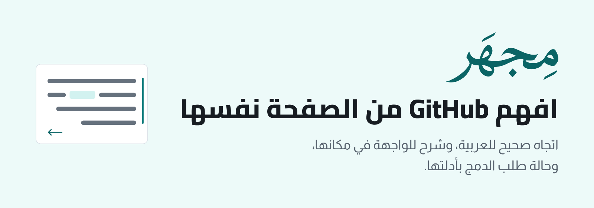
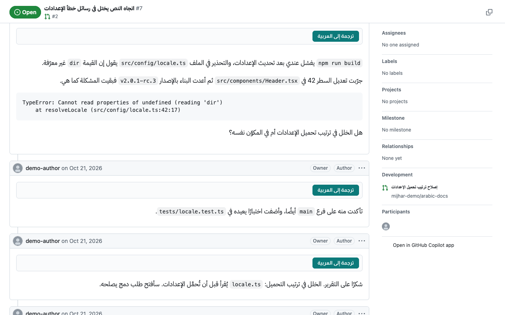
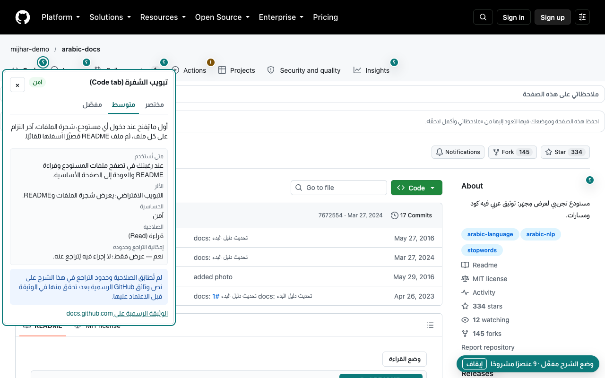
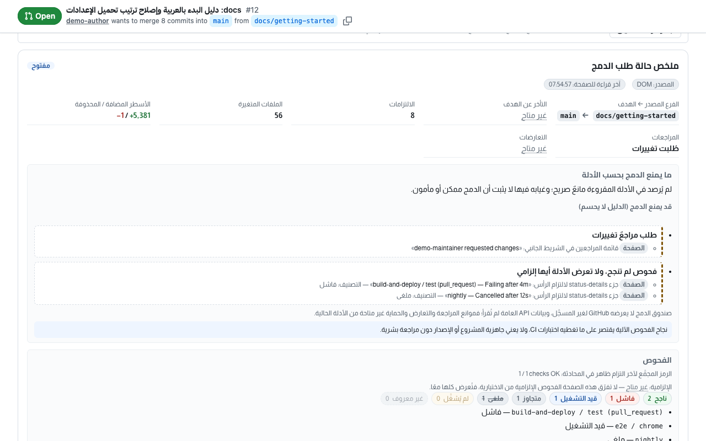
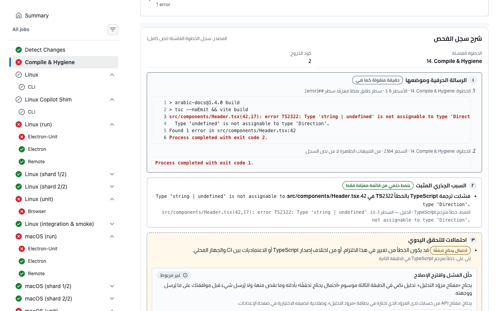
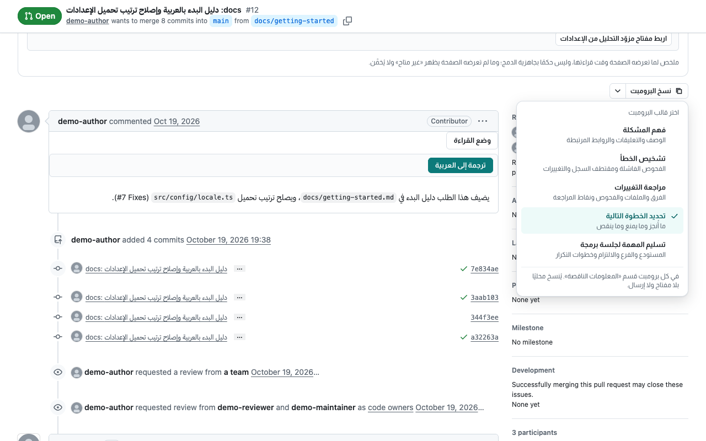
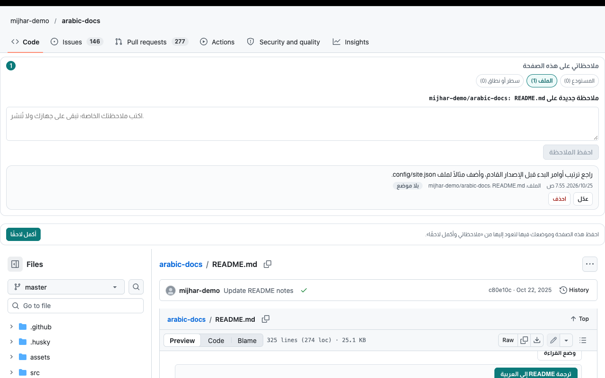

<div dir="rtl">

<p align="center">
  <picture>
    <source media="(prefers-color-scheme: dark)" srcset="release/artwork/readme/hero-dark.png">
    
  </picture>
</p>

# مِجهَر

**إضافة متصفح تجعل GitHub أوضح لمن يقرأ ويكتب بالعربية.** يصحّح اتجاه النص العربي في صفحات GitHub، ويشرح الأزرار والمصطلحات في مكانها، ويقرأ لك حالة طلب الدمج وأين فشل الفحص ولماذا. يعمل فور التثبيت، بلا حساب ولا مفتاح. وهو مشروع مستقل لا يتبع GitHub.

[صفحة مِجهَر](https://bysltan.com/Mjhr) · [سياسة الخصوصية](https://bysltan.com/Mjhr/privacy) · [المساعدة والدعم](https://bysltan.com/Mjhr/support) · [التثبيت من المصدر](#التثبيت)

> **الحالة:** الإصدار الحالي 1.0.0، ولم يُنشر في متاجر الإضافات بعد. وعنوانه فيها سيكون «مِجهَر - مساعدك على GitHub»، وتُضاف روابط التثبيت هنا عند نشره؛ وحتى ذلك الحين يمكنك [بناؤه وتجربته من المصدر](#التثبيت). وشيفرة المستودع معروضة للقراءة والتدقيق، وليست مفتوحة المصدر ([الحقوق](#الحقوق)).

## لمن مِجهَر؟

- لمن يكتب على GitHub بالعربية ويتعب من الفقرات المقلوبة والكود المبعثر داخلها.
- لمن يتعلم GitHub ويريد أن يفهم الزر قبل أن يضغطه.
- لمن يراجع طلبات الدمج ويريد أن يعرف بسرعة ما يمنع الدمج، ولماذا فشل فحص Actions، دون أن يقرأ السجل كله.
- لمن يسأل نموذج ذكاء اصطناعي عن مشكلة ويريد أن يعطيه سياقًا صحيحًا من الصفحة.

## ما يعمل فور التثبيت

كل ما في هذا القسم يعمل على صفحات `github.com` نفسها، بلا حساب ولا رمز ولا مفتاح.

### العربية في اتجاهها الصحيح

يقلب مِجهَر الفقرات العربية التي يعرضها GitHub من اليسار إلى اليمين، ويعزل الكود والمسارات داخلها فلا تتبعثر، ويضيف إلى محرر التعليق زرًّا يبدّل اتجاه الحقل. ومعه وضع قراءة هادئ للنصوص الطويلة، وترجمة المحدَّد إلى العربية بمحرك متصفحك نفسه، وهي متاحة اليوم في Chrome وBrave وحدهما.

<p align="center">
  <picture>
    <source media="(prefers-color-scheme: dark)" srcset="release/screenshots/01-reading--clean--dark.png">
    
  </picture>
  <br>
  <sub>العربية في اتجاهها الصحيح، والكود معزول داخلها</sub>
</p>

### الواجهة مشروحة في مكانها

اطلب شرح زر أو مصطلح فيظهر معناه بالعربية بجانبه: متى تستعمله، وما أثره، وهل يمكن التراجع عنه. ومعه قاموس للمصطلحات يُفتح بالاختصار <kbd>Alt</kbd>+<kbd>K</kbd>، وجولات قصيرة على عناصر الصفحة الحقيقية.

<p align="center">
  <picture>
    <source media="(prefers-color-scheme: dark)" srcset="release/screenshots/02-explain--clean--dark.png">
    
  </picture>
  <br>
  <sub>شرح الزر بالعربية في مكانه، ومتى تستعمله</sub>
</p>

### لماذا لا يُدمج الطلب؟

في صفحة طلب الدمج بطاقة تلخّص ما يمنع الدمج بدليله من الصفحة، وفحوص الطلب ونتائجها، والمراجعات المطلوبة. وحين لا تكفي الأدلة تقول ذلك بدل أن تخمّن.

<p align="center">
  <picture>
    <source media="(prefers-color-scheme: dark)" srcset="release/screenshots/03-status--clean--dark.png">
    
  </picture>
  <br>
  <sub>لماذا لا يُدمج الطلب؟ الموانع والفحوص في بطاقة واحدة</sub>
</p>

### سبب فشل فحص Actions من سجله

في صفحة مهمة فاشلة يقرأ مِجهَر سجل الخطوة الفاشلة، فيعرض الرسالة الحرفية وموضعها في السجل، ثم السبب المثبت بالسطر الذي يدل عليه. ويقول «لا سبب مثبت» حين لا يجد دليلًا بدل أن يخمّن.

<p align="center">
  <picture>
    <source media="(prefers-color-scheme: dark)" srcset="release/screenshots/04-log--clean--dark.png">
    
  </picture>
  <br>
  <sub>سبب فشل الفحص مع السطر الذي يثبته من السجل</sub>
</p>

### سياق المهمة جاهزًا لأي نموذج

يجمع مِجهَر الوصف والفحوص ومقتطف الخطأ والتعليقات ذات الصلة في حزمة تراجعها بنفسك، ثم تنسخها برومبتًا بقالب تختاره: فهم المشكلة، أو تشخيص الخطأ، أو مراجعة التغييرات، أو تحديد الخطوة التالية، أو تسليم المهمة لجلسة برمجة. وينبّهك إلى صيغ الأسرار المعروفة قبل النسخ. النسخ محلي، ولا يحتاج مفتاحًا ولا يرسل شيئًا.

<p align="center">
  <picture>
    <source media="(prefers-color-scheme: dark)" srcset="release/screenshots/05-context--clean--dark.png">
    
  </picture>
  <br>
  <sub>سياق المهمة جاهز للنسخ لأي نموذج، بلا مفتاح</sub>
</p>

### ملاحظات على الصفحة وعلى أسطر الشيفرة

علّق ملاحظة خاصة على مستودع أو ملف أو سطر أو نطاق أسطر، واحفظ ما تريد العودة إليه في «أكمل لاحقًا». تبقى ملاحظاتك في متصفحك على هذا الجهاز بلا مزامنة، وتصدّرها نسخة احتياطية وتستوردها متى شئت.

<p align="center">
  <picture>
    <source media="(prefers-color-scheme: dark)" srcset="release/screenshots/06-notes--clean--dark.png">
    
  </picture>
  <br>
  <sub>ملاحظاتك الخاصة على الصفحة، تبقى في متصفحك</sub>
</p>

وأيضًا: مرشد أول مساهمة، ومعالج README بالعربية، وبنك عبارات المراجعة، وترجمة مسودتك قبل نشرها.

## التثبيت

### من المتاجر

لم يُنشر بعد في Chrome Web Store ولا Microsoft Edge Add-ons ولا Firefox Add-ons، فلا روابط لها الآن. تُضاف هنا عند النشر. ومتى نُشر في Chrome Web Store ثبّته Brave من المتجر نفسه.

### من المصدر

هذا تثبيت تطويري للتجربة، لا بديل عن المتجر. تحتاج Node.js 22 أو أحدث. من مجلد المستودع:

</div>

```bash
npm ci
npm run build
```

<div dir="rtl">

فينتج البناء مجلدين: `dist/chromium` لـChrome وEdge وBrave، و`dist/firefox` لـFirefox.

- **في Chrome وEdge وBrave:** افتح صفحة الإضافات في متصفحك (مثل `chrome://extensions`)، وفعّل وضع المطوّر (Developer mode)، ثم اختر تحميل الإضافة غير المضغوطة (Load unpacked) وحدّد مجلد `dist/chromium`.
- **في Firefox:** افتح `about:debugging#/runtime/this-firefox`، واختر تحميل إضافة مؤقتة (Load Temporary Add-on)، وحدّد الملف `dist/firefox/manifest.json`. تبقى الإضافة المؤقتة حتى تغلق Firefox.

يعمل على الحاسوب في Chrome وEdge وBrave بالإصدار 114 أو أحدث، وفي Firefox بالإصدار 140 أو أحدث.

## أول استعمال

1. افتح أي صفحة في GitHub: مستودعًا أو طلب دمج أو مشكلة أو سجل فحص.
2. افتح لوحة مِجهَر بزرّه في شريط أدوات المتصفح، أو بالاختصار <kbd>Alt</kbd>+<kbd>G</kbd> (وفي macOS <kbd>Control</kbd>+<kbd>Shift</kbd>+<kbd>G</kbd>). تُفتح اللوحة في اللوحة الجانبية للمتصفح في Chrome وEdge وBrave، وفي الشريط الجانبي في Firefox؛ ومن الإعدادات ← «مكان اللوحة» تختار بينها وبين درج يُفتح داخل صفحة GitHub.
3. في أول مرة يعرّفك الترحيب في خطوتين بما يعمل الآن وبالإضافات الاختيارية. تعيده متى شئت من الإعدادات.

والقاموس بالاختصار <kbd>Alt</kbd>+<kbd>K</kbd> (وفي macOS <kbd>Control</kbd>+<kbd>Shift</kbd>+<kbd>K</kbd>). وتغيّر الاختصارين من صفحة اختصارات الإضافات في متصفحك.

## الرمز والمفتاح الاختياريان

لا يتوقف عليهما شيء مما سبق، ولا يغني أحدهما عن الآخر. أضف ما تحتاجه منهما فقط، واحذفه متى شئت.

| | رمز GitHub للقراءة | مفتاح مزوّد التحليل |
| --- | --- | --- |
| **ما هو** | رمز وصول بصلاحيات محددة تنشئه من حسابك في GitHub، واسمه هناك Fine-grained personal access token | مفتاح API تنشئه من حسابك لدى المزوّد: Anthropic أو OpenAI أو Google Gemini |
| **ما يضيفه** | حالة طلبات الدمج وفحوص Actions في مستودعاتك الخاصة التي تختارها، وحد طلبات أعلى من GitHub | تحليل نصي اختياري داخل الأقسام: شرح فشل الفحص، ومراجعة تغييرات طلب الدمج، وفهم المشكلة |
| **إلى أين يُرسل** | `api.github.com` وحده | مضيف المزوّد الذي تختاره وحده |
| **متى** | مع طلبات القراءة التي تبدؤها من مِجهَر | عند التحقق من المفتاح، ومع كل تحليل توافق عليه |

لا يُرفق رمز GitHub بأي طلب إلى مزوّد التحليل، ولا مفتاح مزوّد بطلب إلى GitHub أو إلى مزوّد آخر.

ولـ«تجهيز تعديل» رمز كتابة ثالث منفصل عن رمز القراءة: يكتب ملفًا نصيًا واحدًا في فرع جديد ويفتح طلب دمج، بعد أن تعاين الفرق كاملًا وتوافق على النطاق. لا يدمج ولا يحذف ولا يغلق شيئًا، ويُحفظ في ذاكرة الجلسة وحدها.

**«نسخ البرومبت» لا يحتاج مفتاحًا:** يجهّز السياق نفسه لتلصقه في أي نموذج تستعمله.

والخطوات بالتفصيل، من إنشاء الرمز إلى مسحه وإبطاله، في [المساعدة](Docs/Site/help.md) (أقسام «الرمز أم المفتاح؟» و«إعداد رمز GitHub» و«التغيير والحذف»). وداخل الإضافة دليلان مصوّران: «كيف تحصل على الرمز؟» و«لماذا المفتاح؟».

## اختيار المزوّد والنموذج للتحليل

التحليل الاختياري يعمل عند مزوّد تختاره أنت من ثلاثة: Anthropic وOpenAI وGoogle Gemini. لكل مزوّد مفتاحه ونموذجه، وتبديل المزوّد لا يمس مفتاح غيره، ولا يتحوّل التحليل إلى مزوّد آخر من تلقاء نفسه.

1. افتح الإعدادات ← «الاتصالات والمفاتيح» ← بطاقة «مزوّد التحليل»، واختر المزوّد من القائمة. وبجانب كل مزوّد حالة مفتاحه.
2. أنشئ مفتاح API من حسابك لدى المزوّد (التفصيل بعد الخطوات)، والصقه في البطاقة، واختر مكان حفظه، ثم «احفظ وتحقق». يطلب المتصفح صلاحية مضيف هذا المزوّد وحده (وفي Firefox موافقة «محتوى المواقع» معها)، ثم يرسل مِجهَر طلبًا واحدًا يقرأ النماذج المتاحة لمفتاحك، ولا يحمل شيئًا من صفحاتك.
3. اكتب معرّف النموذج في حقل «النموذج» كما يسمّيه المزوّد؛ هذا الحقل هو الأساس. يُفحص شكله محليًا ويُحفظ لهذا المزوّد دون أي طلب. وإن تركته فارغًا بعد التحقق يقترح مِجهَر أول نموذج أعلنه المزوّد متوافقًا مع التحليل حيث يُعلن ذلك (Anthropic اليوم)، ولك تغييره.
4. زر **+** بجانب الحقل وسيلة مساعدة: يفتح قائمة نماذج المزوّد المختار، واختيار نموذج منها يملأ الحقل. ولا يشترط مِجهَر أن يكون المعرّف في القائمة، فتستطيع كتابة نموذج جديد دون تحديث الإضافة. وإن تعذّر جلب القائمة بقي الحقل يعمل ومعه «أعد المحاولة». وقبل حفظ المفتاح يعمل الحقل ويكون زر + معطّلًا.
5. «اختبر النموذج» اختياري، ويظهر عند OpenAI وGoogle Gemini فقط: يرسل طلبًا واحدًا بنص ثابت «ping» ولا شيء من صفحاتك، ويعرض أن المزوّد قبل النموذج أو رفضه، أو «لم يُحسم» حين يتعذّر الحكم لشبكة أو مصادقة أو حد طلبات. ليس شرطًا للحفظ ولا للتحليل. ولا اختبار لنموذج Anthropic في هذا الإصدار.
6. للتحليل اختر «حلّل…» في القسم، وراجع بطاقة «إرسال للتحليل»: المحتوى وحجمه وما حُجب منه، والمزوّد والنموذج اللذين سيُرسل إليهما فعلًا. لا يُرسل شيء إلا باختيارك «إرسال للتحليل».

والمفتاح من حسابك لدى المزوّد:

- **لدى Anthropic:** مفتاح Claude API من Claude Console، شخصي أو لحساب خدمة أو لمساحة عمل. لا يصلح مفتاح الإدارة (Admin).
- **لدى OpenAI:** مفتاح API عادي من منصة OpenAI، لا مفتاح الإدارة.
- **لدى Google Gemini:** مفتاح Gemini API من Google AI Studio.

**معرّف مساحة العمل (اختياري، لـAnthropic):** إن ردّ التحقق بأن مفتاحك غير مقيّد بمساحة عمل واحدة، فاكتب معرّفها (تجده في عمود ID في صفحة Workspaces في Claude Console، ويبدأ بـ`wrkspc`) في حقل «معرّف مساحة العمل (اختياري)» ثم «تحقق من المفتاح». يُرسل في ترويسة `anthropic-workspace-id` مع طلبات Anthropic وحدها، ولا يخمّنه مِجهَر. وهذا الرد لا يعني أن المفتاح مرفوض.

ما يضمنه مِجهَر هنا أنه يرسل إلى النموذج الذي كتبته، لا أن كل نموذج سيعمل: يعمل ما دام النموذج يقبل واجهة الطلب التي يستعملها مِجهَر عند ذلك المزوّد (Messages عند Anthropic، وResponses عند OpenAI، وgenerateContent عند Gemini). وإن رفض المزوّد النموذج أو الطلب عرض مِجهَر السبب في القسم، دون إعادة تلقائية ودون تحويل إلى مزوّد أو نموذج آخر. وما يحفظه كل مزوّد مما يصله ومدته تحكمه سياسته هو لا مِجهَر؛ والتفصيل في [سياسة الخصوصية](PRIVACY.md#third-parties).

## الخصوصية باختصار

- لا حساب، ولا قياس استخدام ولا إعلانات. ولا تتصل الإضافة بخادم للمطوّر إلا حين ترسل أنت بلاغًا عن مشكلة بعد أن ترى كل ما فيه.
- إعداداتك وملاحظاتك في تخزين الإضافة في هذا المتصفح، ولا تُزامَن مع أي خدمة.
- يقرأ مِجهَر من `github.com` نفسه ما تحتاجه صفحة طلب الدمج. ولا يتصل بـ`api.github.com` ولا بمزوّد التحليل إلا بطلبك.
- الرمز والمفاتيح في ذاكرة الجلسة افتراضًا، وتُمحى بإغلاق المتصفح. والحفظ على القرص اختيار تعلنه أنت، وهو غير مشفَّر.
- المسح من مِجهَر لا يُبطل الرمز في GitHub ولا المفتاح عند المزوّد؛ أبطلهما من حسابك هناك إن لم تعد تحتاجهما.

التفصيل جملةً جملة في [سياسة الخصوصية](PRIVACY.md).

## المساعدة والإبلاغ عن مشكلة

- **دليل المساعدة:** التثبيت، والفرق بين الرمز والمفتاح، وإعدادهما وتغييرهما وحذفهما، في [صفحة المساعدة](Docs/Site/help.md).
- **الإبلاغ عن مشكلة من داخل مِجهَر:** الإعدادات ← «حول مِجهَر» ← «الإبلاغ عن مشكلة». اختر نوع البلاغ واكتب ما حدث، وراجع قبل الإرسال كل ما سيُرسل (نصك، وإصدار مِجهَر والمتصفح والنظام)، ثم أرسله بنفسك؛ ويظهر لك رقمه. يطلب المتصفح أول مرة إذنك بالاتصال بخادم البلاغات وحده، ويصل البلاغ إلى المطوّر ولا يُنشر. لا يُرفق رابط الصفحة ولا محتواها ولا اسم المستودع ولا رمز ولا مفتاح، وإن كان في نصك ما يشبه رمزًا أو مفتاحًا بصيغة معروفة نبّهك مِجهَر ولم يرسله حتى تحذفه.
- **أو بالبريد:** [isultanby@gmail.com](mailto:isultanby@gmail.com). اكتب المتصفح وإصداره، وإصدار مِجهَر، ونوع الصفحة، وما فعلته وما توقعته وما حدث.
- **لا ترفق** رمزًا أو مفتاحًا أو محتوى من مستودع خاص، واحجب من الصور ما لا تريد مشاركته.

وصفحات الموقع منشورة: [التعريف](https://bysltan.com/Mjhr)، و[الخصوصية](https://bysltan.com/Mjhr/privacy)، و[المساعدة والدعم](https://bysltan.com/Mjhr/support). ومصدر نصوصها في هذا المستودع: [`PRIVACY.md`](PRIVACY.md) و[`Docs/Site`](Docs/Site).

## القيود الحالية

- **لم يُنشر في المتاجر بعد:** التثبيت الآن من المصدر وحده.
- **يعمل على `github.com` وحده:** لا في نطاق آخر، ومنه خوادم GitHub المؤسسية بنطاقاتها الخاصة.
- **الترجمة في Chrome وBrave وحدهما:** تعتمد على مترجم المتصفح نفسه (إنجليزية إلى عربية). وفي Edge وFirefox يقول مِجهَر إنها غير متاحة بدل أن يرسل النص إلى خدمة خارجية.
- **في Firefox الأسرار في ذاكرة الجلسة وحدها:** يُمحى رمز GitHub ومفاتيح المزوّدين بإغلاق المتصفح، ولا خيار لحفظها على القرص هناك.
- **لا اختبار للنموذج في Anthropic:** يظهر «اختبر النموذج» عند OpenAI وGoogle Gemini وحدهما.
- **لا ضمان أن كل نموذج يعمل:** ما تكتبه يُرسل إليه كما هو، والحكم لرد المزوّد.
- **فحوص التطبيقات غير Actions في المستودعات الخاصة غير متاحة برمز القراءة:** تظهر «غير متاحة» لأن GitHub لا تتيحها لهذا النوع من الرموز.
- **التحليل اقتراح لا حكم:** «مثبت من الصفحة» يعني اقتباسًا ورد حرفيًا في الصفحة، وما سواه يحتاج منك تحققًا.
- **الملاحظات بلا مزامنة:** تبقى في المتصفح الذي كتبتها فيه، فصدّرها لتنقلها بين الأجهزة.
- **الإصدار الحالي للحاسوب وحده:** لا يعلن دعم متصفحات الجوال، ومنها Firefox على أندرويد، ولم يُجرَّب عليها.

## للمطوّرين

التثبيت من المصدر وتجربته في المتصفح موصوفان أعلاه. ولبقية الأوامر (تحتاج Node.js 22 أو أحدث):

</div>

```bash
npm ci
npm run build
npm run typecheck
npm test
npm run lint:firefox
node scripts/package.mjs
node scripts/package.mjs --check
node scripts/privacy.mjs --check
```

<div dir="rtl">

| الأمر | ما يفعله وما ينتجه |
| --- | --- |
| `npm ci` | يثبّت الاعتماديات المقفلة في `package-lock.json`. |
| `npm run build` | يبني `dist/chromium` و`dist/firefox`. ولهدف واحد: `node scripts/build.mjs firefox` أو `chromium`. |
| `npm run typecheck` | يشغّل `tsc --noEmit`: فحص الأنواع بلا إخراج ملفات. |
| `npm test` | يشغّل `vitest run` على اختبارات `tests`. |
| `npm run lint:firefox` | يشغّل `web-ext lint` على `dist/firefox`، فابنِ أولًا. |
| `node scripts/package.mjs` | بعد البناء، يفحص الحزمتين (ملفات من قائمة مسموحة وحدها، وبلا صيغ أسرار أو مسارات من جهازك) ثم يكتب في `release/packages` حزمة `chromium` وحزمة `firefox` وحزمة الشيفرة المصدرية لمراجعي AMO و`SHA256SUMS`. يحتاج الأمرين `zip` و`unzip`. |
| `node scripts/package.mjs --check` | يجري الفحص نفسه على `dist` والحزم المكتوبة إن وُجدت، دون أن يكتب شيئًا. |
| `node scripts/privacy.mjs --check` | يتحقق أن `PRIVACY.md` يطابق ما يولّده من `Docs/Site/privacy.md`، وبلا `--check` يكتبه. فلا تحرّر `PRIVACY.md` بيدك. |
| `npm run load-check` | يحمّل الحزمتين في المتصفحات المثبتة على macOS (Chrome وEdge وBrave وFirefox) بملف تعريف مؤقت، ويقرأ أخطاء المانيفست وحالة التفعيل. وبعده أسماء متصفحات اختيارية (`chrome` و`edge` و`brave` و`firefox`)، و`--report` لكتابة التقرير في ملف. |

مواد الإصدار (الأيقونات واللقطات ونصوص المتاجر) وطريقة بنائها في [`release/README.md`](release/README.md). ووثائق الصفحات العامة في [`Docs/Site`](Docs/Site).

### أين أجد ماذا؟

| المسار | ما فيه |
| --- | --- |
| [`src`](src) | شيفرة الإضافة: الخلفية والسكربتات المحقونة في صفحات GitHub واللوحة الجانبية وصفحة الإعدادات، والوحدات (`modules`) والقاموس والمانيفست. |
| [`tests`](tests) | الاختبارات (Vitest)، ومعها فحوص تعمل في المتصفحات الحقيقية. |
| [`scripts`](scripts) | سكربتات البناء والتغليف وفحص الخصوصية والشبكة والتحميل. |
| [`release`](release) | الأيقونات واللقطات ونصوص المتاجر. |
| [`Docs`](Docs) | وثائق المشروع، ومنها [`Docs/Site`](Docs/Site) نصوص صفحات الموقع، و[`Docs/MJ`](Docs/MJ) طريقة العمل على مراحل. |
| [`evidence`](evidence) | أدلة الفحوص ولقطاتها لكل مهمة، وهي سجل عمل المشروع. |
| [`EXECUTION_PLAN.md`](EXECUTION_PLAN.md) و[`DECISIONS.md`](DECISIONS.md) و[`STATUS.md`](STATUS.md) | خطة التنفيذ والقرارات والحالة. بعضها مولَّد من `data/plan.json`، فلا يُحرَّر بيد. |

## الحقوق

تصميم وتطوير سلطان — [bysltan.com](https://bysltan.com/)

© 2026 تصميم وتطوير سلطان. جميع الحقوق محفوظة: مِجهَر ليس مفتوح المصدر، ولا يُمنح حق نسخه أو تعديله أو توزيعه إلا بإذن مكتوب ([`LICENSE`](LICENSE)). وعرض الشيفرة هنا للقراءة والتدقيق، لا ترخيص باستعمالها؛ وما تتيحه منصة GitHub نفسها لكل مستودع عام (العرض والتفريع داخل المنصة) يجري بشروطها هي.

الخطوط المضمّنة (Cairo وAlmarai وIBM Plex Sans Arabic وNoto Sans Arabic) بترخيص SIL Open Font License 1.1، ومكتبة Preact بترخيص MIT؛ ونصوص تراخيصها ونسبتها إلى أصحابها في [إشعارات الأطراف الثالثة](THIRD_PARTY_NOTICES.txt)، وتُشحن مع الإضافة.

مِجهَر ليس من منتجات GitHub ولا المتصفحات ولا مزوّدي التحليل المذكورين. الأسماء علامات تجارية لأصحابها.

</div>
