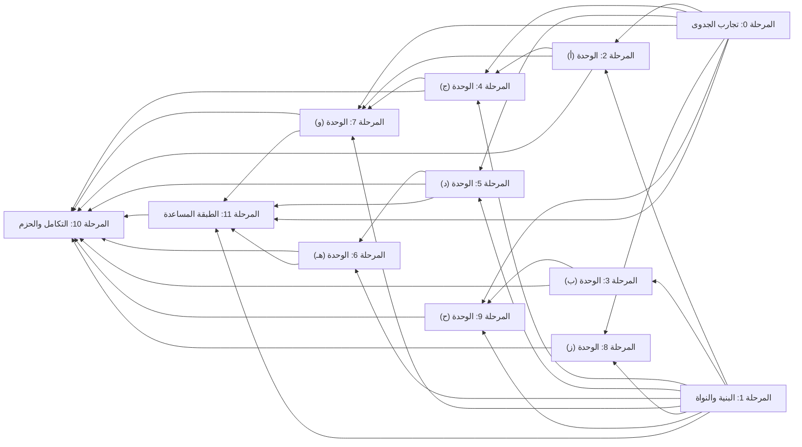

# خريطة الطريق: المراحل وترتيبها واعتمادياتها

> **ملف مولَّد** من `data/plan.json` و`data/status.json` بالأمر `node tools/build.mjs`؛ لا تحرّره يدويًا، وعدّل البيانات ثم أعد التوليد. تاريخ البيانات: `2026-10-24`. لا يحوي هذا الملف أي تقدير زمني.

## قاعدة الترتيب

- **لا جدول زمني:** لا أيام ولا أسابيع ولا مدد ولا مواعيد. تبدأ المهمة حين تُستوفى معايير قبول المهام التي تعتمد عليها فعلًا، ولا تنتظر مرحلة لا تدخل في اعتمادياتها.
- **المراحل تجميع للعرض:** الاعتماد الحقيقي بين المهام، ولذلك تتداخل المراحل؛ فمثلًا تبدأ `T-9.4` حين تكتمل `T-1.4` وحدها دون انتظار بقية مهام الوحدة (ح).
- **القرار المعلق يوقف ما يتصل به فقط:** «يوقف البدء» يوقف المهمة الحاملة وما يعتمد عليها؛ و«يوقف جزءًا» يترك الجزء المستقل يبدأ ويوقف الإغلاق. تفصيل القرارات في [`DECISIONS.md`](DECISIONS.md).
- **مهمتا التكامل** `T-10.1` و`T-10.2`: يجوز العمل الجزئي فيهما مبكرًا (اختبار كل وحدة فور اكتمالها، وتجهيز التوثيق)، واعتمادياتهما تحكم الإغلاق.
- **النطاق:** الوحدات الثماني و56 ميزة فرعية كاملة دون تقليص؛ منها 47 ميزة الطلب الأصلي و9 ميزات أضافها توجيه المالك بتاريخ 2026-10-23 داخل الأقسام القائمة (`AD-23`). والمقترحات الستة اختيارية حتى الاعتماد.

## المراحل

| المرحلة | الهدف | المهام | تعتمد على المراحل | قرارات تمسّها | موضعها في الترتيب |
| :--- | :--- | :--- | :--- | :--- | :--- |
| [0. تجارب الجدوى وقياس الفرضيات](phases/phase-00-feasibility.md) | حسم الفرضيات التي لم تثبتها الوثائق الرسمية قبل البناء عليها، بوثائق قياس على صفحات GitHub الحقيقية والمتصفحات الأربعة، تكون مدخلًا للمهام التي تفتحها وللقرارات `DEC-02` و`DEC-03` و`DEC-04` و`DEC-05`. | 5: `T-0.1`، `T-0.2`، `T-0.3`، `T-0.4`، `T-0.5` | لا شيء | — | الطبقة 0 |
| [1. البنية والنواة المعيارية](phases/phase-01-core.md) | بناء هيكل الإضافة متعدد المتصفحات والطبقات المشتركة التي تُركَّب فوقها الوحدات الثماني: نظام البناء والحزمتان، واكتشاف الصفحة ودورة حياة الوحدات، والتخزين والإعدادات والترحيل، ومضيف الواجهات المعزول. | 4: `T-1.1`، `T-1.2`، `T-1.3`، `T-1.4` | لا شيء | `DEC-01` | الطبقة 0 |
| [2. الوحدة (أ): اتجاه عربي وقراءة مريحة](phases/phase-02-module-a.md) | قراءة وكتابة عربية مريحة دون كسر GitHub: ضبط الاتجاه، وعزل الكود، والخطوط المضمّنة، وزر تبديل الاتجاه، ووضع القراءة وإخفاء التشكيل، والتاريخ الهجري وشكل الأرقام، ونطاق كل إعداد وإلغاء أثره بحارس ملكية الكتابة. | 7: `T-2.1`، `T-2.2`، `T-2.3`، `T-2.4`، `T-2.5`، `T-2.6`، `T-2.7` | المرحلة 0، المرحلة 1 | `DEC-02` | الطبقة 1 |
| [3. الوحدة (ب): قاموس الواجهة وشرح الاستخدام](phases/phase-03-module-b.md) | شرح مصطلحات GitHub وأزراره في سياقها بثلاثة مستويات وبيانات القرار (الأثر والصلاحية وحدود التراجع)، مع وصول كامل بالماوس والكيبورد واللمس، وبحث في القاموس، وجولات إرشادية قرائية لا تنقر شيئًا نيابة عن المستخدم. | 5: `T-3.1`، `T-3.2`، `T-3.3`، `T-3.4`، `T-3.5` | المرحلة 1 | — | الطبقة 1 |
| [4. الوحدة (ج): ترجمة تقنية عند الطلب](phases/phase-04-module-c.md) | ترجمة تقنية محلية عند الطلب تحفظ الكود والمسارات والمصطلحات، بفاحص رموز رباعي وفشل آمن، ومحرك تحدده `DEC-03` بعد قياس `T-0.2`، دون أي خدمة سحابية صامتة. | 5: `T-4.1`، `T-4.2`، `T-4.3`، `T-4.4`، `T-4.5` | المرحلة 0، المرحلة 1، المرحلة 2 | `DEC-03` | الطبقة 2 |
| [5. الوحدة (د): فهم حالة العمل والفحوص](phases/phase-05-module-d.md) | فهم حالة طلب الدمج والفحوص وسجلاتها والمقارنات استنادًا إلى أدلة مرصودة، مع بيان المصدر ووقت القراءة والتقادم، وسياسة رمز الوصول الاختياري بحسب `DEC-04`. | 5: `T-5.1`، `T-5.2`، `T-5.3`، `T-5.4`، `T-5.5` | المرحلة 0، المرحلة 1 | `DEC-04` | الطبقة 1 |
| [6. الوحدة (هـ): تجهيز المعلومات للنموذج أو الزميل](phases/phase-06-module-e.md) | حزمة سياق قابلة للمراجعة والتعديل والنسخ للنموذج أو الزميل، بقائمة اختيار وقسم شفافية لما تعذّر جمعه، وأربعة قوالب، وتنبيه البيانات الخاصة، دون أي إرسال تلقائي. | 3: `T-6.1`، `T-6.2`، `T-6.3` | المرحلة 1، المرحلة 5 | — | الطبقة 2 |
| [7. الوحدة (و): كتابة البلاغات والمراجعات](phases/phase-07-module-f.md) | مساعدة كتابة البلاغات والمراجعات مع احترام قالب المستودع وحماية المسودة والتراجع عن الإدراج، وبنك عبارات محلي ثابت مفصول عن الترجمة الاختيارية للمسودة. | 3: `T-7.1`، `T-7.2`، `T-7.3` | المرحلة 0، المرحلة 1، المرحلة 2، المرحلة 4 | — | الطبقة 3 |
| [8. الوحدة (ز): الملاحظات وحفظ موضع العمل](phases/phase-08-module-g.md) | ملاحظات خاصة محلية على خمسة مستويات وقائمة «أكمل لاحقًا» قابلة للبحث، ومرساة سطر احتمالية تعلن الالتباس بدل التخمين، مع التصدير والاستيراد والنسخ الاحتياطي والحذف وتنبيه الجهاز المشترك. | 4: `T-8.1`، `T-8.2`، `T-8.3`، `T-8.4` | المرحلة 0، المرحلة 1 | `DEC-05` | الطبقة 1 |
| [9. الوحدة (ح): المجتمع وأول مساهمة](phases/phase-09-module-h.md) | اكتشاف README العربي دون جزم بالغياب، ومعالج اقتراح مسؤول، ومرشد أول مساهمة، واكتشاف المحتوى العربي بموسّع تهجئات شفاف، ودليل موارد محلي، مع منع استنتاج هوية أي مطور. | 5: `T-9.1`، `T-9.2`، `T-9.3`، `T-9.4`، `T-9.5` | المرحلة 0، المرحلة 1، المرحلة 3 | — | الطبقة 2 |
| [10. التكامل الشامل وإعداد الحزم](phases/phase-10-integration.md) | التحقق الشامل على المتصفحات الأربعة لكل الوحدات منفردة ومجتمعة، وقياس الميزانيات وتدقيق الشبكة والوصول، ثم تجهيز الحزم والتوثيق محليًا دون رفع أو نشر. | 2: `T-10.1`، `T-10.2` | المرحلة 2، المرحلة 3، المرحلة 4، المرحلة 5، المرحلة 6، المرحلة 7، المرحلة 8، المرحلة 9، المرحلة 11 | `DEC-06`، `DEC-08`، `DEC-12` | الطبقة 5 |
| [11. الطبقة المساعدة: الاتصالات والسياق المشترك والبرومبت والتحليل والإنجاز](phases/phase-11-assist-layer.md) | بناء الطبقة التي تحوّل مِجهَر من أداة فهم إلى أداة فهم وإنجاز، مدمجة داخل الأقسام القائمة لا في قسم منفصل للذكاء الاصطناعي: سجل اتصالات ومفاتيح واحد في الإعدادات يربط التفعيل بصحة الاتصال لا بوجود نص، وطبقة سياق مشتركة واحدة للجمع والتنقيح والبناء تخدم «نسخ البرومبت» والتحليل وحزمة السياق بلا تكرار، وزر نسخ برومبت بلا صندوق نص، وقوالب برومبت خمسة، وطبقة مزوّد تحليل اختيارية بموافقة صريحة تبيّن المحتوى والوجهة، وعرض التحليل بالأدلة داخل القسم نفسه، ومسار إنجاز تدريجي بنطاق محدود مع ضوابط أمان تنفيذي. | 9: `T-11.1`، `T-11.2`، `T-11.3`، `T-11.4`، `T-11.5`، `T-11.6`، `T-11.7`، `T-11.8`، `T-11.9` | المرحلة 0، المرحلة 1، المرحلة 5، المرحلة 6، المرحلة 7 | `DEC-10`، `DEC-09`، `DEC-11` | الطبقة 4 |

«الطبقة» = أطول سلسلة من المراحل قبلها. المراحل في الطبقة نفسها تجري بالتوازي، وأي مهمة فيها تبدأ قبل ذلك متى اكتملت اعتمادياتها الخاصة.

## ترتيب المراحل واعتمادياتها

1. [المرحلة 0 (تجارب الجدوى)](phases/phase-00-feasibility.md) و[المرحلة 1 (البنية والنواة)](phases/phase-01-core.md)
2. [المرحلة 2 (الوحدة (أ))](phases/phase-02-module-a.md) و[المرحلة 3 (الوحدة (ب))](phases/phase-03-module-b.md) و[المرحلة 5 (الوحدة (د))](phases/phase-05-module-d.md) و[المرحلة 8 (الوحدة (ز))](phases/phase-08-module-g.md)
3. [المرحلة 4 (الوحدة (ج))](phases/phase-04-module-c.md) و[المرحلة 6 (الوحدة (هـ))](phases/phase-06-module-e.md) و[المرحلة 9 (الوحدة (ح))](phases/phase-09-module-h.md)
4. [المرحلة 7 (الوحدة (و))](phases/phase-07-module-f.md)
5. [المرحلة 11 (الطبقة المساعدة)](phases/phase-11-assist-layer.md)
6. [المرحلة 10 (التكامل والحزم)](phases/phase-10-integration.md)

## موجات البدء على مستوى المهام

الموجة = طول أطول سلسلة اعتماديات قبل المهمة: أبكر موضع يمكن أن تبدأ فيه، لا موعد. المهام في الموجة نفسها مستقلة عن بعضها.

| الموجة | المهام | قرارات يلزم حسمها قبل بدء مهام الموجة |
| :--- | :--- | :--- |
| 0 | [`T-0.1`](phases/phase-00-feasibility.md#T-0.1)، [`T-0.2`](phases/phase-00-feasibility.md#T-0.2)، [`T-0.3`](phases/phase-00-feasibility.md#T-0.3)، [`T-0.4`](phases/phase-00-feasibility.md#T-0.4)، [`T-0.5`](phases/phase-00-feasibility.md#T-0.5)، [`T-1.1`](phases/phase-01-core.md#T-1.1) | — |
| 1 | [`T-1.2`](phases/phase-01-core.md#T-1.2)، [`T-1.3`](phases/phase-01-core.md#T-1.3)، [`T-3.1`](phases/phase-03-module-b.md#T-3.1)، [`T-4.2`](phases/phase-04-module-c.md#T-4.2) | — |
| 2 | [`T-1.4`](phases/phase-01-core.md#T-1.4)، [`T-2.1`](phases/phase-02-module-a.md#T-2.1)، [`T-2.7`](phases/phase-02-module-a.md#T-2.7) | `DEC-01` |
| 3 | [`T-2.2`](phases/phase-02-module-a.md#T-2.2)، [`T-2.3`](phases/phase-02-module-a.md#T-2.3)، [`T-2.4`](phases/phase-02-module-a.md#T-2.4)، [`T-2.5`](phases/phase-02-module-a.md#T-2.5)، [`T-2.6`](phases/phase-02-module-a.md#T-2.6)، [`T-3.2`](phases/phase-03-module-b.md#T-3.2)، [`T-5.1`](phases/phase-05-module-d.md#T-5.1)، [`T-5.4`](phases/phase-05-module-d.md#T-5.4)، [`T-8.1`](phases/phase-08-module-g.md#T-8.1)، [`T-9.1`](phases/phase-09-module-h.md#T-9.1)، [`T-9.3`](phases/phase-09-module-h.md#T-9.3)، [`T-9.4`](phases/phase-09-module-h.md#T-9.4)، [`T-9.5`](phases/phase-09-module-h.md#T-9.5) | `DEC-02` |
| 4 | [`T-3.3`](phases/phase-03-module-b.md#T-3.3)، [`T-3.4`](phases/phase-03-module-b.md#T-3.4)، [`T-4.1`](phases/phase-04-module-c.md#T-4.1)، [`T-5.2`](phases/phase-05-module-d.md#T-5.2)، [`T-5.3`](phases/phase-05-module-d.md#T-5.3)، [`T-7.1`](phases/phase-07-module-f.md#T-7.1)، [`T-8.2`](phases/phase-08-module-g.md#T-8.2)، [`T-8.3`](phases/phase-08-module-g.md#T-8.3)، [`T-9.2`](phases/phase-09-module-h.md#T-9.2) | — |
| 5 | [`T-3.5`](phases/phase-03-module-b.md#T-3.5)، [`T-4.3`](phases/phase-04-module-c.md#T-4.3)، [`T-5.5`](phases/phase-05-module-d.md#T-5.5)، [`T-6.1`](phases/phase-06-module-e.md#T-6.1)، [`T-7.2`](phases/phase-07-module-f.md#T-7.2)، [`T-7.3`](phases/phase-07-module-f.md#T-7.3)، [`T-8.4`](phases/phase-08-module-g.md#T-8.4) | `DEC-03`، `DEC-04` |
| 6 | [`T-4.4`](phases/phase-04-module-c.md#T-4.4)، [`T-6.2`](phases/phase-06-module-e.md#T-6.2)، [`T-6.3`](phases/phase-06-module-e.md#T-6.3)، [`T-11.1`](phases/phase-11-assist-layer.md#T-11.1) | `DEC-03`، `DEC-10` |
| 7 | [`T-4.5`](phases/phase-04-module-c.md#T-4.5)، [`T-11.2`](phases/phase-11-assist-layer.md#T-11.2)، [`T-11.5`](phases/phase-11-assist-layer.md#T-11.5) | `DEC-03` |
| 8 | [`T-11.3`](phases/phase-11-assist-layer.md#T-11.3)، [`T-11.4`](phases/phase-11-assist-layer.md#T-11.4)، [`T-11.6`](phases/phase-11-assist-layer.md#T-11.6)، [`T-11.8`](phases/phase-11-assist-layer.md#T-11.8) | `DEC-09`، `DEC-11` |
| 9 | [`T-11.7`](phases/phase-11-assist-layer.md#T-11.7)، [`T-11.9`](phases/phase-11-assist-layer.md#T-11.9) | — |
| 10 | [`T-10.1`](phases/phase-10-integration.md#T-10.1) | — |
| 11 | [`T-10.2`](phases/phase-10-integration.md#T-10.2) | — |

## أطول سلسلة اعتماديات

[`T-1.1`](phases/phase-01-core.md#T-1.1) ← [`T-1.2`](phases/phase-01-core.md#T-1.2) ← [`T-1.4`](phases/phase-01-core.md#T-1.4) ← [`T-5.1`](phases/phase-05-module-d.md#T-5.1) ← [`T-5.3`](phases/phase-05-module-d.md#T-5.3) ← [`T-6.1`](phases/phase-06-module-e.md#T-6.1) ← [`T-6.2`](phases/phase-06-module-e.md#T-6.2) ← [`T-11.2`](phases/phase-11-assist-layer.md#T-11.2) ← [`T-11.4`](phases/phase-11-assist-layer.md#T-11.4) ← [`T-11.7`](phases/phase-11-assist-layer.md#T-11.7) ← [`T-10.1`](phases/phase-10-integration.md#T-10.1) ← [`T-10.2`](phases/phase-10-integration.md#T-10.2)

طولها 12 مهام، وتمر بالوحدة (ج): فاتجاه النص والعزل (`T-2.1` و`T-2.2`) يسبقان واجهة الترجمة (`T-4.1`)، ثم المحرك والتنزيل وتدقيق الشبكة (`T-4.3` إلى `T-4.5`). ويقع `DEC-03` على هذه السلسلة، فتأخيره بعد اكتمال `T-4.1` و`T-0.2` يؤخر إغلاق التكامل مباشرة.

## نقاط القرار

| القرار | الموضوع | الحالة | يلزم حسمه | نوع الإيقاف | مدخلات تفيده | ما يستمر حتى حسمه |
| :--- | :--- | :--- | :--- | :--- | :--- | :--- |
| [`DEC-01`](DECISIONS.md#DEC-01) | إطار بناء الواجهات المحقونة واللوحة الجانبية والإعدادات | معتمد: أ — `Preact` + `TypeScript` (2026-10-23، بتفويض المالك (`AD-14`))؛ السبب: أصغر حزمة تحقق المتطلبات بأقل إعادة كتابة؛ وإن فشل مكوّن منقول عبر طبقة التوافق في أول بناء داخل `T-1.4` يُعاد القرار إلى (ب) ويُسجَّل سببه. | قبل بدء `T-1.4` ([المرحلة 1](phases/phase-01-core.md)) | يوقف البدء | — | تستمر 12 مهمة لا تعتمد على `T-1.4`: `T-0.1` إلى `T-0.4`، و`T-1.1` إلى `T-1.3`، و`T-2.1` و`T-2.2` و`T-2.7`، و`T-3.1`، و`T-4.2`. |
| [`DEC-02`](DECISIONS.md#DEC-02) | طريقة تقديم «وضع القراءة وإخفاء التشكيل» (`F-A5`) | معتمد: أ-2 — عارض قراءة معزول داخل الإضافة وحده: صفحة إضافة في تبويب مستقل تعرض لقطة منظَّفة من Markdown الصفحة، ولا يُكتب شيء على عقد نص GitHub (2026-10-23، بتفويض المالك (`AD-14`) عند بدء `MJ7`)؛ السبب: قاس `T-0.1` (`AC-S1.3`، `evidence/T-0.1/report.md`) أن الوضع الموضعي يفسد اقتباس الرد (`r`) لأنه يقرأ النص المعروض ولا يمر بالحافظة، فلا يصلحه معالج `copy` (في جلسة المالك على `Barqawiz/Shakkala#3`: 9 حركات في الوضع المعطّل و0 في المفعّل)؛ واقتباس الرد موجود في كل صفحة محادثة (Issues وPR وDiscussions وتعليقاتها)، وهي أكثر الصفحات التي فيها `.markdown-body` بعد README؛ ولم يُقَس السحب الأصلي ولا واجهة البحث. فالصفحات المتأثرة كثيرة، وبقاعدة التوصية والمرحلة («وإن كثرت الصفحات المتأثرة فالخيار أ-2 وحده أقل كلفة») اختير العارض المعزول وحده: لا يكتب على عقد GitHub، فيبقى الاقتباس وأزرار النسخ ومصدر Markdown والحقول كما هي بالبناء (`AC-A5` البندان ٤ و٥)، ولا يلزم اعتراض `copy` و`dragstart` على مستوى الصفحة ولا تعطيل الوضع بحسب نوع الصفحة. واستُبعد أ-3 لأنه يضيف كلفة الوضع الموضعي كلها (مصفوفة الإزاحة على عقد GitHub ومعالجات الصفحة والتعطيل في صفحات المحادثة) لصفحات لا يصلح فيها. والعارض صفحة إضافة عادية في تبويب لا جذر ظل داخل الصفحة، ليعمل التحديد والنسخ على مستند عادي كما قيسا في `T-0.1`، وليبحث بحث المتصفح الأصلي في نص العارض وحده. ويبقى محرك `T-2.7` وحارسه كما هما لـ`T-2.6`. | حُسم؛ ولم يعد يوقف شيئًا ([المرحلة 2](phases/phase-02-module-a.md)) | يوقف البدء | [`T-0.1`](phases/phase-00-feasibility.md#T-0.1) | حُسم؛ ولا يوقف شيئًا. |
| [`DEC-03`](DECISIONS.md#DEC-03) | استراتيجية محرك الترجمة المحلي (`F-C4` و`F-C5` و`F-C6`) | معتمد: ج-2 — محركات المتصفح وحدها بلا `ONNX`: `Translator API` في سكربت المحتوى بالتوفر المكتشف وقت التشغيل (ثبت في Chrome وBrave)، وحيث لا محرك (Edge وFirefox) حالة صريحة وبديل نسخ النص المقنَّع بلا اتصال؛ و`browser.trial.ml` لا يُوصل حتى يثبت ترخيص نموذج ترجمة يقبله (2026-10-24، بتفويض المالك (`AD-14`) عند بدء `MJ14`)؛ السبب: قاس `T-0.2` (`evidence/T-0.2/report.md`، `AC-S2.5`) أن ترخيص النموذج غير مثبت (`HYP-05`): مستودع `Xenova/opus-mt-en-ar` بلا حقل ترخيص لأوزان ONNX المحوّلة، وأصله `Helsinki-NLP/opus-mt-en-ar` يعلن Apache-2.0 بينما ملف `LICENSE` لمستودع Tatoeba-Challenge مصدر بياناته CC BY-NC-SA 4.0، فأثر شرط «غير تجاري» على الأوزان غير محسوم من النصوص المقروءة. وقاعدة التوصية ونص `MJ14`: الهجين ج-1 إن ثبت الترخيص والذاكرة، وإلا ج-2؛ وإن لم يثبت الترخيص فلا تضمين ولا تنزيل. فسقط ج-1 وج-3 لأن كليهما ينزّل النموذج، ولم يلزم الحكم على الذاكرة (قمة RSS لأكبر عملية في مسار ONNX بين 1,260 و1,387 MB). فاختير ج-2. **وحدّه الذي تفرضه القاعدة نفسها:** مهمة الترجمة في `browser.trial.ml` (`HYP-04` صحيحة بشروط: تفضيل `browser.ml.enable` يغيّره المستخدم وصلاحية `trialML` الاختيارية ومحرك واحد) لم تُقَس إلا بالنموذج نفسه `Xenova/opus-mt-en-ar` ينزّله Firefox من huggingface.co بطلب الإضافة، فلا يُوصل هذا المسار حتى يثبت ترخيص نموذج ترجمة en→ar يقبله `trial.ml` ويُقاس؛ فـFirefox بلا محرك محلي في هذه المرحلة. **وما يُبنى:** `Translator API` في سكربت المحتوى وحده، وهو السياق الذي ثبت فيه بنقرة المستخدم ما دامت حزمة اللغة `downloadable` (`HYP-01`)، ويُختار بالتوفر المكتشف وقت التشغيل لا باسم المتصفح: ثبت في Chrome وBrave، و`unavailable` في Edge، وغائب في Firefox (`HYP-02`)؛ وحيث لا محرك حالة صريحة وبديل نسخ النص المقنَّع بلا أي اتصال. و`NotSupportedError` المتقطع في أول `create()` (Brave وChrome) يُعاد مرة ولا يُعدّ غيابًا نهائيًا. **الأثر:** لا تنزيل نموذج تديره الإضافة، ولا صلاحية مضيف نموذج، ولا تعديل CSP لـWebAssembly؛ وفي `T-4.4` يُكتفى بإظهار أن الحجم غير معلن وبعدم استدعاء المحرك إلا بفعل المستخدم؛ ولا ينطبق شرط تحرير ذاكرة العامل (`PP-02`)؛ وقائمة الاتصالات المسموحة لمسار الترجمة في `T-4.5` خالية من جهة الإضافة، وتنزيل حزمة لغة المتصفح خارج سيطرتها فيُوثَّق ما يعلنه المتصفح ولا يُدّعى فحصه. | حُسم؛ ولم يعد يوقف شيئًا ([المرحلة 4](phases/phase-04-module-c.md)) | يوقف البدء | [`T-0.2`](phases/phase-00-feasibility.md#T-0.2) | حُسم؛ ولا يوقف شيئًا. |
| [`DEC-04`](DECISIONS.md#DEC-04) | رمز الوصول `PAT` الاختياري: دعمه وطريقة تخزينه، أو عدم دعمه (`F-D4` و`F-D5` و`F-D7` و`F-D8`) | معتمد: د-5 — تخيير المستخدم، مقصورًا على د-1 (ذاكرة الجلسة) افتراضًا ود-2 (القرص الصريح) باختيار معلَن (2026-10-23، المالك (توجيه توسيع النطاق 2026-10-23))؛ السبب: أمر المالك في توجيه 2026-10-23 بإتاحة رمز GitHub ومراجعة أي قرار يمنعه، فحلّ هذا القرار محل القرار السابق د-4 (المسجَّل في `history` بتاريخه وسببه). واختير د-5 مقصورًا على مجموعتين لا ثلاث: **د-1 ذاكرة الجلسة هو الافتراضي** لأنه أقل تعرضًا، و**د-2 القرص الصريح** خيار يختاره المستخدم بعد نص صريح يقول إن الرمز يُحفظ غير مشفَّر ويقرؤه من يملك الوصول إلى ملف المتصفح الشخصي؛ ولا يُخلط المساران. واستُبعد د-3 (التشفير بعبارة مرور) لأنه لا يحمي إلا من قراءة الملف ويبقى الرمز مفكوكًا في الذاكرة، ويضيف عبارة مرور متكررة ووعدًا بحماية لا يمكن إثباتها هنا، وهذا يخالف «لا تدّعِ تشفير التخزين دون تحقق فعلي». والرمز للقراءة فقط بأقل صلاحية، وصلاحية الكتابة سرّ آخر ومسار آخر (`T-11.8` و`AC-F7`). **أثر إعادة الحسم:** يعود `AC-5.5` و`TEST-SEC-01` إلى `03` للانطباق ويصير `TEST-SEC-04` «لا ينطبق»، وتعود `HYP-07` و`HYP-09` فرضيتين مفتوحتين، ويُعاد قياس ما عُلِّم «لا ينطبق» في `AC-S3.3` ضمن `T-0.5` (`AC-S5.3` و`AC-S5.4`) لا بإعادة فتح `T-0.3` المدمجة. | حُسم؛ ولم يعد يوقف شيئًا ([المرحلة 5](phases/phase-05-module-d.md)) | يوقف البدء | [`T-0.3`](phases/phase-00-feasibility.md#T-0.3) | حُسم؛ ولا يوقف شيئًا. ويبقى أن `T-5.5` لا تُغلق قبل وثيقة `T-0.5` (أقل الصلاحيات وإشارات الانتهاء والنقص والحد). |
| [`DEC-05`](DECISIONS.md#DEC-05) | ما يُحفظ من محتوى السطر في ملاحظات المستودعات الخاصة (`F-G3`) | معتمد: ز-1 — مقتطف السطر وسياقه نصًّا في المستودعات العامة، وبصمة `SHA-256` بملح محلي فقط للسطر وسياقه في الخاصة؛ وما لم تثبت الصفحة أنه عام يُعامل خاصًّا (2026-10-23، بتفويض المالك (`AD-14`) عند بدء `MJ12`)؛ السبب: قاس `T-0.4` (`AC-S4.4`، `evidence/T-0.4/report.md`) على 295,672 مرساة من تواريخ تسعة ملفات حقيقية أن النتيجة الغالبة بعد أي تعديل هي المنزاح B (53.9% في المراجعة التالية، و75.6% بعد خمس، و63.3% عند رأس الفرع)، وأن مرشحها الوحيد هو السطر نفسه في 99.5% فأكثر، وأن الملتبس C يضم السطر الصحيح في 95.5% فأكثر. وكشف B وC يحتاج مقارنة نص السطر وسياقه ±2 بأسطر الصفحة؛ فالخيار ز-3 (لا مقتطف ولا بصمة) يجعل كل ملاحظة سطر في مستودع خاص «تعذّر التحقق» ويُسقط أكثر من نصف فائدة المرساة، والخيار ز-2 يبقي كود المستودع الخاص نصًّا صريحًا في التخزين المحلي، والخيار ز-4 يضيف واجهة اختيار لكل مستودع ومجموعة يحددها المالك دون حاجة تثبتها الوثيقة. فاختير ز-1، وهو توصية القرار وأبسط ما يبقي A وB وC في الخاصة: تُقارن بصمة كل سطر في الصفحة المفتوحة ببصمة المحفوظ محليًّا دون شبكة ودون تخزين النص. **حدوده المعلنة:** `SHA-256` تجزئة لا تشفير، فلا تخفي سطرًا قصيرًا أو شائعًا يمكن تخمينه ممن يملك الملح والبيانات؛ والملح عشوائي محلي واحد لكل تثبيت يمنع الجداول الجاهزة فقط، ويدخل في التصدير إن شُمل (`T-8.4`). وفي الخاصة تظهر الحالة D «متغيّر» بلا مقتطف (`TEST-NOTE-03D`). **ومتى يُعدّ المستودع عامًّا:** حين تعلن الصفحة `meta[name="octolytics-dimension-repository_public"]` بالقيمة `true` (ثابتة في الصفحات الحية المحفوظة في `fixtures/spikes/`)؛ وغيابها أو أي قيمة أخرى أو اللوحة الأصلية التي لا ترى DOM تُعامل خاصًّا، فلا يُحفظ نص عند الشك. | حُسم؛ ولم يعد يوقف شيئًا ([المرحلة 8](phases/phase-08-module-g.md)) | يوقف جزءًا والإغلاق | [`T-0.4`](phases/phase-00-feasibility.md#T-0.4) | حُسم؛ ولا يوقف شيئًا. |
| [`DEC-06`](DECISIONS.md#DEC-06) | اسم الإضافة | معتمد: ب — مِجهَر (Mijhar) (2026-10-22) | قبل إغلاق `T-10.2` ([المرحلة 10](phases/phase-10-integration.md)) | يوقف جزءًا والإغلاق | — | حُسم؛ ولم يعد يوقف شيئًا. ويبقى في `T-10.2` التحقق من أن الاسم المعتمد مستعمل في الحزم والنصوص. |
| [`DEC-07`](DECISIONS.md#DEC-07) | المقترحات الإضافية الستة (`P-OPT-01` إلى `P-OPT-06`) | معلق | لا موعد ملزم | لا يوقف شيئًا | — | لا تتوقف أي مهمة. |
| [`DEC-08`](DECISIONS.md#DEC-08) | الاختصارات الافتراضية | معتمد: ح-2 — اختصارات معدَّلة بعد فحص تعارض (2026-10-23، بتفويض المالك (`AD-14`))؛ السبب: لا يثبّت مفاتيح لم تُفحص؛ تُختار القيم النهائية في `T-10.2` بعد فحص التعارض على المتصفحات المتاحة، ويُرجَع إلى «بلا اختصار» لأي اختصار يثبت تعارضه. | قبل إغلاق `T-10.2` ([المرحلة 10](phases/phase-10-integration.md)) | يوقف جزءًا والإغلاق | — | تستمر 46 مهمة بالاختصارات المؤقتة. |
| [`DEC-09`](DECISIONS.md#DEC-09) | مزوّد التحليل الأول ومصدر قائمة المودلات | معتمد: ز-1 — Anthropic (Claude API) مزوّدًا أول خلف محوّل (2026-10-23، بتفويض المالك (`AD-14`) في توجيه 2026-10-23)؛ السبب: المالك فوّض اختيار المزوّد الأول بناءً على التوصية. واختير مزوّد واحد خلف محوّل لأنه الأبسط الذي يحقق المتطلب، ولأن المطلوب تحليل نصّي بأدلة لا قدرات خاصة بمزوّد. والمودلات تُقرأ وقت التشغيل لا من هذه الوثيقة (`AC-E9` البند 3). **تعديل 2026-10-24 (`AD-31`):** أُسقطت الأسعار والتكلفة من القرار بتوجيه المالك. ولا يُضاف وسيط يمرّ به محتوى المستخدم إن تعذّر الطلب المباشر. | حُسم؛ والتحقق من المودلات في `T-11.6` ([المرحلة 11](phases/phase-11-assist-layer.md)) | يوقف البدء | [`T-0.5`](phases/phase-00-feasibility.md#T-0.5) | تستمر كل المهام؛ و«نسخ البرومبت» وقوالبه والطبقة المشتركة لا تنتظر مزوّدًا ولا مفتاحًا. |
| [`DEC-10`](DECISIONS.md#DEC-10) | تخزين مفتاح مزوّد التحليل وعزله وحذفه | معتمد: ح-4 — تخيير المستخدم: ذاكرة الجلسة افتراضًا، والقرص الصريح باختيار معلَن (2026-10-23، بتفويض المالك (`AD-14`) في توجيه 2026-10-23)؛ السبب: أبسط ما يحقق المتطلب مع مطابقة سياسة رمز GitHub (`DEC-04` د-5)، فلا يتعلم المستخدم سلوكين مختلفين لسرّين. واستُبعد ح-3 لأنه يَدَّعي حماية لا يمكن إثباتها هنا، والتوجيه يمنع ادّعاء تشفير التخزين دون تحقق فعلي. والسرّان في مفتاحي تخزين مستقلين بمستوى وصول موثوق، ولا يُرسل سرّ إلا إلى خدمته، ويفحص `TEST-CONN-02` ذلك ويفحص نص الإعلان. | حُسم؛ قبل بدء `T-11.1` ([المرحلة 11](phases/phase-11-assist-layer.md)) | يوقف البدء | — | حُسم؛ ولا يوقف شيئًا. |
| [`DEC-11`](DECISIONS.md#DEC-11) | النطاق الأولي لمسار الإنجاز التدريجي (ما يجوز لمِجهَر تجهيزه وتنفيذه) | معتمد: ط-1 — تعديل ملف واحد نصي في طلب دمج واحد، بمعاينة الفرق وموافقة على النطاق (2026-10-23، بتفويض المالك (`AD-14`) في توجيه 2026-10-23)؛ السبب: نطاق أولي مفيد وقابل للإنجاز لا يحوّل مِجهَر إلى بيئة برمجة كاملة، كما طلب التوجيه. وأكثر ما يحتاجه المستخدم العربي عمليًا تعديل نصّي (توثيق أو `README` أو سطر إعداد ظاهر) وهو ما تثبت معاينة الفرق صحته دون بناء ولا اختبار. واستُبعد ط-2 لأنه يحتاج تشغيل أدوات بناء واختبار، وط-3 لأنه يُسقط متطلبًا طلبه المالك. | حُسم؛ قبل بدء `T-11.8` ([المرحلة 11](phases/phase-11-assist-layer.md)) | يوقف البدء | — | حُسم؛ ولا يوقف شيئًا. |
| [`DEC-12`](DECISIONS.md#DEC-12) | قناة «الإبلاغ عن مشكلة» في شاشة «حول» | معلق | قبل بناء «الإبلاغ عن مشكلة» في `T-10.2` ([المرحلة 10](phases/phase-10-integration.md)) | يوقف جزءًا والإغلاق | — | يُبنى كل ما سواه من `T-10.2`، وتصميم «حول» و«الإبلاغ عن مشكلة» جاهز على التوصية. |

## المسارات المتوازية بعد البنية

تبدأ تجارب الجدوى الأربع و`T-1.1` معًا. بعد `T-1.1` تبدأ مهام منطقية لا تنتظر إطار الواجهة: `T-1.2` و`T-1.3` و`T-3.1` و`T-4.2`، ثم `T-2.1` و`T-2.7`. وبعد `T-1.4` (بعد `DEC-01`) تنفتح مسارات الوحدات بالتوازي:

- **مسار القراءة والكتابة:** (أ) ← (ج) ← (و).
- **مسار العمل والسياق:** (د) ← (هـ).
- **مسار الملاحظات:** (ز).
- **مسار التعلم والمجتمع:** (ب) ← (ح).

## ملفات ذات صلة

- [`EXECUTION_PLAN.md`](EXECUTION_PLAN.md): الخطة المرجعية.
- [`phases/`](phases/): ملف لكل مرحلة.
- [`TRACEABILITY.md`](TRACEABILITY.md) و[`DECISIONS.md`](DECISIONS.md) و[`STATUS.md`](STATUS.md) و[`NAMING.md`](NAMING.md).
- لوحة المتابعة: [`dashboard/index.html`](dashboard/index.html).
