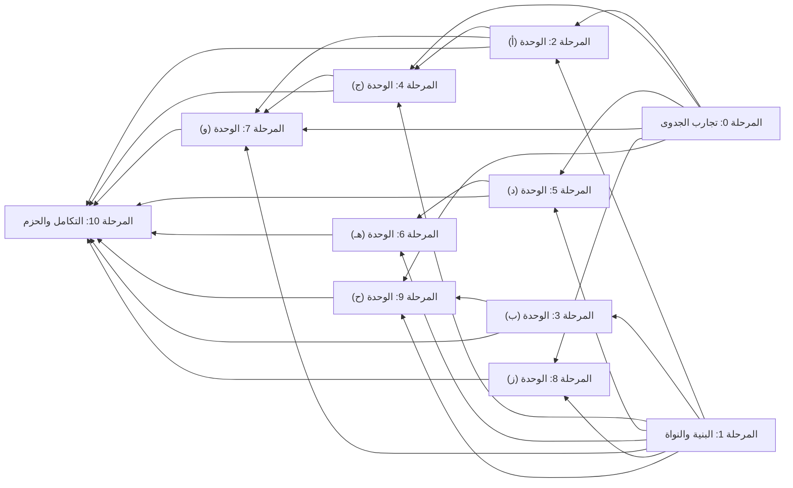

# خريطة الطريق: المراحل وترتيبها واعتمادياتها

> **ملف مولَّد** من `data/plan.json` و`data/status.json` بالأمر `node tools/build.mjs`؛ لا تحرّره يدويًا، وعدّل البيانات ثم أعد التوليد. تاريخ البيانات: `2026-10-23`. لا يحوي هذا الملف أي تقدير زمني.

## قاعدة الترتيب

- **لا جدول زمني:** لا أيام ولا أسابيع ولا مدد ولا مواعيد. تبدأ المهمة حين تُستوفى معايير قبول المهام التي تعتمد عليها فعلًا، ولا تنتظر مرحلة لا تدخل في اعتمادياتها.
- **المراحل تجميع للعرض:** الاعتماد الحقيقي بين المهام، ولذلك تتداخل المراحل؛ فمثلًا تبدأ `T-9.4` حين تكتمل `T-1.4` وحدها دون انتظار بقية مهام الوحدة (ح).
- **القرار المعلق يوقف ما يتصل به فقط:** «يوقف البدء» يوقف المهمة الحاملة وما يعتمد عليها؛ و«يوقف جزءًا» يترك الجزء المستقل يبدأ ويوقف الإغلاق. تفصيل القرارات في [`DECISIONS.md`](DECISIONS.md).
- **مهمتا التكامل** `T-10.1` و`T-10.2`: يجوز العمل الجزئي فيهما مبكرًا (اختبار كل وحدة فور اكتمالها، وتجهيز التوثيق)، واعتمادياتهما تحكم الإغلاق.
- **النطاق:** الوحدات الثماني والميزات الـ47 كاملة دون تقليص؛ والمقترحات الستة اختيارية حتى الاعتماد.

## المراحل

| المرحلة | الهدف | المهام | تعتمد على المراحل | قرارات تمسّها | موضعها في الترتيب |
| :--- | :--- | :--- | :--- | :--- | :--- |
| [0. تجارب الجدوى وقياس الفرضيات](phases/phase-00-feasibility.md) | حسم الفرضيات التي لم تثبتها الوثائق الرسمية قبل البناء عليها، بوثائق قياس على صفحات GitHub الحقيقية والمتصفحات الأربعة، تكون مدخلًا للمهام التي تفتحها وللقرارات `DEC-02` و`DEC-03` و`DEC-04` و`DEC-05`. | 4: `T-0.1`، `T-0.2`، `T-0.3`، `T-0.4` | لا شيء | — | الطبقة 0 |
| [1. البنية والنواة المعيارية](phases/phase-01-core.md) | بناء هيكل الإضافة متعدد المتصفحات والطبقات المشتركة التي تُركَّب فوقها الوحدات الثماني: نظام البناء والحزمتان، واكتشاف الصفحة ودورة حياة الوحدات، والتخزين والإعدادات والترحيل، ومضيف الواجهات المعزول. | 4: `T-1.1`، `T-1.2`، `T-1.3`، `T-1.4` | لا شيء | `DEC-01` | الطبقة 0 |
| [2. الوحدة (أ): اتجاه عربي وقراءة مريحة](phases/phase-02-module-a.md) | قراءة وكتابة عربية مريحة دون كسر GitHub: ضبط الاتجاه، وعزل الكود، والخطوط المضمّنة، وزر تبديل الاتجاه، ووضع القراءة وإخفاء التشكيل، والتاريخ الهجري وشكل الأرقام، ونطاق كل إعداد وإلغاء أثره بحارس ملكية الكتابة. | 7: `T-2.1`، `T-2.2`، `T-2.3`، `T-2.4`، `T-2.5`، `T-2.6`، `T-2.7` | المرحلة 0، المرحلة 1 | `DEC-02` | الطبقة 1 |
| [3. الوحدة (ب): قاموس الواجهة وشرح الاستخدام](phases/phase-03-module-b.md) | شرح مصطلحات GitHub وأزراره في سياقها بثلاثة مستويات وبيانات القرار (الأثر والصلاحية وحدود التراجع)، مع وصول كامل بالماوس والكيبورد واللمس، وبحث في القاموس، وجولات إرشادية قرائية لا تنقر شيئًا نيابة عن المستخدم. | 5: `T-3.1`، `T-3.2`، `T-3.3`، `T-3.4`، `T-3.5` | المرحلة 1 | — | الطبقة 1 |
| [4. الوحدة (ج): ترجمة تقنية عند الطلب](phases/phase-04-module-c.md) | ترجمة تقنية محلية عند الطلب تحفظ الكود والمسارات والمصطلحات، بفاحص رموز رباعي وفشل آمن، ومحرك تحدده `DEC-03` بعد قياس `T-0.2`، دون أي خدمة سحابية صامتة. | 5: `T-4.1`، `T-4.2`، `T-4.3`، `T-4.4`، `T-4.5` | المرحلة 0، المرحلة 1، المرحلة 2 | `DEC-03` | الطبقة 2 |
| [5. الوحدة (د): فهم حالة العمل والفحوص](phases/phase-05-module-d.md) | فهم حالة طلب الدمج والفحوص وسجلاتها والمقارنات استنادًا إلى أدلة مرصودة، مع بيان المصدر ووقت القراءة والتقادم، وسياسة رمز الوصول الاختياري بحسب `DEC-04`. | 5: `T-5.1`، `T-5.2`، `T-5.3`، `T-5.4`، `T-5.5` | المرحلة 0، المرحلة 1 | `DEC-04` | الطبقة 1 |
| [6. الوحدة (هـ): تجهيز المعلومات للنموذج أو الزميل](phases/phase-06-module-e.md) | حزمة سياق قابلة للمراجعة والتعديل والنسخ للنموذج أو الزميل، بقائمة اختيار وقسم شفافية لما تعذّر جمعه، وأربعة قوالب، وتنبيه البيانات الخاصة، دون أي إرسال تلقائي. | 3: `T-6.1`، `T-6.2`، `T-6.3` | المرحلة 1، المرحلة 5 | — | الطبقة 2 |
| [7. الوحدة (و): كتابة البلاغات والمراجعات](phases/phase-07-module-f.md) | مساعدة كتابة البلاغات والمراجعات مع احترام قالب المستودع وحماية المسودة والتراجع عن الإدراج، وبنك عبارات محلي ثابت مفصول عن الترجمة الاختيارية للمسودة. | 3: `T-7.1`، `T-7.2`، `T-7.3` | المرحلة 0، المرحلة 1، المرحلة 2، المرحلة 4 | — | الطبقة 3 |
| [8. الوحدة (ز): الملاحظات وحفظ موضع العمل](phases/phase-08-module-g.md) | ملاحظات خاصة محلية على خمسة مستويات وقائمة «أكمل لاحقًا» قابلة للبحث، ومرساة سطر احتمالية تعلن الالتباس بدل التخمين، مع التصدير والاستيراد والنسخ الاحتياطي والحذف وتنبيه الجهاز المشترك. | 4: `T-8.1`، `T-8.2`، `T-8.3`، `T-8.4` | المرحلة 0، المرحلة 1 | `DEC-05` | الطبقة 1 |
| [9. الوحدة (ح): المجتمع وأول مساهمة](phases/phase-09-module-h.md) | اكتشاف README العربي دون جزم بالغياب، ومعالج اقتراح مسؤول، ومرشد أول مساهمة، واكتشاف المحتوى العربي بموسّع تهجئات شفاف، ودليل موارد محلي، مع منع استنتاج هوية أي مطور. | 5: `T-9.1`، `T-9.2`، `T-9.3`، `T-9.4`، `T-9.5` | المرحلة 0، المرحلة 1، المرحلة 3 | — | الطبقة 2 |
| [10. التكامل الشامل وإعداد الحزم](phases/phase-10-integration.md) | التحقق الشامل على المتصفحات الأربعة لكل الوحدات منفردة ومجتمعة، وقياس الميزانيات وتدقيق الشبكة والوصول، ثم تجهيز الحزم والتوثيق محليًا دون رفع أو نشر. | 2: `T-10.1`، `T-10.2` | المرحلة 2، المرحلة 3، المرحلة 4، المرحلة 5، المرحلة 6، المرحلة 7، المرحلة 8، المرحلة 9 | `DEC-06`، `DEC-08` | الطبقة 4 |

«الطبقة» = أطول سلسلة من المراحل قبلها. المراحل في الطبقة نفسها تجري بالتوازي، وأي مهمة فيها تبدأ قبل ذلك متى اكتملت اعتمادياتها الخاصة.

## ترتيب المراحل واعتمادياتها

1. [المرحلة 0 (تجارب الجدوى)](phases/phase-00-feasibility.md) و[المرحلة 1 (البنية والنواة)](phases/phase-01-core.md)
2. [المرحلة 2 (الوحدة (أ))](phases/phase-02-module-a.md) و[المرحلة 3 (الوحدة (ب))](phases/phase-03-module-b.md) و[المرحلة 5 (الوحدة (د))](phases/phase-05-module-d.md) و[المرحلة 8 (الوحدة (ز))](phases/phase-08-module-g.md)
3. [المرحلة 4 (الوحدة (ج))](phases/phase-04-module-c.md) و[المرحلة 6 (الوحدة (هـ))](phases/phase-06-module-e.md) و[المرحلة 9 (الوحدة (ح))](phases/phase-09-module-h.md)
4. [المرحلة 7 (الوحدة (و))](phases/phase-07-module-f.md)
5. [المرحلة 10 (التكامل والحزم)](phases/phase-10-integration.md)

## موجات البدء على مستوى المهام

الموجة = طول أطول سلسلة اعتماديات قبل المهمة: أبكر موضع يمكن أن تبدأ فيه، لا موعد. المهام في الموجة نفسها مستقلة عن بعضها.

| الموجة | المهام | قرارات يلزم حسمها قبل بدء مهام الموجة |
| :--- | :--- | :--- |
| 0 | [`T-0.1`](phases/phase-00-feasibility.md#T-0.1)، [`T-0.2`](phases/phase-00-feasibility.md#T-0.2)، [`T-0.3`](phases/phase-00-feasibility.md#T-0.3)، [`T-0.4`](phases/phase-00-feasibility.md#T-0.4)، [`T-1.1`](phases/phase-01-core.md#T-1.1) | — |
| 1 | [`T-1.2`](phases/phase-01-core.md#T-1.2)، [`T-1.3`](phases/phase-01-core.md#T-1.3)، [`T-3.1`](phases/phase-03-module-b.md#T-3.1)، [`T-4.2`](phases/phase-04-module-c.md#T-4.2) | — |
| 2 | [`T-1.4`](phases/phase-01-core.md#T-1.4)، [`T-2.1`](phases/phase-02-module-a.md#T-2.1)، [`T-2.7`](phases/phase-02-module-a.md#T-2.7) | `DEC-01` |
| 3 | [`T-2.2`](phases/phase-02-module-a.md#T-2.2)، [`T-2.3`](phases/phase-02-module-a.md#T-2.3)، [`T-2.4`](phases/phase-02-module-a.md#T-2.4)، [`T-2.5`](phases/phase-02-module-a.md#T-2.5)، [`T-2.6`](phases/phase-02-module-a.md#T-2.6)، [`T-3.2`](phases/phase-03-module-b.md#T-3.2)، [`T-5.1`](phases/phase-05-module-d.md#T-5.1)، [`T-5.4`](phases/phase-05-module-d.md#T-5.4)، [`T-8.1`](phases/phase-08-module-g.md#T-8.1)، [`T-9.1`](phases/phase-09-module-h.md#T-9.1)، [`T-9.3`](phases/phase-09-module-h.md#T-9.3)، [`T-9.4`](phases/phase-09-module-h.md#T-9.4)، [`T-9.5`](phases/phase-09-module-h.md#T-9.5) | `DEC-02` |
| 4 | [`T-3.3`](phases/phase-03-module-b.md#T-3.3)، [`T-3.4`](phases/phase-03-module-b.md#T-3.4)، [`T-4.1`](phases/phase-04-module-c.md#T-4.1)، [`T-5.2`](phases/phase-05-module-d.md#T-5.2)، [`T-5.3`](phases/phase-05-module-d.md#T-5.3)، [`T-7.1`](phases/phase-07-module-f.md#T-7.1)، [`T-8.2`](phases/phase-08-module-g.md#T-8.2)، [`T-8.3`](phases/phase-08-module-g.md#T-8.3)، [`T-9.2`](phases/phase-09-module-h.md#T-9.2) | — |
| 5 | [`T-3.5`](phases/phase-03-module-b.md#T-3.5)، [`T-4.3`](phases/phase-04-module-c.md#T-4.3)، [`T-5.5`](phases/phase-05-module-d.md#T-5.5)، [`T-6.1`](phases/phase-06-module-e.md#T-6.1)، [`T-7.2`](phases/phase-07-module-f.md#T-7.2)، [`T-7.3`](phases/phase-07-module-f.md#T-7.3)، [`T-8.4`](phases/phase-08-module-g.md#T-8.4) | `DEC-03`، `DEC-04` |
| 6 | [`T-4.4`](phases/phase-04-module-c.md#T-4.4)، [`T-6.2`](phases/phase-06-module-e.md#T-6.2)، [`T-6.3`](phases/phase-06-module-e.md#T-6.3) | `DEC-03` |
| 7 | [`T-4.5`](phases/phase-04-module-c.md#T-4.5) | `DEC-03` |
| 8 | [`T-10.1`](phases/phase-10-integration.md#T-10.1) | — |
| 9 | [`T-10.2`](phases/phase-10-integration.md#T-10.2) | — |

## أطول سلسلة اعتماديات

[`T-1.1`](phases/phase-01-core.md#T-1.1) ← [`T-1.2`](phases/phase-01-core.md#T-1.2) ← [`T-2.1`](phases/phase-02-module-a.md#T-2.1) ← [`T-2.2`](phases/phase-02-module-a.md#T-2.2) ← [`T-4.1`](phases/phase-04-module-c.md#T-4.1) ← [`T-4.3`](phases/phase-04-module-c.md#T-4.3) ← [`T-4.4`](phases/phase-04-module-c.md#T-4.4) ← [`T-4.5`](phases/phase-04-module-c.md#T-4.5) ← [`T-10.1`](phases/phase-10-integration.md#T-10.1) ← [`T-10.2`](phases/phase-10-integration.md#T-10.2)

طولها 10 مهام، وتمر بالوحدة (ج): فاتجاه النص والعزل (`T-2.1` و`T-2.2`) يسبقان واجهة الترجمة (`T-4.1`)، ثم المحرك والتنزيل وتدقيق الشبكة (`T-4.3` إلى `T-4.5`). ويقع `DEC-03` على هذه السلسلة، فتأخيره بعد اكتمال `T-4.1` و`T-0.2` يؤخر إغلاق التكامل مباشرة.

## نقاط القرار

| القرار | الموضوع | الحالة | يلزم حسمه | نوع الإيقاف | مدخلات تفيده | ما يستمر حتى حسمه |
| :--- | :--- | :--- | :--- | :--- | :--- | :--- |
| [`DEC-01`](DECISIONS.md#DEC-01) | إطار بناء الواجهات المحقونة واللوحة الجانبية والإعدادات | معلق | قبل بدء `T-1.4` ([المرحلة 1](phases/phase-01-core.md)) | يوقف البدء | — | تستمر 12 مهمة لا تعتمد على `T-1.4`: `T-0.1` إلى `T-0.4`، و`T-1.1` إلى `T-1.3`، و`T-2.1` و`T-2.2` و`T-2.7`، و`T-3.1`، و`T-4.2`. |
| [`DEC-02`](DECISIONS.md#DEC-02) | طريقة تقديم «وضع القراءة وإخفاء التشكيل» (`F-A5`) | معلق | قبل بدء `T-2.5` ([المرحلة 2](phases/phase-02-module-a.md)) | يوقف البدء | [`T-0.1`](phases/phase-00-feasibility.md#T-0.1) | تستمر 44 مهمة، منها محرك الحارس `T-2.7` وتحويل الأرقام `T-2.6`. |
| [`DEC-03`](DECISIONS.md#DEC-03) | استراتيجية محرك الترجمة المحلي (`F-C4` و`F-C5` و`F-C6`) | معلق | قبل بدء `T-4.3` ([المرحلة 4](phases/phase-04-module-c.md)) | يوقف البدء | [`T-0.2`](phases/phase-00-feasibility.md#T-0.2) | تستمر 42 مهمة، منها واجهة الترجمة `T-4.1` وفاحص الرموز `T-4.2`. |
| [`DEC-04`](DECISIONS.md#DEC-04) | رمز الوصول `PAT` الاختياري: دعمه وطريقة تخزينه، أو عدم دعمه (`F-D4` و`F-D5`) | معلق | قبل بدء `T-5.5` ([المرحلة 5](phases/phase-05-module-d.md)) | يوقف البدء | [`T-0.3`](phases/phase-00-feasibility.md#T-0.3) | تستمر 44 مهمة؛ والوحدة (د) تعمل كاملة دون رمز. |
| [`DEC-05`](DECISIONS.md#DEC-05) | ما يُحفظ من محتوى السطر في ملاحظات المستودعات الخاصة (`F-G3`) | معلق | قبل إغلاق `T-8.3` ([المرحلة 8](phases/phase-08-module-g.md)) | يوقف جزءًا والإغلاق | [`T-0.4`](phases/phase-00-feasibility.md#T-0.4) | تستمر 44 مهمة، ويبدأ الجزء العام من `T-8.3`. |
| [`DEC-06`](DECISIONS.md#DEC-06) | اسم الإضافة | معتمد: ب — مِجهَر (Mijhar) (2026-10-22) | قبل إغلاق `T-10.2` ([المرحلة 10](phases/phase-10-integration.md)) | يوقف جزءًا والإغلاق | — | حُسم؛ ولم يعد يوقف شيئًا. ويبقى في `T-10.2` التحقق من أن الاسم المعتمد مستعمل في الحزم والنصوص. |
| [`DEC-07`](DECISIONS.md#DEC-07) | المقترحات الإضافية الستة (`P-OPT-01` إلى `P-OPT-06`) | معلق | لا موعد ملزم | لا يوقف شيئًا | — | لا تتوقف أي مهمة. |
| [`DEC-08`](DECISIONS.md#DEC-08) | الاختصارات الافتراضية | معلق | قبل إغلاق `T-10.2` ([المرحلة 10](phases/phase-10-integration.md)) | يوقف جزءًا والإغلاق | — | تستمر 46 مهمة بالاختصارات المؤقتة. |

## المسارات المتوازية بعد البنية

تبدأ تجارب الجدوى الأربع و`T-1.1` معًا. بعد `T-1.1` تبدأ مهام منطقية لا تنتظر إطار الواجهة: `T-1.2` و`T-1.3` و`T-3.1` و`T-4.2`، ثم `T-2.1` و`T-2.7`. وبعد `T-1.4` (بعد `DEC-01`) تنفتح مسارات الوحدات بالتوازي:

- **مسار القراءة والكتابة:** (أ) ← (ج) ← (و).
- **مسار العمل والسياق:** (د) ← (هـ).
- **مسار الملاحظات:** (ز).
- **مسار التعلم والمجتمع:** (ب) ← (ح).

## ملفات ذات صلة

- [`EXECUTION_PLAN.md`](EXECUTION_PLAN.md): الخطة المرجعية.
- [`phases/`](phases/): ملف لكل مرحلة.
- [`TRACEABILITY.md`](TRACEABILITY.md) و[`DECISIONS.md`](DECISIONS.md) و[`STATUS.md`](STATUS.md) و[`NAMING.md`](NAMING.md).
- لوحة المتابعة: [`dashboard/index.html`](dashboard/index.html).
